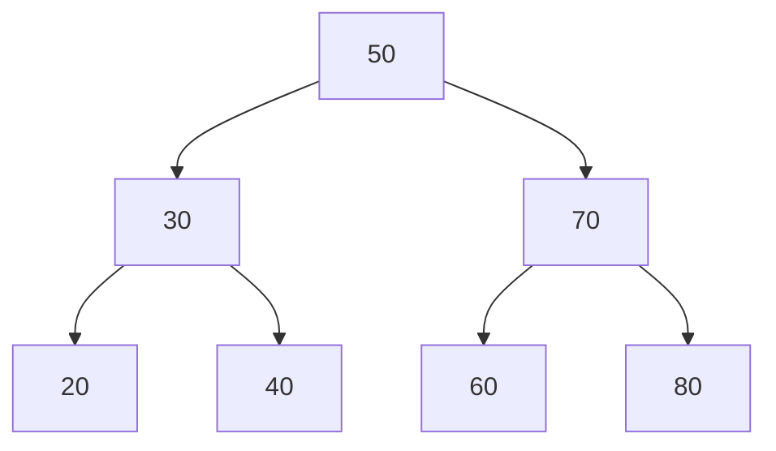
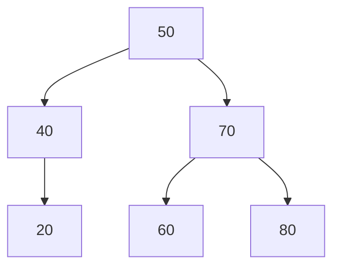

# Binary Search Trees

> **Module 05 · Data Structures & Algorithms** · Prerequisites: [Binary Trees](16-Binary-Trees.md) · Next: [Balanced Trees](18-Balanced-Trees.md)

---

## ⏱ If You Only Have 2 Minutes

- A **binary search tree** (BST) is a binary tree where, for every node, all keys in the left subtree are smaller and all keys in the right subtree are larger.
- Search, insert and delete each follow one path from the root down. Their cost is O(h), where h is the height of the tree.
- A balanced tree has h about log2 n. For one million keys that is about 20 steps. A tree built from sorted input has h = n, so every operation is O(n).
- Delete has three cases: no child, one child, two children. For two children, copy the **in-order successor** (smallest key in the right subtree) into the node, then delete that successor.
- An in-order traversal (left, node, right) visits the keys in sorted order. That is why a BST gives you ordered iteration and range queries for free.
- To validate a BST, pass a `(low, high)` range down the tree. Comparing a node only with its children misses a grandchild that is out of range.
- Plain BSTs are the teaching base. Production code uses a balanced variant such as a red–black tree or a B-tree (see [Balanced Trees](18-Balanced-Trees.md)).

---

## 1. What It Is and Why It Exists

A **binary search tree** (BST) is a binary tree. Each node has at most two children, called left and right. The tree also follows one extra rule: for every node, every key in its left subtree is smaller than the node's key, and every key in its right subtree is larger. Because of this rule, the keys are always in sorted order, but you can still insert and delete keys one at a time.

**Analogy:** think of a game of "higher or lower." At each step you ask, "is my target smaller or larger than this key?" Then you go left or right and never look at the other side again. A balanced tree turns each question into a halving of the remaining candidates.

**The problem it solves.** Suppose you need a sorted set of keys that changes over time. Three simple containers each fail one part of the job:

- A **sorted array** finds a key by binary search in O(log n). But inserting into the middle means shifting elements, which is O(n).
- A **linked list** inserts in O(1) once you hold the position. But finding that position is O(n).
- A **hash table** looks up a key in O(1) on average. But it stores keys in no useful order, so "every key between 100 and 200" becomes a full scan.

A BST supports search, insert, delete, minimum, maximum, and ordered iteration. Each costs O(h), where h is the height. When the tree stays balanced, h is O(log n). The rest of this chapter explains the operations and the case where the tree stops being balanced, because that case is common in real data.

---

## 2. How It Works

### Search

Start at the root. If the key equals the node's key, you are done. If the key is smaller, go left. If it is larger, go right. If you reach an empty child, the key is not in the tree.

The tree below holds seven keys. Searching for 60 takes three comparisons.



| Step | Current node | Compare 60 with node | Decision |
|---|---|---|---|
| 1 | 50 | 60 is larger | Go right |
| 2 | 70 | 60 is smaller | Go left |
| 3 | 60 | Equal | Found |

### Insert

Insertion walks the same path as search. When it reaches an empty child, it attaches a new leaf there. Inserting 35 into the tree above:

| Step | Current node | Compare 35 with node | Decision |
|---|---|---|---|
| 1 | 50 | 35 is smaller | Go left |
| 2 | 30 | 35 is larger | Go right |
| 3 | 40 | 35 is smaller | Go left |
| 4 | empty | — | Attach 35 as the left child of 40 |

Inserting an existing key usually does nothing. This chapter treats keys as a set, so a duplicate is rejected.

### Delete: three cases

Deletion is the hardest of the three operations because removing a node must not break the ordering of the rest of the tree.

1. **No children (leaf).** Remove the node. Its parent's link becomes empty.
2. **One child.** Replace the node with its only child. The child's whole subtree moves up one level, and every key in it is still on the correct side.
3. **Two children.** You cannot simply remove the node, because two subtrees would lose their parent. Instead, find the **in-order successor**: the smallest key in the right subtree. Copy that key into the node. Then delete the successor from the right subtree. The successor has no left child, so deleting it is case 1 or case 2.

The successor works because it is the next larger key after the deleted one. Every key in the left subtree is smaller than it, and every key in the right subtree is larger than it, so the BST property still holds. The **in-order predecessor** (largest key in the left subtree) is an equally valid choice.

Deleting 30 from the tree above (it has two children, 20 and 40):

| Step | Action | Result |
|---|---|---|
| 1 | Find 30. It has two children. | Case 3 |
| 2 | Successor = smallest key in right subtree of 30 = 40 | Successor is 40 |
| 3 | Copy 40 into the node that held 30 | Node now holds 40 |
| 4 | Delete the old 40 from the right subtree (a leaf) | Case 1 |



### In-order traversal

Visit the left subtree, then the node, then the right subtree. For a valid BST this visits every key in ascending order. Each node is visited once, so the traversal is O(n). This is the property that makes BSTs useful for sorted output, range queries and "next larger key" questions.

### The degenerate case

Insert the keys 10, 20, 30, 40, 50 in that order. Each new key is larger than every key before it, so each one becomes the right child of the previous one. The result is a chain: a linked list with extra pointers. The height is 5, and search for 50 takes five steps. With n keys, the height is n and every operation is O(n). The structure is still correct, but it has lost its speed. Section 5 explains how production systems avoid this.

---

## 3. Key Concepts

### The BST property and duplicates

The property is about strict order. A key equal to a node's key is a duplicate, and the implementation must decide what to do with it. Rejecting duplicates (a set) is the simplest rule. Storing a count on the node (a multiset) is common in practice. Pick one rule and state it in the API.

### Height decides the cost

Every operation is a walk from the root down to a node, so its cost is bounded by the height h, not by n. A random sequence of inserts produces a tree whose average height is O(log n). Sorted or nearly sorted inserts produce a height close to n. The cost of the structure depends on the input order, which is why balanced trees exist.

### Successor, predecessor, min and max

The minimum is the leftmost node: go left until there is no left child. The maximum is the rightmost node. The successor of a node is either the minimum of its right subtree or, if there is no right subtree, the nearest ancestor for which the node lies in the left subtree. Both need only the path down the tree, so they are O(h).

### Validating a BST with bounds

A common bug checks only that each node is bigger than its left child and smaller than its right child. That misses a tree where a grandchild on the left is larger than the root. The correct check passes an allowed range down the tree. The root may be any value. A left child must be below its parent's key, and a right child must be above it. Each node then tightens the range for its children.

### Order queries

Because the keys are sorted, a BST answers questions that a hash table cannot: the minimum, the maximum, the k-th smallest key, and all keys in a range. An in-order walk that stops after k keys gives the k-th smallest in O(h + k). To answer it in O(h) for any k, store the size of each subtree in its node. That is a common interview extension.

### Complexity

| Operation | Best | Average | Worst | Extra space | Why |
|---|---|---|---|---|---|
| Search | O(1) | O(log n) | O(n) | O(1) iterative, O(h) recursive | Best: key is the root. Average: random inserts keep h near log n. Worst: a chain, one level per key. |
| Insert | O(1) | O(log n) | O(n) | Same as search | Same path as search. Attaching the new leaf is O(1). |
| Delete | O(1) | O(log n) | O(n) | Same as search | Find the node, then at most one walk down to the successor. Both walks follow one path. |
| Min or max | O(1) | O(log n) | O(n) | O(1) | Walk the leftmost or rightmost path. |
| In-order traversal | O(n) | O(n) | O(n) | O(h) | Each node is visited once. The stack holds at most h nodes. |
| Space for the tree | O(n) | O(n) | O(n) | — | One node per key. |

These bounds are per operation. No amortized analysis applies to a plain BST. Balanced trees keep the worst case at O(log n) instead.

---

## 4. Code Examples

Both implementations store unique keys and expose the same operations: `contains`, `insert`, `delete`, in-order iteration and `height`. Each language then solves the same two problems.

### Node.js / TypeScript

The built-in `Map` and `Set` keep insertion order, not key order, so they cannot answer "smallest key" or range questions. JavaScript has no built-in tree or sorted map. `Array.prototype.sort` is stable and runs in O(n log n), which suits a one-time sort but not repeated inserts.

```ts
// No npm packages. Node.js 22+, TypeScript 5.
// Keys are numbers and must be unique: insert() returns false for a duplicate.

export class BSTNode {
  key: number;
  left: BSTNode | null;
  right: BSTNode | null;

  // Explicit fields (not `constructor(public key…)`) so the file also runs with Node's built-in type stripping.
  constructor(key: number, left: BSTNode | null = null, right: BSTNode | null = null) {
    this.key = key;
    this.left = left;
    this.right = right;
  }
}

export class BinarySearchTree {
  private root: BSTNode | null = null;
  private size = 0;

  get count(): number {
    return this.size;
  }

  get rootNode(): BSTNode | null {
    return this.root;
  }

  contains(key: number): boolean {
    let node = this.root;
    while (node !== null) {
      if (key === node.key) return true;
      node = key < node.key ? node.left : node.right;
    }
    return false;
  }

  insert(key: number): boolean {
    const before = this.size;
    this.root = this.insertAt(this.root, key);
    return this.size > before;
  }

  private insertAt(node: BSTNode | null, key: number): BSTNode {
    if (node === null) {
      this.size++;
      return new BSTNode(key);
    }
    if (key < node.key) node.left = this.insertAt(node.left, key);
    else if (key > node.key) node.right = this.insertAt(node.right, key);
    return node; // equal key: nothing changes
  }

  delete(key: number): boolean {
    const before = this.size;
    this.root = this.removeAt(this.root, key);
    return this.size < before;
  }

  private removeAt(node: BSTNode | null, key: number): BSTNode | null {
    if (node === null) return null; // key not present
    if (key < node.key) {
      node.left = this.removeAt(node.left, key);
      return node;
    }
    if (key > node.key) {
      node.right = this.removeAt(node.right, key);
      return node;
    }
    // Cases 1 and 2: zero or one child. Splice the node out.
    if (node.left === null || node.right === null) {
      this.size--;
      return node.left ?? node.right;
    }
    // Case 3: two children. Copy the in-order successor, then delete it from the right subtree.
    // The successor has no left child, so the recursive call takes case 1 or 2.
    const successorKey = minNode(node.right).key;
    node.key = successorKey;
    node.right = this.removeAt(node.right, successorKey);
    return node;
  }

  *inOrder(): Generator<number> {
    const stack: BSTNode[] = [];
    let node = this.root;
    while (node !== null || stack.length > 0) {
      while (node !== null) {
        stack.push(node);
        node = node.left;
      }
      const current = stack.pop()!; // the loop guarantees a node here
      yield current.key;
      node = current.right;
    }
  }

  // Nodes on the longest root-to-leaf path. An empty tree has height 0.
  height(): number {
    const depth = (node: BSTNode | null): number =>
      node === null ? 0 : 1 + Math.max(depth(node.left), depth(node.right));
    return depth(this.root);
  }
}

function minNode(node: BSTNode): BSTNode {
  let current = node;
  while (current.left !== null) current = current.left;
  return current;
}
```

**Problem 1: validate a BST.** Return `true` if every node obeys the BST property. *Approach:* pass the allowed range down the tree and tighten it at each step. *Complexity:* O(n) time, O(h) stack space.

**Problem 2: k-th smallest key.** Return the k-th smallest key (1-based). *Approach:* in-order walk that stops after k keys. *Complexity:* O(h + k) time, O(h) space.

```ts
// Problems use the BSTNode type above. Each is a plain function, not a class method.

export function isValidBst(node: BSTNode | null, low = -Infinity, high = Infinity): boolean {
  if (node === null) return true;
  if (node.key <= low || node.key >= high) return false; // strict bounds: no duplicates
  return isValidBst(node.left, low, node.key) && isValidBst(node.right, node.key, high);
}

export function kthSmallest(root: BSTNode | null, k: number): number {
  if (k < 1) throw new RangeError("k must be at least 1");
  const stack: BSTNode[] = [];
  let node = root;
  let seen = 0;
  while (node !== null || stack.length > 0) {
    while (node !== null) {
      stack.push(node);
      node = node.left;
    }
    const current = stack.pop()!;
    seen++;
    if (seen === k) return current.key;
    node = current.right;
  }
  throw new RangeError("k is larger than the number of keys");
}
```

### Python

Python has no built-in tree either. `dict` and `set` give fast lookup but no key order. `heapq` is a min-heap only. `bisect` runs binary search on a sorted list in O(log n), but `insort` shifts elements, so each insert is O(n). For a sorted set that changes often, the usual choice is `sortedcontainers.SortedList` (a third-party package). Python also has a default recursion limit of 1000, which matters for the recursive methods below on a degenerate tree.

```python
# No third-party packages. Python 3.12+.
# Keys are ints and must be unique: insert() returns False for a duplicate.
from __future__ import annotations

import math
from collections.abc import Iterator
from dataclasses import dataclass


@dataclass
class BSTNode:
    key: int
    left: BSTNode | None = None
    right: BSTNode | None = None


def _min_node(node: BSTNode) -> BSTNode:
    while node.left is not None:
        node = node.left
    return node


class BinarySearchTree:
    def __init__(self) -> None:
        self.root: BSTNode | None = None
        self._size = 0

    def __len__(self) -> int:
        return self._size

    def contains(self, key: int) -> bool:
        node = self.root
        while node is not None:
            if key == node.key:
                return True
            node = node.left if key < node.key else node.right
        return False

    def insert(self, key: int) -> bool:
        before = self._size
        self.root = self._insert_at(self.root, key)
        return self._size > before

    def _insert_at(self, node: BSTNode | None, key: int) -> BSTNode:
        if node is None:
            self._size += 1
            return BSTNode(key)
        if key < node.key:
            node.left = self._insert_at(node.left, key)
        elif key > node.key:
            node.right = self._insert_at(node.right, key)
        return node  # equal key: nothing changes

    def delete(self, key: int) -> bool:
        before = self._size
        self.root = self._remove_at(self.root, key)
        return self._size < before

    def _remove_at(self, node: BSTNode | None, key: int) -> BSTNode | None:
        if node is None:
            return None  # key not present
        if key < node.key:
            node.left = self._remove_at(node.left, key)
            return node
        if key > node.key:
            node.right = self._remove_at(node.right, key)
            return node
        # Cases 1 and 2: zero or one child. Splice the node out.
        if node.left is None or node.right is None:
            self._size -= 1
            return node.left if node.left is not None else node.right
        # Case 3: two children. Copy the in-order successor, then delete it from the right subtree.
        successor_key = _min_node(node.right).key
        node.key = successor_key
        node.right = self._remove_at(node.right, successor_key)
        return node

    def in_order(self) -> Iterator[int]:
        stack: list[BSTNode] = []
        node = self.root
        while node is not None or stack:
            while node is not None:
                stack.append(node)
                node = node.left
            current = stack.pop()
            yield current.key
            node = current.right

    def height(self) -> int:
        def depth(node: BSTNode | None) -> int:
            return 0 if node is None else 1 + max(depth(node.left), depth(node.right))

        return depth(self.root)
```

**Problem 1: validate a BST.** Return `True` if every node obeys the BST property. *Approach:* pass the allowed range down the tree and tighten it at each step. *Complexity:* O(n) time, O(h) stack space.

**Problem 2: k-th smallest key.** Return the k-th smallest key (1-based). *Approach:* in-order walk that stops after k keys. *Complexity:* O(h + k) time, O(h) space.

```python
# Problems use the BSTNode class above. Each is a plain function.

def is_valid_bst(node: BSTNode | None, low: float = -math.inf, high: float = math.inf) -> bool:
    if node is None:
        return True
    if not (low < node.key < high):  # strict bounds: no duplicates
        return False
    return is_valid_bst(node.left, low, node.key) and is_valid_bst(node.right, node.key, high)


def kth_smallest(root: BSTNode | None, k: int) -> int:
    if k < 1:
        raise ValueError("k must be at least 1")
    stack: list[BSTNode] = []
    node = root
    seen = 0
    while node is not None or stack:
        while node is not None:
            stack.append(node)
            node = node.left
        current = stack.pop()
        seen += 1
        if seen == k:
            return current.key
        node = current.right
    raise ValueError("k is larger than the number of keys")
```

---

## 5. Production Concerns

- **Degenerate trees.** Sorted or nearly sorted keys are common: monotonic IDs, timestamps, and log sequence numbers. A plain BST turns into a chain under these inputs, and every operation becomes O(n). Use a balanced tree (see [Balanced Trees](18-Balanced-Trees.md)), or use a sorted container that does not depend on input order.
- **Recursion depth.** The insert, delete and height code above recurses once per level. On a chain of 10,000 keys, Python's default recursion limit (1000) raises `RecursionError`, and V8 can run out of stack on deep recursion too. Either use the iterative forms or make sure the tree is balanced.
- **Concurrency.** Insert and delete rewrite several pointers. A reader that runs at the same time can see half a rewrite. In Node.js, synchronous code runs to completion, so one request handler cannot interleave with another, but a tree that is updated across `await` points needs its own protection. In Python, threads share the object, and the GIL does not make a multi-step insert atomic. Protect it with a lock or give each reader a snapshot.
- **Memory layout.** Each node is a separate heap object with two pointers and a key. Walking a path causes one cache miss per level, and each object adds runtime overhead. For millions of keys, a sorted array or a B-tree that stores many keys per node uses less memory and fewer cache misses.
- **Duplicates.** Decide what a duplicate insert means and document it. Silent rejection can hide a data bug. A count per node is a common alternative.
- **Observability.** Track the tree size and its height. If the height grows far beyond log2 n of the size, the input order is hurting you. That is the signal to switch to a balanced structure.

---

## 6. Common Mistakes

- **Validating with parent-child checks only.** A grandchild on the left can be larger than the root and the check still passes. **Fix:** pass `(low, high)` bounds down the tree.
- **Deleting a two-child node by linking its parent to one child.** The other subtree is lost. **Fix:** copy the in-order successor's key, then delete the successor.
- **Using a plain BST for sorted input.** Inserts of monotonic keys build a chain, and every operation is O(n). **Fix:** use a balanced tree or a sorted container.
- **Writing a recursive walk over a deep tree.** Deep recursion overflows the stack. **Fix:** use an explicit stack, or keep the tree balanced.
- **Comparing keys with object identity.** In TypeScript, `===` on two objects compares references, not contents, so `contains()` misses equal keys. In Python, sorting objects without `__lt__` raises `TypeError`. **Fix:** use primitive keys, or pass a comparator, or define ordering on the class.
- **Forgetting that `<` mixes types in JavaScript.** `"10" < 9` coerces the string, so the ordering becomes wrong without an error. **Fix:** keep every key the same type.
- **Using `bisect.insort` in a loop as a BST.** Each insert shifts elements, so n inserts cost O(n²). **Fix:** use `sortedcontainers.SortedList` or a database index.

---

## 7. Comparison Table

| | Binary search tree (unbalanced) | Sorted array + binary search | Hash table |
|---|---|---|---|
| Exact lookup | O(h), O(log n) average | O(log n) | O(1) average |
| Insert or delete | O(h), O(log n) average | O(n) shifts | O(1) average |
| Ordered iteration | O(n), in order | O(n), cache-friendly | Not supported |
| Range query (keys in [a, b]) | O(h + k) | O(log n + k) | O(n) full scan |
| Worst-case lookup | O(n) on sorted input | O(log n) | O(n) with heavy collisions |
| Memory | One object per key | Compact, one array | Table plus slack |

A sorted array is often the best choice for a read-mostly set. A hash table is best for exact lookups. A balanced tree is the choice when the set changes often and must stay ordered.

---

## 8. Interview Questions

**[Junior] What is the BST property?**
For every node, every key in its left subtree is smaller than the node's key, and every key in its right subtree is larger. Because of this, an in-order traversal visits the keys in sorted order. The property is strict, so duplicates must be handled as a separate decision.

**[Junior] How do you find the minimum key in a BST?**
Start at the root and keep going left until there is no left child. The node you stop at holds the smallest key. This takes O(h) steps, which is O(log n) for a balanced tree and O(n) for a chain.

**[Mid] Explain the three cases of deleting a node.**
A leaf is removed directly. A node with one child is replaced by that child. A node with two children takes the key of its in-order successor, the smallest key in its right subtree, and then the successor is deleted from the right subtree. The successor has at most one child, so the second deletion is one of the first two cases.

**[Mid] Why does an in-order traversal give sorted output?**
The traversal visits the left subtree, then the node, then the right subtree. By the BST property, every key in the left subtree is smaller than the node, and every key in the right subtree is larger. Applying that rule at every node means each key is emitted after all smaller keys and before all larger ones.

**[Senior] Why does inserting sorted keys ruin a BST, and what would you do about it in production?**
Each new key is larger than all previous keys, so it always goes to the right of the last one. The tree becomes a chain with height n, and every operation is O(n). In production, use a balanced tree such as a red–black tree or a B-tree, which keeps the height at O(log n) no matter what order the keys arrive in. Alternatively, randomize insertion order or use a sorted container that does not rely on the tree shape.

**[Senior] How would you validate a BST, and why is checking each node against its children not enough?**
Pass the allowed range down the recursion. The root has no bounds, and each left child must be below its parent's key, while each right child must be above it. A child-only check misses a grandchild that violates an ancestor's bound, such as a left grandchild larger than the root. The check is O(n) time and O(h) stack space.

**[Senior] How do you answer "find the k-th smallest key" quickly and repeatedly?**
An in-order walk that stops after k keys costs O(h + k), which is fine for one query. For many queries on a changing tree, store the size of each subtree in its node. Then the k-th smallest is found by comparing k with the size of the left subtree and going left or right, which is O(h) per query. Updating the sizes adds O(h) work to each insert and delete.

---

## 9. Cheat Sheet

```text
Property     left subtree < node < right subtree (strict; no duplicates)
Search       compare, go left or right; O(h)
Insert       same path as search; attach a leaf at the empty child; O(h)
Delete       0 children: remove | 1 child: splice in child | 2 children: copy successor, delete it
Successor    min of right subtree (or predecessor = max of left subtree)
In-order     left, node, right = sorted keys; O(n)
Height       h = log2 n if balanced; h = n for sorted inserts (chain)
Validate     pass (low, high) bounds; never only parent vs child
kth smallest in-order walk with counter; O(h + k); subtree sizes give O(h) per query
Python       bisect = binary search on a list, insort is O(n); sortedcontainers for a real sorted set
JavaScript   no built-in tree; Map/Set are not ordered by key; sort() is stable
Production   balanced tree, not a plain BST; watch recursion depth and concurrent writers
```

---

## Related Topics

- [Binary Trees](16-Binary-Trees.md) — the general shape a BST adds an ordering rule to.
- [Balanced Trees](18-Balanced-Trees.md) — how AVL, red–black and B-trees keep the height at O(log n).
- [Binary Search](25-Binary-Search.md) — the same halving idea applied to a sorted array.
- [Hash Tables](11-Hash-Tables.md) — the unordered alternative for exact-match lookups.
- [Indexes](../Module-03-Databases/19-Indexes.md) — how databases use ordered index structures to answer range queries.
