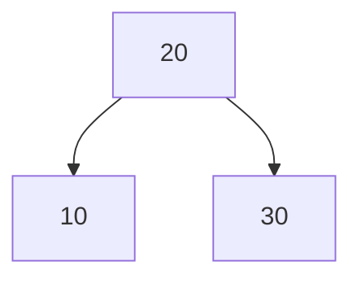

# Balanced Trees

> **Module 05 · Data Structures & Algorithms** · Prerequisites: [Binary Search Trees](17-Binary-Search-Trees.md) · Next: [Tries](19-Tries.md)

---

## ⏱ If You Only Have 2 Minutes

- A plain BST's height depends on the input order. Sorted input gives height n, so every operation is O(n). A **balanced** tree keeps the height at O(log n) for any input.
- **AVL trees** store each node's height. The **balance factor** (left height minus right height) must stay in {−1, 0, 1}. After an insert, one or two **rotations** restore it.
- A rotation changes which node is the root of a subtree but keeps the in-order sequence of keys the same.
- **Red–black trees** colour each node red or black and follow five rules. Their height is at most 2·log2(n+1). Java's `TreeMap` and C++ `std::map` are usually red–black trees.
- **B-trees and B+ trees** store hundreds of keys in one node, sized to one disk page. Few levels means few disk reads, which is why database indexes use them.
- **Skip lists** use layers of linked lists with random levels. Search, insert and delete take expected O(log n). Redis sorted sets use a skip list next to a hash table.
- JavaScript has no built-in sorted map. In Python, `bisect` works on a static sorted list, and `sortedcontainers` handles a set that changes often.

---

## 1. What It Is and Why It Exists

A **balanced tree** is a search tree that rearranges itself after inserts and deletes so that no path becomes much longer than the others. The search tree rule is the same as in a plain BST: keys in the left subtree are smaller and keys in the right subtree are larger. The difference is the height guarantee.

**Analogy:** a sorted filing cabinet where a clerk keeps the drawers even. If the drawers fill up unevenly, the clerk moves folders between them so that finding any folder takes about the same number of steps.

**The problem it solves.** The [previous chapter](17-Binary-Search-Trees.md) showed that inserting keys in sorted order turns a BST into a chain. A search-heavy service that inserts timestamps, IDs or sequence numbers in order gets O(n) lookups. You cannot control the input order in a database or a cache, so the structure has to control its own shape.

Three families solve this in different ways:

- **Self-balancing binary trees** (AVL, red–black) keep the height near log2 n by rotating nodes after each change. They are used in memory, such as ordered maps in standard libraries.
- **Multiway trees** (B-trees and B+ trees) put many keys in each node. They are used on disk, because each node read is one page read.
- **Probabilistic structures** (skip lists) use random coin flips to build layers. They are simple to write and have expected O(log n) cost.

---

## 2. How It Works

### AVL rotations: a right-right case (left rotation)

Insert 10, 20, 30 into an empty AVL tree. Track the balance factor (bf) of each node as the inserts happen. The height of an empty subtree is 0 and a leaf has height 1.

| Step | Insert | Shape after insert | Node 10 bf | Action |
|---|---|---|---|---|
| 1 | 10 | `10` | 0 | None |
| 2 | 20 | `10 → right 20` | 0 − 1 = −1 | None (within −1 to 1) |
| 3 | 30 | `10 → right 20 → right 30` | 0 − 2 = −2 | Right-right case: rotate **left** at 10 |

The left rotation makes 20 the root of the subtree. Node 10 becomes the left child of 20, and the old left subtree of 20 (empty here) moves to become the right child of 10. The result is balanced:



Heights after the fix: 10 has height 1, 30 has height 1, and 20 has height 2. The in-order sequence is still 10, 20, 30.

### AVL rotations: a left-left case (right rotation)

Insert the same keys in the reverse order: 30, 20, 10.

| Step | Insert | Shape after insert | Node 30 bf | Action |
|---|---|---|---|---|
| 1 | 30 | `30` | 0 | None |
| 2 | 20 | `30 → left 20` | 1 − 0 = 1 | None |
| 3 | 10 | `30 → left 20 → left 10` | 2 − 0 = 2 | Left-left case: rotate **right** at 30 |

The right rotation makes 20 the root, with 10 on its left and 30 on its right. This is the mirror image of the previous case.

The two rotations above cover the simple cases. The **left-right** case (a left child that leans right) needs two rotations: first rotate the left child left, which turns the zig-zag into a straight line, then rotate the node right. The **right-left** case is the mirror image.

### Insert then rebalance

An AVL insert has two phases. First, insert the leaf as in a plain BST. Second, walk back up the path. At each node, update its height, compute its balance factor, and rotate if it is 2 or −2. The walk stops early in theory, but the simple implementation below walks to the root, which is still O(log n).

### Red–black tree rules

Red–black trees use colours instead of heights. Every node is red or black, and the tree must satisfy these rules:

1. Every node is red or black.
2. The root is black.
3. Every leaf (an empty child) is black.
4. A red node has no red children.
5. Every path from a node down to its empty leaves contains the same number of black nodes.

These rules keep the longest path at most twice the shortest, so the height is at most 2·log2(n+1). Inserts and deletes fix violations with at most a few recolourings and rotations, so writes are cheap.

### B-tree and B+ tree shape

A B-tree node holds many keys in sorted order, and each internal node has one more child than it has keys. A node holds between half and all of its maximum number of keys (except the root). When a node overflows, it splits in two and pushes its middle key up to the parent. The tree grows at the top, so every leaf stays at the same depth.

A B+ tree adds one rule: all values live in the leaves, and internal nodes hold only separator keys. The leaves are also linked to their neighbours, so a range scan reads a run of leaves in order.

### Skip list levels

A skip list stores keys in a sorted linked list at level 0. Each node is also promoted to higher levels with a fixed probability, usually 1/2 or 1/4. Each higher level is a shorter list that skips over many nodes. A search starts at the top level and moves right while the next key is smaller, then drops one level and repeats. This is the same idea as a binary search, but the levels come from random coin flips instead of rotations.

---

## 3. Key Concepts

### AVL trees

The **balance factor** is the height of the left subtree minus the height of the right subtree. In an AVL tree every balance factor is −1, 0 or 1. The height of an AVL tree is at most about 1.44·log2(n+2), so searches stay logarithmic. AVL trees are strictly balanced, so lookups are fast. The cost is more rotations on writes than a red–black tree needs. Deletes can also require rotations on the way up, not only inserts.

### Red–black trees

Red–black trees allow a bit more imbalance than AVL trees, which makes writes cheaper. Typical implementations are used where ordered maps need steady write speed: Java's `TreeMap` and C++ `std::map` are usually red–black trees. Hand-writing one is error-prone because of the many cases, so use a library unless you are teaching the algorithm.

### B-trees and B+ trees

A database reads data in pages, typically 8 KB in PostgreSQL and 16 KB by default in MySQL's InnoDB engine. One node of a B-tree fills one page, so a node may hold hundreds of keys. The **fan-out** (the number of children per node) is the important number. With a fan-out of 500, a billion keys fit in about four levels, which is an estimate and depends on key size. A binary tree with a billion keys would need about 30 levels, and each level could be a separate disk read. That difference is why database indexes are B+ trees. See [Indexes](../Module-03-Databases/19-Indexes.md) for how this appears in SQL.

### Skip lists

A skip list is simple to code and easy to scan in order, because the bottom level is a plain sorted list. Its expected cost is O(log n), but the worst case is O(n) with negligible probability. Each node has a random number of forward pointers, and the expected number is 1/(1−p), which is 2 when p = 1/2. Redis sorted sets combine a skip list (for ordering and range queries) with a hash table (for score lookups by member).

### Complexity

| Structure | Search: best / average / worst | Insert and delete: best / average / worst | Space | Why |
|---|---|---|---|---|
| AVL tree | O(1) / O(log n) / O(log n) | O(log n) / O(log n) / O(log n) | O(n) | Height is at most about 1.44·log2 n, and every insert walks one path back up. |
| Red–black tree | O(1) / O(log n) / O(log n) | O(log n) / O(log n) / O(log n) | O(n) | Height is at most 2·log2(n+1). Each insert needs at most two rotations after the walk. |
| B+ tree (fan-out b) | O(1) / O(log_b n) / O(log_b n) | O(log_b n) / O(log_b n) / O(log_b n) | O(n) | Depth is log base b of n. A split is rare and touches one parent. |
| Skip list | O(1) / O(log n) expected / O(n) worst | Same as search | O(n) expected | Each level halves the expected work. Worst case needs a very unlikely run of coin flips. |
| Sorted array with bisect | O(1) / O(log n) / O(log n) | Insert: O(1) append / O(n) / O(n) | O(n) | Binary search is logarithmic, but inserting in the middle shifts elements. |

The B+ tree base b is the fan-out. The best-case search is O(1) because the key can be found in the first node.

---

## 4. Code Examples

The AVL code below is the same in both languages. Each node caches its height, and one `rebalance` function handles all four rotation cases. The two problems use the same tree and the same sorted-array range query.

### Node.js / TypeScript

JavaScript has no built-in sorted map. `Map` and `Set` are hash-based and keep insertion order, not key order. For range queries on a sorted array, write the two binary searches yourself, as the problem block does. For a sorted map that changes often, use a third-party package.

```ts
// No npm packages. Node.js 22+, TypeScript 5.
// Each node caches its height; rotations keep every balance factor within -1..1.

export interface AvlNode {
  key: number;
  height: number; // leaf = 1, empty = 0
  left: AvlNode | null;
  right: AvlNode | null;
}

const heightOf = (n: AvlNode | null): number => (n === null ? 0 : n.height);
const balanceFactor = (n: AvlNode): number => heightOf(n.left) - heightOf(n.right);

function updateHeight(n: AvlNode): void {
  n.height = 1 + Math.max(heightOf(n.left), heightOf(n.right));
}

// Right rotation: the left child becomes the subtree root (left-left case).
function rotateRight(y: AvlNode): AvlNode {
  const x = y.left!;
  y.left = x.right;
  x.right = y;
  updateHeight(y); // y moves down, so it is updated first
  updateHeight(x);
  return x;
}

// Left rotation: the right child becomes the subtree root (right-right case).
function rotateLeft(x: AvlNode): AvlNode {
  const y = x.right!;
  x.right = y.left;
  y.left = x;
  updateHeight(x);
  updateHeight(y);
  return y;
}

function rebalance(node: AvlNode): AvlNode {
  updateHeight(node);
  const bf = balanceFactor(node);
  if (bf > 1) {                             // left-heavy
    if (balanceFactor(node.left!) < 0) {    // left-right: straighten the zig-zag first
      node.left = rotateLeft(node.left!);
    }
    return rotateRight(node);               // left-left
  }
  if (bf < -1) {                            // right-heavy
    if (balanceFactor(node.right!) > 0) {   // right-left
      node.right = rotateRight(node.right!);
    }
    return rotateLeft(node);                // right-right
  }
  return node;
}

export function avlInsert(node: AvlNode | null, key: number): AvlNode {
  if (node === null) return { key, height: 1, left: null, right: null };
  if (key < node.key) node.left = avlInsert(node.left, key);
  else if (key > node.key) node.right = avlInsert(node.right, key);
  else return node; // duplicate: nothing changes, so nothing to rebalance
  return rebalance(node);
}
```

**Problem 1: is the tree height-balanced?** Return `true` if every node's two subtrees differ in height by at most 1. *Approach:* post-order walk that returns the height, or −1 as soon as any subtree is unbalanced. *Complexity:* O(n) time, O(h) stack space.

**Problem 2: count values in a range.** Given a sorted array, count the values `v` with `lo <= v <= hi`. *Approach:* two binary searches, one for the first index ≥ `lo` and one for the first index > `hi`. *Complexity:* O(log n) per query after an O(n log n) sort.

```ts
// Problem 1 uses the AvlNode type above. It ignores stored heights and measures them again.
export function isHeightBalanced(node: AvlNode | null): boolean {
  const check = (n: AvlNode | null): number => {
    if (n === null) return 0;
    const left = check(n.left);
    if (left === -1) return -1;
    const right = check(n.right);
    if (right === -1 || Math.abs(left - right) > 1) return -1;
    return 1 + Math.max(left, right);
  };
  return check(node) !== -1;
}

// Problem 2: JavaScript has no bisect, so write the two lower and upper bounds directly.
function lowerBound(a: number[], x: number): number {  // first index with a[i] >= x
  let lo = 0;
  let hi = a.length;
  while (lo < hi) {
    const mid = (lo + hi) >>> 1;
    if (a[mid] < x) lo = mid + 1;
    else hi = mid;
  }
  return lo;
}

function upperBound(a: number[], x: number): number {  // first index with a[i] > x
  let lo = 0;
  let hi = a.length;
  while (lo < hi) {
    const mid = (lo + hi) >>> 1;
    if (a[mid] <= x) lo = mid + 1;
    else hi = mid;
  }
  return lo;
}

export function countInRange(sorted: number[], lo: number, hi: number): number {
  if (lo > hi) return 0;
  return upperBound(sorted, hi) - lowerBound(sorted, lo);
}
```

### Python

Python's standard library has `bisect` for binary search on a list, but no balanced tree. `bisect.insort` finds the position in O(log n), then shifts elements, so each insert is O(n). That is fine for a list that is built once and then read. For a sorted set that changes often, use `sortedcontainers.SortedList` from the third-party package. It keeps the list in sorted blocks and gives O(log n) inserts in practice.

```python
# No third-party packages. Python 3.12+.
from __future__ import annotations

from dataclasses import dataclass


@dataclass
class AvlNode:
    key: int
    height: int = 1  # leaf = 1, empty = 0 (see _height_of)
    left: AvlNode | None = None
    right: AvlNode | None = None


def _height_of(n: AvlNode | None) -> int:
    return 0 if n is None else n.height


def _balance_factor(n: AvlNode) -> int:
    return _height_of(n.left) - _height_of(n.right)


def _update_height(n: AvlNode) -> None:
    n.height = 1 + max(_height_of(n.left), _height_of(n.right))


def _rotate_right(y: AvlNode) -> AvlNode:
    """Left-left case: the left child becomes the subtree root."""
    x = y.left
    assert x is not None  # rebalance only calls this when the left side is taller
    y.left = x.right
    x.right = y
    _update_height(y)  # y moves down, so it is updated first
    _update_height(x)
    return x


def _rotate_left(x: AvlNode) -> AvlNode:
    """Right-right case: the right child becomes the subtree root."""
    y = x.right
    assert y is not None
    x.right = y.left
    y.left = x
    _update_height(x)
    _update_height(y)
    return y


def _rebalance(node: AvlNode) -> AvlNode:
    _update_height(node)
    bf = _balance_factor(node)
    if bf > 1:  # left-heavy
        assert node.left is not None
        if _balance_factor(node.left) < 0:  # left-right: straighten the zig-zag first
            node.left = _rotate_left(node.left)
        return _rotate_right(node)  # left-left
    if bf < -1:  # right-heavy
        assert node.right is not None
        if _balance_factor(node.right) > 0:  # right-left
            node.right = _rotate_right(node.right)
        return _rotate_left(node)  # right-right
    return node


def avl_insert(node: AvlNode | None, key: int) -> AvlNode:
    if node is None:
        return AvlNode(key)
    if key < node.key:
        node.left = avl_insert(node.left, key)
    elif key > node.key:
        node.right = avl_insert(node.right, key)
    else:
        return node  # duplicate: nothing changes, so nothing to rebalance
    return _rebalance(node)
```

**Problem 1: is the tree height-balanced?** Return `True` if every node's two subtrees differ in height by at most 1. *Approach:* post-order walk that returns the height, or −1 as soon as any subtree is unbalanced. *Complexity:* O(n) time, O(h) stack space.

**Problem 2: count values in a range.** Given a sorted list, count the values `v` with `lo <= v <= hi`. *Approach:* `bisect_left(lo)` and `bisect_right(hi)` give the boundaries, and their difference is the count. *Complexity:* O(log n) per query after an O(n log n) sort.

```python
import bisect


def is_height_balanced(node: AvlNode | None) -> bool:
    def check(n: AvlNode | None) -> int:
        if n is None:
            return 0
        left = check(n.left)
        if left == -1:
            return -1
        right = check(n.right)
        if right == -1 or abs(left - right) > 1:
            return -1
        return 1 + max(left, right)

    return check(node) != -1


def count_in_range(sorted_values: list[int], lo: int, hi: int) -> int:
    if lo > hi:
        return 0
    start = bisect.bisect_left(sorted_values, lo)  # first index with value >= lo
    end = bisect.bisect_right(sorted_values, hi)  # first index with value > hi
    return end - start
```

---

## 5. Production Concerns

- **Use the library, not your own tree.** Ordered maps in Java, C++ and Go are built on balanced trees or similar structures that have been tested for years. Your own red–black tree will probably break under a rare case. Write one only as a learning exercise.
- **Disk pages set the design.** Each B-tree level is a page read. Caching the top levels in memory means a point lookup usually costs one disk read for the leaf. Smaller keys mean more keys per page and a shallower tree. Check index size and depth when a query slows down.
- **Page splits and bloat.** Inserts into a full page split it, which writes more data. After many deletes, pages stay sparse, and the index takes more space than its data needs. PostgreSQL's `REINDEX` rebuilds a bloated index, and a fill factor below 100 leaves room for inserts. These are real settings, but check the version docs before you tune them.
- **Concurrency.** A balanced tree changes several nodes on one insert, so a concurrent reader can see a half-finished change. Databases use latches on pages and careful lock ordering. In Node.js or Python, protect a shared in-memory tree with a lock or a single writer.
- **Skip list randomness.** Skip lists depend on random levels. Seed the random generator in tests so a failure can be reproduced, and do not let an attacker predict the levels if the keys come from user input.
- **Sorted containers in Python.** `bisect.insort` on a list that grows to millions of items costs O(n) per insert, so n inserts cost O(n²). Measure the write rate. If the list changes often, switch to `sortedcontainers.SortedList`.
- **Observability.** Track the height or depth of each index, its size in pages, and how many splits happen per minute. A depth jump by one level is a large change in disk reads.

---

## 6. Common Mistakes

- **Recomputing heights from scratch on each insert.** Walking the whole subtree to get its height makes every insert O(n). **Fix:** store the height in each node and update it on the way back up.
- **Using a single rotation for the zig-zag case.** A left-right shape needs two rotations. One rotation leaves the tree unbalanced. **Fix:** check the balance factor of the child before you rotate the parent.
- **Forgetting to rebalance after a delete.** Deletes can shorten one side of a subtree and need the same rotations as inserts. **Fix:** run the rebalance step on every node on the path back to the root.
- **Treating O(log n) as cheap for disk data.** In memory, each level is a pointer hop. On disk, each level can be a page read. **Fix:** count page reads, not comparisons, when you compare a B-tree with a binary tree.
- **Using `bisect.insort` for a write-heavy sorted set.** Each insert shifts the list, so it is O(n) per insert. **Fix:** use `sortedcontainers.SortedList` or a database index.
- **Writing a red–black tree in production.** The rules are easy to state and hard to implement without a bug in a rare case. **Fix:** use the language's ordered map or the database's index.
- **Mixing up the two B-tree types.** A B-tree keeps values in internal nodes too, while a B+ tree keeps them only in the leaves and links the leaves. Range scans are fast only in the B+ tree. **Fix:** say B+ tree when you mean a database index.

---

## 7. Comparison Table

| | AVL tree | Red–black tree | B+ tree | Skip list | Sorted array |
|---|---|---|---|---|---|
| Balance method | Height difference ≤ 1 | Colour rules | Fixed depth, many keys per node | Random levels | None (fixed layout) |
| Lookup | O(log n) | O(log n) | O(log_b n) | O(log n) expected | O(log n) |
| Writes | O(log n), more rotations | O(log n), fewer rotations | O(log_b n), splits | O(log n) expected | O(n) shifts |
| Range scan | In-order walk | In-order walk | Linked leaves, very fast | Bottom-level walk | Very fast |
| Typical home | Read-heavy in-memory maps | Standard-library ordered maps | Database indexes, file systems | Redis sorted sets, in-memory lists | Read-mostly data |
| Good for concurrency | Hard | Hard | Designed for it (latches) | Easier to make lock-free | Easy (read-only) |

Pick a balanced tree when the set is in memory, changes often, and must stay ordered. Pick a B+ tree when the data lives on disk. Pick a sorted array when the data changes rarely.

---

## 8. Interview Questions

**[Junior] Why is a balanced tree better than a plain BST?**
A plain BST's height depends on the order of the inserts. Sorted input builds a chain, and then every operation takes O(n). A balanced tree rebalances after changes, so its height stays at O(log n) for any input. The search rule is the same, so the code path is the same.

**[Junior] What is the balance factor in an AVL tree?**
It is the height of the left subtree minus the height of the right subtree. Every node in a valid AVL tree has a balance factor of −1, 0 or 1. A value of 2 or −2 means the node needs a rotation.

**[Mid] Explain the left-right case and how you fix it.**
The left-right case happens when a node has a left child that leans right. The node's balance factor is 2, but a single right rotation would leave a zig-zag below the new root. First rotate the left child to the left, which turns the zig-zag into a straight line. Then rotate the node to the right. Both rotations keep the in-order sequence.

**[Mid] Why do databases use B+ trees instead of binary search trees?**
A database reads pages from disk, and each page read is expensive compared with a comparison in memory. A B+ tree node holds hundreds of keys, so the tree is only a few levels deep even for billions of rows. A binary tree of the same size would need about 30 levels, and each level could be a separate read. The linked leaves also make range scans fast.

**[Mid] Which would you choose for a write-heavy in-memory ordered map, AVL or red–black?**
Red–black. Its height bound is looser, so it does fewer rotations on each write, and lookups are still O(log n). An AVL tree is stricter and gives faster lookups, which suits read-heavy workloads. Most standard libraries pick red–black for this reason.

**[Senior] An index on 2 billion rows has four levels. Estimate the disk reads for a point lookup and say what changes the number.**
The top levels are small and usually stay in the buffer cache, so a point lookup often needs one disk read for the leaf page and maybe one more for an internal level. The depth comes from the fan-out, which depends on key size and page size. Smaller keys or larger pages give more keys per node and a shallower tree. A cold cache, a heavily bloated index or a large key adds reads. Measure with the database's plan output rather than trusting the formula.

**[Senior] Why might you choose a skip list over a red–black tree for a sorted set?**
A skip list is simpler to implement correctly, and its bottom level is a plain sorted list, so range scans are a simple walk. It has expected O(log n) operations without rotations, and its inserts touch only local pointers, which makes lock-free variants easier. The costs are randomness in performance, expected rather than strict bounds, and a slightly larger memory overhead per node. Redis uses a skip list for its sorted sets, which is consistent with these trade-offs.

---

## 9. Cheat Sheet

```text
Why          plain BST height = n on sorted input; balanced tree keeps height O(log n)
AVL          height stored per node; balance factor = hL - hR in {-1, 0, 1}
Rotations    LL -> rotate right at node; RR -> rotate left; LR -> left on child, then right; RL mirror
AVL height   at most about 1.44 * log2(n+2)
Red-black    5 rules (root black, no red-red, equal black depth); height <= 2*log2(n+1)
B+ tree      many keys per node = one disk page; values in leaves; leaves linked for range scans
Fan-out      depth = log base fan-out of n; a few levels for billions of keys
Skip list    random levels; expected O(log n); Redis sorted sets = skip list + hash table
Python       bisect = binary search on a list; insort is O(n); sortedcontainers.SortedList for changing sets
JavaScript   no built-in sorted map; use a package or sorted array with two binary searches
Production   use the library or the database index; watch page splits, bloat and depth
```

---

## Related Topics

- [Binary Search Trees](17-Binary-Search-Trees.md) — the plain tree that these structures keep balanced.
- [Tries](19-Tries.md) — another ordered structure, for prefix searches on strings.
- [Binary Search](25-Binary-Search.md) — the search method used on sorted arrays and inside skip lists.
- [Indexes](../Module-03-Databases/19-Indexes.md) — how B+ tree indexes appear in SQL databases.
- [Hash Tables](11-Hash-Tables.md) — the unordered alternative when you only need exact lookups.
