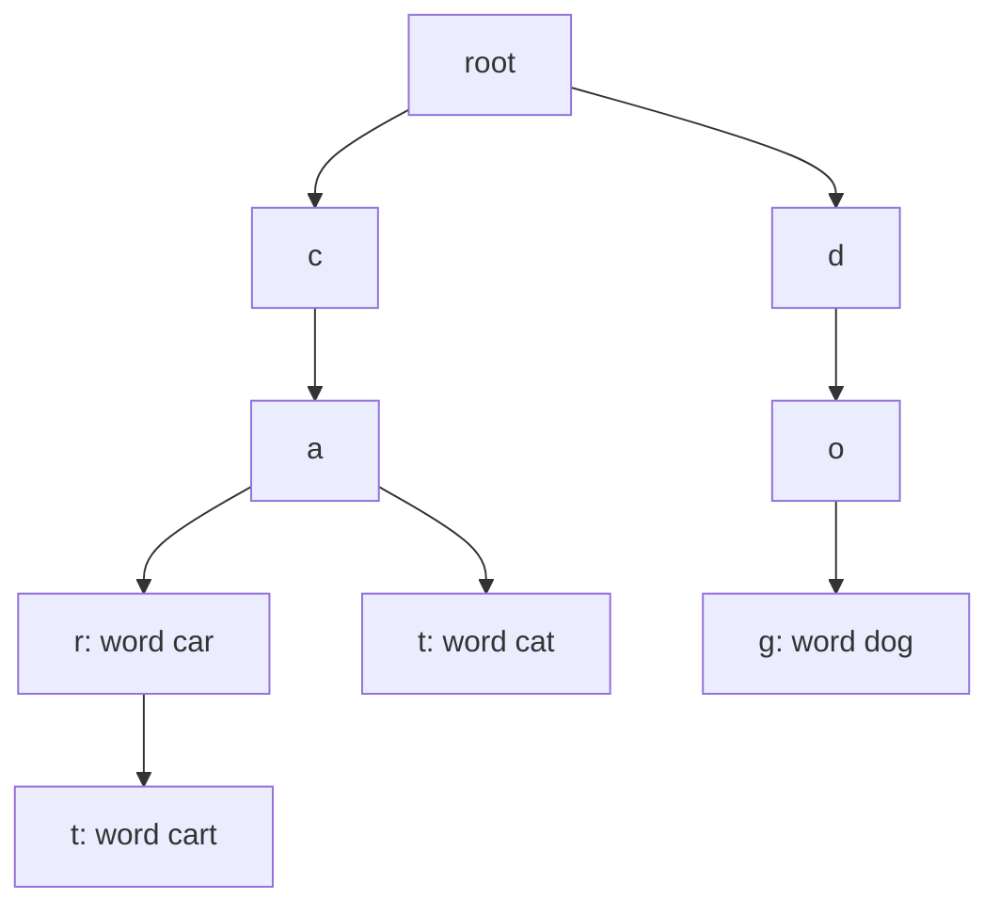

# Tries

> **Module 05 · Data Structures & Algorithms** · Prerequisites: [Balanced Trees](18-Balanced-Trees.md) · Next: [Graphs](20-Graphs.md)

---

## ⏱ If You Only Have 2 Minutes

- A **trie** (a prefix tree, pronounced "try") stores strings by sharing their common prefixes. Each path from the root spells out a prefix.
- Each node has a **children map** (character to child) and a **count** or end flag that says a stored word ends at this node.
- `insert`, `contains` and `startsWith` all cost O(L), where L is the length of the word. The number of stored words does not change the cost.
- For an exact search, check the end flag. Without it, `contains("app")` returns true when only "apple" is stored. `startsWith("app")` should return true in that case.
- The cost of a trie is memory: every node is an object plus a map. A **compressed trie** (radix tree) merges chains of single-child nodes into one edge.
- Autocomplete walks to the prefix node, collects the words below it, and keeps the top k by weight. The work grows with the size of that subtree, so cap it or cache the top results.
- Iterate strings by Unicode code point, not by UTF-16 unit or byte, and normalize text (NFC) before you store it. Some HTTP routers use radix trees to match routes.

---

## 1. What It Is and Why It Exists

A **trie** is a tree for strings. The root is empty. Each edge is labelled with one character, and the path from the root to a node spells a prefix. A node is marked when the path to it is a complete stored word. Words that share a prefix share the same nodes near the root. The name comes from "retrieval," and the usual pronunciation is "try."

**Analogy:** a printed dictionary with an index tab for each first letter, then a tab for each second letter, and so on. To find every word that starts with "ca," you go to the "c" tab, then the "a" tab, and read everything below.

**The problem it solves.** Suppose you store one million product names and need the names that start with "wire." A hash set can tell you whether the exact name "wireless mouse" exists in O(L) time. It cannot list every name that starts with "wire" without scanning all of them. A sorted list can answer prefix questions with binary search, but inserting a new name means shifting elements. A trie answers both questions in time that depends on the length of the input string, not on how many strings are stored. That is why trie-like structures appear in autocomplete, spell checking, routing tables and dictionaries.

---

## 2. How It Works

Store the words `car`, `cat`, `cart` and `dog` in an empty trie. Each insert walks from the root, one character at a time, creates any missing nodes, and marks the last node.

| Insert | Path walked | Nodes created | Marked node |
|---|---|---|---|
| `car` | root → c → a → r | c, a, r | r (word `car`) |
| `cat` | root → c → a (exists) → t | t | t (word `cat`) |
| `cart` | root → c → a → r (exists) → t | t under r | t (word `cart`) |
| `dog` | root → d → o → g | d, o, g | g (word `dog`) |

The finished trie looks like this. Two words share the path `c → a`, and `car` is also a prefix of `cart`.



### Search and startsWith

Both operations walk down the path for the query string. If a character has no child, the walk stops and the answer is "no." The two operations differ only at the end of the walk.

| Query | Path walked | Node reached | `contains` (exact word) | `startsWith` (prefix) |
|---|---|---|---|---|
| `car` | c, a, r | r, end flag set | true | true |
| `ca` | c, a | a, end flag not set | false | true |
| `cow` | c, then `o` is not a child | none | false | false |

The rule is simple: `contains` also needs the end flag. `startsWith` only needs the walk to succeed.

### Autocomplete

To suggest completions for `ca`, walk to the node for `ca`. Then visit every node below it and collect each marked node's word and weight. Sort the collected words by weight and return the first k. The walk for `ca` finds `car`, `cat` and `cart`. If the weights are 40, 25 and 90, the top two are `cart` and `car`.

### Compressed tries

In the example, the node for `c` has one child (`a`), and no word ends at `c`. The same is true of the path `c → a` before the branch at `a`. A **compressed trie**, also called a **radix tree** or Patricia trie, replaces such a chain with one edge labelled `ca`. Nodes exist only where the tree branches or where a word ends. This keeps the same operations and cuts the node count, often by a large factor for sparse word sets.

---

## 3. Key Concepts

### Node layout

Each node holds a children map (character to child node) and a count. A count of 0 means no word ends here. A count above 0 means a stored word ends here, and the count can be a frequency or a weight. Storing a weight rather than a plain flag is what makes ranked autocomplete possible.

### Characters and Unicode

A trie is only as correct as its notion of a character. In JavaScript, `"é".length` can be 1 or 2, and an emoji is 2 UTF-16 units. A `for...of` loop yields Unicode code points, one per visible character in most cases. In Python, `str` already indexes by code point. Two spellings can still look the same and differ in code points: `é` can be one code point, or `e` followed by a combining accent. Normalize strings to NFC before you insert or search, so both spellings reach the same path.

### Choosing a children map

A node's children are usually stored in a map keyed by character. For lowercase English letters, an array of 26 slots is faster, but it wastes memory when most nodes have one child. A map or dictionary is the common default. A plain object works in JavaScript for single characters, but a `Map` is the safer habit because it cannot collide with inherited property names if you later store longer tokens.

### Memory cost

A trie can use much more memory than the raw strings. Each node is an object with a map inside. Millions of nodes add up quickly, and most of them have only one child. The size depends on the word set. Shared prefixes help, but long unique suffixes do not share anything. Compressed tries, array-based layouts or a sorted array with prefix ranges are the usual fixes for large static dictionaries.

### Complexity

| Operation | Best | Average | Worst | Extra space | Why |
|---|---|---|---|---|---|
| `insert(word)` | O(L) | O(L) | O(L) | O(new nodes) | One step per character. Each step creates at most one node. |
| `contains(word)` | O(L) | O(L) | O(L) | O(1) | One step per character. The end flag check is O(1). |
| `startsWith(prefix)` | O(L) | O(L) | O(L) | O(1) | One step per character, and no end-flag check. |
| `suggest(prefix, k)` | O(L) | O(L + S) | O(L + S + W log W) | O(W) | Best: prefix not in the trie. Average: walk L, then visit S nodes below it. Worst: sort W matching words. |
| Space for N words | O(total characters) | — | O(total characters) | — | Worst case has no shared prefixes. Shared prefixes reduce the count. |

L is the length of the word or prefix, S is the number of nodes below the prefix node, and W is the number of stored words below it. All bounds are per operation, with no amortized analysis. The trie's cost does not depend on N, the number of stored words, except through S and W for autocomplete.

---

## 4. Code Examples

Both implementations store words as a sequence of characters with a weight at the end. Each includes insert, exact search, prefix search and top-k autocomplete. The problem blocks use the same trie for a longest-common-prefix query.

### Node.js / TypeScript

JavaScript has no built-in trie, and `Map` and `Set` do not help with prefixes. `String.prototype.startsWith` checks one string at a time, so using it over a list of words is O(N·L). The trie replaces that scan. For a fixed, sorted array of words, you can also binary-search for the first word with the prefix, then read forward. That is a good option when the list never changes.

```ts
// No npm packages. Node.js 22+, TypeScript 5.
// for...of yields Unicode code points, so "é" or an emoji counts as one step.

export class TrieNode {
  readonly children = new Map<string, TrieNode>();
  count = 0; // > 0 means a stored word ends here; the value is its weight
}

export class Trie {
  private readonly root = new TrieNode();

  get rootNode(): TrieNode {
    return this.root;
  }

  insert(word: string, weight = 1): void {
    if (weight <= 0) throw new RangeError("weight must be positive");
    let node = this.root;
    for (const ch of word) {
      let next = node.children.get(ch);
      if (next === undefined) {
        next = new TrieNode();
        node.children.set(ch, next);
      }
      node = next;
    }
    node.count += weight; // inserting the same word again adds to its weight
  }

  private find(prefix: string): TrieNode | undefined {
    let node = this.root;
    for (const ch of prefix) {
      const next = node.children.get(ch);
      if (next === undefined) return undefined;
      node = next;
    }
    return node;
  }

  // True only if this exact word was stored. Checks the end flag, not just the path.
  contains(word: string): boolean {
    return (this.find(word)?.count ?? 0) > 0;
  }

  // True if at least one stored word starts with this prefix.
  startsWith(prefix: string): boolean {
    return this.find(prefix) !== undefined;
  }

  // Autocomplete: up to k words that start with prefix, highest weight first, then alphabetical.
  suggest(prefix: string, k: number): string[] {
    const start = this.find(prefix);
    if (start === undefined || k <= 0) return [];
    const matches: { word: string; count: number }[] = [];
    const collect = (node: TrieNode, word: string): void => {
      if (node.count > 0) matches.push({ word, count: node.count });
      for (const [ch, child] of node.children) collect(child, word + ch);
    };
    collect(start, prefix);
    matches.sort((a, b) => b.count - a.count || (a.word < b.word ? -1 : 1));
    return matches.slice(0, k).map((m) => m.word);
  }
}
```

**Problem 1: autocomplete with top suggestions.** Given a set of weighted words, return the k best completions of a prefix. *Approach:* the `suggest` method above. Walk to the prefix node, collect the marked nodes below it, sort by weight, and keep k. *Complexity:* O(L + S + W log W) time in the worst case, O(W) space.

**Problem 2: longest common prefix.** Return the longest prefix shared by every word in a list. *Approach:* insert every word, then walk down from the root while the node has exactly one child and no word ends there. *Complexity:* O(total characters) time to build, O(length of the answer) to walk, O(total characters) space.

```ts
// Problem 2 uses the Trie class above. The walk stops at a branch, at a word end, or at an empty trie.
export function longestCommonPrefix(words: string[]): string {
  const trie = new Trie();
  for (const word of words) trie.insert(word);

  let node = trie.rootNode;
  let prefix = "";
  while (node.count === 0 && node.children.size === 1) {
    const [[ch, child]] = node.children; // the only child, as [character, node]
    prefix += ch;
    node = child;
  }
  return prefix;
}
```

### Python

Python has no trie in its standard library. A `dict` is the natural children map, because it keeps insertion order and has O(1) average lookup. For a static word list, `bisect` gives a second option: sort the list once, use `bisect_left` to find the first word with the prefix, then read forward while the words still start with the prefix. That costs O(log n + k) per query but makes inserts O(n). A trie is better when inserts and queries interleave.

```python
# No third-party packages. Python 3.12+.
# str indexing and iteration use Unicode code points, so "é" (one code point) is one step.
from __future__ import annotations

from dataclasses import dataclass, field


@dataclass
class TrieNode:
    children: dict[str, TrieNode] = field(default_factory=dict)
    count: int = 0  # > 0 means a stored word ends here; the value is its weight


class Trie:
    def __init__(self) -> None:
        self.root = TrieNode()

    def insert(self, word: str, weight: int = 1) -> None:
        if weight <= 0:
            raise ValueError("weight must be positive")
        node = self.root
        for ch in word:
            child = node.children.get(ch)
            if child is None:
                child = node.children[ch] = TrieNode()
            node = child
        node.count += weight  # inserting the same word again adds to its weight

    def _find(self, prefix: str) -> TrieNode | None:
        node = self.root
        for ch in prefix:
            child = node.children.get(ch)
            if child is None:
                return None
            node = child
        return node

    def contains(self, word: str) -> bool:
        """True only if this exact word was stored. Checks the end flag, not just the path."""
        node = self._find(word)
        return node is not None and node.count > 0

    def starts_with(self, prefix: str) -> bool:
        return self._find(prefix) is not None

    def suggest(self, prefix: str, k: int) -> list[str]:
        """Up to k words that start with prefix, highest weight first, then alphabetical."""
        start = self._find(prefix)
        if start is None or k <= 0:
            return []
        matches: list[tuple[str, int]] = []

        def collect(node: TrieNode, word: str) -> None:
            if node.count > 0:
                matches.append((word, node.count))
            for ch, child in node.children.items():
                collect(child, word + ch)

        collect(start, prefix)
        matches.sort(key=lambda item: (-item[1], item[0]))
        return [word for word, _ in matches[:k]]
```

**Problem 1: autocomplete with top suggestions.** Given a set of weighted words, return the k best completions of a prefix. *Approach:* the `suggest` method above. Walk to the prefix node, collect the marked nodes below it, sort by weight, and keep k. *Complexity:* O(L + S + W log W) time in the worst case, O(W) space.

**Problem 2: longest common prefix.** Return the longest prefix shared by every word in a list. *Approach:* insert every word, then walk down from the root while the node has exactly one child and no word ends there. *Complexity:* O(total characters) time to build, O(length of the answer) to walk, O(total characters) space.

```python
# Problem 2 uses the Trie class above. The walk stops at a branch, at a word end, or at an empty trie.
def longest_common_prefix(words: list[str]) -> str:
    trie = Trie()
    for word in words:
        trie.insert(word)

    node = trie.root
    prefix: list[str] = []
    while node.count == 0 and len(node.children) == 1:
        ch, child = next(iter(node.children.items()))  # the only child
        prefix.append(ch)
        node = child
    return "".join(prefix)
```

---

## 5. Production Concerns

- **Memory growth.** A trie of millions of words can use far more memory than the raw text, because each node is an object with a map. Measure the node count and the process memory after loading a real dictionary. For large static sets, use a compressed trie, an array-based layout, or a sorted list with prefix ranges.
- **Unicode normalization.** Two spellings of the same word can be different code point sequences. Normalize at the boundary, with `String.prototype.normalize("NFC")` in JavaScript and `unicodedata.normalize("NFC", s)` in Python. Choose one case rule as well. Lowercasing everything at the boundary is common for search.
- **Input limits.** A user can insert very long strings to fill memory. Cap the length of words and prefixes, and cap how many words a tenant can add. Reject inputs above the limit with a clear error.
- **Autocomplete latency.** A one-letter prefix like `a` can match millions of words, and collecting them all on every keystroke is slow. Cap the number of nodes visited, cache the results for hot prefixes, and debounce the requests on the client. Another option is to store the top k words at each node, which makes queries O(L + k) but makes each weight update touch every node on the path.
- **Concurrency.** In Python, two threads that insert the same new character under one node can both see the child missing, both create a node, and one overwrites the other, which loses words. Protect writes with a lock, or build a new trie in the background and swap the reference. In Node.js, a long synchronous insert loop blocks the event loop. Build large tries at startup or in a worker thread.
- **Rebuild cost.** Rebuilding a dictionary-backed trie on every deploy can be slow. Measure the build time, and keep the old trie in service until the new one is ready.
- **Observability.** Track the node count and memory at startup, the p99 latency of suggest calls, and the rate of empty results. A rising empty-result rate often means the dictionary is missing words that users type.

---

## 6. Common Mistakes

- **Checking only the path for exact search.** `contains("app")` returns true for "apple" because the path exists. **Fix:** check the end flag, or count, on the final node.
- **Iterating UTF-16 units or bytes.** In JavaScript, an emoji is two units, and iterating by index can split it into two invalid halves. In UTF-8 bytes, an accented letter takes two bytes. **Fix:** iterate code points with `for...of` in JavaScript and with plain `str` in Python.
- **Storing un-normalized text.** `é` in two forms creates two separate paths, so a search for one form misses the other. **Fix:** apply NFC and a case rule at the boundary, both when inserting and when searching.
- **Scanning the whole subtree on every keystroke.** A short prefix can match a huge subtree, and each keystroke then costs O(S). **Fix:** cap the scan, cache the results, or store the top k at each node.
- **Building a trie per request.** Rebuilding the trie for every query throws away the work. **Fix:** build once at startup, reuse it, and swap in a new version when the dictionary changes.
- **Using a trie for exact lookups only.** A hash set answers exact questions with less code and usually less memory. **Fix:** use a trie only when you need prefix queries, shared-prefix storage or ordered completions.
- **Sharing a trie between Python threads without a lock.** Two threads can create the same child at once and lose one subtree. **Fix:** guard inserts with a lock or swap in a read-only copy.

---

## 7. Comparison Table

| | Trie | Hash set / map | Sorted list + bisect | Balanced BST |
|---|---|---|---|---|
| Exact lookup | O(L) | O(L) average | O(L log n) | O(L log n) |
| Prefix search | O(L + k) | O(N·L) scan | O(L log n + k) | O(L log n + k) |
| Insert | O(L) | O(L) average | O(n) shifts | O(L log n) |
| Ordered output | Yes, by the trie order | No | Yes | Yes |
| Memory | High: one node per character, shared prefixes help | Moderate | Low: one array | Moderate: one object per key |
| Best fit | Autocomplete, routing, prefix dictionaries | Exact membership | Static, read-mostly lists | Ordered sets with general keys |

The trie wins when prefix queries dominate and the memory cost is acceptable. A hash set wins for exact membership. A sorted list wins for a large static dictionary that rarely changes.

---

## 8. Interview Questions

**[Junior] What does each node in a trie hold, and what does a path from the root represent?**
Each node holds a map from a character to its child node, and a flag or count that says whether a stored word ends at that node. A path from the root spells out a prefix of the words stored below it. Words that share a prefix share the same nodes along that path.

**[Junior] If the trie contains only "apple," what do `contains("app")` and `startsWith("app")` return?**
`contains("app")` returns false, because "app" was not stored as a word and its node has no end flag. `startsWith("app")` returns true, because a stored word begins with "app". The difference is the end flag, so mixing the two methods is a common bug.

**[Mid] Design autocomplete for a search box with a million queries.**
Store each past query in a trie with its frequency as the weight. Walk to the typed prefix, collect the words below it, and return the top k by weight. Cap the subtree walk for short prefixes, and cache the answers for the most common prefixes. Update the weights in a background job so the query path stays read-only.

**[Mid] When would you choose a hash set over a trie?**
Choose a hash set when you only need exact membership, such as checking whether a username is taken. It is simpler, needs less memory per entry, and is usually faster in practice. A trie earns its memory cost only when you need prefix queries, ordered completions or many shared prefixes.

**[Mid] Why do trie operations not depend on the number of stored words?**
Each operation walks one node per character of the query, so the work depends only on the length of the query. Adding a million more words does not make a lookup longer, because the walk never looks at words it does not match. The number of words matters only for autocomplete, where the cost depends on the size of the subtree below the prefix.

**[Senior] Weights change constantly for millions of words. How do you keep top-k suggestions fast?**
Cache the top k words at each node, so a query only reads the prefix node and returns k items. The cost moves to updates: a weight change must refresh the cached lists on every node along the word's path, which is O(L·k log k) with a bounded list. If that is still too costly, accept a short delay by updating weights in batches and publishing a new snapshot. Readers keep using the old snapshot until the swap, which avoids locking the hot path.

**[Senior] A routing table for an HTTP API has thousands of paths. How would you match requests quickly, and why do some routers use radix trees?**
A radix tree stores the path segments as edges, so common prefixes like `/api/v1/` are stored once. A request walks the tree in O(length of the path) and does not scan every route. Routes with parameters, such as `/users/:id`, need a special edge that matches any value at that position. Some HTTP routers use radix trees for this reason. The tricky parts are priority between static and parameter routes and handling trailing slashes consistently.

**[Senior] A trie of five million English words uses 2 GB. How would you shrink it without changing the API?**
Compress single-child chains into a radix tree, which often removes most nodes. Replace per-node maps with a compact layout, such as sorted arrays of child characters, for nodes with few children. If the dictionary is static, store the words in a sorted array and answer prefix queries with bisect, which uses much less memory. Measure the node count and the bytes per node before and after, and keep the same method signatures so callers do not change.

---

## 9. Cheat Sheet

```text
Shape        root = empty; edge = one character; path = prefix; marked node = word
Node         children map (char -> node) + count (0 = no word ends here)
insert       walk L characters, create missing nodes, set count; O(L)
contains     walk L characters, then check count > 0 (end flag); O(L)
startsWith   walk L characters; any surviving path is enough; O(L)
Autocomplete walk to prefix, collect marked nodes below, sort by weight, keep k; O(L + S + W log W)
LCP          walk from root while one child and no word ends; O(length of answer)
Memory       one node per distinct prefix; compressed tries merge single-child chains
Unicode      iterate code points; normalize NFC; choose one case rule
Python       dict as children map; bisect on a sorted list for static prefix ranges
JavaScript   no built-in trie; for...of iterates code points; Map keeps insertion order
Production   cap input length; cache hot prefixes; lock writes in Python threads
Routers      some HTTP routers use radix trees for path matching
```

---

## Related Topics

- [Hash Tables](11-Hash-Tables.md) — the exact-match alternative to a trie.
- [Trees](15-Trees.md) — the general tree terms (root, child, depth) used in this chapter.
- [Binary Search Trees](17-Binary-Search-Trees.md) — an ordered alternative that handles prefix ranges on general keys.
- [Heaps](14-Heaps.md) — the structure behind efficient top-k selection in autocomplete.
- [Strings](06-Strings.md) — the immutability, Unicode and normalization details behind character-level code.
