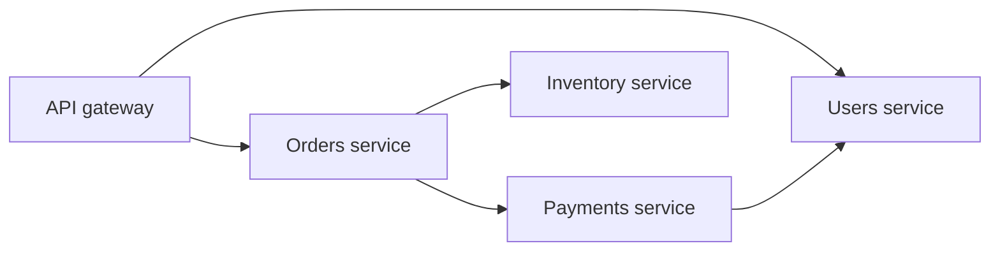

# Graphs

> **Module 05 · Data Structures & Algorithms** · Prerequisites: [Tries](19-Tries.md) · Next: [Breadth First Search](21-Breadth-First-Search.md)

---

## ⏱ If You Only Have 2 Minutes

- A **graph** is a set of **vertices** (things) and **edges** (relationships between them). Trees, linked lists and dependency DAGs are all special cases.
- An edge can be **directed** (A → B, one way), **undirected** (A – B, both ways), **weighted** (has a cost), or part of a **cycle** (a path that returns to its start). A **DAG** is a directed graph with no cycles.
- Most backend graphs are **sparse**: the number of edges E is close to the number of vertices V, far below V². That makes an adjacency list the usual choice.
- An **adjacency list** costs O(V + E) space and lists neighbours in O(degree). An **adjacency matrix** costs O(V²) space but answers "is there an edge A → B?" in O(1).
- Build a graph from its vertex list **and** its edge list. Edges alone drop isolated vertices, which have no edges to name them.
- In-degree (edges in) and out-degree (edges out) come from one pass over the edges, which is O(V + E).
- Backend uses: service call graphs (directed), social follows (directed) or friendships (undirected), permission inheritance (a DAG), and package dependencies (which must be a DAG).

---

## 1. What It Is and Why It Exists

A **graph** is a collection of **vertices** (also called nodes) and **edges** (also called links). A vertex can be a user, a service, a file or a package. An edge says that two vertices are related. Graphs are the most general way to model relationships, because a vertex can have any number of edges and the edges can form loops.

**Analogy:** a road map. Intersections are vertices and roads are edges. A one-way street is a directed edge. A road with a toll is a weighted edge. A ring road that loops back is a cycle.

**The problem it solves.** A relational table can store "service A calls service B" as one row. But a question like "if the payments service goes down, which services are affected, directly or through other services?" requires following edges many steps. The answer is a graph traversal. Trees cannot model the same thing, because a tree allows only one parent per node. A shared library used by two services has two parents, so it is a graph, not a tree.

Backend systems that are naturally graphs include:

- **Service dependencies.** Vertices are services, and an edge means "calls" or "depends on." The graph shows blast radius and call chains.
- **Social graphs.** Vertices are users. A "follows" relation is directed. A "friends" relation is usually undirected.
- **Permission inheritance.** Vertices are folders, groups and roles. An edge means "inherits permissions from." The graph should have no cycles, or access checks loop forever.
- **Package dependencies.** Vertices are packages and edges are "depends on." Build tools need the graph to be a DAG, because a cycle has no valid install or build order.

---

## 2. How It Works

Take five services, A to E, and one isolated vertex F that has no edges yet. Use directed edges A → B, A → C, B → C and C → D. The trace below builds an **adjacency list**: a map from each vertex to its list of outgoing neighbours. It starts from an empty graph, then adds the vertices, then adds each edge.

| Step | Action | adj[A] | adj[B] | adj[C] | adj[D] |
|---|---|---|---|---|---|
| 0 | Add vertices A to F | [] | [] | [] | [] |
| 1 | Add edge A → B | [B] | [] | [] | [] |
| 2 | Add edge A → C | [B, C] | [] | [] | [] |
| 3 | Add edge B → C | [B, C] | [C] | [] | [] |
| 4 | Add edge C → D | [B, C] | [C] | [D] | [] |

Each edge is added once, and each addition is O(1) amortized because it appends to one list. Vertices E and F never appear in any edge, so they exist only because step 0 added them. If step 0 were skipped, a service that nothing calls and that calls nothing would silently vanish from the graph.

Now compute the degrees. The **out-degree** of a vertex is the number of edges leaving it. The **in-degree** is the number of edges arriving at it. A vertex with both values at 0 is **isolated**.

| Vertex | Out-degree | In-degree | Isolated? |
|---|---|---|---|
| A | 2 | 0 | No |
| B | 1 | 1 | No |
| C | 1 | 2 | No |
| D | 0 | 1 | No |
| E | 0 | 0 | Yes |
| F | 0 | 0 | Yes |

Both degrees come from a single walk over the adjacency list: for each edge `u → v`, add 1 to out-degree of `u` and 1 to in-degree of `v`. That walk touches each edge once and each vertex once, so it is O(V + E).

The service graph from section 1 looks like this. It is a DAG, because no service can reach itself.



Traversal algorithms such as breadth-first search and depth-first search walk this structure. They are the subject of the next chapters: [Breadth First Search](21-Breadth-First-Search.md), [Depth First Search](22-Depth-First-Search.md) and [Topological Sorting](38-Topological-Sorting.md). This chapter covers how to store the graph and what its shape means.

---

## 3. Key Concepts

### Kinds of graph

| Kind | Meaning | Example |
|---|---|---|
| Directed | Each edge has a direction (A → B is not B → A) | Who follows whom; which service calls which |
| Undirected | Each edge goes both ways | Friendship; a network link that carries traffic both ways |
| Weighted | Each edge has a number, such as a cost or latency | Network latency between data centres |
| Unweighted | Edges have no number, or all count as 1 | Simple dependency lists |
| Self-loop | An edge from a vertex to itself | A recursive function call; a folder that lists itself (a data error) |
| Multigraph | More than one edge between the same pair | Two different relationships between the same two users |

Most interview problems use simple directed or undirected graphs. Check the question first, because the direction changes the answer.

### Cycles, DAGs and connectivity

A **cycle** is a path that starts and ends at the same vertex. A graph with no cycles is **acyclic**. A **directed acyclic graph (DAG)** has directed edges and no cycles. DAGs are important because they have a valid order in which every vertex comes after the vertices it depends on, which is the basis of topological sorting.

For undirected graphs, a **connected component** is a set of vertices that can all reach each other. A graph with more than one component has some vertices that can never reach others. For directed graphs, the matching idea is a **strongly connected component**, where every vertex can reach every other one along directed edges.

A tree is a connected, acyclic, undirected graph. A rooted tree is a DAG where every vertex has at most one parent.

### Density

A graph is **sparse** when E is much smaller than V², and **dense** when E is close to V². A social graph with a billion users and an average of 200 follows each has E = 2 × 10¹¹, which is far below V² = 10¹⁸. Sparse graphs are the norm in backend systems. Density decides which representation wastes less memory.

### Representations

| Representation | Space | Check edge u → v | List neighbours of u | Best for |
|---|---|---|---|---|
| Adjacency list (hash map of sets or maps) | O(V + E) | O(1) average | O(deg(u)) | Sparse graphs, most backend work |
| Adjacency matrix (V × V table) | O(V²) | O(1) | O(V) | Small or dense graphs; fast matrix algorithms |
| Edge list (array of pairs) | O(E) | O(E) | O(E) | Input and storage; simple bulk processing |

The adjacency list is the default. The matrix is worth using when V is small, roughly a few thousand, or when the graph is dense. The edge list is a storage format: it is easy to write to a file or a table, but slow for queries, so build an adjacency list from it before you run algorithms.

### Complexity

| Operation | Best | Average | Worst | Extra space | Why |
|---|---|---|---|---|---|
| Build from V vertices and E edges (adjacency list) | O(V + E) | O(V + E) | O(V + E) | O(V + E) | Each vertex and edge is inserted once into a hash map. |
| Check edge u → v (adjacency list) | O(1) | O(1) | O(deg(u)) | O(1) | A hash lookup. The worst case happens only when hash collisions force a scan. |
| Check edge u → v (adjacency matrix) | O(1) | O(1) | O(1) | O(V²) total | One array index. The matrix is paid for up front. |
| List neighbours of u (adjacency list) | O(1) | O(deg(u)) | O(deg(u)) | O(deg(u)) for the copy | Walk the vertex's own map. Other vertices are not touched. |
| List neighbours of u (adjacency matrix) | O(V) | O(V) | O(V) | O(V) | Must read the whole row to find the non-zero entries. |
| Degrees of all vertices | O(V + E) | O(V + E) | O(V + E) | O(V) | One pass over every edge. |

The "best" column is for a lookup that is answered on the first try. The "average" column is for hash-based storage, which is what most languages use. All bounds are per operation, with no amortized analysis except the build step's append.

---

## 4. Code Examples

Both implementations store a directed or undirected graph as an adjacency list, with an edge weight. They can build the graph from a vertex list and an edge list, compute degrees, and list isolated vertices. The problem is to find a celebrity: a user followed by everyone else who follows nobody.

### Node.js / TypeScript

JavaScript has no built-in graph type. `Map` and `Set` are the building blocks, and both keep insertion order. The adjacency list below uses a `Map` of `Map`s, so an edge lookup is O(1) average and the weight is stored with the edge. Plain arrays of neighbours work too, but then an edge check is O(deg).

```ts
// No npm packages. Node.js 22+, TypeScript 5.
// Adjacency list: vertex -> (neighbour -> weight). Map gives O(1) average edge lookup.

export class Graph<V> {
  private readonly adj = new Map<V, Map<V, number>>();

  private readonly directed: boolean;

  // Explicit field (not a parameter property) so the file also runs with Node's built-in type stripping.
  constructor(directed = true) {
    this.directed = directed;
  }

  get vertexCount(): number {
    return this.adj.size;
  }

  addVertex(v: V): void {
    if (!this.adj.has(v)) this.adj.set(v, new Map());
  }

  addEdge(from: V, to: V, weight = 1): void {
    this.addVertex(from);
    this.addVertex(to); // both ends exist, so every vertex appears as a key
    this.adj.get(from)!.set(to, weight);
    if (!this.directed) this.adj.get(to)!.set(from, weight); // store both directions
  }

  hasEdge(from: V, to: V): boolean {
    return this.adj.get(from)?.has(to) ?? false;
  }

  neighbors(v: V): V[] {
    const out = this.adj.get(v);
    return out ? [...out.keys()] : [];
  }

  // In-degree and out-degree of every vertex, in O(V + E).
  degrees(): Map<V, { indegree: number; outdegree: number }> {
    const result = new Map<V, { indegree: number; outdegree: number }>();
    for (const v of this.adj.keys()) result.set(v, { indegree: 0, outdegree: 0 });
    for (const [from, outs] of this.adj) {
      for (const to of outs.keys()) {
        result.get(from)!.outdegree++;
        result.get(to)!.indegree++;
      }
    }
    return result;
  }

  isolated(): V[] {
    const result: V[] = [];
    for (const [v, d] of this.degrees()) {
      if (d.indegree === 0 && d.outdegree === 0) result.push(v);
    }
    return result;
  }
}

// Vertices come first, so isolated vertices are kept even though no edge names them.
export function buildGraph<V>(vertices: V[], edges: [V, V][], directed = true): Graph<V> {
  const g = new Graph<V>(directed);
  for (const v of vertices) g.addVertex(v);
  for (const [from, to] of edges) g.addEdge(from, to);
  return g;
}
```

**Problem: find the celebrity.** In a directed "follows" graph, return the vertex that every other vertex follows and that follows nobody, or `null` if there is none. *Approach:* one pass over the degrees. The celebrity has in-degree n − 1 and out-degree 0. *Complexity:* O(V + E) time, O(V) space. With an adjacency matrix the same check costs O(V²), because you must read whole rows and columns. For n ≥ 2, there can be at most one celebrity: two of them would each have to follow the other, but a celebrity follows nobody.

```ts
// Uses the Graph class above.
export function findCelebrity<V>(g: Graph<V>): V | null {
  const n = g.vertexCount;
  for (const [v, d] of g.degrees()) {
    if (d.indegree === n - 1 && d.outdegree === 0) return v;
  }
  return null;
}
```

### Python

Python has no graph type in its standard library, but `dict` and `set` do the same job as the `Map` above. `collections.deque` is the usual queue for traversals in the next chapters. The standard library also has `graphlib.TopologicalSorter` (Python 3.9+), which runs a topological sort on a dependency dict. That algorithm is covered in [Topological Sorting](38-Topological-Sorting.md). The class below uses PEP 695 generic syntax, which needs Python 3.12 or newer.

```python
# No third-party packages. Python 3.12+ (PEP 695 generic syntax).
# Adjacency list: vertex -> {neighbour: weight}. dict gives O(1) average edge lookup.
from __future__ import annotations

from collections.abc import Iterable
from dataclasses import dataclass


@dataclass
class Degree:
    indegree: int = 0
    outdegree: int = 0


class Graph[V]:
    def __init__(self, directed: bool = True) -> None:
        self._directed = directed
        self._adj: dict[V, dict[V, int]] = {}

    @property
    def vertex_count(self) -> int:
        return len(self._adj)

    def add_vertex(self, v: V) -> None:
        self._adj.setdefault(v, {})

    def add_edge(self, source: V, target: V, weight: int = 1) -> None:
        self.add_vertex(source)
        self.add_vertex(target)  # both ends exist, so every vertex appears as a key
        self._adj[source][target] = weight
        if not self._directed:
            self._adj[target][source] = weight  # store both directions

    def has_edge(self, source: V, target: V) -> bool:
        return target in self._adj.get(source, {})

    def neighbors(self, v: V) -> list[V]:
        return list(self._adj.get(v, {}))

    def degrees(self) -> dict[V, Degree]:
        """In-degree and out-degree of every vertex, in O(V + E)."""
        result = {v: Degree() for v in self._adj}
        for source, targets in self._adj.items():
            for target in targets:
                result[source].outdegree += 1
                result[target].indegree += 1
        return result

    def isolated(self) -> list[V]:
        return [v for v, d in self.degrees().items() if d.indegree == 0 and d.outdegree == 0]


def build_graph[V](vertices: Iterable[V], edges: Iterable[tuple[V, V]], directed: bool = True) -> Graph[V]:
    # Vertices come first, so isolated vertices are kept even though no edge names them.
    g: Graph[V] = Graph(directed)
    for v in vertices:
        g.add_vertex(v)
    for source, target in edges:
        g.add_edge(source, target)
    return g
```

**Problem: find the celebrity.** In a directed "follows" graph, return the vertex that every other vertex follows and that follows nobody, or `None` if there is none. *Approach:* one pass over the degrees. The celebrity has in-degree n − 1 and out-degree 0. *Complexity:* O(V + E) time, O(V) space. For n ≥ 2 there is at most one celebrity, for the same reason as in the TypeScript version.

```python
# Uses the Graph class above.
def find_celebrity[V](g: Graph[V]) -> V | None:
    n = g.vertex_count
    for v, d in g.degrees().items():
        if d.indegree == n - 1 and d.outdegree == 0:
            return v
    return None
```

---

## 5. Production Concerns

- **Edges in a database.** A graph with billions of edges does not fit in one process. Store edges in a table with one row per edge (`source_id`, `target_id`, and any attributes), and index both columns. Queries by source need one index, and queries by target, such as "who follows this user," need the other. Without the second index, a follower-count query scans the whole table. See [Indexes](../Module-03-Databases/19-Indexes.md) for how indexes are chosen.
- **Hub vertices.** A few vertices can have huge degrees. A celebrity account with 50 million followers turns one post into 50 million fan-out writes if you push it into every follower's feed. Measure the maximum out-degree and in-degree, not only the average, and handle hubs with a separate path.
- **Cycles in live data.** A dependency or permission graph that is supposed to be a DAG can get a cycle from a bad edit. The traversal then loops, or a build fails with no clear message. Reject a new edge that closes a cycle when it is written, and when a cycle is found, report the cycle path, not just "cycle found."
- **Stale graphs.** A service graph built from traces is a snapshot. Store a `last_seen` time on each edge and drop edges that have not appeared for a set window, so an old dependency does not look live.
- **Memory overhead.** A map of maps costs much more memory per edge than the two integers it stores, because each entry has runtime overhead. For large static graphs, a compact array layout (vertex IDs as integers, neighbours in one array) uses far less memory.
- **Observability.** Track V, E, the maximum degree and the number of isolated vertices as health metrics. A sudden rise in isolated vertices after a deploy can mean that the code that builds edges is failing silently.

---

## 6. Common Mistakes

- **Building a graph from edges alone.** Vertices with no edges never appear, so isolated services or users vanish from counts and reports. **Fix:** add the vertex list first, as `buildGraph` and `build_graph` do.
- **Storing an undirected edge once.** Then the second vertex's neighbour list is missing the first vertex, and traversals are wrong in one direction. **Fix:** store both directions, or track the graph's direction explicitly.
- **Counting undirected edges twice.** The stored neighbour lists hold each edge twice, so dividing the total by 2 is the right count, but only if no self-loop is involved. **Fix:** count edges from a set of pairs you control, or document the rule.
- **Using an adjacency matrix for a large sparse graph.** A matrix for 1 million vertices needs 10¹² cells. **Fix:** use an adjacency list whenever E is much smaller than V².
- **Assuming a dependency graph is acyclic.** Algorithms that expect a DAG loop forever or give wrong answers on a cycle. **Fix:** check for cycles when edges are added, or detect them before running topological sort.
- **Recursion without a visited set.** A traversal over a graph with a cycle recurses forever. **Fix:** record visited vertices before you recurse into them. The traversal chapters cover this.
- **Mixing "friends" and "follows."** Undirected friendship and directed following look alike in code but behave differently. **Fix:** give each relation its own type, with its direction stated in the name.

---

## 7. Comparison Table

| | Tree | Graph (general) | Edge table in a relational database |
|---|---|---|---|
| Parents per node | Exactly one, except the root | Any number | Not applicable |
| Cycles | Not allowed | Allowed (or forbidden by rule, as in a DAG) | Allowed; the rule is enforced by code or constraints |
| Typical backend use | Folder hierarchy, JSON documents, org charts | Social networks, service dependencies, permissions, packages | Simple many-to-many relations with a few hops |
| Multi-hop question | Walk up or down: O(depth) | BFS or DFS: O(V + E) | Recursive query (`WITH RECURSIVE` in PostgreSQL) |
| Storage | Parent pointers or child lists | Adjacency list or matrix | One row per edge, with indexes |

A tree is a special case of a graph, so any tree algorithm works on a graph only if the graph really is a tree. Use a relational edge table when the relationship is simple and the data already lives in the database. Use an in-memory graph when you run many multi-hop queries that the database cannot answer quickly.

---

## 8. Interview Questions

**[Junior] What is the difference between a directed and an undirected graph? Give one backend example of each.**
In a directed graph, an edge A → B does not imply B → A. A follow relation is directed: user A follows user B without B following back. In an undirected graph, the edge goes both ways, like a friendship or a two-way network link. The direction changes what a traversal can reach, so decide it before you model the data.

**[Junior] What is a DAG and why do build tools need one?**
A DAG is a directed graph with no cycles. Build tools model tasks as a DAG, where an edge means "must run before." A valid build order exists only if there is no cycle, because a cycle would require each task in it to finish before itself. A DAG always has at least one valid order, which a topological sort finds.

**[Mid] Compare an adjacency list and an adjacency matrix. When would you choose each?**
An adjacency list uses O(V + E) space and lists neighbours in time proportional to the degree. An adjacency matrix uses O(V²) space and checks any edge in O(1). Choose the list for sparse graphs, which is most backend graphs. Choose the matrix for small or dense graphs, or when you need many edge checks and the graph fits in memory.

**[Mid] Why must the vertex list be stored separately from the edge list?**
An edge only names the vertices it touches. A vertex with no edges, such as a service that nothing calls and that calls nothing, appears in no edge at all. If you build the graph only from edges, that vertex disappears, and counts or health checks miss it. Storing the vertex set separately keeps every vertex, including isolated ones.

**[Senior] A social graph has 500 million users, and one account has 50 million followers. How would you store and query follows?**
Store each follow as an edge row with the source and target, and index both columns, so you can query followers and followees quickly. The hub account makes a naive fan-out on write expensive, because one post would create 50 million feed writes. A common approach is to fan out on write for normal accounts and to read the hub's posts at query time for followers who read them. Shard the edges by user ID, cap the work per request, and cache follower counts, since exact counts on hubs are expensive to keep current.

**[Senior] How would you model permission inheritance, so that a change to a parent folder applies to its children and cycles cannot break the check?**
Model folders and groups as vertices, with an edge from parent to child for "inherits from." When a new edge is added, run a reachability check from the child back to the parent. If the parent is already reachable from the child, the edge would close a cycle, so reject it. For checks, traverse the graph with a visited set so a shared ancestor is counted once. Cache the effective permissions for hot paths, and invalidate the cache when an edge or a grant changes.

**[Senior] A production service has a circular dependency between two modules. How do you find it, and what do you do?**
Run a cycle check on the dependency graph built from the current code or from a build report. Depth-first search with a marker for the current path finds the cycle and reports the exact loop, which is more useful than a yes or no. The fix depends on the cycle. Often an interface can be moved to a shared module so that the arrows point one way. Until the cycle is removed, the build tool's topological order is undefined for those modules, so guard the build and alert on the cycle instead of letting it fail randomly.

---

## 9. Cheat Sheet

```text
Graph        vertices + edges; trees and DAGs are special cases
Directed     A -> B is not B -> A; follows, calls, depends-on
Undirected   both ways; friendship, two-way links; store both directions
Weighted     each edge has a cost; Dijkstra and others use it
DAG          directed, no cycles; the basis of build order and topological sort
Sparse       E much smaller than V^2; the usual case in backend systems
Adjacency list   O(V + E) space; check edge O(1) average; neighbours O(deg)
Adjacency matrix O(V^2) space; check edge O(1); neighbours O(V)
Edge list        O(E) space; good for storage and bulk input, slow for queries
Build        add all vertices first, then edges; otherwise isolated vertices vanish
Degrees      one pass over edges: out for source, in for target; O(V + E)
Celebrity    in-degree n - 1 and out-degree 0; at most one for n >= 2
Production   index both edge columns; watch hub degrees; reject edges that close cycles
Traversal    BFS, DFS and topological sort: see the next chapters
```

---

## Related Topics

- [Trees](15-Trees.md) — a tree is a connected, acyclic graph where each node has one parent.
- [Breadth First Search](21-Breadth-First-Search.md) — the traversal that finds shortest hop counts in an unweighted graph.
- [Depth First Search](22-Depth-First-Search.md) — the traversal used for cycle detection and connected components.
- [Topological Sorting](38-Topological-Sorting.md) — ordering the vertices of a DAG, such as tasks or packages.
- [Hash Tables](11-Hash-Tables.md) — why adjacency maps give O(1) average edge checks.
