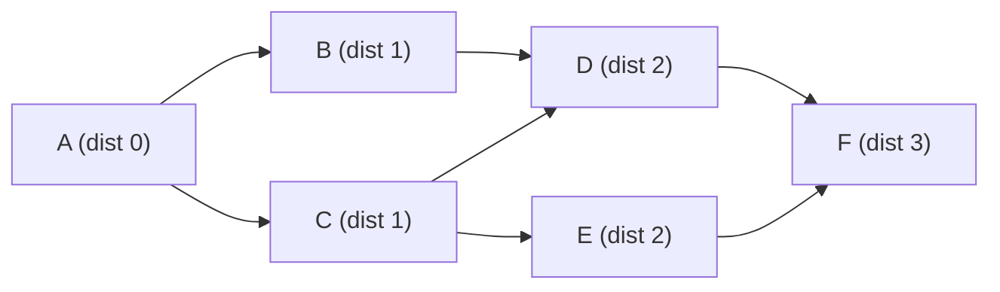

# Breadth-First Search

> **Module 05 · Data Structures & Algorithms** · Prerequisites: [Graphs](20-Graphs.md) · Next: [Depth-First Search](22-Depth-First-Search.md)

---

## ⏱ If You Only Have 2 Minutes

- BFS visits nodes in rings: every node at distance 1, then every node at distance 2, and so on. It uses a **FIFO queue** (first in, first out).
- In an **unweighted** graph, the first time BFS reaches a node is the shortest distance to that node. This stops being true once edges have different costs; use Dijkstra's algorithm then.
- **Mark a node as visited when you enqueue it**, not when you dequeue it. Otherwise the same node sits in the queue many times.
- Keep a **parent map** while you search. Walk it backwards from the target to rebuild the path.
- Running time is **O(V + E)**: each vertex is enqueued once and each edge is checked once. Extra space is O(V).
- **Multi-source BFS** starts with many nodes at distance 0 (for example, every rotten orange). One pass gives the distance to the nearest source for every cell.
- In backend code, BFS powers "degrees of separation", crawler frontiers and "which services break if this one fails".

---

## 1. What It Is and Why It Exists

**Breadth-first search (BFS)** is a graph traversal. It starts at one node, visits all of its neighbours, then all of their neighbours, and so on. The search moves outward in layers: distance 0, then distance 1, then distance 2. A graph is a set of **vertices** (V) joined by **edges** (E). See [Graphs](20-Graphs.md) for the representations.

**Analogy:** drop a stone into a pond. The ripples spread one ring at a time, so every point on the first ring is reached before any point on the second ring. The ring number is the number of edges from the stone.

**The problem it solves.** Suppose you need the fewest hops between two people in a social network, or the fewest moves between two cells in a maze. A depth-first search can find *a* path, but that path may be long and winding. A plain recursive search has no way to say it found the shortest one. BFS guarantees the shortest path in an unweighted graph, because it finishes every node at distance *k* before it touches any node at distance *k+1*.

Without BFS, you would either compare every possible path (exponential in the worst case) or accept a correct path that is not the shortest. For unweighted graphs, BFS is both correct and linear in the size of the graph.

The cost of BFS is memory. It must hold the whole current layer in its queue, so a very wide layer needs a lot of space. That trade-off matters for the production concerns later in this chapter.

---

## 2. How It Works

The algorithm has three parts:

1. A **queue** holds nodes waiting to be expanded. New nodes join the back; the next node to expand leaves from the front.
2. A **visited set** (or a distance table) records every node that has been queued. This stops cycles and repeated work.
3. A **parent map** records which node discovered each node. Path reconstruction uses it.

The loop:

1. Put the start node in the queue. Mark it visited with distance 0 and parent `null`.
2. Remove the front node `u`.
3. For each neighbour `v` of `u`: if `v` is not visited, mark it visited, set `dist[v] = dist[u] + 1`, set `parent[v] = u`, and add `v` to the back of the queue.
4. Repeat until the queue is empty, or stop early once the target is found.

### Trace on a small graph

Graph as an adjacency list:

```text
A: B, C
B: D
C: D, E
D: F
E: F
F: (none)
```

Start at `A`. The table shows the state after each step.

| Step | Dequeued | Neighbours checked | Newly enqueued | Queue after step | Visited so far |
|---|---|---|---|---|---|
| 0 | (start) | — | A (dist 0) | [A] | A |
| 1 | A | B, C | B (dist 1), C (dist 1) | [B, C] | A, B, C |
| 2 | B | D | D (dist 2) | [C, D] | A, B, C, D |
| 3 | C | D (already seen), E | E (dist 2) | [D, E] | A to E |
| 4 | D | F | F (dist 3) | [E, F] | A to F |
| 5 | E | F (already seen) | nothing | [F] | A to F |
| 6 | F | nothing | nothing | [] | A to F |

Final distances: A=0, B=1, C=1, D=2, E=2, F=3. The parent of F is D, the parent of D is B, and the parent of B is A. So the shortest path is **A → B → D → F**.

At step 3, C points at D, but D is already visited, so that edge is skipped. That skip is what keeps each node in the queue exactly once.



### Why the queue gives shortest paths

The queue always holds nodes of distance *d* followed by nodes of distance *d+1*. When a node at distance *d* leaves the queue, every node it discovers is at distance *d+1*. No node can be discovered earlier, because all the distance-*d* nodes are ahead of it in the queue. So the first time BFS discovers a node, it has found the shortest distance to that node.

### Multi-source BFS

Put several start nodes in the queue at distance 0 before the loop begins. The search then gives every node its distance to the *nearest* source. Use it for "how long until every orange is rotten" (the sources are the rotten oranges), "nearest exit from a building", or "how far an alert spreads from several servers". The algorithm does not change; only the starting queue does.

### Grid BFS

A grid is an implicit graph. Each cell is a node, and its neighbours are the cells one step up, down, left or right (or diagonal, if the problem allows it). You do not build an adjacency list. You compute the neighbours from the coordinates and check the bounds. Use a flat index (`row * cols + col`) or a `"row,col"` string as the visited key.

### Early exit

When you only need the distance to one target, stop as soon as the target is dequeued or first discovered. The answer is still correct, and the search may never touch most of the graph.

---

## 3. Key Concepts

### Why mark on enqueue

If you mark a node only when you dequeue it, several neighbours can add the same node before its first dequeue. Each copy is then expanded again. On a dense graph the queue can hold far more than V entries. Marking when you enqueue guarantees one queue entry per vertex, which is what gives the O(V + E) bound.

### Parent map and path reconstruction

Store `parent[v] = u` at the moment `v` is discovered. To get the path to a target, follow parents from the target back to the start, then reverse the list. If the target has no parent entry, it is unreachable. The start node's parent is `null`, and that is the stop condition.

### Queue implementation

A queue needs constant-time removal from the front. In JavaScript, `Array.prototype.shift()` can cost O(n) on large arrays, so keep an index that moves forward (a "head" pointer). In Python, `collections.deque.popleft()` is O(1), while `list.pop(0)` is O(n).

### Complexity

| Variant | Best | Average | Worst | Extra space | Why |
|---|---|---|---|---|---|
| Full BFS (all reachable nodes) | O(V + E) | O(V + E) | O(V + E) | O(V) | Each vertex enters the queue once; each edge is checked once from its tail |
| Shortest path to one target (early exit) | O(1) when start equals target | O(V + E) | O(V + E) | O(V) | Worst case explores everything before the target; no tighter general bound |
| Grid of R × C cells | O(R·C) | O(R·C) | O(R·C) | O(R·C) | Each cell is a vertex with at most 4 edges |
| Word ladder, N words of length L | O(N · 26 · L²) | same | same | O(N · L) | Each word is dequeued once; each of L positions tries 26 letters; each candidate costs O(L) to build and hash |

The word ladder row depends on how candidate strings are built. The L² comes from creating and hashing a new string of length L for each of the 26 · L candidates per word.

### BFS versus weighted search

BFS answers "fewest edges". It does not answer "lowest total cost". If edges have different costs, a route with more hops can be cheaper, so BFS returns the wrong route. The fix is Dijkstra's algorithm, which replaces the FIFO queue with a min-heap ordered by distance. For interviews, remember one rule: BFS gives the shortest path only when every edge has the same cost.

---

## 4. Code Examples

Two classic problems are solved below, in both languages:

1. **Shortest path in a grid.** Given a grid of 0 (open) and 1 (wall), return the fewest moves up, down, left or right from the top-left cell to the bottom-right cell, or −1 if no path exists. *Approach:* grid BFS with a distance table. *Complexity:* O(R·C) time and space.
2. **Word ladder.** Given `begin`, `end` and a word list (all words the same length, lowercase letters), return the number of words in the shortest sequence where each step changes one letter and every word is in the list. Return 0 if there is none. *Approach:* BFS where each state is a word and its neighbours are the one-letter changes that exist in the list. *Complexity:* O(N · 26 · L²) time, O(N · L) space.

The generic `bfs` and `shortestPath` come first, so the problems reuse the same idea.

**Built-ins.** JavaScript has `Map` and `Set`, which keep insertion order and give average O(1) lookups. It has no queue type, so use an array with a head index. Python has `collections.deque` for an O(1) queue, `dict` and `set` for the visited and parent maps, and `heapq` (a min-heap) only for weighted problems.

### Node.js / TypeScript

```ts
// No npm packages. Node.js 22+, TypeScript 5 with "strict" and "noUncheckedIndexedAccess".
export interface BfsResult<T> {
  dist: Map<T, number>;      // edges from the start; only reached nodes appear
  parent: Map<T, T | null>;  // one shortest-path predecessor; the start maps to null
}

export function bfs<T>(start: T, neighbors: (node: T) => Iterable<T>): BfsResult<T> {
  const dist = new Map<T, number>([[start, 0]]);
  const parent = new Map<T, T | null>([[start, null]]);
  // A head index instead of queue.shift(): shift() can cost O(n) on large arrays.
  const queue: T[] = [start];
  for (let head = 0; head < queue.length; head++) {
    const node = queue[head]!;
    for (const next of neighbors(node)) {
      // Mark on enqueue. Duplicate edges and self-loops are skipped here.
      if (dist.has(next)) continue;
      dist.set(next, dist.get(node)! + 1);
      parent.set(next, node);
      queue.push(next);
    }
  }
  return { dist, parent };
}

// Returns [start, ..., goal], or null when goal is unreachable. start === goal gives [start].
export function shortestPath<T>(start: T, goal: T, neighbors: (node: T) => Iterable<T>): T[] | null {
  const { parent } = bfs(start, neighbors);
  if (!parent.has(goal)) return null;
  const path: T[] = [];
  for (let node: T | null = goal; node !== null; node = parent.get(node)!) {
    path.push(node);
  }
  return path.reverse();
}

// Demo on the graph from section 2. Nodes with no neighbours return an empty list.
const graph = new Map<string, string[]>([
  ["A", ["B", "C"]], ["B", ["D"]], ["C", ["D", "E"]], ["D", ["F"]], ["E", ["F"]], ["F", []],
]);
console.log(shortestPath("A", "F", (n) => graph.get(n) ?? [])); // [ 'A', 'B', 'D', 'F' ]
```

```ts
// Problem 1: fewest moves on a 0/1 grid (0 = open, 1 = wall), 4-directional. Returns -1 if blocked.
export function shortestGridPath(grid: number[][]): number {
  const rows = grid.length;
  const cols = rows > 0 ? grid[0]!.length : 0;
  if (rows === 0 || cols === 0 || grid[0]![0] !== 0 || grid[rows - 1]![cols - 1] !== 0) return -1;
  const moves: [number, number][] = [[1, 0], [-1, 0], [0, 1], [0, -1]];
  const dist = new Int32Array(rows * cols).fill(-1); // -1 = not reached yet
  const queue: number[] = [0];                          // flat index: r * cols + c
  dist[0] = 0;
  for (let head = 0; head < queue.length; head++) {
    const cell = queue[head]!;
    const r = Math.floor(cell / cols);
    const c = cell % cols;
    if (r === rows - 1 && c === cols - 1) return dist[cell]!; // first arrival is the shortest
    for (const [dr, dc] of moves) {
      const nr = r + dr;
      const nc = c + dc;
      if (nr < 0 || nc < 0 || nr >= rows || nc >= cols) continue; // stay inside the grid
      const next = nr * cols + nc;
      if (grid[nr]![nc] !== 0 || dist[next] !== -1) continue;
      dist[next] = dist[cell]! + 1;
      queue.push(next);
    }
  }
  return -1;
}

// Problem 2: word ladder. Returns the number of words in the shortest ladder, or 0.
export function ladderLength(begin: string, end: string, wordList: readonly string[]): number {
  const dictionary = new Set(wordList);
  if (!dictionary.has(end)) return 0;
  const queue: [word: string, length: number][] = [[begin, 1]];
  const seen = new Set<string>([begin]);
  for (let head = 0; head < queue.length; head++) {
    const [word, length] = queue[head]!;
    if (word === end) return length;
    const chars = word.split("");
    for (let i = 0; i < chars.length; i++) {
      const original = chars[i]!;
      for (let code = 97; code <= 122; code++) { // 'a' to 'z'
        const letter = String.fromCharCode(code);
        if (letter === original) continue;
        chars[i] = letter;
        const candidate = chars.join("");
        if (dictionary.has(candidate) && !seen.has(candidate)) {
          seen.add(candidate);
          queue.push([candidate, length + 1]);
        }
      }
      chars[i] = original; // restore before trying the next position
    }
  }
  return 0;
}
```

### Python

```python
# No third-party packages. Python 3.12+ (PEP 695 generics, collections.deque).
from collections import deque
from collections.abc import Callable, Hashable, Iterable


def bfs[T: Hashable](start: T, neighbors: Callable[[T], Iterable[T]]) -> tuple[dict[T, int], dict[T, T | None]]:
    dist: dict[T, int] = {start: 0}
    parent: dict[T, T | None] = {start: None}
    queue: deque[T] = deque([start])  # popleft() is O(1); list.pop(0) is O(n)
    while queue:
        node = queue.popleft()
        for nxt in neighbors(node):
            # Mark on enqueue. Duplicate edges and self-loops are skipped here.
            if nxt in dist:
                continue
            dist[nxt] = dist[node] + 1
            parent[nxt] = node
            queue.append(nxt)
    return dist, parent


def shortest_path[T: Hashable](start: T, goal: T, neighbors: Callable[[T], Iterable[T]]) -> list[T] | None:
    # Returns [start, ..., goal], or None when goal is unreachable. start == goal gives [start].
    _, parent = bfs(start, neighbors)
    if goal not in parent:
        return None
    path: list[T] = []
    node: T | None = goal
    while node is not None:
        path.append(node)
        node = parent[node]
    path.reverse()
    return path


graph: dict[str, list[str]] = {"A": ["B", "C"], "B": ["D"], "C": ["D", "E"], "D": ["F"], "E": ["F"], "F": []}
print(shortest_path("A", "F", lambda n: graph.get(n, [])))  # ['A', 'B', 'D', 'F']
```

```python
# Problem 1 and 2 use the same imports.
import string
from collections import deque
from collections.abc import Iterable


# Problem 1: fewest moves on a 0/1 grid (0 = open, 1 = wall), 4-directional. Returns -1 if blocked.
def shortest_grid_path(grid: list[list[int]]) -> int:
    rows = len(grid)
    cols = len(grid[0]) if rows else 0
    if rows == 0 or cols == 0 or grid[0][0] != 0 or grid[-1][-1] != 0:
        return -1
    dist = [[-1] * cols for _ in range(rows)]  # -1 = not reached yet
    dist[0][0] = 0
    queue: deque[tuple[int, int]] = deque([(0, 0)])
    while queue:
        r, c = queue.popleft()
        if (r, c) == (rows - 1, cols - 1):
            return dist[r][c]  # first arrival is the shortest distance
        for dr, dc in ((1, 0), (-1, 0), (0, 1), (0, -1)):
            nr, nc = r + dr, c + dc
            # Check bounds first: a negative index in Python silently wraps around.
            if 0 <= nr < rows and 0 <= nc < cols and grid[nr][nc] == 0 and dist[nr][nc] == -1:
                dist[nr][nc] = dist[r][c] + 1
                queue.append((nr, nc))
    return -1


# Problem 2: word ladder. Returns the number of words in the shortest ladder, or 0.
def ladder_length(begin: str, end: str, word_list: Iterable[str]) -> int:
    dictionary = set(word_list)
    if end not in dictionary:
        return 0
    queue: deque[tuple[str, int]] = deque([(begin, 1)])
    seen = {begin}
    while queue:
        word, length = queue.popleft()
        if word == end:
            return length
        chars = list(word)
        for i, original in enumerate(chars):
            for letter in string.ascii_lowercase:
                if letter == original:
                    continue
                chars[i] = letter
                candidate = "".join(chars)
                if candidate in dictionary and candidate not in seen:
                    seen.add(candidate)
                    queue.append((candidate, length + 1))
            chars[i] = original  # restore before the next position
    return 0
```

---

## 5. Production Concerns

- **Memory is the frontier, not the depth.** BFS keeps a whole layer in memory. On a wide graph, such as a celebrity account with millions of followers, the queue can hold millions of nodes. For user-facing requests, cap both the depth and the number of visited nodes.
- **Bound user-controlled graphs.** Friend lists, tenant hierarchies and dependency trees are supplied by users or other teams, so their size is not under your control. Give each request a node budget and a time budget. When the budget runs out, return a partial answer and say that it is partial.
- **Crawlers.** A crawl frontier is a BFS queue whose nodes are URLs. Store the frontier and the visited set outside the process (Redis, a database). Redis `SADD` returns 1 only when the member was new, which gives an atomic "seen before?" check. Normalise URLs before the check, or the same page enters the frontier under many keys. Apply per-host rate limits, because BFS order alone can send many requests to one site at once.
- **Large graphs.** A graph too big for one machine is processed one layer at a time. Systems in the Pregel style run one BFS layer per superstep, with messages sent between workers at each step. The number of rounds equals the shortest-path distance, so latency grows with depth, not with the number of nodes.
- **Observability.** Log the layer reached, the frontier size per layer, and whether a budget was hit. A sudden growth in the frontier usually means a hub node, a missing visited check, or a URL that changes on every request.

---

## 6. Common Mistakes

- **Marking visited on dequeue** — the same node enters the queue many times and the work grows far beyond V + E — mark each node when you enqueue it.
- **Using a stack instead of a queue** — the search becomes a depth-first search, and the first path found is not necessarily the shortest — use a FIFO queue (`deque` or a head index).
- **Calling `shift()` or `pop(0)` in a loop** — each removal costs O(n), so the search becomes quadratic on large inputs — use `deque.popleft()` or a head index.
- **Forgetting bounds checks in grids** — Python's negative indexes wrap around silently, and JavaScript returns `undefined` — check `0 <= r < rows` and `0 <= c < cols` before you index.
- **Mixing up edges and nodes** — the answer is off by one — decide whether the question asks for edges or cells, and say which in the code and aloud in the interview.
- **Using BFS on weighted edges** — a path with fewer hops can cost more — use Dijkstra's algorithm for non-negative weights.
- **Keeping a full parent map when you only need a distance** — wasted memory on a large graph — store the distance per node, or stop as soon as the target is found.

---

## 7. Comparison Table

| Algorithm | Frontier structure | Shortest path (unweighted) | Weighted edges | Extra memory | Typical use |
|---|---|---|---|---|---|
| BFS | FIFO queue | Yes | No (equal costs only) | O(V) worst; the widest layer in practice | Degrees of separation, grid mazes, crawl depth |
| DFS | Stack or recursion | No | No | O(depth) | Components, cycles, topological order |
| Dijkstra | Min-heap keyed by distance | Yes | Yes, non-negative only | O(V) | Road networks, latency-weighted routing |
| Bellman-Ford | Repeated relaxation of all edges | Yes | Yes, negative costs allowed | O(V) | Routing where some costs can be negative |

---

## 8. Interview Questions

**[Junior] Why does BFS find the shortest path in an unweighted graph?**
BFS finishes every node at distance *d* before it touches any node at distance *d+1*. A node is first discovered from a node at the smallest possible distance, so its first discovery gives its shortest distance. Every edge counts as one step, so fewer edges means a shorter path. If the edges had different costs, this order would not reflect the total cost.

**[Junior] Why must the visited check happen when a node is enqueued?**
If the check happens on dequeue, several neighbours can add the same node before it is processed. The node is then expanded several times, which wastes time and memory. Marking on enqueue guarantees that each vertex enters the queue exactly once. The answer is still correct either way, but only the enqueue-time check gives the O(V + E) bound.

**[Mid] How do you return the actual path, not only its length?**
Keep a parent map. When BFS discovers `v` from `u`, store `parent[v] = u`. After the search, start at the target and follow parents until you reach the start, then reverse the list. If the target is missing from the map, there is no path. The extra memory is one entry per visited node.

**[Mid] How would you compute the time until every cell in a grid is reached from several sources?**
Use multi-source BFS. Put all the source cells in the queue at distance 0 before the loop starts. Each cell's distance is then the distance to its nearest source, and the answer is the largest distance seen. The work is still O(R·C), because each cell is visited once. This is the standard approach for "rotting oranges" style problems.

**[Senior] A product manager asks for the cheapest route on a graph where every edge has a cost. Why can you not use BFS, and what do you use instead?**
BFS minimises the number of hops, and it assumes every hop costs the same. With real costs, a route with more hops can be cheaper, so BFS returns the wrong route. Use Dijkstra's algorithm with a min-heap keyed by distance. It is correct when no edge cost is negative, and it runs in O((V + E) log V) with a binary heap. If some costs can be negative, use Bellman-Ford instead.

**[Senior] You need the degrees of separation between two users in a graph of a billion accounts. How do you design it?**
A single BFS from one user grows very quickly, because the frontier multiplies at each level, and it may touch a large part of the graph before it reaches the target. Run bidirectional BFS instead: expand the smaller frontier from the source and from the target until they meet. With average branching factor *b* and distance *d*, this explores about 2·b^(d/2) nodes instead of b^d. Partition the graph by user ID, cap the depth, and return "more than N hops" when the cap is reached. Cache popular answers, since the social graph changes slowly compared with query volume.

**[Senior] A crawler's frontier has grown to 50 million URLs. What do you change?**
Move the frontier and the visited set out of process memory, into Redis or a database, so memory is limited by the store, not by one worker. Partition the frontier per host so that one large site cannot dominate the crawl, and so that politeness delays apply per host. Set a maximum depth and a page budget per host, and normalise URLs before the visited check. Track frontier size by depth, so you can see when the crawl is spreading out faster than it is finishing.

---

## 9. Cheat Sheet

```text
BFS         FIFO queue; each layer = one more edge from the start (unweighted only)
Visited     mark on ENQUEUE; each vertex enters the queue exactly once
Path        parent map set at discovery; walk back from target, then reverse
Cost        O(V + E) time; O(V) extra space (queue + visited)
Queue       deque.popleft() or a head index; never list.pop(0) or shift() in a loop
Multi-src   push every source at distance 0 before the loop starts
Grid        neighbours from coordinates; check bounds before indexing
Weights     equal costs only; otherwise Dijkstra (non-negative) or Bellman-Ford
Early exit  return when the target is dequeued or first discovered
Backend     degrees of separation, crawl frontier, blast radius of a failing service
Limits      cap depth and node count for any user-controlled graph
```

---

## Related Topics

- [Graphs](20-Graphs.md) — the adjacency list and matrix representations that BFS runs on
- [Depth-First Search](22-Depth-First-Search.md) — the other traversal; uses a stack and does not give shortest paths
- [Queues](09-Queues.md) — the FIFO structure behind BFS and why `deque` matters
- [Hash Tables](11-Hash-Tables.md) — the visited and parent maps that keep each check at O(1) on average
- [Backend DSA Patterns](41-Backend-DSA-Patterns.md) — where graph search shows up in production systems
