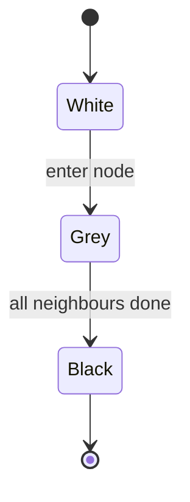

# Depth-First Search

> **Module 05 · Data Structures & Algorithms** · Prerequisites: [Breadth-First Search](21-Breadth-First-Search.md) · Next: [Recursion](23-Recursion.md)

---

## ⏱ If You Only Have 2 Minutes

- DFS goes as deep as it can along one path, then backs up and tries the next branch. Its frontier is a **stack**: the call stack in recursive DFS, or an array in iterative DFS.
- Every traversal needs a **visited** record for each node. Without it, a single cycle makes the search loop forever.
- **Pre-order** records a node when it is entered. **Post-order** records it after all its children are finished. Post-order is the basis of topological sorting (chapter 38).
- **Undirected graphs:** a visited neighbour that is not your parent means there is a cycle.
- **Directed graphs:** use three colours. White is unvisited, grey is on the current path, black is finished. An edge into a **grey** node is a cycle. An edge into a black node is not.
- Running time is **O(V + E)**. Extra space is O(V) for the visited record, plus the stack, which can reach O(V) or O(E) entries.
- Recursive DFS can overflow the call stack on a long path. Python's default limit is 1,000 frames, and Node's limit is also fixed. Use an explicit stack for large inputs.
- In backend systems, DFS shows up in dependency resolution, cycle checks in config includes, and reference resolution.

---

## 1. What It Is and Why It Exists

**Depth-first search (DFS)** is a graph traversal that follows one path as far as it can go. When it reaches a dead end, or a node it has already finished, it backs up to the last place where it had a choice and tries the next option. Like [BFS](21-Breadth-First-Search.md), it visits every reachable node exactly once when it has a visited record.

**Analogy:** a person in a maze who always takes the first unexplored corridor. They keep walking until they hit a dead end, then return to the last junction that still has an open door. Their path goes deep first, not wide first.

**The problem it solves.** DFS is the natural tool for questions about structure rather than distance:

- How many separate groups (connected components) does this graph have?
- Does this directed graph contain a cycle?
- In what order should dependencies be processed?

DFS does not give shortest paths. It finds *a* path, which may be long and winding. Use [BFS](21-Breadth-First-Search.md) when the number of hops matters.

Without a visited record, DFS on any graph with a cycle never ends. Without the right state (two states for undirected graphs, three colours for directed graphs), the cycle check reports false alarms or misses real cycles. Those two failures are the main reasons DFS code goes wrong in interviews.

---

## 2. How It Works

### Recursive DFS

1. Enter the start node: mark it visited and record it (pre-order).
2. For each neighbour that is not visited, run DFS on it.
3. When all neighbours are done, leave the node (post-order).

The call stack holds the current path. Each call is one node on that path.

### Trace on a small graph

Directed graph as an adjacency list (neighbours in the order listed):

```text
A: B, C
B: D
C: D
D: (none)
```

Recursive DFS from `A`. The table shows each event in order.

| Step | Event | Pre-order so far | Post-order so far |
|---|---|---|---|
| 1 | Enter A | A | |
| 2 | A's first neighbour B is unvisited: enter B | A, B | |
| 3 | B's neighbour D is unvisited: enter D | A, B, D | |
| 4 | D has no neighbours: leave D | A, B, D | D |
| 5 | B has no more neighbours: leave B | A, B, D | D, B |
| 6 | A's next neighbour C is unvisited: enter C | A, B, D, C | D, B |
| 7 | C's neighbour D is already visited: skip it | A, B, D, C | D, B |
| 8 | C has no more neighbours: leave C | A, B, D, C | D, B, C |
| 9 | A has no more neighbours: leave A | A, B, D, C | D, B, C, A |

Pre-order is **A, B, D, C**. Post-order is **D, B, C, A**. Step 7 is the important one: D was reached through B, so the edge from C is skipped.

### Iterative DFS

Replace the call stack with an array:

1. Push the start node.
2. Pop a node. If it is already visited, skip it. Otherwise mark it visited and record it.
3. Push its unvisited neighbours.

A node can be pushed once for each edge that points at it, so the stack can hold up to E entries. To visit neighbours in the same order as the recursive version, push them in reverse. The last neighbour goes on first, so the first neighbour is popped first.

### Three colours for directed cycles

Recursive DFS on a directed graph gives each node one of three colours:



An edge from the current node to a **grey** node points back into the path being explored. That is a cycle. An edge to a **black** node points to a node whose whole subtree is already finished. That is not a cycle, because the cycle would have been found while the black node was grey.

---

## 3. Key Concepts

### Visited states

A visited record stops DFS from entering the same node twice. For a traversal, one bit per node is enough. For cycle detection in a directed graph, one bit is not enough, because a finished node is also "visited" but is not on the current path. That is why three colours are needed.

### Pre-order and post-order

Pre-order gives the order in which nodes are first discovered. Post-order gives the order in which they are finished. Reversing the post-order of a DFS on a directed acyclic graph gives a **topological order**, a sequence where every node comes after its prerequisites. The details are in [Topological Sorting](38-Topological-Sorting.md).

### Connected components

In an undirected graph, a connected component is a set of nodes that can reach each other. To count components, start a DFS from every node that is not yet visited. Each start begins a new component, and the DFS floods all of its nodes. The number of starts is the number of components.

### Cycle detection: undirected versus directed

| Graph type | Rule | Why |
|---|---|---|
| Undirected | Visiting a neighbour that is already visited and is **not the parent** means a cycle | Each tree edge leads back to its parent, and that is not a cycle. Any other visited neighbour closes a loop. With parallel edges, count edges, not parents |
| Directed | An edge into a **grey** node means a cycle | Grey nodes are on the current path, so the edge closes a loop along that path |

A plain visited flag is wrong for directed graphs. An edge to a black node is a "cross" or "forward" edge in DFS terms, and it does not close a cycle.

### Recursion depth

Each recursive call uses a stack frame, and the stack is limited. A long chain of 100,000 nodes can overflow it. Node's limit depends on frame size and is typically a few thousand to around ten thousand calls. Python's default `sys.getrecursionlimit()` is 1,000, and it raises `RecursionError` when exceeded. The call stack is covered in [Stack Memory](../Module-04-Operating-Systems/23-Stack-Memory.md) and in [Recursion](23-Recursion.md).

### Complexity

| Variant | Best | Average | Worst | Extra space | Why |
|---|---|---|---|---|---|
| Recursive DFS, full traversal | O(V + E) | O(V + E) | O(V + E) | O(V) | Each vertex is entered once; each edge is examined once |
| Iterative DFS, mark on pop | O(V + E) | O(V + E) | O(V + E) | O(V + E) | Each edge can push one stack entry, so the stack can hold O(E) entries |
| Connected components (all vertices) | O(V + E) | O(V + E) | O(V + E) | O(V) | One pass over every vertex and edge, split into components |
| Directed cycle detection | O(V + E) | O(V + E) | O(V + E) | O(V) | Colours plus recursion path; each edge checked once |
| DFS on a rooted tree | O(n) | O(n) | O(n) | O(h) | h is the tree height: O(log n) when balanced, O(n) for a chain |

---

## 4. Code Examples

Two classic problems are solved below, in both languages:

1. **Number of connected components.** Given `n` nodes numbered `0` to `n-1` and an undirected edge list, return how many connected components there are. *Approach:* start a DFS from each unvisited node and count the starts. *Complexity:* O(V + E) time, O(V + E) space.
2. **Course schedule (cycle check).** Given `n` courses and prerequisite pairs `[course, before]`, return `true` if all courses can be finished. That is true exactly when the directed graph of `before → course` has no cycle. *Approach:* three-colour DFS. *Complexity:* O(V + E) time, O(V + E) space.

Topological ordering, which gives the actual order of courses, is in chapter 38.

**Built-ins.** JavaScript has no built-in graph type, so use arrays of neighbours and `Set` for the visited record. `Array.prototype.pop()` is O(1) and makes a convenient stack. Python has `list.append` and `list.pop()`, both O(1) at the end, so a list is an efficient stack. `sys.setrecursionlimit()` can raise the recursion cap, but very high values can crash the interpreter, so prefer an explicit stack for deep graphs.

### Node.js / TypeScript

```ts
// No npm packages. Node.js 22+, TypeScript 5 with "strict" and "noUncheckedIndexedAccess".
// Recursive DFS: pre-order, visited set. Depth equals the longest path, so keep it bounded.
export function dfsRecursive<T>(start: T, neighbors: (node: T) => readonly T[]): T[] {
  const order: T[] = [];
  const visited = new Set<T>();
  const visit = (node: T): void => {
    visited.add(node);  // mark on entry, so a cycle cannot re-enter this node
    order.push(node);   // pre-order: record on entry
    for (const next of neighbors(node)) {
      if (!visited.has(next)) visit(next);
    }
  };
  visit(start);
  return order;
}

// Iterative DFS: same visit order as the recursive version when neighbours are pushed in reverse.
// Marks on pop, so a node can sit on the stack several times; stale copies are skipped.
export function dfsIterative<T>(start: T, neighbors: (node: T) => readonly T[]): T[] {
  const order: T[] = [];
  const visited = new Set<T>();
  const stack: T[] = [start];
  while (stack.length > 0) {
    const node = stack.pop()!;
    if (visited.has(node)) continue;
    visited.add(node);
    order.push(node);
    const next = neighbors(node);
    for (let i = next.length - 1; i >= 0; i--) {
      if (!visited.has(next[i]!)) stack.push(next[i]!);
    }
  }
  return order;
}

// Demo: a single node with no neighbours returns just itself.
const graph = new Map<string, string[]>([["A", ["B", "C"]], ["B", ["D"]], ["C", ["D"]], ["D", []]]);
console.log(dfsRecursive("A", (n) => graph.get(n) ?? []));  // [ 'A', 'B', 'D', 'C' ]
console.log(dfsIterative("A", (n) => graph.get(n) ?? []));  // [ 'A', 'B', 'D', 'C' ]
```

```ts
// Problem 1: number of connected components in an undirected graph with nodes 0..n-1.
export function countComponents(n: number, edges: readonly [number, number][]): number {
  const adj: number[][] = Array.from({ length: n }, () => []);
  for (const [a, b] of edges) {
    adj[a]!.push(b);
    adj[b]!.push(a);
  }
  const visited = new Array<boolean>(n).fill(false);
  let components = 0;
  for (let start = 0; start < n; start++) {
    if (visited[start]) continue;  // already inside a component we have counted
    components++;
    visited[start] = true;
    const stack = [start];         // mark on push, so each node is stacked at most once
    while (stack.length > 0) {
      const node = stack.pop()!;
      for (const next of adj[node]!) {
        if (!visited[next]) {
          visited[next] = true;
          stack.push(next);
        }
      }
    }
  }
  return components;
}

const WHITE = 0; // not visited yet
const GREY = 1;  // on the current DFS path
const BLACK = 2; // finished: every path from it has been explored

// Problem 2: does the directed graph (nodes 0..n-1) contain a cycle?
export function hasCycle(n: number, edges: readonly [number, number][]): boolean {
  const adj: number[][] = Array.from({ length: n }, () => []);
  for (const [from, to] of edges) adj[from]!.push(to);
  const colour = new Array<number>(n).fill(WHITE);
  const visit = (node: number): boolean => {
    colour[node] = GREY;
    for (const next of adj[node]!) {
      if (colour[next] === GREY) return true;                  // back edge: a cycle
      if (colour[next] === WHITE && visit(next)) return true;  // explore unvisited nodes
    }
    colour[node] = BLACK;  // finished nodes are not on the path, so edges into them are safe
    return false;
  };
  for (let v = 0; v < n; v++) {
    if (colour[v] === WHITE && visit(v)) return true;
  }
  return false;
}

// Course schedule: prerequisite pair [course, before] means "before" must be taken first.
export function canFinish(numCourses: number, prerequisites: readonly [number, number][]): boolean {
  const edges = prerequisites.map(([course, before]): [number, number] => [before, course]);
  return !hasCycle(numCourses, edges);
}

console.log(countComponents(5, [[0, 1], [1, 2], [3, 4]]));        // 2
console.log(canFinish(2, [[1, 0]]), canFinish(2, [[0, 1], [1, 0]])); // true false
```

### Python

```python
# No third-party packages. Python 3.12+ (PEP 695 generics).
from collections.abc import Callable, Hashable, Iterable


def dfs_recursive[T: Hashable](start: T, neighbors: Callable[[T], Iterable[T]]) -> list[T]:
    # Recursive DFS. Depth equals the longest path; Python stops at sys.getrecursionlimit() (1000 by default).
    order: list[T] = []
    visited: set[T] = set()

    def visit(node: T) -> None:
        visited.add(node)  # mark on entry, so a cycle cannot re-enter this node
        order.append(node)  # pre-order: record on entry
        for nxt in neighbors(node):
            if nxt not in visited:
                visit(nxt)

    visit(start)
    return order


def dfs_iterative[T: Hashable](start: T, neighbors: Callable[[T], Iterable[T]]) -> list[T]:
    # An explicit list as the stack: no recursion limit. Marks on pop; stale copies are skipped.
    order: list[T] = []
    visited: set[T] = set()
    stack: list[T] = [start]
    while stack:
        node = stack.pop()
        if node in visited:
            continue
        visited.add(node)
        order.append(node)
        # Reverse the neighbours so the first one is popped first, matching the recursive order.
        for nxt in reversed(list(neighbors(node))):
            if nxt not in visited:
                stack.append(nxt)
    return order


graph: dict[str, list[str]] = {"A": ["B", "C"], "B": ["D"], "C": ["D"], "D": []}
print(dfs_recursive("A", lambda n: graph.get(n, [])))  # ['A', 'B', 'D', 'C']
print(dfs_iterative("A", lambda n: graph.get(n, [])))  # ['A', 'B', 'D', 'C']
```

```python
# Problem 1 and 2 use these imports.
from collections.abc import Iterable

WHITE, GREY, BLACK = 0, 1, 2  # not visited, on the current path, finished


# Problem 1: number of connected components in an undirected graph with nodes 0..n-1.
def count_components(n: int, edges: Iterable[tuple[int, int]]) -> int:
    adj: list[list[int]] = [[] for _ in range(n)]
    for a, b in edges:
        adj[a].append(b)
        adj[b].append(a)
    visited = [False] * n
    components = 0
    for start in range(n):
        if visited[start]:
            continue  # already inside a component we have counted
        components += 1
        visited[start] = True
        stack = [start]  # mark on push, so each node is stacked at most once
        while stack:
            node = stack.pop()
            for nxt in adj[node]:
                if not visited[nxt]:
                    visited[nxt] = True
                    stack.append(nxt)
    return components


# Problem 2: does the directed graph (nodes 0..n-1) contain a cycle?
def has_cycle(n: int, edges: Iterable[tuple[int, int]]) -> bool:
    adj: list[list[int]] = [[] for _ in range(n)]
    for src, dst in edges:
        adj[src].append(dst)
    colour = [WHITE] * n

    def visit(node: int) -> bool:
        colour[node] = GREY
        for nxt in adj[node]:
            if colour[nxt] == GREY:  # back edge into the current path: a cycle
                return True
            if colour[nxt] == WHITE and visit(nxt):
                return True
        colour[node] = BLACK  # finished nodes are not on the path
        return False

    return any(colour[v] == WHITE and visit(v) for v in range(n))


# Course schedule: prerequisite pair (course, before) means "before" must be taken first.
def can_finish(num_courses: int, prerequisites: Iterable[tuple[int, int]]) -> bool:
    edges = [(before, course) for course, before in prerequisites]
    return not has_cycle(num_courses, edges)


print(count_components(5, [(0, 1), (1, 2), (3, 4)]))         # 2
print(can_finish(2, [(1, 0)]), can_finish(2, [(0, 1), (1, 0)]))  # True False
```

**Runtime difference to notice.** The TypeScript recursive version and the Python recursive version both fail on very deep graphs, but with different errors: `RangeError: Maximum call stack size exceeded` in Node and `RecursionError` in Python. Neither runtime removes tail calls or grows the stack on demand, so the iterative versions are the safe choice for large inputs. A blocking loop in either language also blocks everything else on the same thread, so a long graph walk inside a request handler should run with a budget.

---

## 5. Production Concerns

- **Deep input means deep recursion.** Nested data supplied by users is a stack-depth risk. A request body with a few thousand levels of nesting can crash a recursive walker with a stack overflow, which is a denial-of-service issue. Reject input nested beyond a sensible depth (for example 100 levels) at the edge, and use an explicit stack for anything that walks user-controlled structures.
- **Object graphs with cycles.** Serialisers recurse through object graphs, and a cycle makes them loop or fail. `JSON.stringify` throws a `TypeError` ("Converting circular structure to JSON") and Python's `json.dumps` raises `ValueError` ("Circular reference detected"). Track visited objects during serialisation, or reject cyclic data before you serialise it.
- **Reference resolution.** Schema and config systems that follow `$ref` links can loop forever if `A` refers to `B` and `B` refers back to `A`. Track the references on the current path, the same way grey nodes are tracked, and report the cycle with its path.
- **Dependency cycles in build and plugin systems.** Detect cycles before running any work. Keep the current path (the grey nodes) on a stack, so the error can print the full cycle, such as `config/a.yml → config/b.yml → config/a.yml`. A message with the cycle is far easier to fix than "resolution failed".
- **Budgets and metrics.** On a user-controlled graph, cap the number of visited nodes and the maximum depth. Record the number of nodes visited and the deepest level reached. A spike in depth usually means an unexpected chain, such as inherited permissions that were never meant to be nested.

---

## 6. Common Mistakes

- **No visited record** — any cycle makes the search loop forever — mark each node on entry, before you recurse into its neighbours.
- **Using a plain visited flag for directed cycle detection** — a node reached by a second path is reported as a cycle, which is a false alarm — use three colours and report a cycle only for an edge into a grey node.
- **Applying the parent rule to a directed graph** — the parent of a node is not meaningful there, so real cycles are missed or misreported — use colours for directed graphs and the parent rule only for undirected ones.
- **Deep recursion on large input** — `RangeError` in Node or `RecursionError` in Python on a long chain — write the iterative version, or check depth and fail with a clear message.
- **Starting only once when counting components** — the result is 1 whatever the graph looks like — loop over every node and start a new search for each unvisited one.
- **Expecting DFS to give shortest paths** — DFS returns the first path it finds, which can be long — use [BFS](21-Breadth-First-Search.md) for shortest paths in unweighted graphs.
- **Sharing visited state between independent runs** — the second traversal skips nodes the first one visited, so its answer is wrong — create a fresh visited record for each run.

---

## 7. Comparison Table

| Approach | Frontier | Extra memory | Best for | Main risk |
|---|---|---|---|---|
| Recursive DFS | Call stack | O(depth) | Short, readable code; trees; backtracking | Stack overflow on long chains |
| Iterative DFS | Explicit array stack | O(E) worst case | Large or deep graphs | Order differs unless neighbours are pushed in reverse |
| BFS | FIFO queue | O(width of widest layer) | Shortest paths in unweighted graphs | Memory for wide layers |
| Union-Find | Disjoint-set forest | O(V) | Connectivity while edges arrive one at a time | Cannot list paths or detect directed cycles |

---

## 8. Interview Questions

**[Junior] What is the main difference between BFS and DFS in terms of their data structure?**
BFS uses a FIFO queue, so it explores nodes in layers by distance. DFS uses a stack, either the call stack or an explicit array, so it follows one path as far as it can before backing up. Both visit each reachable node once when they keep a visited record. The queue gives shortest paths in unweighted graphs; the stack does not.

**[Junior] How do you count connected components in an undirected graph?**
Loop over all the nodes. For each node that is not yet visited, increase the counter and run a DFS or BFS from it, marking every node it reaches. Each run covers exactly one component. The total running time is O(V + E), because each node and edge is handled once across all the runs.

**[Mid] How do you detect a cycle in an undirected graph?**
Run DFS while remembering each node's parent. If you reach a neighbour that is already visited and it is not the parent, you have found a cycle. The parent is excluded because the edge you just came along also leads back to it. If the graph has parallel edges, the parent rule fails, so track edge identifiers instead.

**[Mid] Why does directed cycle detection need three colours instead of a visited flag?**
A node that has been fully explored (black) is still marked visited, and an edge into it is perfectly safe. A visited flag cannot tell that apart from an edge into a node on the current path. The grey state marks exactly the nodes on the current path, so an edge into grey is the only signal of a real cycle.

**[Senior] A service crashes with a stack overflow when it walks a dependency graph that has a 200,000-node chain. What do you change?**
Replace the recursion with an explicit stack, so the depth is limited by memory rather than by the call stack. Keep the visited and colour records, and keep a parallel path stack so cycle errors can print the cycle. Add a sanity limit on the number of nodes and on depth, and log when it is hit. Raising the recursion limit only moves the crash point, and it risks a hard crash of the process.

**[Senior] Design a check that rejects cyclic configuration includes during deployment and tells the author which files form the cycle.**
Build the include graph from all the config files, then run a three-colour DFS over it. Keep the grey nodes on an explicit path stack. When an edge points at a grey node, the cycle is the part of the path from that node to the current one, so report those file names in order. Run the check in CI and in the deploy pipeline, not just at runtime, so the error appears before anything is applied. The check is O(files + includes), which stays fast for any realistic config size.

---

## 9. Cheat Sheet

```text
DFS          stack (call stack or array): go deep first, then back up
Visited      mark on entry; no mark means infinite loops on cycles
Pre-order    record when entered; post-order: record when finished
Cost         O(V + E) time; O(V) visited + stack (up to O(E) pushes iteratively)
Components   start a DFS from every unvisited node and count the starts
Undirected   cycle = visited neighbour that is not the parent
Directed     three colours: edge into GREY = cycle; edge into BLACK = safe
Topological  reverse post-order of a DAG (chapter 38)
Recursion    deep graphs overflow: RangeError (Node), RecursionError (Python)
Fix          explicit stack; cap depth and node count for user input
Not          not shortest paths (use BFS for hop counts)
```

---

## Related Topics

- [Graphs](20-Graphs.md) — the representations that DFS walks over
- [Breadth-First Search](21-Breadth-First-Search.md) — the queue-based traversal that finds shortest paths
- [Recursion](23-Recursion.md) — base cases, call stacks and how to turn recursion into a loop
- [Topological Sorting](38-Topological-Sorting.md) — uses DFS post-order or Kahn's algorithm to order dependencies
- [Union Find](37-Union-Find.md) — an alternative for counting connected components as edges arrive
- [Stack Memory](../Module-04-Operating-Systems/23-Stack-Memory.md) — why the call stack has a fixed size
