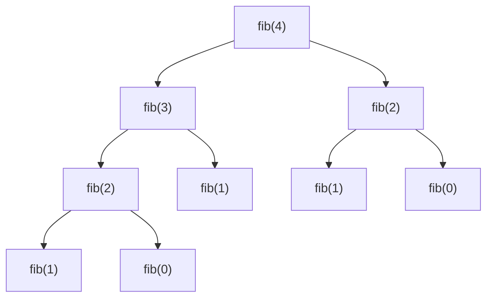

# Recursion

> **Module 05 · Data Structures & Algorithms** · Prerequisites: [Depth-First Search](22-Depth-First-Search.md) · Next: [Divide and Conquer](24-Divide-and-Conquer.md)

---

## ⏱ If You Only Have 2 Minutes

- A recursive function solves a problem by calling itself on a **smaller** input. It needs a **base case** that stops the calls and a **recursive case** that moves toward it.
- Each call adds a **frame** to the call stack. The stack has a fixed size, so a call chain that is too deep fails with `RangeError` (Node) or `RecursionError` (Python).
- Count the cost with the **recurrence**. `T(n) = T(n-1) + O(1)` is O(n). `T(n) = 2T(n-1) + O(1)` is O(2ⁿ).
- Naive recursive Fibonacci makes about 1.618ⁿ calls because it solves the same subproblems again and again. **Memoization** caches each answer, which cuts the work to O(n).
- **Tail calls** can reuse the stack frame only when the engine implements tail-call optimisation. Python does not. Node's V8 engine does not either, so do not rely on it.
- Any recursion can be rewritten as a loop with an **explicit stack**. Do this for input whose depth you do not control.
- Nested data from users (JSON bodies, config trees) is a stack-depth risk. Cap the depth at the edge.

---

## 1. What It Is and Why It Exists

**Recursion** is a function that calls itself. The idea is simple: if you can solve a smaller version of the problem, and you know the answer for the smallest version, you can build up the answer for the full problem.

**Analogy:** Russian nesting dolls. To open the big doll, you open the next doll inside it, and so on, until you reach the smallest doll that does not open. Then you know the whole set. The smallest doll is the base case, and "open this doll, then look inside" is the recursive case.

**The problem it solves.** Many data structures are recursive by nature. A tree is a root with subtrees. A JSON document is an object whose values can be objects. A directory is a folder that contains folders. Recursion mirrors that shape, so the code is short and easy to check. [Depth-first search](22-Depth-First-Search.md) is a recursive walk over a graph, and [divide and conquer](24-Divide-and-Conquer.md) is recursion that splits the work in two.

Recursion also has real costs. Each call uses memory on the call stack. Without a base case, the calls never end. Without memoization, some recursions repeat the same work an exponential number of times. This chapter covers how to avoid each of these failures.

---

## 2. How It Works

Every recursive function has two parts:

1. **Base case.** An input so small that the answer is known without recursion. Example: `power(x, 0) = 1`.
2. **Recursive case.** Break the problem into a smaller call, get its answer, and combine it with the current step. Example: `power(x, n) = x × power(x, n-1)`.

The call stack holds one frame per active call. When a call returns, its frame is removed and the result goes to the caller. The stack grows on the way down and shrinks on the way up.

### Trace: power(2, 5)

The function `power(x, n)` multiplies `x` by itself `n` times, using the recursive case above.

| Step | What happens | Value returned |
|---|---|---|
| 1 | `power(2, 5)` needs `power(2, 4)` | — |
| 2 | `power(2, 4)` needs `power(2, 3)` | — |
| 3 | `power(2, 3)` needs `power(2, 2)` | — |
| 4 | `power(2, 2)` needs `power(2, 1)` | — |
| 5 | `power(2, 1)` needs `power(2, 0)` | — |
| 6 | `power(2, 0)` hits the base case | 1 |
| 7 | `power(2, 1)` returns 2 × 1 | 2 |
| 8 | `power(2, 2)` returns 2 × 2 | 4 |
| 9 | `power(2, 3)` returns 2 × 4 | 8 |
| 10 | `power(2, 4)` returns 2 × 8 | 16 |
| 11 | `power(2, 5)` returns 2 × 16 | 32 |

At step 6 the stack holds six frames, which is the deepest point. Steps 7 to 11 pop them one at a time. The running time is O(n), and the stack depth is O(n) too.

### Trace the call tree: naive Fibonacci

The naive recursion `fib(n) = fib(n-1) + fib(n-2)` repeats work. Here is the call tree for `fib(4)`:



`fib(2)` is computed twice, and `fib(1)` three times. The tree has 9 calls. In general, the number of calls for `fib(n)` is about 1.618ⁿ, so it grows exponentially. Memoization removes the repeats, as described in section 3.

---

## 3. Key Concepts

### Base case and recursive case

A missing or wrong base case is the most common bug. The base case must be reached by every path, and each recursive call must move strictly closer to it. For a list, that means a shorter list. For a number, that means a smaller number. If the input can grow or stay the same, the recursion may never stop.

### The call stack and its limits

Each call stores its arguments, local variables and a return address in a frame. Frames live on the call stack, which has a fixed size set by the runtime and the operating system. Node's stack depth is usually a few thousand to around ten thousand frames, depending on how large each frame is. Python's limit is set by `sys.getrecursionlimit()`, which is 1,000 by default. The stack itself is explained in [Stack Memory](../Module-04-Operating-Systems/23-Stack-Memory.md).

Recursion depth is the length of the longest chain of calls. When the input depth is small and bounded, recursion is fine. When the input depth comes from users or from a large data set, use an explicit stack instead.

### Recurrence relations

A recurrence describes the running time in terms of smaller inputs. Use it to count the cost:

| Recurrence | Meaning | Result | Example |
|---|---|---|---|
| T(n) = T(n−1) + O(1) | One smaller call, constant work | O(n) | Sum of a list, factorial |
| T(n) = 2T(n−1) + O(1) | Two smaller calls, each of size n−1 | O(2ⁿ) | Naive "all subsets" recursion |
| T(n) = T(n/2) + O(1) | One call on half the input | O(log n) | Binary search |
| T(n) = 2T(n/2) + O(n) | Two half-size calls plus linear merge | O(n log n) | Merge sort (chapter 24) |

Sum the work per level and multiply by the number of levels. For a recursion tree, the number of nodes is the number of calls, and the cost is the sum of each node's own work.

### Tail calls

A **tail call** is a call that is the last thing a function does before it returns its result. A language with tail-call optimisation (TCO) can reuse the current frame for that call, so a tail-recursive loop uses constant stack space.

- **Python** does not optimise tail calls. Every call adds a frame, and the recursion limit applies. `sys.setrecursionlimit` can raise the cap, but pushing it far above the default can crash the interpreter with a real C-stack overflow.
- **JavaScript:** the ECMAScript specification includes proper tail calls, but in practice only Safari's JavaScriptCore engine implements them. V8, which runs Node.js, does not. Write loops for deep work instead of relying on TCO.

### Memoization: a preview of dynamic programming

**Memoization** stores the result of each subproblem the first time it is solved, and returns the stored value on later calls. Naive `fib(n)` takes exponential time, and with memoization it takes O(n) time and O(n) space. The full technique, and the bottom-up version, is covered in [Dynamic Programming Fundamentals](36-Dynamic-Programming-Fundamentals.md).

### Converting recursion to iteration

Every recursive algorithm can be written with a loop and an explicit stack, because the call stack is just a stack. The loop version has no depth limit beyond memory. The price is that the code can be harder to read. For problems where the recursion depth is bounded by a small constant, keep the recursive version. For depth set by user data, convert it. When the recursive call is the last step, a plain loop with two or three variables often replaces the recursion completely, as the iterative Fibonacci shows.

### Complexity

| Algorithm | Best | Average | Worst | Space | Why |
|---|---|---|---|---|---|
| Linear recursion (sum of a list of n items) | O(n) | O(n) | O(n) | O(n) stack | One call per item; depth equals n |
| Naive Fibonacci | Θ(1.618ⁿ) | Θ(1.618ⁿ) | Θ(1.618ⁿ) | O(n) stack | About 1.618ⁿ calls; the stack depth is only n |
| Memoised Fibonacci | O(n) | O(n) | O(n) | O(n) memo + O(n) stack | Each subproblem is solved once; the memo holds n answers |
| Binary recursion (halving) | O(1) | O(log n) | O(log n) | O(log n) stack | Each call halves the input; best case finds the answer at once |
| Power set (all subsets) | O(n · 2ⁿ) | O(n · 2ⁿ) | O(n · 2ⁿ) | O(n) stack | There are 2ⁿ subsets, and each takes O(n) to build |

---

## 4. Code Examples

Two problems are solved below, in both languages:

1. **Climbing stairs.** You can climb 1 or 2 steps at a time. Given `n`, return the number of distinct ways to reach the top. *Approach:* recursion with a memo, using the recurrence `ways(k) = ways(k-1) + ways(k-2)`. *Complexity:* O(n) time, O(n) space.
2. **Flatten a nested JSON object.** Given a JSON object, return a flat object whose keys are dotted paths, such as `{"db": {"host": "x"}}` becomes `{"db.host": "x"}`. *Approach:* recursion over objects and arrays, where scalars and empty containers are the base case. *Complexity:* O(total nodes) time, O(depth) stack space.

The first code block shows a recursive and an iterative version of summing nested lists, which is the basic conversion pattern.

**Built-ins.** JavaScript has `Array.prototype.flat(Infinity)`, which flattens nested arrays to any depth, but it does not handle objects. Python has `functools.cache` and `functools.lru_cache` for memoization, and `int` values in Python are arbitrary precision, so `fib` stays exact for any size. JavaScript numbers are exact only up to 2⁵³, so use `BigInt` for large integer results. `itertools.chain.from_iterable` flattens only one level.

### Node.js / TypeScript

```ts
// No npm packages. Node.js 22+, TypeScript 5 with "strict".
// A nested list is a number or a list of nested lists.
export type Nested = number | Nested[];

// Recursive: the base case is a number; the recursive case is a list.
// Edge cases: an empty list sums to 0; a bare number returns itself.
export function sumNested(value: Nested): number {
  if (typeof value === "number") return value;
  let total = 0;
  for (const child of value) total += sumNested(child);
  return total;
}

// Same result with an explicit stack: the depth is limited by memory, not by the call stack.
export function sumNestedIterative(value: Nested): number {
  let total = 0;
  const stack: Nested[] = [value];
  while (stack.length > 0) {
    const item = stack.pop()!;
    if (typeof item === "number") total += item;
    else for (const child of item) stack.push(child);
  }
  return total;
}

console.log(sumNested([1, [2, [3, []]], 4]), sumNestedIterative([1, [2, [3, []]], 4])); // 10 10
```

```ts
// Problem 1: number of ways to climb n stairs taking 1 or 2 steps at a time.
// n = 0 returns 1 (one way: stay where you are). Exact only while the result is below 2^53.
export function climbStairs(n: number): number {
  if (!Number.isInteger(n) || n < 0) throw new RangeError("n must be a non-negative integer");
  const memo = new Map<number, number>();
  const ways = (k: number): number => {
    if (k <= 1) return 1;                     // base cases: 0 or 1 steps left, one way each
    const cached = memo.get(k);
    if (cached !== undefined) return cached;  // reuse an answer already computed
    const result = ways(k - 1) + ways(k - 2); // the last move was 1 step or 2 steps
    memo.set(k, result);
    return result;
  };
  return ways(n);
}

// Problem 2: flatten a nested JSON object into dotted keys. Arrays use [i] indexes.
export type Json = string | number | boolean | null | Json[] | { [key: string]: Json };

function isPlainObject(value: Json): value is { [key: string]: Json } {
  return typeof value === "object" && value !== null && !Array.isArray(value);
}

export function flattenJson(value: Json, prefix = "", out: Record<string, Json> = {}): Record<string, Json> {
  if (isPlainObject(value) && Object.keys(value).length > 0) {
    for (const [key, child] of Object.entries(value)) {
      flattenJson(child, prefix === "" ? key : `${prefix}.${key}`, out);
    }
  } else if (Array.isArray(value) && value.length > 0) {
    value.forEach((child, i) => flattenJson(child, `${prefix}[${i}]`, out));
  } else {
    out[prefix] = value; // scalars and empty containers are the base case
  }
  return out;
}

console.log(climbStairs(2), climbStairs(5)); // 2 8
console.log(flattenJson({ db: { host: "x", ports: [5432, 5433] }, debug: false }));
// { 'db.host': 'x', 'db.ports[0]': 5432, 'db.ports[1]': 5433, debug: false }
```

### Python

```python
# No third-party packages. Python 3.12+ (type statement, PEP 695 generics).
type Nested = int | list[Nested]


# Recursive: the base case is an int; the recursive case is a list.
# Edge cases: an empty list sums to 0; a bare int returns itself.
def sum_nested(value: Nested) -> int:
    if isinstance(value, int):
        return value
    return sum(sum_nested(child) for child in value)


# Same result with an explicit list as the stack: depth is limited by memory, not the recursion limit.
def sum_nested_iterative(value: Nested) -> int:
    total = 0
    stack: list[Nested] = [value]
    while stack:
        item = stack.pop()
        if isinstance(item, int):
            total += item
        else:
            stack.extend(item)
    return total


print(sum_nested([1, [2, [3, []]], 4]), sum_nested_iterative([1, [2, [3, []]], 4]))  # 10 10
```

```python
# Problem 1 and 2 use these imports.
from functools import lru_cache
from typing import Any

type Json = str | int | float | bool | None | list[Json] | dict[str, Json]


# Problem 1: number of ways to climb n stairs taking 1 or 2 steps at a time.
# n = 0 returns 1 (one way: stay where you are). Python ints are exact for any size.
def climb_stairs(n: int) -> int:
    if n < 0:
        raise ValueError("n must be non-negative")

    @lru_cache(maxsize=None)  # the memo lives only for this call, so it cannot grow across requests
    def ways(k: int) -> int:
        if k <= 1:  # base cases: 0 or 1 steps left, one way each
            return 1
        return ways(k - 1) + ways(k - 2)  # the last move was 1 step or 2 steps

    return ways(n)


# Problem 2: flatten a nested JSON object into dotted keys. Arrays use [i] indexes.
def flatten_json(value: Json, prefix: str = "", out: dict[str, Any] | None = None) -> dict[str, Any]:
    if out is None:  # a mutable default argument would be shared between calls
        out = {}
    if isinstance(value, dict) and value:
        for key, child in value.items():
            flatten_json(child, f"{prefix}.{key}" if prefix else key, out)
    elif isinstance(value, list) and value:
        for i, child in enumerate(value):
            flatten_json(child, f"{prefix}[{i}]", out)
    else:
        out[prefix] = value  # scalars and empty containers are the base case
    return out


print(climb_stairs(2), climb_stairs(5))  # 2 8
print(flatten_json({"db": {"host": "x", "ports": [5432, 5433]}, "debug": False}))
# {'db.host': 'x', 'db.ports[0]': 5432, 'db.ports[1]': 5433, 'debug': False}
```

**Runtime difference to notice.** Python integers grow as needed, so `climb_stairs(500)` is exact. In JavaScript, `climbStairs(500)` returns a number that is no longer exact, because the value passes 2⁵³. Use `BigInt` there. Also, a `lru_cache` on a module-level function keeps its entries until the process exits, so the example creates the cache inside each call instead.

---

## 5. Production Concerns

- **Stack overflow is a denial-of-service risk.** A request body with thousands of nested levels can crash a recursive walker. Parsers and serialisers recurse on nesting too. Reject bodies nested deeper than a sensible limit, such as 100 levels, before they reach your own code.
- **Memoization must be bounded.** A cache keyed by user input grows forever unless you bound it. In Python, use `lru_cache(maxsize=...)`. Do not put an unbounded `lru_cache` on a function that runs for every request. A cache scoped to one call, as in the example, is safe.
- **Avoid `lru_cache` on methods.** The cache keeps a reference to `self` for the lifetime of the cache, so instances cannot be garbage-collected. Cache a module-level function, or store the value on the instance.
- **Exponential recursion is a latency bomb.** A function that is fast on 20 items can take hours on 60 if it has a naive recursion. Measure with realistic sizes, and add a limit on input size before the recursion starts.
- **Logging.** When a recursive walk fails, log the depth reached and the path to the failing node, not the whole input. The path is what lets an engineer find the bad record.
- **Exact arithmetic.** Use `BigInt` in JavaScript when results can exceed 2⁵³, and store monetary values as integers in cents, not floats.

---

## 6. Common Mistakes

- **Missing or wrong base case** — the calls never stop and the stack overflows — make every path reach a base case, and check that each call moves toward it.
- **A recursive call that does not shrink the input** — `f(n)` calls `f(n)` or `f(n+1)` — make sure each argument is strictly closer to the base case.
- **Repeated subproblems without a memo** — naive `fib(50)` makes about 2 × 10¹⁰ calls — cache each result, or write the loop version.
- **Assuming tail-call optimisation** — Python and V8 do not do it, so a "tail-recursive" loop of 100,000 steps still overflows — write a loop, or keep the depth small.
- **Sharing mutable state across calls** — a list passed down the recursion is changed by one branch and seen by the next — pass a copy, or undo the change after the recursive call returns.
- **Mutable default arguments in Python** — `def f(out={})` is created once and shared between calls — default to `None` and create the object inside the function.
- **Recursing on user-controlled depth** — a nested input can exceed the stack limit — cap the depth at the boundary, or use an explicit stack.

---

## 7. Comparison Table

| Approach (climbing stairs) | Time | Extra space | Call-stack risk | Notes |
|---|---|---|---|---|
| Naive recursion | Θ(1.618ⁿ) | O(n) stack | Yes, grows with n | Clear, but repeats subproblems |
| Memoised recursion | O(n) | O(n) memo + O(n) stack | Yes, grows with n | Same shape as the recurrence |
| Iterative loop | O(n) | O(1) | None | Keeps only the last two values |

---

## 8. Interview Questions

**[Junior] What are the two parts every recursive function needs?**
A base case that returns an answer without recursing, and a recursive case that calls itself on a smaller input and combines the result. If the base case is missing, or the recursive call does not get closer to it, the function never stops. In an interview, state the base case first, then show that each call moves toward it.

**[Junior] Why is naive recursive Fibonacci so slow?**
Each call makes two more calls, and many of those calls ask for the same values. `fib(2)` is computed many times for `fib(n)` with larger n. The number of calls grows like 1.618ⁿ. Caching each answer, so each value is computed once, reduces the time to O(n).

**[Mid] How do you find the time complexity of a recursive function?**
Write a recurrence for the work done by one call, in terms of the calls it makes. Then solve it by counting the nodes in the recursion tree and the work at each node. For example, `T(n) = 2T(n/2) + O(n)` has log n levels with O(n) work each, so the total is O(n log n). Check the space too: the recursion depth is the size of the call stack.

**[Mid] What does memoization change, and what does it cost?**
It removes repeated subproblems, so the number of distinct calls becomes the number of distinct inputs. The cost is memory for the cache, and the recursion depth stays the same. A memo is only correct for pure functions, meaning functions whose result depends only on their arguments.

**[Senior] An API flattens user-supplied nested JSON recursively and occasionally crashes with a stack overflow. What do you do?**
Treat the depth as untrusted input. Reject documents above a sensible nesting limit at the request boundary, before parsing or walking them. Replace the recursive walk with an explicit stack so the cost depends on memory, and cap the total number of nodes. Return a clear `413` or `400` error with the reason. Add a test with a deeply nested input, and monitor how often the limit is reached.

**[Senior] Should a long-running loop in Node or Python rely on tail-call optimisation?**
No. The ECMAScript specification includes proper tail calls, but in practice only Safari's engine implements them, and V8 in Node does not. Python never removes frames for tail calls. Rewrite the recursion as a loop, or as a loop with an explicit stack for tree-shaped work. Then the stack depth does not depend on the input size or on the runtime's choices.

---

## 9. Cheat Sheet

```text
Recursion     base case + recursive case; each call must move toward the base case
Call stack    one frame per active call; fixed size; RangeError (Node), RecursionError (Python)
Limits        Python default recursion limit 1000; Node a few thousand to ~10k frames
Recurrence    T(n)=T(n-1)+O(1) -> O(n); T(n)=2T(n-1)+O(1) -> O(2^n); T(n)=T(n/2)+O(1) -> O(log n)
Naive fib     about 1.618^n calls; repeats subproblems
Memoize       cache each result once; O(n) for fib; bound the cache for user input
Tail calls    Python: no TCO; V8/Node: no TCO in practice; Safari: has TCO
Convert       recursion -> loop with an explicit stack (depth limited by memory)
Nested data   user input can be deep; cap the depth; walk with a stack
JS numbers    exact only to 2^53; use BigInt for big results
Python int    arbitrary precision; no overflow
Never         mutable default arguments; lru_cache on methods; unbounded caches
```

---

## Related Topics

- [Depth-First Search](22-Depth-First-Search.md) — a recursive graph walk, and the iterative version with an explicit stack
- [Divide and Conquer](24-Divide-and-Conquer.md) — recursion that splits a problem into halves and combines the results
- [Dynamic Programming Fundamentals](36-Dynamic-Programming-Fundamentals.md) — memoization taken to tabulation
- [Backtracking](35-Backtracking.md) — recursion that explores choices and undoes them
- [Stack Memory](../Module-04-Operating-Systems/23-Stack-Memory.md) — how call frames are laid out and why the stack is limited
