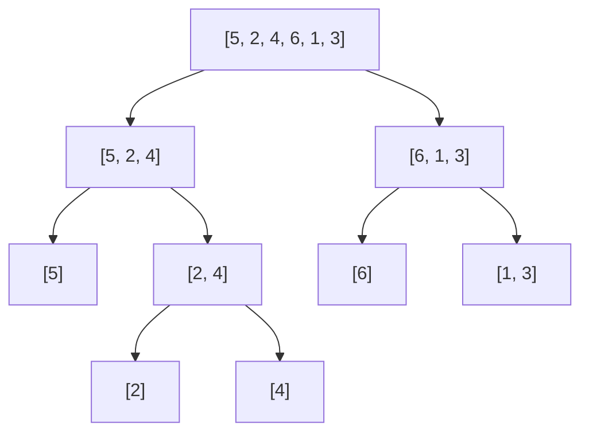

# Divide and Conquer

> **Module 05 · Data Structures & Algorithms** · Prerequisites: [Recursion](23-Recursion.md) · Next: [Binary Search](25-Binary-Search.md)

---

## ⏱ If You Only Have 2 Minutes

- **Divide and conquer** splits a problem into smaller independent subproblems, solves each one recursively, then **combines** the answers.
- The running time follows the recurrence **T(n) = a·T(n/b) + f(n)**: `a` subproblems, each of size `n/b`, plus `f(n)` work to split and combine.
- The **master theorem** solves that recurrence. Compare `f(n)` with `n^(log_b a)`: if `f` is smaller, the recursion dominates; if equal, add a log factor; if larger, the combine step dominates.
- Merge sort is T(n) = 2T(n/2) + O(n), so it is **O(n log n)**. Binary search is T(n) = T(n/2) + O(1), so it is **O(log n)**.
- Karatsuba multiplies large numbers with 3 half-size multiplications instead of 4, giving about **O(n^1.585)**. Strassen uses 7 instead of 8 for matrices.
- Fast exponentiation computes `x^n` in **O(log n)** multiplications by squaring.
- Maximum subarray has a divide-and-conquer solution in O(n log n), but Kadane's algorithm solves it in **O(n)**. Know both, and know which one to use.
- Divide and conquer needs **non-overlapping** subproblems. When subproblems overlap, use dynamic programming instead.

---

## 1. What It Is and Why It Exists

**Divide and conquer** is a design pattern with three steps:

1. **Divide** the problem into smaller subproblems of the same kind.
2. **Conquer** each subproblem by solving it recursively. The smallest ones are solved directly.
3. **Combine** the subproblem answers into the answer for the whole problem.

**Analogy:** a manager needs a total of 10,000 survey forms counted. She splits the pile between two teams, each team splits its pile again, and so on, until each person counts a small stack. Then the counts are added up pair by pair on the way back. The work is the same as a single count, but it is shared out, and each merge step is small and easy.

**The problem it solves.** Many problems have a simple brute-force answer that is slow. Comparing every pair of points for the closest pair costs O(n²). Sorting by repeatedly picking the smallest element costs O(n²). Splitting the problem, solving the halves, and combining them can bring the cost down to O(n log n). The trick is that the combine step must be cheap, usually linear, and the halves must not overlap. Without those two conditions, the recursion does not save work.

Divide and conquer is also the reason many search and sorting algorithms are fast. Binary search throws away half the input each step, and merge sort uses the same idea to sort. Chapter 27 covers merge sort in full. This chapter focuses on the pattern and the math behind its running time.

---

## 2. How It Works

The usual shape of a divide-and-conquer function is:

```text
solve(problem):
    if problem is small: solve it directly (base case)
    split problem into a subproblems of size n/b
    answers = [solve(sub) for each subproblem]
    return combine(answers) and any extra work
```

For merge sort, the split is "left half and right half", and the combine step is "merge two sorted lists". Merging takes linear time, because each element is copied once.

### Trace: merge sort on [5, 2, 4, 6, 1, 3]

The table shows each divide and combine step, in the order the recursion reaches them.

| Step | Action | Result |
|---|---|---|
| 1 | Divide [5, 2, 4, 6, 1, 3] into [5, 2, 4] and [6, 1, 3] | — |
| 2 | Divide [5, 2, 4] into [5] and [2, 4] | — |
| 3 | Divide [2, 4] into [2] and [4]; combine them | [2, 4] |
| 4 | Combine [5] with [2, 4] | [2, 4, 5] |
| 5 | Divide [6, 1, 3] into [6] and [1, 3]; combine [1] and [3] | [1, 3] |
| 6 | Combine [6] with [1, 3] | [1, 3, 6] |
| 7 | Combine [2, 4, 5] with [1, 3, 6] | [1, 2, 3, 4, 5, 6] |

The recursion tree shows the same structure:



Six items need about three levels of splitting, and the merges on each level touch about six items in total. In general the tree has about log₂ n levels, and each level costs O(n). That is the source of the O(n log n) bound.

### Writing the recurrence

Let `T(n)` be the time to solve a problem of size `n`. A divide-and-conquer algorithm that makes `a` calls of size `n/b` and does `f(n)` extra work gives:

**T(n) = a · T(n/b) + f(n)**

For merge sort, `a = 2`, `b = 2` and `f(n) = Θ(n)` (the merge). For binary search, `a = 1`, `b = 2` and `f(n) = Θ(1)` (one comparison). The recurrence is the cost model; the master theorem, below, turns it into a closed form.

---

## 3. Key Concepts

### Divide, conquer and combine

Each step has a cost, and the overall cost depends on all three. A divide step that copies arrays costs O(n) per level, and that cost counts. Many interview mistakes come from ignoring the cost of combining. For example, the max-subarray combine step must check the subarrays that cross the midpoint, and that check costs O(n) per level.

### The master theorem

For `T(n) = a·T(n/b) + f(n)` with `a ≥ 1` and `b > 1`, let `c = log_b a`. Compare `f(n)` with `n^c`:

| Case | Condition on f(n) | Result | Typical example |
|---|---|---|---|
| 1 | f(n) = O(n^(c−ε)) for some ε > 0 | T(n) = Θ(n^c) | Karatsuba, Strassen |
| 2 | f(n) = Θ(n^c · log^k n), k ≥ 0 | T(n) = Θ(n^c · log^(k+1) n) | Merge sort (k = 0), binary search (k = 0) |
| 3 | f(n) = Ω(n^(c+ε)) and a·f(n/b) ≤ r·f(n) for some r < 1 | T(n) = Θ(f(n)) | Recursion dominated by a heavy combine step |

The theorem does not cover every recurrence. For example, `T(n) = 2T(n/2) + n / log n` falls in a gap between the cases, and the basic theorem does not apply. For interviews, the three cases are enough, and you should state the condition each time.

### Examples beyond sorting

| Problem | Recurrence | Master theorem | Result |
|---|---|---|---|
| Binary search | T(n) = T(n/2) + O(1) | a=1, b=2, c=0; case 2 | O(log n) |
| Fast exponentiation | T(n) = T(n/2) + O(1) | a=1, b=2, c=0; case 2 | O(log n) |
| Merge sort | T(n) = 2T(n/2) + O(n) | a=2, b=2, c=1; case 2 with k=0 | O(n log n) |
| Maximum subarray (D&C) | T(n) = 2T(n/2) + O(n) | a=2, b=2, c=1; case 2 with k=0 | O(n log n) |
| Karatsuba multiplication | T(n) = 3T(n/2) + O(n) | a=3, b=2, c≈1.585; case 1 | O(n^1.585) |
| Strassen matrix multiplication | T(n) = 7T(n/2) + O(n²) | a=7, b=2, c≈2.807; case 1 | O(n^2.807) |

**Karatsuba.** Schoolbook multiplication of two n-digit numbers uses 4 half-size products. Karatsuba's method uses 3, by computing the middle term from a combination of the three products. That changes the recurrence from `4T(n/2)` to `3T(n/2)`, and the exponent from 2 to log₂3 ≈ 1.585. Python's `int` multiplication uses Karatsuba for large numbers.

**Closest pair of points.** A divide-and-conquer algorithm finds the closest pair among n points in O(n log n) by splitting on x-coordinates and checking a narrow strip at the combine step. It is a classic interview topic, but its details are longer than this chapter needs.

---

## 4. Code Examples

Two problems are solved below, in both languages:

1. **Fast exponentiation.** Compute `x^n` for an integer `n` (including negative values) using O(log n) multiplications. *Approach:* `x^n = (x^(n/2))²` when `n` is even, and `x · x^(n-1)` when `n` is odd. The recurrence is T(n) = T(n/2) + O(1). *Complexity:* O(log n) time, O(log n) stack space (O(1) with a loop).
2. **Maximum subarray.** Given an array of integers, return the largest sum of a contiguous, non-empty subarray. *Approach (divide and conquer):* the best subarray is either entirely in the left half, entirely in the right half, or crosses the midpoint. Find each case and take the maximum. *Complexity:* O(n log n) time, O(log n) stack space. The Kadane comparison is O(n) time and O(1) space.

The first code block is a merge sort with a stable merge. The second code block solves both problems.

**Built-ins.** JavaScript's `**` operator works on numbers, and on `BigInt` values for exact integer results. `Array.prototype.sort` is stable, as the ECMAScript specification requires. Python's built-in `pow(base, exp, mod)` performs modular fast exponentiation, and `x ** n` works for integers and floats. `sorted()` and `list.sort()` use Timsort, which is stable and is itself a hybrid of merge sort and insertion sort.

### Node.js / TypeScript

```ts
// No npm packages. Node.js 22+, TypeScript 5 with "strict" and "noUncheckedIndexedAccess".
// Divide: split at the middle. Conquer: sort both halves. Combine: merge them.
export function mergeSort<T>(items: readonly T[], compare: (a: T, b: T) => number): T[] {
  if (items.length <= 1) return items.slice(); // 0 or 1 items are already sorted
  const mid = items.length >> 1;
  const left = mergeSort(items.slice(0, mid), compare);
  const right = mergeSort(items.slice(mid), compare);
  const out: T[] = [];
  let i = 0;
  let j = 0;
  while (i < left.length && j < right.length) {
    // "<= 0" takes the left item on ties, so equal items keep their original order (stable).
    if (compare(left[i]!, right[j]!) <= 0) out.push(left[i++]!);
    else out.push(right[j++]!);
  }
  while (i < left.length) out.push(left[i++]!);
  while (j < right.length) out.push(right[j++]!);
  return out;
}

console.log(mergeSort([5, 2, 4, 6, 1, 3], (a, b) => a - b)); // [ 1, 2, 3, 4, 5, 6 ]
console.log(mergeSort([], (a: number, b: number) => a - b));  // []
```

```ts
// Problem 1: x^n for an integer n, including negative n. Uses O(log n) multiplications.
export function power(x: number, n: number): number {
  if (!Number.isInteger(n)) throw new RangeError("n must be an integer");
  if (n < 0) {
    if (x === 0) throw new RangeError("0 raised to a negative power");
    return 1 / power(x, -n);
  }
  if (n === 0) return 1;                  // base case; also gives 0^0 = 1
  const half = power(x, Math.floor(n / 2)); // one recursive call on half the exponent
  return n % 2 === 0 ? half * half : half * half * x;
}

// Problem 2: maximum sum of a contiguous, non-empty subarray, by divide and conquer.
// If every element is negative, the answer is the largest single element.
export function maxSubarray(nums: readonly number[]): number {
  if (nums.length === 0) throw new RangeError("need at least one element");
  const solve = (lo: number, hi: number): number => {  // inclusive range
    if (lo === hi) return nums[lo]!;
    const mid = Math.floor((lo + hi) / 2);             // floor: a fractional index is a bug
    const bestLeft = solve(lo, mid);
    const bestRight = solve(mid + 1, hi);
    // Best sum that crosses mid: a suffix of the left half plus a prefix of the right half.
    let leftCross = nums[mid]!;
    let sum = 0;
    for (let i = mid; i >= lo; i--) {
      sum += nums[i]!;
      leftCross = Math.max(leftCross, sum);
    }
    let rightCross = nums[mid + 1]!;
    sum = 0;
    for (let i = mid + 1; i <= hi; i++) {
      sum += nums[i]!;
      rightCross = Math.max(rightCross, sum);
    }
    return Math.max(bestLeft, bestRight, leftCross + rightCross);
  };
  return solve(0, nums.length - 1);
}

// Kadane's algorithm for comparison: O(n) time, O(1) space.
export function kadane(nums: readonly number[]): number {
  if (nums.length === 0) throw new RangeError("need at least one element");
  let best = nums[0]!;
  let current = nums[0]!;
  for (let i = 1; i < nums.length; i++) {
    current = Math.max(nums[i]!, current + nums[i]!); // extend the run, or start over here
    best = Math.max(best, current);
  }
  return best;
}

console.log(power(2, 10), power(2, -2), power(5, 0), power(0, 0)); // 1024 0.25 1 1
console.log(maxSubarray([-2, 1, -3, 4, -1, 2, 1, -5, 4]), kadane([-2, 1, -3, 4, -1, 2, 1, -5, 4])); // 6 6
console.log(maxSubarray([-3, -1, -2]), maxSubarray([7]));  // -1 7
```

### Python

```python
# No third-party packages. Python 3.12+ (PEP 695 generics, Protocol-based bound).
from collections.abc import Sequence
from typing import Any, Protocol


class SupportsLt(Protocol):
    def __lt__(self, other: Any, /) -> bool: ...


# Divide: split at the middle. Conquer: sort both halves. Combine: merge them.
def merge_sort[T: SupportsLt](items: Sequence[T]) -> list[T]:
    if len(items) <= 1:
        return list(items)  # 0 or 1 items are already sorted
    mid = len(items) // 2
    left = merge_sort(items[:mid])
    right = merge_sort(items[mid:])
    out: list[T] = []
    i = j = 0
    while i < len(left) and j < len(right):
        # Take from the right only when it is strictly smaller, so equal items keep their order.
        if right[j] < left[i]:
            out.append(right[j])
            j += 1
        else:
            out.append(left[i])
            i += 1
    out.extend(left[i:])
    out.extend(right[j:])
    return out


print(merge_sort([5, 2, 4, 6, 1, 3]))  # [1, 2, 3, 4, 5, 6]
print(merge_sort([]))                  # []
```

```python
# Problem 1 and 2 use these imports.
from collections.abc import Sequence


# Problem 1: x^n for an integer n, including negative n. Uses O(log n) multiplications.
def power(x: float, n: int) -> float:
    if n < 0:
        if x == 0:
            raise ZeroDivisionError("0 raised to a negative power")
        return 1 / power(x, -n)
    if n == 0:
        return 1  # base case; also gives 0^0 = 1 (an int is a valid float here)
    half = power(x, n // 2)  # one recursive call on half the exponent
    return half * half if n % 2 == 0 else half * half * x


# Problem 2: maximum sum of a contiguous, non-empty subarray, by divide and conquer.
# If every element is negative, the answer is the largest single element.
def max_subarray(nums: Sequence[int]) -> int:
    if not nums:
        raise ValueError("need at least one element")

    def solve(lo: int, hi: int) -> int:  # inclusive range
        if lo == hi:
            return nums[lo]
        mid = (lo + hi) // 2
        best_left = solve(lo, mid)
        best_right = solve(mid + 1, hi)
        # Best sum that crosses mid: a suffix of the left half plus a prefix of the right half.
        left_cross = nums[mid]
        total = 0
        for i in range(mid, lo - 1, -1):
            total += nums[i]
            left_cross = max(left_cross, total)
        right_cross = nums[mid + 1]
        total = 0
        for i in range(mid + 1, hi + 1):
            total += nums[i]
            right_cross = max(right_cross, total)
        return max(best_left, best_right, left_cross + right_cross)

    return solve(0, len(nums) - 1)


# Kadane's algorithm for comparison: O(n) time, O(1) space.
def kadane(nums: Sequence[int]) -> int:
    if not nums:
        raise ValueError("need at least one element")
    best = current = nums[0]
    for i in range(1, len(nums)):
        current = max(nums[i], current + nums[i])  # extend the run, or start over here
        best = max(best, current)
    return best


print(power(2, 10), power(2, -2), power(5, 0), power(0, 0))  # 1024 0.25 1 1
print(max_subarray([-2, 1, -3, 4, -1, 2, 1, -5, 4]), kadane([-2, 1, -3, 4, -1, 2, 1, -5, 4]))  # 6 6
print(max_subarray([-3, -1, -2]), max_subarray([7]))  # -1 7
```

**Runtime difference to notice.** Python's `int` has unlimited precision, so the recursive `power` returns exact integers for integer inputs, and `2 ** 100` is exact too. In JavaScript, `number` is exact only up to 2⁵³, so exact large powers need `BigInt` values (`2n ** 100n`) instead of the recursive version. Both recursions have depth about log₂ n, so the call stack is not a concern at any realistic exponent.

---

## 5. Production Concerns

- **Exact arithmetic.** Floating-point results from `power` drift for large exponents. For money, use integers in the smallest unit, such as cents. For modular exponentiation (common in cryptography), use the language's modular power (`pow(base, exp, mod)` in Python, `BigInt` with a loop in JavaScript) and never a floating-point result.
- **Cutoffs for small inputs.** The recursion overhead of tiny subproblems can make divide and conquer slower than a simple method. Real sorting libraries switch to insertion sort for small ranges. Measure before you choose a cutoff.
- **Allocation.** The TypeScript `mergeSort` above creates new arrays at each level, which costs time and garbage collection. Production code usually sorts in place with a single temporary buffer. Chapter 27 covers that.
- **Parallel divide and conquer.** The halves are independent, so they can run in parallel. Node can use `worker_threads` for CPU-heavy halves, and Python can use `multiprocessing`, because threads do not speed up pure-Python CPU work in standard builds that have the GIL. Only parallelise when each half is large enough to pay for the transfer cost.
- **Depth is log n.** Divide and conquer on a balanced split has a recursion depth of about log₂ n, so the call stack is not a risk. An unbalanced split, such as always removing one element, has depth n. That is the quicksort worst case.
- **Logging and tests.** Test the combine step with inputs that cross the midpoint, such as an answer that spans both halves. Compare against Kadane or a brute-force version on random small inputs.

---

## 6. Common Mistakes

- **Missing base case** — the recursion never reaches size 1 or 0 — stop when `lo === hi`, or when the length is at most 1, and check the empty input.
- **Fractional midpoint in TypeScript** — `(lo + hi) / 2` gives 2.5, and indexing with it returns `undefined` — use `Math.floor((lo + hi) / 2)`, and `>> 1` for non-negative integers.
- **Forgetting the crossing case** — the maximum subarray is missed when it spans the midpoint — compute the best suffix of the left half and the best prefix of the right half.
- **Starting a maximum with 0** — the answer is wrong when every number is negative — start from the first element, not from 0.
- **Using divide and conquer on overlapping subproblems** — the same subproblem is solved many times, as with naive Fibonacci — use dynamic programming with a memo or table.
- **Unbalanced splits** — splitting off one element each time gives O(n²) time and O(n) depth — always split at the middle for guaranteed bounds.
- **Ignoring the cost of combining** — the recurrence has the wrong `f(n)`, so the bound is wrong — count the copying and the scanning done in the combine step.
- **Using `sort` for stability without knowing it** — stability matters for multi-key sorts — check the stable guarantee of your library, and keep the `<=` tie rule in hand-written merges.

---

## 7. Comparison Table

| | Divide and conquer | Dynamic programming | Greedy |
|---|---|---|---|
| Subproblems | Independent, do not repeat | Overlap, repeat often | Not solved separately |
| Typical structure | Split, solve, combine | Table or memo of subproblem answers | Pick the best local choice |
| Maximum subarray | O(n log n) | O(n) (Kadane is a DP) | — |
| Merge sort | O(n log n), the classic example | Not applicable | Not applicable |
| Extra memory | Call stack of depth log n, plus merge buffers | Table of size of the subproblem space | Usually O(1) |
| Proof tool | Master theorem | Recurrence and state definition | Exchange argument |

---

## 8. Interview Questions

**[Junior] What are the three steps of divide and conquer?**
Divide the problem into smaller subproblems, conquer each one by solving it recursively, and combine the subproblem answers into the final answer. The base case solves the smallest subproblems directly. Good examples are merge sort (split the list, sort the halves, merge) and binary search (split the range, keep one half).

**[Junior] Why is merge sort O(n log n)?**
The recursion has about log₂ n levels, because each level halves the size. At each level, the merges touch every element once, so each level costs O(n). Multiply the levels by the work per level to get O(n log n). This is the same as the recurrence T(n) = 2T(n/2) + O(n), which the master theorem solves as Θ(n log n).

**[Mid] Apply the master theorem to T(n) = 2T(n/2) + n and T(n) = T(n/2) + 1.**
For the first, a = 2, b = 2, so c = log₂ 2 = 1. The work f(n) = n equals n^c, so case 2 with k = 0 applies, and T(n) = Θ(n log n). For the second, a = 1, b = 2, so c = 0. f(n) = 1 equals n⁰, so case 2 applies again, and T(n) = Θ(log n). Always state the value of c and which case you used.

**[Mid] Binary search only recurses on one half. Why is it still divide and conquer?**
It fits the pattern: divide the range in two, decide which half can contain the answer, and recurse on that half. Its combine step is trivial, so the total work is the sum of constant steps over log n levels. Some texts call it "decrease and conquer" to mark the difference, but the recurrence and the analysis are the same.

**[Senior] When would you choose divide and conquer over dynamic programming, and when not?**
Choose divide and conquer when the subproblems are independent, so there is nothing to reuse, and when the combine step is cheap. Merge sort and closest pair are examples. Choose dynamic programming when the same subproblems appear many times, such as in naive Fibonacci or knapsack. Divide and conquer on overlapping subproblems does the same work repeatedly and can be exponential. The check is simple: if the recursion tree has the same subproblem in two branches, use memoization or a table.

**[Senior] Explain why Karatsuba is faster than schoolbook multiplication, and where the 3 comes from.**
Split each n-digit number into high and low halves. The schoolbook method needs four half-size products: high×high, high×low, low×high and low×low. Karatsuba computes the two outer products and the product of the sums, then recovers the middle terms by subtraction. That is three products, so T(n) = 3T(n/2) + O(n). The master theorem gives log₂ 3 ≈ 1.585 as the exponent, which is less than 2. For very large numbers the gain is real. For small numbers, the overhead makes the schoolbook method faster, so real implementations switch at a cutoff.

---

## 9. Cheat Sheet

```text
Pattern       divide -> conquer (recurse) -> combine
Recurrence    T(n) = a·T(n/b) + f(n); c = log_b(a)
Master        f < n^c -> n^c; f = n^c·log^k n -> n^c·log^(k+1) n; f > n^c -> f(n)
Merge sort    2T(n/2)+n -> O(n log n); stable with <= on ties
Binary search T(n/2)+1 -> O(log n)
Fast power    T(n/2)+1 -> O(log n); x^n = (x^(n/2))^2, times x if odd
Max subarray  D&C: max(left, right, crossing) -> O(n log n); Kadane -> O(n)
Karatsuba     3 products of half size -> O(n^1.585)
Strassen      7 products of half size -> O(n^2.807)
Midpoint      Math.floor((lo + hi) / 2) in TypeScript; (lo + hi) // 2 in Python
Need          independent subproblems and a cheap combine step
Overlap?      use dynamic programming (chapter 36) instead
Built-ins     JS ** and BigInt; Python pow(b, e, m); Timsort (stable) via sorted()
```

---

## Related Topics

- [Recursion](23-Recursion.md) — the call-stack mechanics that every divide-and-conquer algorithm uses
- [Binary Search](25-Binary-Search.md) — the simplest divide-and-conquer algorithm, and the bugs in its bounds
- [Merge Sort](27-Merge-Sort.md) — the full implementation, stability and external merge sort
- [Quick Sort](28-Quick-Sort.md) — divide and conquer with an in-place partition, and its worst case
- [Dynamic Programming Fundamentals](36-Dynamic-Programming-Fundamentals.md) — the alternative when subproblems overlap
