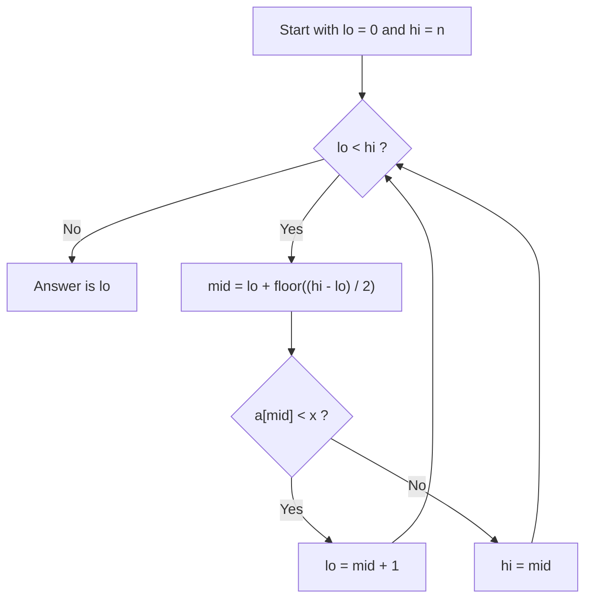

# Binary Search

> **Module 05 · Data Structures & Algorithms** · Prerequisites: [Divide and Conquer](24-Divide-and-Conquer.md) · Next: [Sorting Algorithms](26-Sorting-Algorithms.md)

---

## ⏱ If You Only Have 2 Minutes

- Binary search needs **sorted** input (or, more generally, a **monotonic** yes/no test). Each step throws away half of the remaining range, so `n` items take about `log2(n)` steps. A billion items take about 30 steps.
- Use one template everywhere: a **half-open** range `[lo, hi)`, start with `lo = 0`, `hi = n`, loop while `lo < hi`. Each step sets either `lo = mid + 1` or `hi = mid`. Never mix this with `hi = mid - 1` in the same code.
- **Lower bound** = first index where `a[i] >= x` (Python `bisect_left`). **Upper bound** = first index where `a[i] > x` (Python `bisect_right`). The number of copies of `x` is `upper - lower`.
- To find the first value that satisfies a yes/no test, search **on the answer**. The test must go `false, false, ..., true, true`. Then binary search over the possible answers.
- Compute the midpoint as `lo + (hi - lo) / 2`. In 32-bit languages `(lo + hi) / 2` can overflow. JavaScript numbers and Python integers do not overflow here, but the habit prevents real bugs elsewhere.
- Cost: O(log n) time and O(1) extra space for the iterative version.
- Backend uses: `git bisect` finds the first bad commit in O(log n) test runs. Sorted timestamps let a rate limiter count requests in a window with two binary searches.

---

## 1. What It Is and Why It Exists

**Binary search** finds a value, or the boundary between two kinds of values, in a sorted sequence. It looks at the middle element. If the middle is too small, the answer cannot be in the left half, so it throws that half away. If the middle is too large, it throws away the right half. It repeats on what is left.

**Analogy:** a dictionary. To find "queue", you do not start at page 1. You open near the middle, see that you have passed "queue", and move toward the front. Each look cuts the remaining pages roughly in half. A guessing game ("I am thinking of a number from 1 to 100") works the same way.

**The problem it solves.** A linear scan checks every element. That is O(n). On a sorted list of 10 million timestamps, a linear scan may check 10 million items to answer one question. Binary search checks about 24. Backend data is often sorted already: database index keys, log timestamps, release versions, sorted lists of IDs. Binary search turns those lookups from a scan into a handful of comparisons.

Binary search is also the easiest case of [divide and conquer](24-Divide-and-Conquer.md). Divide and conquer usually solves both halves. Binary search solves only one half and discards the other, so its work per step is constant.

The hard part is not the idea. It is getting the boundaries right. Many engineers can write a binary search that works on the first try for a simple case, but fail on duplicates, on empty arrays, or when the answer is "the first index that satisfies a condition". This chapter focuses on those details.

---

## 2. How It Works

The core loop keeps an **invariant**: a statement that is true before every iteration. For the lower bound search, the invariant is:

- every index before `lo` holds a value `< x`;
- every index at or after `hi` holds a value `>= x`;
- so the answer is always inside `[lo, hi]`.

The loop stops when `lo == hi`. At that moment the invariant says the answer is `lo`.

Here is the template as a flowchart:



### Trace on a small input

Input: `a = [1, 3, 3, 3, 7, 9, 12]`, so `n = 7`.

**Lower bound for x = 3** (first index with `a[i] >= 3`):

| Step | lo | hi | mid | a[mid] | Test | Action |
|---|---|---|---|---|---|---|
| 1 | 0 | 7 | 3 | 3 | 3 < 3 is false | hi = 3 |
| 2 | 0 | 3 | 1 | 3 | 3 < 3 is false | hi = 1 |
| 3 | 0 | 1 | 0 | 1 | 1 < 3 is true | lo = 1 |
| 4 | 1 | 1 | - | - | lo == hi, stop | answer 1 |

**Upper bound for x = 3** (first index with `a[i] > 3`):

| Step | lo | hi | mid | a[mid] | Test | Action |
|---|---|---|---|---|---|---|
| 1 | 0 | 7 | 3 | 3 | 3 <= 3 is true | lo = 4 |
| 2 | 4 | 7 | 5 | 9 | 9 <= 3 is false | hi = 5 |
| 3 | 4 | 5 | 4 | 7 | 7 <= 3 is false | hi = 4 |
| 4 | 4 | 4 | - | - | lo == hi, stop | answer 4 |

The count of 3s is `4 - 1 = 3`. The search never had to check a duplicate directly; the two bounds fall out of the same loop with one comparison changed.

### Why half-open ranges

With `[lo, hi)`, `hi` is one past the last candidate. Three things follow:

- `hi = n` is the correct start for an array of length `n`, with no `- 1`.
- The empty range `lo == hi` means "no candidates left", so the loop condition is simply `lo < hi`.
- When the answer may be "not present", returning `hi` or `lo` (equal to `n`) is a valid insertion point.

Inclusive ranges `[lo, hi]` can work too, but they need `hi = mid - 1` and `lo <= hi` in the loop. That combination is where most off-by-one bugs come from. Pick one template and use it every time.

---

## 3. Key Concepts

### Sorted or monotonic input

Binary search needs a rule that tells the search which side to keep. For a sorted array that rule is "compare `a[mid]` with `x`". More generally, the rule works whenever a test is **monotonic**: once it becomes true, it stays true. The sorted array is the simplest case, because "is `a[i] >= x`" is `false, false, ..., true, true` across the array.

If the input is not sorted, binary search returns garbage without an error. It will not crash; it will simply look in the wrong half. Sorting costs O(n log n), so sort once and search many times. Do not sort inside every lookup.

### The loop invariant and the template

The template in section 2 never needs special cases for one element or for two. A range of length 1 has `mid = lo`. If `a[lo] < x`, `lo` moves past the end and the loop ends with `lo = hi`. Otherwise `hi` moves to `lo` and the loop ends. Both outcomes return the right answer. There is no need to test `hi - lo == 1` separately.

### Lower bound and upper bound

| Name | Definition | Python | Typical use |
|---|---|---|---|
| Lower bound | first `i` with `a[i] >= x` | `bisect_left` | first occurrence, insertion point before equal items |
| Upper bound | first `i` with `a[i] > x` | `bisect_right` | last occurrence plus one, count of values `<= x` |

Both return `len(a)` when no element qualifies. Count of `x`: `upper - lower`. Count of values in `[L, R]`: `upperBound(R) - lowerBound(L)`.

### Overflow-safe midpoint

`mid = (lo + hi) / 2` is the classic line. In C, Java, or any language with fixed-width `int`, `lo + hi` can exceed the maximum `int` (2^31 - 1) when arrays are large. The result wraps around to a negative number and the program reads memory it should not. Joshua Bloch described this bug in Java's own library code in 2006.

The safe form is `mid = lo + (hi - lo) / 2`. Because `hi - lo` is never larger than the array length, it cannot overflow. The two languages in this handbook behave differently:

- **JavaScript** numbers are 64-bit floats. Integers are exact up to `Number.MAX_SAFE_INTEGER` (2^53 - 1), and arrays cannot be longer than 2^32 - 1, so `(lo + hi) / 2` is exact. But the bitwise operators `>>` and `>>>` work on 32-bit values, so do not use them for indices on large arrays.
- **Python** integers have arbitrary precision. `(lo + hi) // 2` never overflows.

Use the same safe form in both languages anyway. Habits carry over to Java, C, and Go, where the bug is real.

### Binary search on the answer

Sometimes you do not search an array at all. You search a range of possible answers, such as "the smallest capacity", "the smallest speed", or "the earliest day". The method has two parts:

1. A **predicate** `feasible(v)` that is cheap to check and monotonic: if `v` works, every larger `v` also works (or every smaller `v` works).
2. A search over `v` in `[low, high]` that finds the first value where the predicate is true.

The search cost is `O(log(high - low))` predicate calls. If each predicate costs O(n), the total is O(n log(high - low)). This pattern appears often in scheduling, capacity planning, and "minimum maximum" problems.

### Complexity

| Operation | Best | Average | Worst | Extra space | Why |
|---|---|---|---|---|---|
| Exact search in a sorted array | O(1) | O(log n) | O(log n) | O(1) | Best: the first midpoint is the target. Otherwise each step halves the range, so about log2(n) steps |
| Lower or upper bound | O(log n) | O(log n) | O(log n) | O(1) | The loop always runs until the range is empty, so every call takes about log2(n) steps |
| Binary search on the answer | O(log R) predicate calls | same | same | O(1) | R is the size of the answer range; each call halves it |
| Insert into a sorted array (`bisect.insort`) | O(log n) search | O(n) | O(n) | O(1) | Finding the spot is logarithmic, but later elements must shift one place to make room |

The space column is for the iterative version. A recursive version uses O(log n) stack frames. Amortized bounds do not apply here: there is no growing structure to average over.

---

## 4. Code Examples

Scenario: a sorted list of values, and two real problems from interviews: searching a rotated sorted array, and finding the smallest shipping capacity that delivers all packages in D days.

### Node.js / TypeScript

Node.js 22+ and TypeScript 5. JavaScript has no standard binary search helper for arrays. `indexOf`, `includes`, and `findIndex` all scan from the start, so they are O(n). The code below is hand-written.

```ts
// No dependencies. Node.js 22+, TypeScript 5. The input array must be sorted ascending.
import assert from "node:assert/strict";

// First index i with a[i] >= x. Returns a.length when every value is smaller than x.
// Invariant: indices before lo hold values < x; indices at or after hi hold values >= x.
export function lowerBound(a: readonly number[], x: number): number {
  let lo = 0;
  let hi = a.length; // half-open [lo, hi): hi is one past the last candidate
  while (lo < hi) {
    // lo + (hi - lo) / 2 cannot overflow in 32-bit arithmetic; (lo + hi) / 2 can.
    const mid = lo + Math.floor((hi - lo) / 2);
    if (a[mid] < x) lo = mid + 1; // a[mid] is too small, and so is everything before it
    else hi = mid;                // a[mid] >= x, so the answer is mid or earlier
  }
  return lo;
}

// First index i with a[i] > x. Returns a.length when no value is greater than x.
export function upperBound(a: readonly number[], x: number): number {
  let lo = 0;
  let hi = a.length;
  while (lo < hi) {
    const mid = lo + Math.floor((hi - lo) / 2);
    if (a[mid] <= x) lo = mid + 1;
    else hi = mid;
  }
  return lo;
}

// Index of the first occurrence of x, or -1. Built on lowerBound, so duplicates are handled.
export function indexOfSorted(a: readonly number[], x: number): number {
  const i = lowerBound(a, x);
  return i < a.length && a[i] === x ? i : -1;
}

// Quick checks: empty input, duplicates, value below and above the range, and a missing value.
assert.equal(lowerBound([], 5), 0);
assert.equal(lowerBound([1, 3, 3, 3, 7], 3), 1);
assert.equal(upperBound([1, 3, 3, 3, 7], 3), 4);
assert.equal(lowerBound([1, 3, 7], 0), 0);
assert.equal(lowerBound([1, 3, 7], 9), 3);
assert.equal(indexOfSorted([1, 3, 7], 2), -1);
```

Problems, using the same helpers as the Python block below:

```ts
// No dependencies. Node.js 22+, TypeScript 5.
import assert from "node:assert/strict";

// Problem 1: minimum ship capacity. Packages must ship in their given order.
// Find the smallest capacity so all packages ship within `days` days.
// Approach: binary search on the answer. "Can this capacity ship everything in time?" is monotonic.
// Time O(n log(sum of weights)), space O(1).
function daysNeeded(weights: readonly number[], capacity: number): number {
  let days = 1;
  let load = 0;
  for (const w of weights) {
    if (load + w > capacity) {
      days++;   // start a new day
      load = 0;
    }
    load += w;
  }
  return days;
}

export function minShipCapacity(weights: readonly number[], days: number): number {
  if (weights.length === 0 || days < 1) throw new RangeError("need packages and at least one day");
  // A capacity below the heaviest package never works. Everything in one day always works.
  let lo = weights.reduce((m, w) => Math.max(m, w), 0);
  let hi = weights.reduce((sum, w) => sum + w, 0);
  while (lo < hi) {
    const mid = lo + Math.floor((hi - lo) / 2);
    if (daysNeeded(weights, mid) <= days) hi = mid; // feasible: try a smaller capacity
    else lo = mid + 1;                              // infeasible: capacity must grow
  }
  return lo;
}

// Problem 2: search a rotated sorted array with distinct values, e.g. [4,5,6,7,0,1,2].
// Approach: at every step, one half around mid is sorted. Check if target lies in that sorted half.
// Time O(log n), space O(1). With duplicates the sorted half can be ambiguous, and the worst case is O(n).
export function searchRotated(nums: readonly number[], target: number): number {
  let lo = 0;
  let hi = nums.length;
  while (lo < hi) {
    const mid = lo + Math.floor((hi - lo) / 2);
    if (nums[mid] === target) return mid;
    if (nums[lo] <= nums[mid]) {
      // [lo, mid] is sorted. Is the target inside its value range?
      if (nums[lo] <= target && target < nums[mid]) hi = mid;
      else lo = mid + 1;
    } else {
      // [mid, hi) is sorted. Is the target inside its value range?
      if (nums[mid] < target && target <= nums[hi - 1]) lo = mid + 1;
      else hi = mid;
    }
  }
  return -1;
}

assert.equal(minShipCapacity([1, 2, 3, 4, 5, 6, 7, 8, 9, 10], 5), 15);
assert.equal(minShipCapacity([5], 1), 5);
assert.equal(searchRotated([4, 5, 6, 7, 0, 1, 2], 0), 4);
assert.equal(searchRotated([4, 5, 6, 7, 0, 1, 2], 3), -1);
assert.equal(searchRotated([1], 1), 0);
```

Built-ins in JavaScript: there is no standard sorted-array search. For sorted data you write the loop or use a small library. The fast path is to keep data in a structure that already supports ordered lookups, such as a `Map` for exact keys plus a sorted array of keys that you search once.

### Python

Python 3.12+. The standard library ships `bisect`, which is a tested, C-accelerated binary search. In production code, use it. The functions below show what it does and solve the same two problems.

```python
# Standard library only. Python 3.12+.
from bisect import bisect_left, bisect_right
from collections.abc import Sequence


def lower_bound(a: Sequence[int], x: int) -> int:
    """First index i with a[i] >= x, or len(a). Same result as bisect.bisect_left."""
    lo, hi = 0, len(a)  # half-open [lo, hi)
    while lo < hi:
        mid = lo + (hi - lo) // 2  # Python ints never overflow, but the safe form costs nothing
        if a[mid] < x:
            lo = mid + 1
        else:
            hi = mid
    return lo


def upper_bound(a: Sequence[int], x: int) -> int:
    """First index i with a[i] > x, or len(a). Same result as bisect.bisect_right."""
    lo, hi = 0, len(a)
    while lo < hi:
        mid = lo + (hi - lo) // 2
        if a[mid] <= x:
            lo = mid + 1
        else:
            hi = mid
    return lo


def index_of_sorted(a: Sequence[int], x: int) -> int:
    i = lower_bound(a, x)
    return i if i < len(a) and a[i] == x else -1


# Quick checks: empty input, duplicates, values outside the range, and a missing value.
assert lower_bound([], 5) == 0
assert lower_bound([1, 3, 3, 3, 7], 3) == 1
assert upper_bound([1, 3, 3, 3, 7], 3) == 4
assert lower_bound([1, 3, 7], 0) == 0
assert lower_bound([1, 3, 7], 9) == 3
assert index_of_sorted([1, 3, 7], 2) == -1
assert lower_bound([1, 3, 3, 3, 7], 3) == bisect_left([1, 3, 3, 3, 7], 3)  # the built-in agrees
assert upper_bound([1, 3, 3, 3, 7], 3) == bisect_right([1, 3, 3, 3, 7], 3)
```

Problems, using the same approach as the TypeScript block:

```python
# Standard library only. Python 3.12+.
from collections.abc import Sequence


# Problem 1: minimum ship capacity. Packages ship in order; find the smallest capacity
# that ships everything within `days` days.
# Approach: binary search on the answer. "Can this capacity work?" is monotonic.
# Time O(n log(sum of weights)), space O(1).
def days_needed(weights: Sequence[int], capacity: int) -> int:
    days, load = 1, 0
    for w in weights:
        if load + w > capacity:
            days += 1  # start a new day
            load = 0
        load += w
    return days


def min_ship_capacity(weights: Sequence[int], days: int) -> int:
    if not weights or days < 1:
        raise ValueError("need packages and at least one day")
    lo, hi = max(weights), sum(weights)  # the answer lies between the heaviest package and the total
    while lo < hi:
        mid = lo + (hi - lo) // 2
        if days_needed(weights, mid) <= days:
            hi = mid  # feasible: a smaller capacity might also work
        else:
            lo = mid + 1  # infeasible: capacity must grow
    return lo


# Problem 2: search a rotated sorted array with distinct values, e.g. [4,5,6,7,0,1,2].
# Approach: one half around mid is always sorted; check whether the target lies in that half.
# Time O(log n), space O(1). Duplicates make the sorted half ambiguous (worst case O(n)).
def search_rotated(nums: Sequence[int], target: int) -> int:
    lo, hi = 0, len(nums)
    while lo < hi:
        mid = lo + (hi - lo) // 2
        if nums[mid] == target:
            return mid
        if nums[lo] <= nums[mid]:  # [lo, mid] is sorted
            if nums[lo] <= target < nums[mid]:
                hi = mid
            else:
                lo = mid + 1
        else:  # [mid, hi) is sorted
            if nums[mid] < target <= nums[hi - 1]:
                lo = mid + 1
            else:
                hi = mid
    return -1


assert min_ship_capacity([1, 2, 3, 4, 5, 6, 7, 8, 9, 10], 5) == 15
assert min_ship_capacity([5], 1) == 5
assert search_rotated([4, 5, 6, 7, 0, 1, 2], 0) == 4
assert search_rotated([4, 5, 6, 7, 0, 1, 2], 3) == -1
assert search_rotated([1], 1) == 0
```

Built-ins in Python: the `bisect` module gives `bisect_left` (lower bound), `bisect_right` (upper bound), and `insort` / `insort_left` / `insort_right` to insert into a sorted list while keeping it sorted. Since Python 3.10 all of them accept a `key=` argument, so you can search a list of records by one field without building a separate key list. The built-ins do not search on answers; for that you write the loop as above.

**Runtime difference:** neither runtime needs a special binary search for performance. Both loops are O(log n) and run in one thread. The main difference is that Python's built-in `bisect` runs in C, so it is faster than a Python loop for large inputs. In Node.js the hand-written loop is already compiled by the JIT to machine code.

---

## 5. Production Concerns

- **Sorted storage costs.** A sorted array gives O(log n) lookups but O(n) inserts, because later elements shift. For data that changes often, use a balanced tree or a database index instead. A database [B-tree index](../Module-03-Databases/19-Indexes.md) keeps keys sorted in pages. Each page does a binary search over its keys, then follows one child pointer. The page is the unit of disk I/O, so the tree is usually only three or four levels deep for millions of rows.
- **Monotonicity bugs fail silently.** If the predicate is not monotonic, binary search returns a wrong answer without raising an error. Test the predicate at a few points around the boundary, and state the monotonic direction in a comment.
- **Floating-point search.** When the answer is a real number, `lo` and `hi` may never become equal. Loop a fixed number of times (for example, 60 to 100 halvings) rather than until the range is empty. Also say what precision you need.
- **Time windows.** To count events in the last `w` seconds, keep timestamps sorted (append in time order, which is already sorted for logs). Then `count = upper_bound(now) - lower_bound(now - w)`. Two binary searches cost O(log n), which is far cheaper than a scan for each request.
- **Locale-sensitive keys.** Binary search only works if the comparison is consistent with the sort order. Strings sorted with one collation (for example, `localeCompare`) and searched with another (plain `<`) return wrong results. Pick one comparison and use it for both.
- **Logs to keep.** Log the number of comparisons and the input size only when a search is slow. A search that takes 40 steps on a 10-element list is a bug in the data or in the predicate.

---

## 6. Common Mistakes

- **Infinite loop with `lo = mid`** — when `hi = lo + 1`, `mid` equals `lo`, so nothing changes and the loop never ends — always move one side past `mid` (`lo = mid + 1`) or use the half-open template where `hi = mid` always shrinks the range.
- **Mixing inclusive and half-open conventions** — `hi = n - 1` with `while (lo < hi)` skips the last element, or `hi = mid - 1` with `lo < hi` misses the answer — pick one template (`[lo, hi)` in this chapter) and do not change it inside a function.
- **Returning any match instead of the first** — with duplicates, `mid` may land on any copy, so `index` changes between runs and "first occurrence" queries break — use `lowerBound` / `bisect_left` for the first index.
- **Searching unsorted data** — the search silently looks in the wrong half and returns `-1` or a wrong index — sort once, then search; check the invariant in tests.
- **Overflow in fixed-width languages** — `(lo + hi) / 2` wraps around on large arrays — write `lo + (hi - lo) / 2`.
- **Wrong monotonic direction for the answer** — the search returns the largest feasible value instead of the smallest, or vice versa — write the predicate first, check that it flips once, and then decide which side to keep.

---

## 7. Comparison Table

Binary search is one way to answer "where is `x`?" The right choice depends on whether the data is sorted, whether it changes, and whether you need range queries.

| Method | Needs | Lookup | Range query (`x` to `y`) | Insert or delete | Best for |
|---|---|---|---|---|---|
| Linear scan | Nothing | O(n) | O(n) | O(1) append | Small or unsorted data |
| Binary search on a sorted array | Sorted array | O(log n) | O(log n) plus output size | O(n) | Read-mostly data, static lists, time-sorted logs |
| Hash table | Hashable keys | O(1) average | Not supported | O(1) average | Exact-match lookups, no ordering needed |
| Balanced tree or B-tree | Ordered keys | O(log n) | O(log n) plus output size | O(log n) | Frequently updated ordered data, database indexes |

If you only need exact matches and the data changes often, a hash table is usually better. If you need "the first value greater than 100" or any range query, binary search on a sorted array or an ordered tree is the right tool.

---

## 8. Interview Questions

**[Junior] Why does binary search need sorted input?**
Each step uses one comparison to decide which half can contain the answer. That decision is only valid if all values on one side are smaller than the middle value and all values on the other side are larger. Without sorted order, the middle value says nothing about the rest, so the search can throw away the half that contains the answer. Sorting costs O(n log n), so sort once if you will search many times.

**[Junior] What is the complexity of binary search, and why?**
O(log n) time, because each comparison halves the remaining range and the range starts at n elements. O(1) extra space for the iterative version, because it only stores `lo`, `hi`, and `mid`. A recursive version uses O(log n) stack frames.

**[Mid] How do you find the first occurrence of a value that appears many times?**
Use the lower bound. Keep the search going left: when `a[mid] >= x`, set `hi = mid` and do not return yet. The loop ends at the first index where `a[i] >= x`. Then check that this index holds `x`. In Python this is `bisect_left`. Upper bound (`bisect_right`) gives the position just after the last copy, and the count is the difference.

**[Mid] Why is `(lo + hi) / 2` risky, and what do you write instead?**
In languages with fixed-width integers, `lo + hi` can exceed the maximum value when the array is large, and the result wraps to a negative number. Write `lo + (hi - lo) / 2`, which never exceeds the upper bound of the range. JavaScript and Python do not overflow in this case, but the safe form keeps the code correct when it is ported.

**[Senior] Search a rotated sorted array in O(log n). What breaks with duplicates?**
At every step, one half around `mid` is sorted. Check whether the target falls inside the sorted half's value range. If it does, keep that half; otherwise keep the other one. With distinct values this always discards half the range. With duplicates, `nums[lo] == nums[mid]` does not tell you which half is sorted, so you cannot be sure which side to discard. The fix is to shrink both ends one step when the ambiguity appears, but then the worst case is O(n), for example when all values are equal except one.

**[Senior] Explain binary search on the answer. Why is the predicate monotonic for shipping capacity?**
You search the range of possible capacities, from the heaviest package to the total weight, for the smallest one where a greedy check succeeds. The check is "can every package ship in `days` days with this capacity?" If capacity `c` works, any larger capacity also works, because every day's load can only stay the same or get more room. So the answers go `no, no, ..., yes, yes`, and binary search finds the first yes. The cost is O(log(total)) calls to the check, and each check costs O(n), for O(n log(total)) overall.

**[Senior] A service has 500 million sorted request timestamps in a log and must answer "how many requests in the last 60 seconds?" for 1,000 queries per second. How do you design this?**
If the timestamps are stored in sorted order (append-only logs already are), each query is two binary searches: `upper_bound(now)` minus `lower_bound(now - 60)`. That is O(log n) per query, a few dozen comparisons even at that size. The data must stay sorted, so appends go at the end and nothing is inserted in the middle. If the store is a database, a B-tree index on the timestamp column gives the same behaviour with a range count. For very high write rates, switch to bucketed counters per second instead of raw timestamps, which trades exactness for memory.

---

## 9. Cheat Sheet

```text
Requirement    sorted input, or a monotonic yes/no test (false...false true...true)
Template       lo = 0, hi = n, while lo < hi: mid = lo + (hi - lo) / 2
               a[mid] < x  ->  lo = mid + 1     else  hi = mid
Lower bound    first i with a[i] >= x          Python bisect_left
Upper bound    first i with a[i] > x           Python bisect_right
Count of x     upper - lower
Not found      lower bound i, check i < n and a[i] == x
Answer search  binary search over candidate values; predicate must flip once
Midpoint       lo + (hi - lo) / 2  (safe for 32-bit ints)
Cost           O(log n) time, O(1) space iterative
Insert         search O(log n), but insert into array is O(n)
Floats         loop a fixed number of times, not until lo == hi
Built-ins      Python bisect (C speed, key= since 3.10); JS has none
Backend        git bisect (first bad commit), sorted timestamps for windows,
               B-tree index keys
```

---

## Related Topics

- [Divide and Conquer](24-Divide-and-Conquer.md) — binary search is divide and conquer that discards one half each step.
- [Arrays](05-Arrays.md) — random access is what makes each probe O(1); a linked list cannot support binary search efficiently.
- [Sorting Algorithms](26-Sorting-Algorithms.md) — binary search only works after sorting, and the sort is the expensive part.
- [Indexes](../Module-03-Databases/19-Indexes.md) — B-tree indexes search sorted keys in pages, the database form of this idea.
