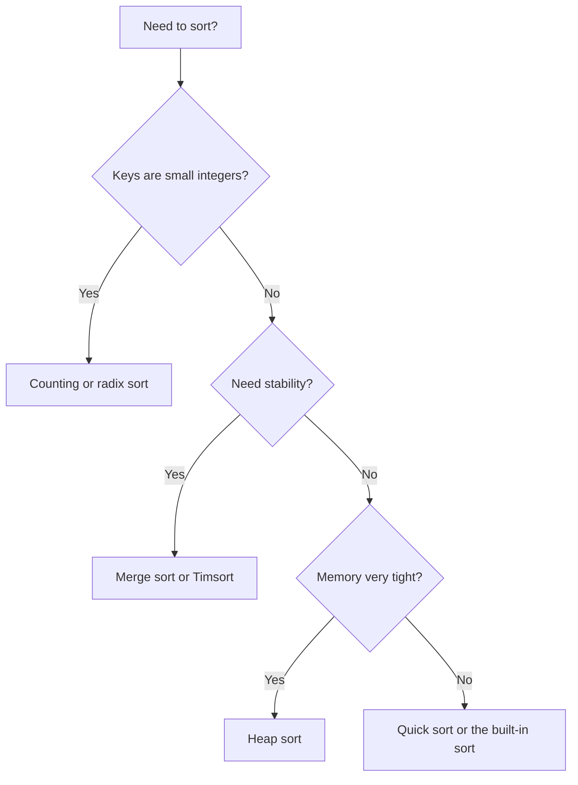

# Sorting Algorithms

> **Module 05 · Data Structures & Algorithms** · Prerequisites: [Binary Search](25-Binary-Search.md) · Next: [Merge Sort](27-Merge-Sort.md)

---

## ⏱ If You Only Have 2 Minutes

- A **comparison sort** cannot beat **Ω(n log n)** comparisons in the worst case. Every comparison gives one yes/no answer, and there are n! possible orders to tell apart.
- **Stable** means equal keys keep their original order. Stability matters when you sort by several keys in passes, and when a user sorts a table by one column after another.
- **Merge sort** and **Timsort** are stable and O(n log n) in the worst case. **Quick sort** and **heap sort** are not stable. Quick sort is O(n²) in the worst case; heap sort uses O(1) extra space.
- **Insertion sort** is O(n) on nearly sorted input and is the right tool for small arrays. Bubble and selection sort are teaching tools; do not use them in production.
- **Counting** and **radix** sort avoid comparisons. They run in O(n + k) or O(d(n + b)) time, but only for integers or keys with a small range.
- **Python** `sorted()` and `list.sort()` use **Timsort**, which is stable. **JavaScript** `Array.prototype.sort` must be stable (ES2019) and sorts **as strings** when you pass no comparator: `[10, 9, 1].sort()` gives `[1, 10, 9]`.

---

## 1. What It Is and Why It Exists

**Sorting** arranges items in order by a key, such as numeric value, alphabetical name, or creation time. Once data is sorted, you can use [binary search](25-Binary-Search.md) to find items in O(log n), find duplicates by scanning neighbours, merge two lists in one pass, or pick the top K without a full scan.

**Analogy:** sorting a hand of playing cards. Most people pick up one card at a time and slide it into the right place among the cards already in their hand. That is insertion sort. Another method is to lay all the cards out, pick the smallest, put it first, and repeat. That is selection sort.

**The problem it solves.** Ordering data is needed everywhere in a backend: `ORDER BY` in a database query, reports sorted by revenue, a list of jobs sorted by priority, a search result sorted by relevance. Without an efficient sort, each of these becomes a quadratic cost as the data grows. With 1 million rows, an O(n²) sort does about 10^12 comparisons, which takes hours. An O(n log n) sort does about 2 × 10^7, which takes well under a second in a compiled or JIT-compiled runtime.

This chapter gives the map. The next three chapters cover [merge sort](27-Merge-Sort.md), [quick sort](28-Quick-Sort.md), and [heap sort](29-Heap-Sort.md) in depth.

---

## 2. How It Works

Sorting algorithms fall into two families:

- **Comparison sorts** learn the order only by comparing two items at a time. Insertion, selection, bubble, merge, quick, heap, and Timsort are comparison sorts.
- **Distribution (non-comparison) sorts** use the values themselves, such as digits or small integers, to place items. Counting sort and radix sort are in this family.

The chapter first traces the simplest comparison sort, **insertion sort**, so you can see how an algorithm changes the array.

### Trace: insertion sort on `[5, 2, 4, 6, 1, 3]`

The sorted prefix grows from the left. Each step takes the next item (the key) and shifts larger items right until the key fits.

| Pass | Key | Shifts | Array after the pass |
|---|---|---|---|
| start | - | - | `[5, 2, 4, 6, 1, 3]` |
| i = 1 | 2 | 5 moves right | `[2, 5, 4, 6, 1, 3]` |
| i = 2 | 4 | 5 moves right | `[2, 4, 5, 6, 1, 3]` |
| i = 3 | 6 | none (6 >= 5) | `[2, 4, 5, 6, 1, 3]` |
| i = 4 | 1 | 6, 5, 4, 2 move right | `[1, 2, 4, 5, 6, 3]` |
| i = 5 | 3 | 6, 5, 4 move right | `[1, 2, 3, 4, 5, 6]` |

Each pass keeps the prefix `a[0..i-1]` sorted. The "shifts" are the work: an element moves only when it is strictly larger than the key, and equal elements never move past each other. That detail is why insertion sort is stable.

### The other classic O(n²) sorts, briefly

- **Bubble sort** walks the array and swaps neighbours that are out of order. After each pass the largest unsorted item reaches its place at the end. If a pass makes no swaps, it stops early, so it is O(n) on sorted input. Its only real use is teaching.
- **Selection sort** finds the minimum of the unsorted part and swaps it into place. It always does about n²/2 comparisons, even on sorted input, and it does at most n − 1 swaps, which can matter when writes are expensive.

### The O(n log n) sorts, in one line each

- [Merge sort](27-Merge-Sort.md) splits the array in half, sorts each half, and merges the two sorted halves.
- [Quick sort](28-Quick-Sort.md) partitions around a pivot and recurses on both sides.
- [Heap sort](29-Heap-Sort.md) builds a max-heap and repeatedly moves the top item to the end.

### Non-comparison sorts

- **Counting sort** counts how many times each value occurs in a range of size k, then writes the values out in order. Time O(n + k).
- **Radix sort** sorts integers one digit at a time, using a stable sort (often counting sort) for each digit. Time O(d(n + b)) for d digits in base b.

These sorts beat the n log n bound because they never compare two keys. They only work when the keys are integers or fixed-length strings in a known range.



---

## 3. Key Concepts

### Stability

A sort is **stable** if items with equal keys come out in the same order they went in. Example: sort customer orders by status. If two orders are both "paid", the one that was placed first should still come first. Stable sorts make multi-key sorts possible: sort by the secondary key first, then stable-sort by the primary key, and the secondary order survives inside each primary group.

Stability is a property of the algorithm and its implementation. Insertion sort and merge sort are stable when they compare with `<=` at the right place. Quick sort and heap sort are not stable without extra work, such as comparing indices as a tie-breaker.

### In-place sorting

An **in-place** sort uses O(1) extra space beyond the input (apart from the recursion stack). Heap sort and insertion sort are in-place. Merge sort on arrays needs a buffer of size n. Quick sort is in-place but uses O(log n) stack space on average.

### Adaptivity

An **adaptive** sort runs faster on input that is already partly sorted. Insertion sort is O(n) on sorted input. Timsort is O(n) on sorted and reverse-sorted runs, because it detects runs and merges them. Heap sort and merge sort are not adaptive in the basic form: they do the same O(n log n) work whatever the input.

### The Ω(n log n) lower bound for comparison sorts

For n distinct items there are n! possible orders. Each comparison answers a yes/no question, so it splits the remaining possibilities in two at most. A decision process that must identify one of n! orders needs at least log2(n!) comparisons. By Stirling's approximation, log2(n!) is about n log2 n. So no comparison sort can do better than Ω(n log n) comparisons in the worst case. This is why the best general sorts are O(n log n), and why O(n) sorting needs assumptions about the keys.

### Complexity

| Algorithm | Best | Average | Worst | Extra space | Stable | Adaptive |
|---|---|---|---|---|---|---|
| Bubble sort | O(n) | O(n²) | O(n²) | O(1) | Yes | Yes (with early exit) |
| Insertion sort | O(n) | O(n²) | O(n²) | O(1) | Yes | Yes |
| Selection sort | O(n²) | O(n²) | O(n²) | O(1) | No (in the usual swap form) | No |
| Merge sort | O(n log n) | O(n log n) | O(n log n) | O(n) | Yes | No |
| Quick sort | O(n log n) | O(n log n) | O(n²) | O(log n) stack | No | No |
| Heap sort | O(n log n) | O(n log n) | O(n log n) | O(1) | No | No |
| Timsort (Python, V8) | O(n) | O(n log n) | O(n log n) | O(n) | Yes | Yes |
| Counting sort | O(n + k) | O(n + k) | O(n + k) | O(n + k) | Yes (if placed stably) | No |
| Radix sort (d digits, base b) | O(d(n + b)) | same | same | O(n + b) | Yes | No |

Why each bound holds, in one line:

- **Insertion** is O(n) on sorted input because each key finds its place after one comparison. Its O(n²) worst case comes from reversed input, where each key shifts past the whole prefix.
- **Selection** always scans the rest of the array to find the minimum, so the sum is n + (n−1) + ... + 1, which is O(n²).
- **Merge** halves the input log2(n) times, and each level does O(n) merge work.
- **Quick** is O(n log n) when pivots split the input evenly, and O(n²) when each pivot removes only one element.
- **Heap** does n insertions or removals of O(log n) each.
- **Timsort** finds existing sorted runs in one pass, so already-sorted input needs only n − 1 comparisons.
- **Counting** does one pass to count, one pass over the k buckets, and one pass to write, so O(n + k).

---

## 4. Code Examples

Scenario: an order-management service needs to sort small batches of orders, count status codes in a bounded range, and sort orders by status and then by time without losing the time order.

### Node.js / TypeScript

Node.js 22+ and TypeScript 5. The built-in `Array.prototype.sort` is the right tool in production. These pitfalls show why you should know its rules:

- The default comparator converts values to strings and compares UTF-16 code units. So `[10, 9, 1].sort()` returns `[1, 10, 9]`. For numbers, pass `(a, b) => a - b`.
- A comparator must return a negative number, zero, or a positive number. A comparator that returns a boolean (`(a, b) => a > b`) is wrong, because `true` and `false` become 1 and 0. The order is then undefined.
- `sort` sorts in place and returns the same array. `toSorted` (ES2023, available in Node 22) returns a sorted copy and leaves the input alone.
- Since ES2019 the sort is **stable**. V8, the engine behind Node, uses Timsort.

```ts
// No dependencies. Node.js 22+, TypeScript 5.
import assert from "node:assert/strict";

export type Compare<T> = (a: T, b: T) => number;
export const numberAsc: Compare<number> = (a, b) => a - b;

// Insertion sort. Returns a sorted copy; the input array is not modified.
// Stable: an element moves only when the element before it is strictly greater.
// O(n) on sorted input, O(n^2) worst case, O(1) extra space.
export function insertionSort<T>(items: readonly T[], cmp: Compare<T>): T[] {
  const a = [...items];
  for (let i = 1; i < a.length; i++) {
    const key = a[i];
    let j = i - 1;
    while (j >= 0 && cmp(a[j], key) > 0) {
      a[j + 1] = a[j]; // shift the larger element one slot right
      j--;
    }
    a[j + 1] = key;
  }
  return a;
}

// Counting sort for integers in a bounded range. Handles negatives by subtracting the minimum.
// O(n + k) time and space, where k = max - min + 1. Do not use it when k is huge (for example, [1, 10^9]).
export function countingSort(values: readonly number[]): number[] {
  if (values.length <= 1) return [...values];
  let min = values[0];
  let max = values[0];
  for (const v of values) {
    if (v < min) min = v;
    if (v > max) max = v;
  }
  const counts = new Array<number>(max - min + 1).fill(0);
  for (const v of values) counts[v - min]++;
  const out: number[] = [];
  for (let offset = 0; offset < counts.length; offset++) {
    for (let c = 0; c < counts[offset]; c++) out.push(offset + min);
  }
  return out;
}

assert.deepEqual(insertionSort([5, 2, 4, 6, 1, 3], numberAsc), [1, 2, 3, 4, 5, 6]);
assert.deepEqual(insertionSort([], numberAsc), []);
assert.deepEqual(insertionSort([7], numberAsc), [7]);
assert.deepEqual(countingSort([3, -1, 3, 0]), [-1, 0, 3, 3]);
assert.deepEqual(countingSort([]), []);
assert.deepEqual([10, 9, 1].sort(), [1, 10, 9]); // the default string sort pitfall
assert.deepEqual([10, 9, 1].sort(numberAsc), [1, 9, 10]);
```

Problem: **sort orders by status, newest first within each status.** Status groups appear in the order pending, paid, shipped. The sort must be stable so that the newest-first order survives inside each group. Approach: sort by creation time descending, then stable-sort by status rank. Time O(n log n), space O(n) for the copy.

```ts
// No dependencies. Node.js 22+, TypeScript 5.
import assert from "node:assert/strict";

type Status = "pending" | "paid" | "shipped";
interface Order {
  id: string;
  status: Status;
  createdAt: number; // epoch milliseconds
}

const STATUS_RANK: Record<Status, number> = { pending: 0, paid: 1, shipped: 2 };

// Two passes. The second pass is stable, so the time order from the first pass
// survives inside each status group. This is the usual way to do a multi-key sort.
export function groupOrders(orders: readonly Order[]): Order[] {
  return [...orders]
    .sort((a, b) => b.createdAt - a.createdAt)                    // pass 1: newest first
    .sort((a, b) => STATUS_RANK[a.status] - STATUS_RANK[b.status]); // pass 2: stable by status
}

const grouped = groupOrders([
  { id: "a", status: "shipped", createdAt: 100 },
  { id: "b", status: "pending", createdAt: 300 },
  { id: "c", status: "paid", createdAt: 200 },
  { id: "d", status: "pending", createdAt: 400 },
]);
assert.deepEqual(grouped.map((o) => o.id), ["d", "b", "c", "a"]);
assert.deepEqual(groupOrders([]), []);
```

### Python

Python 3.12+. The built-in `sorted()` returns a new list, and `list.sort()` sorts in place and returns `None`. Both use **Timsort**, a hybrid of merge sort and insertion sort that finds and merges existing sorted runs. Both are stable. The `key=` argument computes one key per item, and `reverse=True` keeps stability (equal items still keep their original order). For a comparison function, use `functools.cmp_to_key`. A common mistake is `a = a.sort()`, which sets `a` to `None`.

```python
# Standard library only. Python 3.12+.
from collections.abc import Callable, Sequence
from typing import Any


def insertion_sort[T](items: Sequence[T], key: Callable[[T], Any] = lambda x: x) -> list[T]:
    """Returns a sorted copy. Stable: an element moves only when the one before it is strictly greater.

    O(n) on sorted input, O(n^2) worst case, O(1) extra space.
    """
    a = list(items)  # copy, so the caller's list is untouched
    for i in range(1, len(a)):
        current = a[i]
        k = key(current)  # compute the key once per element, not once per comparison
        j = i - 1
        while j >= 0 and key(a[j]) > k:  # strict >: equal keys never swap places
            a[j + 1] = a[j]
            j -= 1
        a[j + 1] = current
    return a


def counting_sort(values: Sequence[int]) -> list[int]:
    """Sort integers in a bounded range. O(n + k) time and space, k = max - min + 1.

    Use it only when k is small; [1, 10**9] would allocate a billion buckets.
    """
    if not values:
        return []
    lo, hi = min(values), max(values)
    counts = [0] * (hi - lo + 1)
    for v in values:
        counts[v - lo] += 1
    out: list[int] = []
    for offset, c in enumerate(counts):
        out.extend([offset + lo] * c)
    return out


assert insertion_sort([5, 2, 4, 6, 1, 3]) == [1, 2, 3, 4, 5, 6]
assert insertion_sort([]) == []
assert insertion_sort([7]) == [7]
assert counting_sort([3, -1, 3, 0]) == [-1, 0, 3, 3]
assert counting_sort([]) == []
assert sorted([10, 9, 1]) == [1, 9, 10]  # numbers compare numerically; no string pitfall
```

Problem: **sort orders by status, newest first within each status.** Approach: the same two-pass stable sort as the TypeScript version, using `sorted()` twice. Time O(n log n), space O(n).

```python
# Standard library only. Python 3.12+.
from collections.abc import Sequence
from dataclasses import dataclass
from typing import Literal

Status = Literal["pending", "paid", "shipped"]
STATUS_RANK: dict[str, int] = {"pending": 0, "paid": 1, "shipped": 2}


@dataclass(frozen=True)
class Order:
    id: str
    status: Status
    created_at: int  # epoch milliseconds


def group_orders(orders: Sequence[Order]) -> list[Order]:
    # Two passes. sorted() is stable, so the time order from the first pass
    # survives inside each status group. reverse=True also keeps stability.
    by_newest = sorted(orders, key=lambda o: o.created_at, reverse=True)
    return sorted(by_newest, key=lambda o: STATUS_RANK[o.status])


grouped = group_orders([
    Order("a", "shipped", 100),
    Order("b", "pending", 300),
    Order("c", "paid", 200),
    Order("d", "pending", 400),
])
assert [o.id for o in grouped] == ["d", "b", "c", "a"]
assert group_orders([]) == []
```

**Runtime difference:** both runtimes use a stable Timsort for their default sort, so the same two-pass recipe works in both. The difference is the default comparison. JavaScript's default sort compares strings, so you must pass a numeric comparator. Python's `sorted()` compares values by their own type, so numbers sort numerically, but mixing types (for example `int` and `str`) raises `TypeError` instead of silently coercing.

---

## 5. Production Concerns

- **Sorting costs CPU on the request path.** Sorting 100,000 records in a request handler blocks Node's event loop for the whole sort, because JavaScript runs on one thread. Push large sorts into the database with `ORDER BY` and an index that matches the sort order, or move them to a worker thread.
- **Locale and collation.** Strings sorted with `<` compare UTF-16 code units (JavaScript) or Unicode code points (Python). Human-facing lists usually need locale-aware order, such as `Intl.Collator` in JavaScript. The two orders disagree on accents and case, so pick one for each use and do not mix them.
- **Stability is a contract.** Do not rely on a sort being stable unless the API promises it. Stable sort is guaranteed by the ECMAScript spec and by Python's `sorted`. Other libraries may use unstable quick or heap sorts, and a bug that appears only with equal keys is hard to find.
- **Memory.** Merge-based sorts need a buffer about the size of the input. For data larger than memory, use an external sort, covered in [Merge Sort](27-Merge-Sort.md). Database engines spill to disk when a sort does not fit in memory.
- **Distribution sorts need a bounded key range.** Counting sort is fast for status codes (0 to 599) or small ages. It is a bad choice for arbitrary IDs or timestamps.
- **Measure before optimizing.** The built-in sorts are highly tuned. Writing your own sort is rarely faster in production. The real wins are usually avoiding a sort (keep an index in order) or sorting fewer items (filter first).

---

## 6. Common Mistakes

- **Default JavaScript sort on numbers** — `[10, 9, 1].sort()` returns `[1, 10, 9]` because the default compares strings — pass `(a, b) => a - b`.
- **Boolean comparator** — `(a, b) => a > b` returns only `true` or `false`, which is not a valid order — return a negative, zero, or positive number.
- **Assigning the result of `list.sort()` in Python** — `a = a.sort()` sets `a` to `None` — call `a.sort()` alone, or use `a = sorted(a)`.
- **Mutating input you did not own** — `arr.sort()` changes the caller's array, which surprises code that reuses it — use `toSorted()` in JavaScript or `sorted()` in Python.
- **Counting sort over a huge range** — `[1, 10^9]` allocates a billion buckets and runs out of memory — use a comparison sort when the key range is not small.
- **Assuming instability is harmless** — a quick sort reorders equal orders, so the earlier sort key is lost — use a stable sort or add the original index as a tie-breaker.
- **Sorting to find one value** — sorting all n items to get the minimum costs O(n log n) instead of O(n) — use a single pass for min or max, and quickselect or a heap for top K.

---

## 7. Comparison Table

| Sort | Average time | Extra space | Stable | Use it when |
|---|---|---|---|---|
| Insertion | O(n²) | O(1) | Yes | Very small arrays, or nearly sorted input; inside other algorithms |
| Merge | O(n log n) | O(n) | Yes | You need stability, guaranteed O(n log n), or external sorting |
| Quick | O(n log n) | O(log n) | No | Fast in-place sort on random-looking data; the usual default in C-family libraries |
| Heap | O(n log n) | O(1) | No | In-place with a worst-case bound, and stability is not needed |
| Timsort | O(n log n) | O(n) | Yes | Real data with existing runs; Python and V8 default |
| Counting or radix | O(n + k) | O(n + k) | Yes | Integer keys in a small range (or fixed-width digits) |

For a typical backend team, the answer is simple: call the built-in sort, which is stable and fast. Know the table so you can explain why, and know when the built-in is the wrong tool (bounded integer keys, huge data that does not fit in memory, or a custom ordering the sort cannot express).

---

## 8. Interview Questions

**[Junior] What is a stable sort, and why does it matter?**
A stable sort keeps items with equal keys in the order they had before sorting. It matters when you sort in passes. For example, you can sort orders by time, then stable-sort by status, and the orders stay in time order within each status. It also matters for user-facing tables, where clicking "sort by status" should not shuffle the rows that tie.

**[Junior] Why does JavaScript give `[1, 10, 9]` for `[10, 9, 1].sort()`?**
With no comparator, the default sort converts each value to a string and compares the strings by UTF-16 code units. "1" < "10" < "9" as strings. The fix is a numeric comparator, `(a, b) => a - b`. This is a classic interview trap, and it is a good reminder to read the API rules instead of assuming numeric order.

**[Mid] Can you sort faster than O(n log n)?**
Yes, but only without comparisons and only with assumptions about the keys. A comparison sort needs Ω(n log n) comparisons in the worst case, because there are n! possible orders and each comparison has two outcomes. Counting and radix sort avoid comparisons by using the key values directly. They run in O(n + k) or O(d(n + b)) time, which beats n log n when the range k or the digit count d is small.

**[Mid] When is insertion sort the right choice?**
For small arrays, and for nearly sorted input. Its constant factor is small, it is in-place, and it is stable. On data that is already almost in order it is O(n). Production sorts use it for short runs: Timsort uses insertion sort on small pieces before merging them. It is a poor choice for large random inputs, where it is O(n²).

**[Senior] Why is O(n log n) the best possible for a general comparison sort? Sketch the argument.**
Consider the sorting algorithm as a decision tree. Each internal node is a comparison with two outcomes, and each leaf is one output permutation. The input can be any of n! orderings, so the tree needs at least n! leaves. A binary tree with L leaves has depth at least log2(L). So the algorithm needs at least log2(n!) comparisons in the worst case. Stirling's approximation gives log2(n!) ≈ n log2 n. This bound holds for every comparison sort, including the ones in this chapter.

**[Senior] A service must sort 10 million records that do not fit in memory, by a key that is a 64-bit integer. Describe your approach.**
Use an external merge sort. Read chunks that fit in memory, sort each chunk with an in-place or Timsort-style sort, and write each sorted run to disk. Then merge the runs with a k-way merge that holds one item per run in a min-heap, writing the output sequentially. Use multiple passes if there are too many runs to hold open at once. Sequential I/O keeps the cost close to the disk's bandwidth. If the key has a small range or the records are fixed-width, a radix sort on the key can be faster. Details are in [Merge Sort](27-Merge-Sort.md).

**[Senior] Why does a database often sort with stability in mind, even though SQL's ORDER BY does not promise stable order?**
SQL's `ORDER BY` only defines order for the listed keys. Rows with equal keys may come back in any order, unless you add a unique tie-breaker such as the primary key. That is why pagination with `ORDER BY created_at` alone can skip or repeat rows across pages. Engines may use stable or unstable algorithms internally, so the query must not depend on it. The fix is to make the sort key unique, for example `ORDER BY created_at, id`.

---

## 9. Cheat Sheet

```text
Lower bound       Omega(n log n) comparisons for any comparison sort
Stable            equal keys keep their order (needed for multi-key sorts)
Insertion         O(n) best, O(n^2) worst, O(1) space, stable, adaptive
Selection         always O(n^2), O(1) space, unstable in the usual form
Merge             O(n log n) always, O(n) space, stable
Quick             O(n log n) avg, O(n^2) worst, O(log n) stack, unstable
Heap              O(n log n) always, O(1) space, unstable
Timsort           O(n) on runs, O(n log n) worst, stable (Python, V8)
Counting / radix  O(n + k) / O(d(n + b)), integers in a small range only
JS default sort   compares STRINGS: [10, 9, 1].sort() -> [1, 10, 9]
JS comparator     return negative / 0 / positive, never a boolean
JS copy           toSorted() (ES2023) leaves the input unchanged
Python            sorted() copies; list.sort() returns None; key= and reverse= keep stability
Multi-key sort    sort by secondary key, then stable-sort by primary key
Pagination        ORDER BY a unique key (add id) so pages do not overlap
```

---

## Related Topics

- [Merge Sort](27-Merge-Sort.md) — the stable O(n log n) divide-and-conquer sort, and external sorting for large data.
- [Quick Sort](28-Quick-Sort.md) — the fast in-place average-case sort, plus quickselect for top-K problems.
- [Heap Sort](29-Heap-Sort.md) — in-place O(n log n) sorting with a heap.
- [Query Execution Plans](../Module-03-Databases/22-Query-Execution-Plans.md) — where a database sort step shows up, and when it spills to disk.
