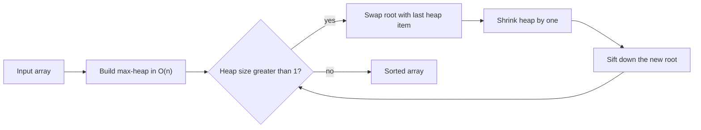

# Heap Sort

> **Module 05 · Data Structures & Algorithms** · Prerequisites: [Quick Sort](28-Quick-Sort.md) · Next: [Two Pointers](30-Two-Pointers.md)

---

## ⏱ If You Only Have 2 Minutes

- Heap sort has two phases: build a max-heap in O(n), then repeatedly move the largest item to the end and sift the new root down. The whole sort is **O(n log n) in every case**.
- It sorts **in place** with O(1) extra space. Quick sort uses O(log n) stack space on average, and merge sort needs O(n) extra space.
- It is **not stable**: equal keys can swap their relative order, because the root travels a long way through the array.
- Its memory access jumps between parents and children that are far apart in the array, so it has **poor cache locality**. In practice it is often slower than quick sort, even though its Big-O is better in the worst case.
- Library sorts use it as a **fallback**. Introsort starts as quick sort and switches to heap sort when recursion gets too deep, which keeps the worst case at O(n log n).
- A heap of size *k* solves "sort a k-sorted array" in O(n log k), because you only need to keep the next *k+1* candidates in order.

---

## 1. What It Is and Why It Exists

**Heap sort** sorts an array by building a **heap** inside it and then taking items out of the heap one at a time, largest first. A heap is a tree where each parent is greater than or equal to its children (a **max-heap**). The largest item is always at the top, so you can read it in O(1) and remove it in O(log n). See [Heaps](14-Heaps.md) for the data structure itself. This chapter uses the heap only as a sorting tool.

**Analogy:** think of a tournament bracket. The winner of the whole bracket is always the strongest player. When the winner leaves, the bracket is replayed among the rest, and the next winner comes out. Each replay is short because only the path from the vacant spot to the bottom has to be fixed.

**The problem it solves.** Quick sort is fast on average but has a bad worst case. Its runtime becomes O(n²) when the pivot is chosen badly again and again, and an attacker can build inputs that force this. Merge sort has a good worst case but needs O(n) extra memory. Heap sort is the sort that gives you both: a guaranteed O(n log n) bound and O(1) extra space. Those two properties are why it matters in memory-limited code and as the safety net inside faster sorts.

**The cost.** Heap sort is not stable, and it is usually slower than a well-written quick sort on real hardware because of how it accesses memory. You choose heap sort for guarantees, not for speed.

---

## 2. How It Works

The algorithm has two phases.

**Phase 1: build a max-heap (O(n)).** Treat the array as a complete binary tree. For a 0-based index *i*, the children are at `2i + 1` and `2i + 2`, and the parent is at `(i - 1) / 2` rounded down. Leaves are already one-item heaps, so you only need to fix the internal nodes. Go from the last internal node (index `floor(n/2) - 1`) back to index 0, and **sift down** each one. Sifting down means: compare the value with its two children, swap it with the larger child if that child is bigger, and repeat at the child's position until the value is not smaller than its children.

**Phase 2: extract the maximum (O(n log n)).** The heap holds the largest value at index 0. Swap index 0 with the last position of the heap, shrink the heap by one, and sift down the new root. The swapped-out maximum now sits in its final place, at the end of the array. Repeat until the heap has one item.

### Trace on a small input

Input: `[4, 10, 3, 5, 1]`, with n = 5.

| Step | Action | Array after the step |
|---|---|---|
| 0 | Start | `[4, 10, 3, 5, 1]` |
| 1 | Sift down index 1 (value 10): both children smaller, no change | `[4, 10, 3, 5, 1]` |
| 2 | Sift down index 0 (value 4): swap with 10 | `[10, 4, 3, 5, 1]` |
| 3 | Keep sifting value 4 at index 1: swap with child 5 at index 3 | `[10, 5, 3, 4, 1]` |
| 4 | Heap is ready. Swap index 0 with index 4, heap size 4 | `[1, 5, 3, 4, \| 10]` |
| 5 | Sift down 1: swap with 5, then with 4 | `[5, 4, 3, 1, \| 10]` |
| 6 | Swap index 0 with index 3, heap size 3 | `[1, 4, 3, \| 5, 10]` |
| 7 | Sift down 1: swap with 4 | `[4, 1, 3, \| 5, 10]` |
| 8 | Swap index 0 with index 2, heap size 2 | `[3, 1, \| 4, 5, 10]` |
| 9 | Swap index 0 with index 1, heap size 1 | `[1, \| 3, 4, 5, 10]` |

The bar (`|`) marks the sorted tail. The final array is `[1, 3, 4, 5, 10]`.



### Why the build is O(n), not O(n log n)

A node at height *h* (the number of levels below it) sifts down at most *h* steps. About half the nodes are leaves (height 0), a quarter have height 1, an eighth have height 2, and so on. The total work is the sum over *h* of (n / 2^(h+1)) × h, which is bounded by a constant times n. Building a heap by inserting items one at a time, by contrast, is O(n log n) in the worst case, so always use the bottom-up build.

### Why the extraction is O(n log n)

Phase 2 runs n − 1 times. Each sift-down follows one path from the root to a leaf, and a heap of size *m* has about log₂ *m* levels. So the total work is at most the sum of log₂ *m* for *m* from n down to 2, which is O(n log n).

---

## 3. Key Concepts

### Complexity

| Case | Time | Extra space | Why |
|---|---|---|---|
| Best | O(n log n) | O(1) | Even a sorted input is turned into a heap and then drained, so the extraction phase still does log-height sift-downs. (Only degenerate inputs, such as all keys equal, let sift-down stop early.) |
| Average | O(n log n) | O(1) | Build is O(n). Each of the n − 1 extractions sifts down a path of about log₂ n levels. |
| Worst | O(n log n) | O(1) | The bound above holds for any input, because the sift-down path length never exceeds log₂ n. |

Space is O(1) because the sort works only on the array it was given. The iterative sift-down uses a few variables, not recursion. A recursive version would use O(log n) stack space, which is why most implementations are iterative.

The bounds are the same for best, average and worst case, so the sort has no bad input shape. That is its main selling point. Quick sort, by contrast, has O(n²) worst case.

### Stability

A sort is **stable** when equal keys keep their original order. Heap sort is **not stable**. In the example `[2a, 2b, 1]` (two items with key 2, where `2a` came first), the algorithm produces `[1, 2b, 2a]`. The root element is moved to the end across many positions, and equal keys can pass each other. If you need stable sorting, use merge sort or Timsort. Heap sort also cannot be made stable with a simple tie-breaker unless you add the original index to each key.

### Cache locality

Heap sort's memory pattern is the weak point. Sift-down jumps from index *i* to `2i + 1` and then to `4i + 3`, so each step touches memory that is far away. Once the array is larger than the CPU cache, most of these accesses are cache misses. Quick sort partitions by scanning the array from both ends, which is sequential and prefetcher-friendly. So two algorithms with the same Big-O bound can differ by a large constant factor on real hardware.

### Heap sort inside introsort

Introsort (introspective sort, by David Musser, 1997) is the standard design for a general-purpose sort. It runs quick sort, switches to insertion sort for small slices, and switches to heap sort if the recursion depth exceeds about 2 × log₂ n. The depth limit means quick sort can never reach its O(n²) case. Heap sort then finishes that part in O(n log n). For example, C++ `std::sort` implementations use this design. Heap sort is rarely the main algorithm; it is the safety net.

### Heap sort versus the k-sorted problem

If every item is at most *k* positions away from its sorted place, you do not need a full sort. Keep a min-heap of the first *k + 1* items and pop its smallest item each time you read a new one. This is O(n log k), which beats O(n log n) when *k* is small. The code section shows this.

---

## 4. Code Examples

Scenario: sort a list of numeric scores in place, then sort a nearly sorted list where each element is at most *k* places from its correct spot.

### Node.js / TypeScript

```ts
// No npm packages. Node.js 22+, TypeScript 5, strict mode.

/** Push the value at `i` down until the subtree rooted at `i` is a max-heap.
 *  Only indices below `size` take part; the sorted tail is never touched. */
function siftDown(a: number[], i: number, size: number): void {
  let parent = i;
  for (;;) {
    const left = 2 * parent + 1;
    const right = left + 1;
    let largest = parent;
    // Strict `>` keeps equal items where they are. This is one reason the sort is unstable.
    if (left < size && a[left] > a[largest]) largest = left;
    if (right < size && a[right] > a[largest]) largest = right;
    if (largest === parent) return; // heap property holds at this node
    [a[parent], a[largest]] = [a[largest], a[parent]];
    parent = largest;
  }
}

/** Sort `values` ascending, in place. O(n log n) time, O(1) extra space, not stable. */
export function heapSort(values: number[]): number[] {
  const n = values.length;
  // Bottom-up build: start at the last internal node. This is O(n) in total.
  for (let i = Math.floor(n / 2) - 1; i >= 0; i--) siftDown(values, i, n);
  // Move the current maximum to the end, shrink the heap, and repair the root.
  for (let end = n - 1; end > 0; end--) {
    [values[0], values[end]] = [values[end], values[0]];
    siftDown(values, 0, end);
  }
  return values;
}

// Problem 1: sort an array in place with heap sort.
// Approach: the two phases above. Time O(n log n), space O(1).
// Edge cases: empty array, one item, duplicates.
console.log(heapSort([4, 10, 3, 5, 1])); // [1, 3, 4, 5, 10]
console.log(heapSort([])); // []
console.log(heapSort([2, 2, 1])); // [1, 2, 2]
```

Built-ins: JavaScript has no heap class. `Array.prototype.sort` is the standard sort. Since ES2019 it is required to be stable, and V8 uses Timsort. Use it by default. Write your own heap only when you need the heap operations themselves (for example a priority queue) or the O(1) extra space guarantee.

```ts
// Problem 2: sort an array where each item is at most k positions from its sorted place.
// Approach: keep a min-heap of the first k + 1 items. The heap's smallest item is always
// the next output, because no item further right can be smaller than it.
// Time O(n log k), space O(k).

class MinHeap {
  private readonly items: number[] = [];

  get size(): number {
    return this.items.length;
  }

  push(value: number): void {
    const a = this.items;
    a.push(value);
    let i = a.length - 1;
    while (i > 0) {
      const parent = (i - 1) >> 1;
      if (a[parent] <= a[i]) break;
      [a[parent], a[i]] = [a[i], a[parent]];
      i = parent;
    }
  }

  pop(): number {
    const a = this.items;
    if (a.length === 0) throw new RangeError("pop from an empty heap");
    const top = a[0];
    const last = a.pop()!; // pop() returns undefined only for an empty array; checked above
    if (a.length > 0) {
      a[0] = last;
      let i = 0;
      for (;;) {
        const left = 2 * i + 1;
        const right = left + 1;
        let smallest = i;
        if (left < a.length && a[left] < a[smallest]) smallest = left;
        if (right < a.length && a[right] < a[smallest]) smallest = right;
        if (smallest === i) break;
        [a[i], a[smallest]] = [a[smallest], a[i]];
        i = smallest;
      }
    }
    return top;
  }
}

export function sortKSorted(values: number[], k: number): number[] {
  if (k < 0) throw new RangeError("k must be >= 0");
  const heap = new MinHeap();
  for (const x of values.slice(0, k + 1)) heap.push(x);
  const out: number[] = [];
  for (const x of values.slice(k + 1)) {
    heap.push(x);
    out.push(heap.pop());
  }
  while (heap.size > 0) out.push(heap.pop());
  return out;
}

console.log(sortKSorted([2, 1, 4, 3, 6, 5], 1)); // [1, 2, 3, 4, 5, 6]
console.log(sortKSorted([3, 4, 5], 0)); // [3, 4, 5] (k = 0 means the input is already sorted)
console.log(sortKSorted([], 3)); // []
```

### Python

```python
# Standard library only. Python 3.12+.
from collections.abc import MutableSequence


def _sift_down(a: MutableSequence[int], i: int, size: int) -> None:
    """Push a[i] down until neither child is larger. Only indices below `size` are used."""
    while True:
        left = 2 * i + 1
        right = left + 1
        largest = i
        # Strict `>` keeps equal items in place. This is one reason the sort is unstable.
        if left < size and a[left] > a[largest]:
            largest = left
        if right < size and a[right] > a[largest]:
            largest = right
        if largest == i:
            return
        a[i], a[largest] = a[largest], a[i]
        i = largest


def heap_sort(values: list[int]) -> list[int]:
    """Sort ascending, in place. O(n log n) time, O(1) extra space, not stable."""
    n = len(values)
    # Bottom-up build from the last internal node. O(n) in total.
    for i in range(n // 2 - 1, -1, -1):
        _sift_down(values, i, n)
    # Move the maximum to the end, shrink the heap, and repair the root.
    for end in range(n - 1, 0, -1):
        values[0], values[end] = values[end], values[0]
        _sift_down(values, 0, end)
    return values


# Problem 1: sort an array in place with heap sort.
print(heap_sort([4, 10, 3, 5, 1]))  # [1, 3, 4, 5, 10]
print(heap_sort([]))  # []
print(heap_sort([2, 2, 1]))  # [1, 2, 2]
```

```python
# Problem 2: sort a k-sorted list (each item is at most k places from its sorted place).
# Approach: a min-heap of the first k + 1 items; pop the smallest, then read one more.
# Time O(n log k), space O(k).
import heapq


def sort_k_sorted(values: list[int], k: int) -> list[int]:
    if k < 0:
        raise ValueError("k must be >= 0")
    heap = values[: k + 1]
    heapq.heapify(heap)  # O(k)
    out: list[int] = []
    for x in values[k + 1 :]:
        # heappushpop pushes x and pops the smallest in one call (faster than push, then pop).
        out.append(heapq.heappushpop(heap, x))
    while heap:
        out.append(heapq.heappop(heap))
    return out


print(sort_k_sorted([2, 1, 4, 3, 6, 5], 1))  # [1, 2, 3, 4, 5, 6]
print(sort_k_sorted([3, 4, 5], 0))  # [3, 4, 5]
print(sort_k_sorted([], 3))  # []
```

Built-ins: Python's `heapq` module gives a **min-heap** only. For a max-heap, store negated values. It provides `heapify` (O(n)), `heappush` and `heappop` (O(log n) each), and `heappushpop`. `list.sort()` and `sorted()` use Timsort, which is stable, has O(n log n) worst case, and needs O(n) extra space. Use them in production. `heapq.nsmallest(k, items)` and `heapq.nlargest(k, items)` are the built-in top-K helpers.

**Runtime difference to notice:** the TypeScript version has to implement its own min-heap class. Python gives you a tested one, so the code is shorter. Both versions use the same idea.

---

## 5. Production Concerns

- **Do not hand-roll sorting for ordinary data.** Library sorts (Timsort in Python and JavaScript, introsort in C++) are tuned for real hardware and are stable where the API promises it. Use heap sort when you need its specific guarantees: O(1) extra space and a bounded O(n log n) worst case.
- **Memory-limited environments.** On a small device or inside a tight memory budget, the O(1) extra space matters. Merge sort may need a second array as large as the input. Heap sort does not.
- **Top-K is the heap you use in production.** Keeping the K largest items from a stream takes a heap of size K, not a full sort. This is the same structure as heap sort. PostgreSQL can show `Sort Method: top-N heapsort` in `EXPLAIN` output when a query uses `ORDER BY ... LIMIT`, so you will see this idea in query plans.
- **Comparators must be consistent.** Sorting with a comparator that is not a total order (for example, a `NaN` in a JavaScript comparator, or a comparison that changes between calls) gives wrong results or meaningless ordering. Heap sort does not detect this. Validate keys before sorting them.
- **Adversarial input.** A naive quick sort can be forced to O(n²) by crafted input (McIlroy's "killer adversary", 1999). Heap sort has no such input, which is why libraries use it as the fallback. It is a real defence in any system that sorts data an attacker can shape.
- **Measure before you choose.** On a modern machine, quick sort or Timsort is usually faster than heap sort for ordinary arrays. Benchmark with realistic sizes before you change a sort. A large array that does not fit in cache will show the gap.

---

## 6. Common Mistakes

- **Claiming O(n) build with repeated inserts** — inserting *n* items one at a time costs O(n log n) in the worst case — use the bottom-up `heapify` (sift down from `floor(n/2) - 1` to 0).
- **Forgetting to shrink the heap** — after the swap, the sift-down touches the sorted tail and corrupts the output — pass the current heap size (`end`) into every sift-down.
- **Assuming the sort is stable** — equal records change order, which breaks multi-key sorting done in several passes — use merge sort or Timsort when stability matters.
- **Using a min-heap for "largest first" in Python** — `heapq` is a min-heap, so you get the smallest first — negate the values, or write a comparator wrapper.
- **Off-by-one in child indices** — the children of `i` are `2i + 1` and `2i + 2`, not `2i` and `2i + 1` — use the 0-based formulas consistently and test on a two-item array.
- **Choosing heap sort for nearly sorted data** — insertion sort and Timsort run in O(n) on nearly sorted input, but heap sort always does O(n log n) work — use the k-sorted heap (O(n log k)) or a stable adaptive sort.

---

## 7. Comparison Table

| Algorithm | Best | Average | Worst | Extra space | Stable | Notes |
|---|---|---|---|---|---|---|
| Heap sort | n log n | n log n | n log n | O(1) | No | Guaranteed bound, poor cache locality |
| Quick sort | n log n | n log n | n² | O(log n) average stack | No | Fastest in practice, bad worst case without defences |
| Merge sort | n log n | n log n | n log n | O(n) | Yes | Good for linked lists and external data |
| Timsort (Python, V8) | n | n log n | n log n | O(n) | Yes | Adapts to existing runs; the common default |

Heap sort's only advantage over merge sort is memory. Its only advantage over quick sort is the worst case. Timsort beats it on nearly sorted input and is stable. Pick heap sort when you need the O(1) extra space and a guaranteed bound together.

---

## 8. Interview Questions

**[Junior] What are the two phases of heap sort?**
First, build a max-heap from the array. Start at the last non-leaf node and sift each node down, which takes O(n) time. Second, repeatedly swap the root (the maximum) with the last item of the heap, shrink the heap by one, and sift the new root down. Each step puts one item in its final position, so the sort takes O(n log n) time in total.

**[Junior] How do you find the children of index `i` in an array-based heap?**
With 0-based indices, the left child is `2i + 1`, the right child is `2i + 2`, and the parent of `i` is `floor((i - 1) / 2)`. Because the tree is complete, the array has no gaps and no pointers are needed. This is also why the heap uses less memory than a pointer-based tree.

**[Mid] Why is building a heap O(n) and not O(n log n)?**
Most nodes are near the bottom of the tree. About half are leaves, which need no work. A node at height *h* needs at most *h* swaps, and there are about n / 2^(h+1) nodes at each height. The sum of these costs is a convergent series, so the total is linear in n.

**[Mid] When would you choose heap sort over quick sort or merge sort?**
Choose heap sort when you need a guaranteed O(n log n) bound and O(1) extra memory, for example in a memory-constrained component or inside a library's introsort fallback. Choose quick sort for raw speed on ordinary arrays. Choose merge sort when you need stability or when you sort linked lists or external data.

**[Senior] Heap sort has a better worst case and less memory than quick sort, yet most standard libraries use quick sort (or a variant) as their main algorithm. Why?**
Big-O hides constants. Heap sort jumps between parent and child positions that are far apart, so on large arrays it incurs many cache misses. Quick sort scans memory sequentially and partitions in place with good locality, so it runs several times faster in practice on typical hardware. Libraries keep quick sort as the main path and switch to heap sort only when recursion gets too deep. That gives the speed of quick sort on typical input and a guaranteed bound on adversarial input.

**[Senior] You need the 100 largest events from a stream of a billion records that do not fit in memory. How do you do it?**
Keep a min-heap of size 100. For each record, if the heap is smaller than 100 push it; otherwise compare it with the heap's minimum and replace the minimum if the new record is larger. Each record costs O(log 100), and memory is O(100). Sorting the whole stream would need O(n) memory and O(n log n) time, which is not needed here. For data on disk, read it in chunks and merge the results with the same heap idea.

**[Senior] Design question: how would you sort 10 GB of log lines on a machine with 1 GB of RAM?**
Heap sort's O(1) space does not solve this, because the data does not fit in RAM and random access on disk is slow. Use an external sort. Split the input into chunks that fit in memory, sort each chunk with a fast in-memory sort, write each sorted run to disk, and then merge the runs. A k-way merge with a min-heap of k run heads picks the next line in O(log k) time. Keep the sort stable if records with equal timestamps must keep their original order.

---

## 9. Cheat Sheet

```text
Idea          build max-heap (O(n)), then n-1 times: swap root to end, shrink, sift down
Children      2i+1, 2i+2     Parent  (i-1)//2     Build starts at floor(n/2)-1
Time          O(n log n) best, average and worst   (build O(n), extraction O(n log n))
Space         O(1) extra, in place
Stable        NO (strict > keeps equal items in place, but the root still moves far)
Cache         poor: far-apart accesses; quick sort is usually faster in practice
Use it when   guaranteed bound + O(1) memory; introsort fallback; top-K via a heap
K-sorted      min-heap of k+1 items, O(n log k)
Python        heapq = min-heap only (negate for max); list.sort = Timsort (stable)
TypeScript    no heap built-in; Array.prototype.sort is stable (ES2019)
Avoid         nearly sorted input (use Timsort / insertion); stability requirement
Pitfall       forgetting to pass the shrinking heap size into sift-down
```

---

## Related Topics

- [Heaps](14-Heaps.md) — the heap data structure, sift-up and sift-down in depth
- [Quick Sort](28-Quick-Sort.md) — the faster average-case sort that heap sort backs up in introsort
- [Merge Sort](27-Merge-Sort.md) — the stable O(n log n) alternative that needs O(n) extra space
- [Priority Queue](13-Priority-Queue.md) — the top-K and scheduling uses of the same heap
- [Sorting Algorithms](26-Sorting-Algorithms.md) — how all the sorts compare on stability, memory and speed
