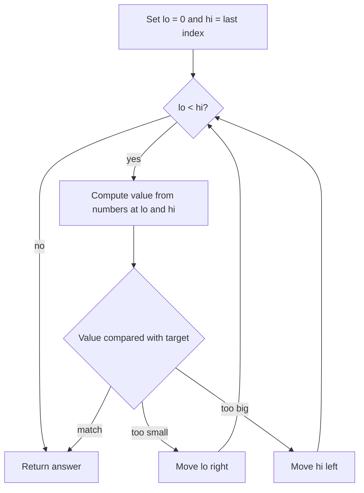

# Two Pointers

> **Module 05 · Data Structures & Algorithms** · Prerequisites: [Heap Sort](29-Heap-Sort.md) · Next: [Sliding Window](31-Sliding-Window.md)

---

## ⏱ If You Only Have 2 Minutes

- Two pointers keep two indexes into one array (or two arrays) and move them under a clear rule, so each element is visited once instead of once per pair.
- **Opposite direction:** start one pointer at the left end and one at the right end, and move them toward each other. This needs **sorted** input for pair-sum problems.
- **Same direction:** a slow pointer and a fast pointer (or a read pointer and a write pointer) both move left to right. Use this for merging, filtering, and in-place removal.
- The speed-up comes from ruling out work: when a move is provably safe, the pointer that moves never has to come back. Turning O(n²) brute force into O(n) is the usual result.
- Each solution rests on an **invariant**, a statement that stays true after every step. For Two Sum II it is "no valid pair lies outside the window `[lo, hi]`."
- Typical interview bugs are off-by-one errors in the loop condition (`<` versus `<=`), forgetting the sorted precondition, and moving the wrong pointer.

---

## 1. What It Is and Why It Exists

The **two pointers** technique uses two indexes that move through a sequence according to a fixed rule. Each index is a number that points at a position in an array. Instead of checking every pair of items with nested loops, you move the pointers so that each step either finds the answer or rules out a whole group of candidates.

**Analogy:** imagine you are checking whether two people in a line of sorted heights add up to a given total. You stand one person at the shortest end and one at the tallest end. If the pair is too tall, you step down the tall end. If it is too short, you step up the short end. You never have to compare the same pair twice, and you never walk backwards.

**The problem it solves.** The brute-force method for "find two numbers that sum to a target" compares every pair. With n items that is n(n − 1) / 2 comparisons, which is O(n²). With a million items you would do about 500 billion checks. Two pointers solve the same problem in about a million steps, because each pointer only moves forward through the array. Many other problems have the same shape: merging two sorted lists, removing duplicates in place, and finding the largest container between two walls.

**The cost.** The pattern depends on a property of the input, usually sorted order. If the input is not sorted, you either sort it first (O(n log n)) or use a different tool such as a hash map. Two pointers also demand careful reasoning about each move. The code is short, but the proof of correctness is where the interview points are.

---

## 2. How It Works

There are two families. The pattern is the same in both: keep an **invariant**, move a pointer only when that move is safe, and stop when the pointers meet or the answer is found.

### Opposite-direction pointers

Start `lo = 0` and `hi = n − 1`. At each step, compute a value from `numbers[lo]` and `numbers[hi]` and decide which pointer to move:

- If the value is too small, move `lo` right to get a larger value.
- If the value is too big, move `hi` left to get a smaller value.

The invariant for Two Sum II on a sorted array: every pair with a left index below `lo` or a right index above `hi` has already been ruled out. The reason a move is safe: if `numbers[lo] + numbers[hi]` is smaller than the target, then `numbers[lo]` cannot pair with any index at or below `hi`, because each of those values is no larger than `numbers[hi]`. So `lo` can move on.

### Same-direction pointers

Both pointers move left to right, at different speeds or with different jobs:

- **Read and write pointers** (in-place filtering): `read` scans every element; `write` marks where the next kept element goes. Everything before `write` is the result so far.
- **Merge pointers** (two sorted inputs): one pointer per input. Each step outputs the smaller current value and advances only that input.
- **Fast and slow pointers** (linked lists, cycle detection): `fast` moves two steps for each step of `slow`. This is covered in the linked-list chapter, not here.

### Trace: Two Sum II

Input: `numbers = [1, 3, 4, 6, 8]`, `target = 10`.

| Step | lo | hi | numbers[lo] + numbers[hi] | Decision |
|---|---|---|---|---|
| 1 | 0 | 4 | 1 + 8 = 9 | 9 < 10, so move lo right |
| 2 | 1 | 4 | 3 + 8 = 11 | 11 > 10, so move hi left |
| 3 | 1 | 3 | 3 + 6 = 9 | 9 < 10, so move lo right |
| 4 | 2 | 3 | 4 + 6 = 10 | Match. Return indices `[2, 3]` |

Only four comparisons were needed. The brute force would check up to ten pairs.

### Trace: Container With Most Water

Input: heights `[1, 8, 6, 2, 5, 4, 8, 3, 7]`. The area between walls `lo` and `hi` is `(hi − lo) × min(height[lo], height[hi])`.

| lo | hi | Area | Best so far | Move |
|---|---|---|---|---|
| 0 | 8 | 1 × 8 = 8 | 8 | shorter wall is index 0 (height 1), so lo++ |
| 1 | 8 | 7 × 7 = 49 | 49 | shorter wall is index 8 (height 7), so hi-- |
| 1 | 7 | 6 × 3 = 18 | 49 | hi-- |
| 1 | 6 | 5 × 8 = 40 | 49 | equal heights, so hi-- |
| 1 | 5 | 4 × 4 = 16 | 49 | hi-- |
| 1 | 4 | 3 × 5 = 15 | 49 | hi-- |
| 1 | 3 | 2 × 2 = 4 | 49 | hi-- |
| 1 | 2 | 1 × 6 = 6 | 49 | hi-- ends the loop |

The answer is 49, from walls at indexes 1 and 8.



### Why it is O(n)

In an opposite-direction scan, `lo` only increases and `hi` only decreases. The loop stops when they meet, so the total number of moves is at most n − 1. Each move does O(1) work. The same argument applies to read and write pointers: `read` increases by one each step and `write` never passes `read`, so there are at most n steps.

---

## 3. Key Concepts

### The invariant

An invariant is the claim that stays true before and after every loop iteration. It is how you prove correctness. For two pointers, the claim is usually about what has been ruled out:

- Two Sum II: every pair outside `[lo, hi]` has been ruled out.
- Container: every container whose walls lie outside `[lo, hi]` is no better than the best one already found.
- Remove duplicates: `nums[0 .. write − 1]` holds the unique values seen so far, in order.

State the invariant before you write the loop. If you cannot state it, the move rule is probably wrong.

### Preconditions

Two pointers rely on one property of the input. For pair sums it is sorted order. For merge it is that each input is sorted. For container it is no order at all, but the rule "move the shorter wall" needs the area formula to be correct. Always state the precondition in the interview, and handle inputs that break it, either by sorting first or by rejecting the input.

### Opposite versus same direction

| | Opposite direction | Same direction |
|---|---|---|
| Typical problems | Pair sum, container, palindrome check, 3Sum | Merge, remove duplicates, partition, filter in place |
| Starting point | Both ends | Both at the start |
| Stop condition | Pointers meet or cross | Read pointer reaches the end |
| Needs sorted input? | Usually yes | Usually yes for merge and dedupe |

### Complexity

| Problem | Best time | Average time | Worst time | Extra space | Why |
|---|---|---|---|---|---|
| Two Sum II (sorted) | O(1) | O(n) | O(n) | O(1) | Best: the first pair matches. Worst: the pointers cross with no match, about n moves. |
| Container With Most Water | O(n) | O(n) | O(n) | O(1) | Every step moves one pointer, and the loop ends after at most n − 1 moves, whatever the heights. |
| Merge two sorted arrays | O(n + m) | O(n + m) | O(n + m) | O(n + m) for the output | Every element is written to the output once. |
| Remove duplicates in place | O(n) | O(n) | O(n) | O(1) | `read` visits each element once. `write` never exceeds `read`. |

The "best" column for Two Sum II is O(1) only because it returns at the first comparison. Treat O(n) as the bound you should quote for the average and worst case. Two pointers do not change the sorting cost: if the input is unsorted, add O(n log n) for the sort, or use a hash map for O(n) time and O(n) space.

---

## 4. Code Examples

Scenario: a backend job receives sorted lists of timestamps or scores. It merges two sorted feeds, removes duplicate values in place, and finds pairs and container-style areas in sorted data.

### Node.js / TypeScript

```ts
// No npm packages. Node.js 22+, TypeScript 5, strict mode.

/** Merge two sorted arrays into one sorted array. O(n + m) time, O(n + m) space. */
export function mergeSorted(a: readonly number[], b: readonly number[]): number[] {
  const out: number[] = [];
  let i = 0;
  let j = 0;
  while (i < a.length && j < b.length) {
    // `<=` takes from `a` on ties, so equal items keep their original order (a stable merge).
    if (a[i] <= b[j]) out.push(a[i++]);
    else out.push(b[j++]);
  }
  // One input is exhausted; the other is already sorted, so copy its tail as it is.
  while (i < a.length) out.push(a[i++]);
  while (j < b.length) out.push(b[j++]);
  return out;
}

/** Problem 3: remove duplicates from a sorted array in place. Returns the new length.
 *  Approach: `read` scans; `write` is where the next unique value goes.
 *  O(n) time, O(1) extra space. Only nums[0 .. length - 1] is meaningful afterwards. */
export function removeDuplicates(nums: number[]): number {
  if (nums.length === 0) return 0;
  let write = 1; // nums[0] is always kept
  for (let read = 1; read < nums.length; read++) {
    // Compare with the last value we kept. That value is what makes "duplicate" well-defined.
    if (nums[read] !== nums[write - 1]) {
      nums[write] = nums[read];
      write++;
    }
  }
  return write;
}

console.log(mergeSorted([1, 4, 7], [2, 3, 8, 9])); // [1, 2, 3, 4, 7, 8, 9]
console.log(mergeSorted([], [])); // []
const nums = [1, 1, 2, 2, 2, 3];
const len = removeDuplicates(nums);
console.log(nums.slice(0, len)); // [1, 2, 3]
console.log(removeDuplicates([])); // 0
```

Built-ins: JavaScript has no two-pointer helper. `Array.prototype.sort` sorts in place (and is stable since ES2019), so sort first when the input is unsorted. `Array.prototype.splice` removes items but shifts the array each time, which is O(n) per call. That is why in-place removal uses a write pointer and not repeated `splice`.

```ts
// Problem 1: Two Sum II. Given a sorted array and a target, return the indices of two
// numbers that add up to the target, or null.
// Approach: opposite-direction pointers. Time O(n), space O(1).
export function twoSumSorted(numbers: readonly number[], target: number): [number, number] | null {
  let lo = 0;
  let hi = numbers.length - 1;
  while (lo < hi) {
    const total = numbers[lo] + numbers[hi];
    if (total === target) return [lo, hi];
    if (total < target) lo++; // too small: only a larger left value can help
    else hi--; // too big: only a smaller right value can help
  }
  return null;
}

// Problem 2: Container With Most Water. Heights are the walls; find the two walls
// that hold the most water. Approach: always move the shorter wall. Time O(n), space O(1).
export function maxArea(heights: readonly number[]): number {
  let lo = 0;
  let hi = heights.length - 1;
  let best = 0;
  while (lo < hi) {
    best = Math.max(best, (hi - lo) * Math.min(heights[lo], heights[hi]));
    // Moving the taller wall cannot raise the height limit, and it shrinks the width.
    if (heights[lo] < heights[hi]) lo++;
    else hi--;
  }
  return best;
}

console.log(twoSumSorted([1, 3, 4, 6, 8], 10)); // [2, 3]
console.log(twoSumSorted([1, 2], 10)); // null
console.log(twoSumSorted([], 0)); // null
console.log(maxArea([1, 8, 6, 2, 5, 4, 8, 3, 7])); // 49
console.log(maxArea([])); // 0
```

### Python

```python
# Standard library only. Python 3.12+.


def merge_sorted(a: list[int], b: list[int]) -> list[int]:
    """Merge two sorted lists. O(n + m) time, O(n + m) space."""
    out: list[int] = []
    i = j = 0
    while i < len(a) and j < len(b):
        # `<=` takes from `a` on ties, so equal items keep their original order.
        if a[i] <= b[j]:
            out.append(a[i])
            i += 1
        else:
            out.append(b[j])
            j += 1
    # One list is exhausted; the other is already sorted. Slicing copies its tail.
    out.extend(a[i:])
    out.extend(b[j:])
    return out


def remove_duplicates(nums: list[int]) -> int:
    """Problem 3: keep one copy of each value in a sorted list, in place. Returns the new length.
    O(n) time, O(1) extra space. Only nums[:length] is meaningful; `del nums[length:]` trims it."""
    if not nums:
        return 0
    write = 1  # nums[0] is always kept
    for read in range(1, len(nums)):
        if nums[read] != nums[write - 1]:  # compare with the last value we kept
            nums[write] = nums[read]
            write += 1
    return write


print(merge_sorted([1, 4, 7], [2, 3, 8, 9]))  # [1, 2, 3, 4, 7, 8, 9]
print(merge_sorted([], []))  # []
values = [1, 1, 2, 2, 2, 3]
length = remove_duplicates(values)
del values[length:]
print(values)  # [1, 2, 3]
print(remove_duplicates([]))  # 0
```

```python
# Problem 1: Two Sum II. Given a sorted list and a target, return the indices of two
# numbers that add up to the target, or None.
# Approach: opposite-direction pointers. Time O(n), space O(1).
def two_sum_sorted(numbers: list[int], target: int) -> tuple[int, int] | None:
    lo, hi = 0, len(numbers) - 1
    while lo < hi:
        total = numbers[lo] + numbers[hi]
        if total == target:
            return lo, hi
        if total < target:
            lo += 1  # too small: only a larger left value can help
        else:
            hi -= 1  # too big: only a smaller right value can help
    return None


# Problem 2: Container With Most Water. Approach: always move the shorter wall.
# Time O(n), space O(1).
def max_area(heights: list[int]) -> int:
    lo, hi, best = 0, len(heights) - 1, 0
    while lo < hi:
        best = max(best, (hi - lo) * min(heights[lo], heights[hi]))
        # Moving the taller wall cannot raise the height limit, and it shrinks the width.
        if heights[lo] < heights[hi]:
            lo += 1
        else:
            hi -= 1
    return best


print(two_sum_sorted([1, 3, 4, 6, 8], 10))  # (2, 3)
print(two_sum_sorted([1, 2], 10))  # None
print(max_area([1, 8, 6, 2, 5, 4, 8, 3, 7]))  # 49
print(max_area([]))  # 0
```

Built-ins: Python's `heapq.merge(a, b)` is the standard k-way merge of sorted iterables. It is lazy and uses a heap internally, so it costs O(n log k) for k inputs, not O(n) as the two-pointer version does for two inputs. Use `heapq.merge` when you have many inputs or want an iterator. Use the two-pointer loop when you are writing a hot path for two arrays and want a clear invariant. `itertools.pairwise` helps for adjacent-pair checks, but it is not a two-pointer search. `bisect` finds a value in a sorted list in O(log n), which is another way to solve pair sums in O(n log n).

**Runtime difference to notice:** Python slices (`a[i:]`) copy the list, so `out.extend(a[i:])` costs extra memory. TypeScript code here uses index loops and never copies the tail. Both are O(n), but the copy matters when the inputs are large.

---

## 5. Production Concerns

- **Merge is the core of database and storage engines.** A merge join in PostgreSQL walks two sorted inputs with two pointers. LSM-tree storage engines (such as RocksDB and LevelDB) merge sorted files during compaction with the same pattern. The cost is linear in the data read, which is why these engines keep their inputs sorted.
- **Check the precondition at the boundary.** If an API promises sorted input and the caller breaks that promise, two pointers return wrong answers without an error. Validate the order once (an O(n) check) at the edge of the system, or document that the function sorts first.
- **Mutating shared arrays.** `removeDuplicates` changes the array it is given. If another part of the code still holds a reference to that array, it sees the new contents. Copy the input first if the caller must keep the original.
- **Equal values and stability.** A merge with `<` instead of `<=` still produces a sorted result but changes the order of equal items. For log lines or events with the same timestamp, that can reorder records that should stay in order.
- **Input size and abuse.** Two pointers are fast, so a large input is rarely the problem. The risk is the sort in front of them. Cap the input size and reject unsorted inputs before doing a costly sort on user-controlled data.
- **What to measure.** Log the input sizes and the number of pointer moves in a slow job. If the moves are close to n, the code is doing its job; if the sort dominates the time, the fix is to keep the data sorted at write time.

---

## 6. Common Mistakes

- **Forgetting the sorted precondition** — the pointers move in the wrong direction and return a wrong answer or none — check the order, or sort first at O(n log n).
- **Using `lo <= hi` in Two Sum II** — the same index can be used twice (for example `5 + 5 = 10`) — use `lo < hi`, so two different positions are required.
- **Stopping at the first match when all pairs are wanted** — "find all pairs that sum to target" needs extra logic to skip duplicate values after each match — move both pointers past equal values before continuing.
- **Moving the taller wall in Container With Most Water** — the height limit stays the same or drops, while the width also shrinks — always move the shorter wall.
- **Starting `write` at 0** — the check `nums[read] !== nums[write - 1]` then reads index -1 on the first pass, which is `undefined` in TypeScript and the last element in Python — start `write` at 1, because the first element is always kept.
- **Returning the array length instead of the write length** — the array still has its original length, so the caller reads stale values — return `write` and document that only the first `write` items are valid.

---

## 7. Comparison Table

For "find two numbers that sum to target", you have three realistic options.

| Approach | Time | Extra space | Needs sorted input? | Notes |
|---|---|---|---|---|
| Brute force over all pairs | O(n²) | O(1) | No | Fine for n up to a few thousand; too slow beyond that |
| Two pointers on sorted input | O(n) after sorting | O(1) | Yes | Best when the data is already sorted or stored sorted |
| Hash map of seen values | O(n) | O(n) | No | Simplest for unsorted data; needs memory |
| Binary search for each partner | O(n log n) | O(1) | Yes | Useful when you also need the sorted order for other reasons |

Pick two pointers when the data is already sorted and memory is tight. Pick a hash map when the input is unsorted and you can afford O(n) memory.

---

## 8. Interview Questions

**[Junior] What is the two-pointers technique?**
It is a way to scan an array using two indexes that move by a rule, not a nested loop. Each move is chosen so that a group of candidates can be ignored safely. Typical uses are sorted pair sums, merging sorted lists, and in-place filtering. The technique usually reduces O(n²) work to O(n).

**[Junior] Why must Two Sum II use sorted input?**
The rule "move `lo` right if the sum is too small" is only safe if moving `lo` right makes the sum larger. That is true only when the values are in sorted order. On unsorted input, the pointers would skip pairs that are valid. Sort first if you cannot rely on the order, or use a hash map.

**[Mid] Explain why the container solution moves the shorter wall.**
The area is the width times the smaller of the two heights. Moving the taller wall keeps the smaller height as the limit and makes the width shorter, so the area cannot grow. Moving the shorter wall is the only move that can produce a larger height limit. Every skipped pair is therefore worse than the best one already seen.

**[Mid] How do you remove duplicates from a sorted array in place with O(1) extra space?**
Use a read pointer that scans every element and a write pointer that marks where the next unique value goes. Keep the first element. For each later element, if it differs from the last value kept, write it at `write` and advance `write`. Return `write` as the new length. The algorithm does one pass, so it is O(n) time, and it uses no extra array.

**[Senior] A feed of events arrives from 20 sorted shards, and you need one sorted stream. How do you merge them, and what does it cost?**
Two pointers handle two inputs. For k inputs, keep a min-heap of the current head of each shard. Pop the smallest head, output it, and push the next item from the same shard. Each output costs O(log k), so the total is O(n log k). Stream the output instead of building an array, so memory stays at O(k). Keep the shard order as a tie-breaker if equal timestamps must keep a fixed order.

**[Senior] A service stores unsorted user scores and must answer many "do two scores add up to X" queries per second. How do you design it?**
Do not re-sort on every query. For a mostly static dataset, keep a sorted copy and answer each query with two pointers in O(n), or sort once and binary search for each partner in O(n log n) per query. For a dataset that changes often, use a hash set of the values and answer each query in O(n) with a single pass. The best choice depends on how often the data changes and how many queries arrive, so measure both costs before deciding.

**[Senior] How would you prove that Two Sum II's loop is correct?**
State the invariant: every pair with one index outside `[lo, hi]` has been ruled out. Initially the window is the whole array, so the invariant holds. When the sum is too small, `numbers[lo]` pairs with no index up to `hi`, because each value there is at most `numbers[hi]`. So `lo` can move right while keeping the invariant. The symmetric argument works for `hi`. When the pointers meet or match, the result is correct. The loop ends with the window empty, so no valid pair was missed.

---

## 9. Cheat Sheet

```text
Opposite      lo = 0, hi = n-1; while lo < hi; move the pointer the rule says
Same dir      read scans every item; write = next slot to keep
Precondition  sorted input for pair sums and merge; state it, check it, or sort first
Invariant     what has been ruled out (state it before coding)
Two Sum II    total < target -> lo++ ; total > target -> hi-- ; use lo < hi
Container     area = (hi - lo) * min(h[lo], h[hi]); always move the shorter wall
Merge         <= on ties keeps equal items in order; copy the tail of the other input
Dedupe        compare with last kept value; return write, not the array length
Time          O(n) per pass; O(n log n) if you must sort first
Space         O(1) for in-place patterns; O(n + m) for a merged output
Python        heapq.merge for k inputs (O(n log k)); bisect for binary search
TypeScript    no built-in; Array.prototype.sort (stable) for the sort step
Pitfall       lo <= hi reuses an index; splice in a loop costs O(n) per call
```

---

## Related Topics

- [Arrays](05-Arrays.md) — the contiguous memory that makes index-based pointers cheap
- [Hash Tables](11-Hash-Tables.md) — the O(n) alternative for pair sums when the input is unsorted
- [Merge Sort](27-Merge-Sort.md) — the merge step that uses two pointers on two sorted halves
- [Binary Search](25-Binary-Search.md) — the other way to find a partner value in a sorted array
- [Sliding Window](31-Sliding-Window.md) — the same pointer idea, where both pointers form a window that grows and shrinks
