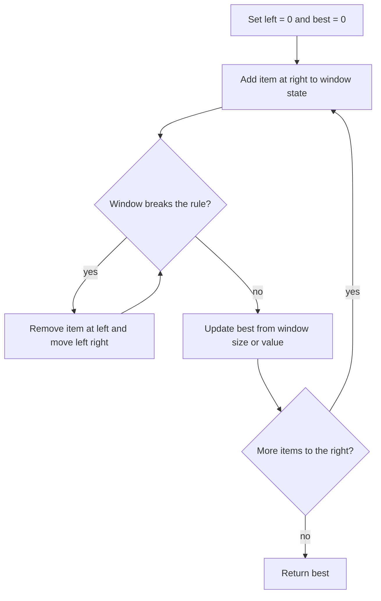

# Sliding Window

> **Module 05 · Data Structures & Algorithms** · Prerequisites: [Two Pointers](30-Two-Pointers.md) · Next: [Prefix Sum](32-Prefix-Sum.md)

---

## ⏱ If You Only Have 2 Minutes

- A **sliding window** is a contiguous range `[left, right]` of an array or string. You move the right edge to add items and the left edge to remove them, instead of recomputing each range from scratch.
- **Fixed-size window:** the length is given (for example "subarrays of length k"). Add the item entering on the right, remove the one leaving on the left.
- **Variable-size window:** the length changes. Expand the right edge, and shrink the left edge while the window breaks a rule (for example, "no repeated characters").
- Keep the window's state (sums, counts, a hash map of character counts) updated as the edges move. Each update is O(1) for a hash map or a running sum.
- The loop is O(n), not O(n²), because each element enters the window at most once and leaves it at most once. The left edge never moves backwards.
- Backend uses: a sliding-window rate limiter (exact with a log of timestamps, approximate with two counters) and moving averages in metrics.

---

## 1. What It Is and Why It Exists

A **sliding window** is a range of consecutive items that moves across a sequence. The range has two edges, `left` and `right`. Everything between them is "inside the window". To move the window one step, you add the new item on the right and remove the old item on the left. You never rebuild the window from nothing.

**Analogy:** think of a train of cars with a fixed number of seats, passing a platform. You can see only the cars inside the window. When a new car enters at the front, the car at the back leaves. You count passengers by adding the new car and subtracting the one that left, not by counting every car again.

**The problem it solves.** Many questions ask about every contiguous range of a given kind: "maximum sum of any *k* consecutive numbers", "longest substring with no repeated letter", "fewest requests in the last minute". The brute-force approach checks each start and end pair. For an array of length n that is about n²/2 ranges, and each range costs O(n) to compute, so the total is O(n³) in the naive form, or O(n²) with running sums. A sliding window does one pass: each step adds one item and removes at most one, so the whole scan costs O(n).

**The cost.** The window's state must be easy to update in both directions. A sum or a count map is easy. A "minimum of the window" is harder, because removing the minimum needs more than a single number. That case needs a deque (see the [Deque](10-Deque.md) chapter). Sliding windows also assume the rule is monotonic: once the window breaks the rule, shrinking it is the right way to fix it.

---

## 2. How It Works

There are two templates. Both keep one loop over `right`, and both move `left` forward only.

### Fixed-size template

```text
window_state = state of the first k items
best = value of the first window
for right from k to n-1:
    add item[right] to the window state      # the entering item
    remove item[right - k] from the state    # the leaving item
    best = max(best, value of the window)
```

### Variable-size template

```text
left = 0
for right from 0 to n-1:
    add item[right] to the window state
    while the window breaks the rule:       # shrink until it is valid again
        remove item[left] from the state
        left = left + 1
    best = max(best, right - left + 1)     # or whatever the problem asks for
```

The rule for the variable template is that `left` only moves forward. Once an item has left the window, it never comes back, and each item is removed at most once.

### Trace 1: fixed window (maximum sum of 3 consecutive numbers)

Input: `[2, 1, 5, 1, 3, 2]`, `k = 3`.

| Step | Entering | Leaving | Window | Window sum | Best |
|---|---|---|---|---|---|
| Start | | | `[2, 1, 5]` | 8 | 8 |
| right = 3 | 1 | 2 | `[1, 5, 1]` | 8 + 1 − 2 = 7 | 8 |
| right = 4 | 3 | 1 | `[5, 1, 3]` | 7 + 3 − 1 = 9 | 9 |
| right = 5 | 2 | 5 | `[1, 3, 2]` | 9 + 2 − 5 = 6 | 9 |

The answer is 9. Three windows were checked with a single addition and subtraction each.

### Trace 2: variable window (longest substring without repeats)

Input: `"pwwkew"`. The window must hold no repeated character. The state is a count per character inside the window.

| right | Entering | Window before the step | Repeat inside? | Shrink actions | Window after | Best |
|---|---|---|---|---|---|---|
| 0 | p | (empty) | no | none | `p` | 1 |
| 1 | w | `p` | no | none | `pw` | 2 |
| 2 | w | `pw` | yes, two w | remove p (left 0 to 1), remove w (left 1 to 2) | `w` | 2 |
| 3 | k | `w` | no | none | `wk` | 2 |
| 4 | e | `wk` | no | none | `wke` | 3 |
| 5 | w | `wke` | yes, two w | remove w at index 2 (left 2 to 3) | `kew` | 3 |

The answer is 3 (for example `wke`). Each character was added once and removed at most once.



### Why it is O(n)

In the variable template, `right` moves n times. `left` moves at most n times in total because it never goes back. Each move does an O(1) update of the state. So the total number of updates is at most 2n, which is O(n). This is an **amortized** argument: a single `while` loop can shrink the window many steps at once, but across the whole run those shrink steps add up to at most n.

---

## 3. Key Concepts

### Fixed versus variable windows

| | Fixed-size window | Variable-size window |
|---|---|---|
| Length | Given (k) | Found by the rule |
| Loop | Add one, remove one, every step | Add one, then shrink while the rule breaks |
| Typical questions | Max or min sum of k items, averages of k items | Longest or shortest range with a property |
| State | Running sum, count, or a fixed-size deque | Count map, set, or a sum that must stay under a limit |

### Window state and the hash map

The window needs a way to answer "does the window break the rule?" in O(1). For characters, a hash map from character to count does this: the window is valid when no count is greater than 1. For numbers with a target sum, a running sum does it. For "at most K distinct values", a map of counts plus a size check does it. The rule is: if you cannot update the state in O(1) when an item leaves, you cannot use the basic template.

### Why shrinking is safe

In "longest substring with no repeats", shrinking from the left when the window has a duplicate is safe. Any window that starts at or before the current `left` still contains the duplicate, so it cannot be valid. The left edge can therefore jump forward without checking those windows. This monotonic property is what makes the single pass correct. Problems where the rule is not monotonic (for example, "sum exactly equal to target" with negative numbers) need a different tool, such as prefix sums (see the [Prefix Sum](32-Prefix-Sum.md) chapter).

### Complexity

| Problem | Best time | Average time | Worst time | Extra space | Why |
|---|---|---|---|---|---|
| Fixed window, sum of k items | O(n) | O(n) | O(n) | O(1) | n − k + 1 windows, each updated with one add and one subtract. The first window costs O(k). |
| Variable window, longest with rule | O(n) | O(n) | O(n) | O(min(n, σ)) | Each item enters and leaves once. σ is the alphabet size, because the count map holds at most one key per distinct value in the window. |
| Naive check of every range | O(n²) or O(n³) | O(n²) or O(n³) | O(n³) | O(1) | Every pair of ends is checked, and each check costs up to O(n). |

For the variable window, the best case is the same as the worst case because the scan always visits every item. Amortized analysis is what gives O(n) for the shrink loop, as explained in section 2.

---

## 4. Code Examples

Scenario: a backend service analyses short text tokens and request metrics. It finds the longest run of distinct tokens and the best sum over a fixed number of recent samples.

### Node.js / TypeScript

```ts
// No npm packages. Node.js 22+, TypeScript 5, strict mode.

/** Problem 1: longest substring without repeating characters.
 *  Approach: variable window. Expand right; shrink left while a character repeats.
 *  Window state is a Map of character counts. O(n) time, O(min(n, alphabet)) space.
 *  Note: indexes count UTF-16 code units, so an emoji made of two units counts as two. */
export function longestUniqueSubstring(s: string): number {
  const counts = new Map<string, number>(); // how many times each character is in the window
  let left = 0;
  let best = 0;
  for (let right = 0; right < s.length; right++) {
    const incoming = s[right];
    counts.set(incoming, (counts.get(incoming) ?? 0) + 1);
    // Shrink from the left until the incoming character appears only once.
    while (counts.get(incoming)! > 1) {
      const outgoing = s[left];
      const remaining = counts.get(outgoing)! - 1;
      if (remaining === 0) counts.delete(outgoing); // keep the map small: no zero entries
      else counts.set(outgoing, remaining);
      left++;
    }
    best = Math.max(best, right - left + 1);
  }
  return best;
}

console.log(longestUniqueSubstring("abcabcbb")); // 3 ("abc")
console.log(longestUniqueSubstring("pwwkew")); // 3 ("wke")
console.log(longestUniqueSubstring("")); // 0
console.log(longestUniqueSubstring("bbbb")); // 1
```

```ts
// Problem 2: maximum sum of any contiguous subarray of length k.
// Approach: fixed window. Add the entering item, remove the leaving one.
// Time O(n), space O(1). Returns null when no window of length k exists.
export function maxSumWindow(nums: readonly number[], k: number): number | null {
  if (!Number.isInteger(k) || k <= 0 || k > nums.length) return null;
  let windowSum = 0;
  for (let i = 0; i < k; i++) windowSum += nums[i];
  let best = windowSum;
  for (let right = k; right < nums.length; right++) {
    windowSum += nums[right] - nums[right - k]; // enter one item, leave one
    best = Math.max(best, windowSum);
  }
  return best;
}

console.log(maxSumWindow([2, 1, 5, 1, 3, 2], 3)); // 9
console.log(maxSumWindow([-1, -2, -3], 1)); // -1 (negatives still need one window)
console.log(maxSumWindow([1, 2], 3)); // null
```

Built-ins: JavaScript has no deque in the standard library. `Array.prototype.shift` removes the first item, but engines may need to move every other item, so it can cost O(n). Do not use a plain array as a queue for a sliding window of a large input. For a fixed window of recent values, keep a ring buffer or a fixed-length array with an index. `Map` and `Set` both use hashing with insertion-order iteration, which makes them good window state.

### Python

```python
# Standard library only. Python 3.12+.


def longest_unique_substring(s: str) -> int:
    """Problem 1: longest substring without repeating characters.
    Variable window with a dict of character counts. O(n) time, O(min(n, alphabet)) space.
    Python indexes code points, so an emoji counts as one character."""
    counts: dict[str, int] = {}  # how many times each character is in the window
    left = 0
    best = 0
    for right, incoming in enumerate(s):
        counts[incoming] = counts.get(incoming, 0) + 1
        # Shrink from the left until the incoming character appears only once.
        while counts[incoming] > 1:
            outgoing = s[left]
            counts[outgoing] -= 1
            if counts[outgoing] == 0:
                del counts[outgoing]  # keep the dict small: no zero entries
            left += 1
        best = max(best, right - left + 1)
    return best


print(longest_unique_substring("abcabcbb"))  # 3
print(longest_unique_substring("pwwkew"))  # 3
print(longest_unique_substring(""))  # 0
print(longest_unique_substring("bbbb"))  # 1
```

```python
# Problem 2: maximum sum of any contiguous subarray of length k.
# Approach: fixed window. Add the entering item, remove the leaving one.
# Time O(n), space O(1). Returns None when no window of length k exists.


def max_sum_window(nums: list[int], k: int) -> int | None:
    if k <= 0 or k > len(nums):
        return None
    window_sum = sum(nums[:k])  # the first window is built in O(k)
    best = window_sum
    for right in range(k, len(nums)):
        window_sum += nums[right] - nums[right - k]  # enter one item, leave one
        best = max(best, window_sum)
    return best


print(max_sum_window([2, 1, 5, 1, 3, 2], 3))  # 9
print(max_sum_window([-1, -2, -3], 1))  # -1
print(max_sum_window([1, 2], 3))  # None
```

Built-ins: Python's `collections.deque(maxlen=k)` keeps only the last *k* items and drops the oldest automatically, which is a ready-made fixed window of recent values. `collections.Counter` is a count map for the variable window. For "minimum of the window" questions, a `deque` used as a monotonic queue is the standard tool, covered in the [Deque](10-Deque.md) chapter.

**Runtime difference to notice:** Python's `str` indexes code points, and JavaScript strings index UTF-16 code units. The same string can give different lengths for emoji and other characters outside the Basic Multilingual Plane. In interviews, say which unit you mean; in production, normalize or count graphemes if users type emoji.

---

## 5. Production Concerns

- **Rate limiting with a sliding window.** The two common versions trade accuracy for memory. The **sliding-window log** stores the timestamp of every request in the last window and counts them. It is exact, but it stores up to *limit* timestamps per key, for example 100 per minute for each API key. The **sliding-window counter** keeps two fixed-window counts and estimates the current rate as `previous × (remaining fraction of the window) + current`. It stores two numbers per key and is approximate, but usually close. The full design, including Redis commands and response headers, is in [Rate Limiting](../Module-07-Advanced-Backend-and-System-Design/33-Rate-Limiting.md).
- **Shared state needs atomic updates.** When several servers share a rate-limit window in Redis, the read-count-write sequence must be atomic. Otherwise two requests can both read "99 of 100" and both pass. A Lua script or an atomic command pattern solves this. Keep the script short, because it blocks other clients while it runs.
- **Clock skew.** A log-based window compares timestamps from different servers. If their clocks differ by a few seconds, a request can be counted in the wrong window. Use a single time source (the Redis server's clock for shared logs) or accept a small error.
- **Memory growth.** A per-key log grows with the limit, and a per-key map of counts grows with the number of distinct keys. Cap the limit, expire idle keys, and monitor the total number of keys in the store.
- **Metrics moving averages.** A simple moving average over the last *N* samples uses a window of fixed size *N* with a running sum. It is O(1) per sample. An exponential moving average (EMA) needs no window at all, only the previous value, which uses less memory. Pick the EMA when old samples should fade gradually, and the fixed window when the exact last *N* samples matter.
- **What to measure.** Track the rejected-request ratio for rate limits, and the difference between the approximate counter and the exact log on a sample of keys. For metrics, record the window size and the update rate; a window that is too large hides spikes.

---

## 6. Common Mistakes

- **Forgetting to remove the leaving item** — the window keeps growing and the sum or count is wrong — update the state on both edges every step.
- **Shrinking with `if` instead of `while`** — one removal may not clear the problem, because the earlier copy of the repeated character can sit several positions to the left (for example `"abba"` needs two removals after the second `b`) — use a `while` loop.
- **Recomputing the window each step** — for example, calling `slice(...).reduce(...)` for each window — this turns O(n) into O(nk) or O(n²) — update the running state instead.
- **Keeping zero counts in the map** — the map size stops reflecting the window, and "distinct count" checks give wrong results — delete keys when their count reaches zero.
- **Using a sliding window on non-monotonic rules** — "sum exactly equal to target" with negative numbers can have a valid window after an invalid one — use prefix sums and a hash map for that case.
- **Using `Array.prototype.shift` as the queue** — each removal can cost O(n) in JavaScript — use an index-based ring buffer or a fixed-length array for long streams.

---

## 7. Comparison Table

| Approach | Time | Space | When to use |
|---|---|---|---|
| Brute force over all ranges | O(n²) to O(n³) | O(1) | Only for tiny inputs or as a correctness check |
| Sliding window | O(n) | O(1) to O(alphabet) | Contiguous ranges with a rule that shrinks monotonically |
| Prefix sums plus hash map | O(n) | O(n) | Counting ranges with an exact sum, including negative values |
| Two pointers (same direction) | O(n) | O(1) | Pointers that move independently, such as merge or in-place filters |

For rate limiting, the comparison is between the exact log (memory proportional to the limit) and the counter approximation (memory proportional to the number of keys only). Fixed windows are cheaper still, but they allow twice the limit in a burst around a window boundary.

---

## 8. Interview Questions

**[Junior] What is the difference between a fixed-size and a variable-size window?**
A fixed-size window has a set length *k*, so each step adds one item on the right and removes one on the left. A variable-size window grows on the right and shrinks on the left until a rule is satisfied again. Use the fixed form for questions about "every subarray of length k" and the variable form for "longest or shortest range with property P".

**[Junior] Why is sliding window O(n) even though there is a nested loop in the code?**
The inner `while` loop shrinks the left edge, and `left` never moves backwards. Over the whole run, the inner loop can execute at most n times in total, and the outer loop runs n times. The total number of add and remove operations is at most 2n. This is amortized O(n), not O(n²).

**[Mid] How do you find the longest substring with at most two distinct characters?**
Use a variable window with a Map of character counts and a count of distinct keys. Expand right and add the character. While the number of distinct keys is greater than 2, remove the character at left, delete its key when the count reaches zero, and move left. Track the best window size after each expansion. Time is O(n) and space is O(1) because the map has at most three keys.

**[Mid] Why does sliding window fail for "subarray sum equals k" when the array has negative numbers?**
The window rule is not monotonic. With negative numbers, a window that has a sum too large may become right after adding a negative item, and shrinking from the left can skip a valid range. The left edge cannot be moved safely based on the current sum alone. Prefix sums with a hash map solve it in O(n), because they count earlier prefix values directly.

**[Senior] Design a rate limiter that allows 100 requests per minute per API key across 20 servers. Which algorithm do you pick?**
Store the state in a shared store such as Redis, so every server sees the same counts. For exact behaviour, use the sliding-window log: keep one timestamp per accepted request in a sorted set, remove entries older than one minute, and accept the request if fewer than 100 remain. Each key holds at most 100 entries. For lower memory, use the sliding-window counter: two fixed-window counts and a weighted estimate. The estimate is approximate, but it is cheap, and at a window boundary it avoids the burst allowed by plain fixed windows. Make the read-check-write sequence atomic (a Lua script), and use one clock source.

**[Senior] A monitoring system must show the average latency of the last 5 minutes, refreshed every second, for 50,000 services. What structure do you use?**
Use a fixed-size window of per-second buckets (300 buckets for 5 minutes). Each bucket keeps a sum and a count. Keep running totals of the sum and count across the buckets. Each second, subtract the oldest bucket and add the new one, which is O(1). The average is total sum divided by total count. Memory is 300 small buckets per service, about 15 million buckets across 50,000 services, so you may prefer a smaller bucket size or an approximate structure for very large fleets. An exponential moving average needs far less memory, but it does not give an exact 5-minute window.

**[Senior] How would you prove that the longest-unique-substring window is correct?**
State the invariant: after processing `right`, the window `[left, right]` contains no repeated character, and `left` is the smallest index for which that holds. When a character repeats, every window starting before the current `left` still contains the old copy, so none of them is valid, and it is safe to skip them. Each new window is checked once, so the best value seen is the answer. The proof relies on the monotonic property: if a window is invalid, every window that contains it is also invalid.

---

## 9. Cheat Sheet

```text
Window        contiguous range [left, right]; move right to add, left to remove
Fixed (k)     add item[right], remove item[right-k], update best every step
Variable      add item[right]; while rule broken: remove item[left], left++
State         running sum, or Map/dict of counts; update in O(1) on both edges
Time          O(n) amortized: each item enters and leaves at most once
Space         O(1) for sums; O(min(n, alphabet)) for a count map
Monotonic     shrinking must be safe; fails for negatives with sum equals k (use prefix sums)
Unique chars  counts map; shrink with while; delete zero counts
Python        collections.deque(maxlen=k); Counter for counts
TypeScript    no deque; Array.shift can be O(n); Map / Set for state
Rate limit    log = exact, O(limit) per key; counter = approximate, O(1) per key
Metrics avg   fixed buckets + running sum = O(1) per update; EMA = no window
Pitfall       forgetting to remove the leaving item, or using if where while is needed
```

---

## Related Topics

- [Two Pointers](30-Two-Pointers.md) — the same pair of moving indexes, where the window is the space between them
- [Deque](10-Deque.md) — the monotonic queue that gives the window minimum or maximum in O(1)
- [Prefix Sum](32-Prefix-Sum.md) — the tool for window-like questions that a plain sliding window cannot answer
- [Hash Tables](11-Hash-Tables.md) — the O(1) state updates that make count-map windows work
- [Rate Limiting](../Module-07-Advanced-Backend-and-System-Design/33-Rate-Limiting.md) — the backend system that uses sliding-window logs and counters
