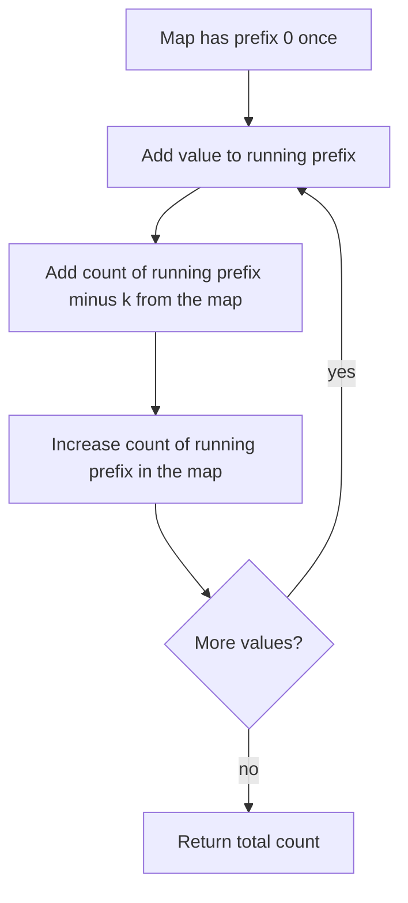

# Prefix Sum

> **Module 05 · Data Structures & Algorithms** · Prerequisites: [Sliding Window](31-Sliding-Window.md) · Next: [Difference Array](33-Difference-Array.md)

---

## ⏱ If You Only Have 2 Minutes

- A **prefix sum array** stores running totals: `prefix[i]` is the sum of the first *i* values, and `prefix[0] = 0`. It has length n + 1.
- Build it once in O(n). Then the sum of any range `values[l..r]` (both ends inclusive) is `prefix[r + 1] - prefix[l]`, which is O(1) per query.
- The leading zero removes a special case: a range that starts at index 0 needs no separate handling.
- In 2D, a summed-area table answers any rectangle sum in O(1) with four lookups and inclusion-exclusion.
- "Count subarrays whose sum equals k" is O(n) with a hash map of prefix values seen so far. A sliding window cannot do it when the values can be negative.
- Backend uses: cumulative counters (Prometheus rates are differences of cumulative values), usage-billing ranges, and precomputed daily totals. For data that changes often, use a Fenwick tree, which costs O(log n) per update and per query instead.

---

## 1. What It Is and Why It Exists

A **prefix sum** (also called a cumulative sum) is a running total. If the values are `[3, -1, 4, 2]`, the running totals are `0, 3, 2, 6, 8`. Position *i* of the prefix array holds the total of the first *i* values. The prefix array has one more slot than the input, because the total of zero values (the empty prefix) is 0.

**Analogy:** a bank statement that lists the balance after every transaction. To find how much money moved between transaction 3 and transaction 7, you do not add up the transactions in between. You subtract the balance after transaction 3 from the balance after transaction 7.

**The problem it solves.** Suppose you have an array and must answer many questions of the form "what is the sum from index *l* to index *r*?" If you add up the values each time, each question costs O(n). With q questions, the total cost is O(n·q). With a prefix array, the build costs O(n) once and each question costs O(1). For 100,000 values and 100,000 queries, that is roughly 10 billion additions against about 200,000 operations.

**The cost.** The prefix array is a snapshot. If one value changes, every prefix after that position changes too, so a single update costs O(n) to rebuild. The technique suits data that is read far more often than it changes. When updates are frequent, use a Fenwick tree (also called a binary indexed tree), which trades O(1) queries for O(log n) updates and queries.

---

## 2. How It Works

### Building and querying a 1D prefix array

1. Create `prefix` with length n + 1 and set `prefix[0] = 0`.
2. For `i` from 0 to n − 1, set `prefix[i + 1] = prefix[i] + values[i]`.
3. For a query on the inclusive range `[l, r]`, return `prefix[r + 1] − prefix[l]`.

Why the formula works: `prefix[r + 1]` is the sum of values at indexes 0 through r. Subtracting `prefix[l]`, the sum of indexes 0 through l − 1, leaves the sum of indexes l through r.

### Trace: build and query

Input: `values = [3, -1, 4, 2]`.

| i | values[i] | prefix[i + 1] = prefix[i] + values[i] |
|---|---|---|
| 0 | 3 | prefix[0] = 0 (base), prefix[1] = 0 + 3 = 3 |
| 1 | -1 | prefix[2] = 3 + (-1) = 2 |
| 2 | 4 | prefix[3] = 2 + 4 = 6 |
| 3 | 2 | prefix[4] = 6 + 2 = 8 |

The prefix array is `[0, 3, 2, 6, 8]`.

| Query `[l, r]` | Formula | Result | Check |
|---|---|---|---|
| `[1, 2]` | prefix[3] − prefix[1] = 6 − 3 | 3 | −1 + 4 = 3 |
| `[0, 3]` | prefix[4] − prefix[0] = 8 − 0 | 8 | 3 − 1 + 4 + 2 = 8 |
| `[3, 3]` | prefix[4] − prefix[3] = 8 − 6 | 2 | single value 2 |

### Two dimensions

For a grid `A` with R rows and C columns, build a table `P` of size (R + 1) × (C + 1), with the first row and first column set to zero. Each cell holds the sum of the rectangle from the top-left corner to that cell:

```text
P[i + 1][j + 1] = A[i][j] + P[i][j + 1] + P[i + 1][j] - P[i][j]
```

The rectangle with rows `r1..r2` and columns `c1..c2` (inclusive) is:

```text
sum = P[r2 + 1][c2 + 1] - P[r1][c2 + 1] - P[r2 + 1][c1] + P[r1][c1]
```

The subtraction removes the two strips above and to the left, and the last term adds back the corner that was removed twice. This is inclusion-exclusion.

Example: `A = [[1, 2], [3, 4]]` gives `P = [[0, 0, 0], [0, 1, 3], [0, 4, 10]]`. The bottom-right rectangle of row 1 and columns 0 to 1 (values 3 and 4) is `P[2][2] − P[1][2] − P[2][0] + P[1][0] = 10 − 3 − 0 + 0 = 7`.

### Prefix XOR and prefix counts

The same idea works for any operation that can be undone. XOR can be undone because `x ^ x = 0`, so the XOR of range `[l, r]` is `px[r + 1] ^ px[l]`. For counts of a value (for example, how many `"a"` characters are in a range), keep one prefix count array per value. This costs memory proportional to the alphabet size times n, so it fits small alphabets such as lowercase letters.

### Subarray sum equals k

A subarray `[i, j)` has sum `prefix[j] − prefix[i]`. We want that to equal *k*, so `prefix[i] = prefix[j] − k`. While scanning left to right, store how many times each prefix value has appeared, and at each position add the count of `prefix − k` to the answer.

Input: `[1, 2, 3]`, `k = 3`. The map starts with `{0: 1}` for the empty prefix.

| Step | Value | Running prefix | Look up prefix − 3 | Count added | Map after step |
|---|---|---|---|---|---|
| 1 | 1 | 1 | −2 → 0 | 0 | `{0: 1, 1: 1}` |
| 2 | 2 | 3 | 0 → 1 | 1 (the subarray `[1, 2]`) | `{0: 1, 1: 1, 3: 1}` |
| 3 | 3 | 6 | 3 → 1 | 1 (the subarray `[3]`) | `{0: 1, 1: 1, 3: 1, 6: 1}` |

The answer is 2. The lookup happens before the current prefix is stored, so the empty subarray is never counted.



---

## 3. Key Concepts

### Prefix array definition and indexing

Use a leading zero. Store `prefix[i]` as the sum of the first *i* values, so `prefix` has n + 1 slots. Off-by-one errors are the most common bug in this technique. The rule is: the range `[l, r]` uses `prefix[r + 1]` and `prefix[l]`. Keep that rule and you never need a special case for the first element.

### Range queries and updates

Prefix sums give O(1) queries but O(n) updates. A Fenwick tree gives O(log n) for both, and a segment tree also supports other operations. Choose by the ratio of reads to writes. The prefix array is the right answer when the data is built once and then queried.

### Hash map for counting subarrays

The prefix idea turns "sum of a subarray equals k" into "two earlier prefixes differ by k". The hash map makes that lookup O(1). This is the standard way to handle negative numbers, which break the monotonic rule that sliding windows need.

### Complexity

| Operation | Best | Average | Worst | Extra space | Why |
|---|---|---|---|---|---|
| Build 1D prefix array | O(n) | O(n) | O(n) | O(n) | One addition per value. |
| Range sum query | O(1) | O(1) | O(1) | O(1) | Two array reads and one subtraction. |
| Build 2D prefix table | O(RC) | O(RC) | O(RC) | O(RC) | One formula per cell. |
| 2D rectangle query | O(1) | O(1) | O(1) | O(1) | Four reads and three additions or subtractions. |
| Subarray sum equals k | O(n) | O(n) | O(n) | O(n) | One pass; each step does one map lookup and one map update. |

The subarray count is O(n) only with ideal hashing. Map operations are O(1) on average, but a worst case of O(n) per operation is possible if every key collides. That makes the worst case O(n²) in theory. The attack is realistic only when an adversary controls the keys and the hash function is predictable. Python randomizes string hashes but not integer hashes, so this is a concern for integer keys that come from users.

---

## 4. Code Examples

Scenario: a backend service stores per-minute request counts and daily usage amounts. It answers range totals for dashboards and counts how many time windows add up to a usage budget.

### Node.js / TypeScript

```ts
// No npm packages. Node.js 22+, TypeScript 5, strict mode.

/** Immutable range-sum index. prefix[i] is the sum of the first i values, and prefix[0] = 0.
 *  The leading zero removes the special case for ranges that start at index 0.
 *  Build O(n), each query O(1), space O(n). Use it when the values do not change. */
export class RangeSum {
  private readonly prefix: number[];

  constructor(values: readonly number[]) {
    this.prefix = [0];
    for (const v of values) {
      this.prefix.push(this.prefix[this.prefix.length - 1] + v);
    }
  }

  /** Sum of values[left..right], both ends inclusive. Throws on an invalid range. */
  sumRange(left: number, right: number): number {
    const n = this.prefix.length - 1;
    if (!Number.isInteger(left) || !Number.isInteger(right) || left < 0 || right >= n || left > right) {
      throw new RangeError(`invalid range [${left}, ${right}] for length ${n}`);
    }
    return this.prefix[right + 1] - this.prefix[left];
  }
}

// Problem 1: range sum query (immutable). Build once, then answer each query in O(1).
const index = new RangeSum([3, -1, 4, 2]);
console.log(index.sumRange(1, 2)); // 3  (-1 + 4)
console.log(index.sumRange(0, 3)); // 8
console.log(index.sumRange(3, 3)); // 2
// new RangeSum([]).sumRange(0, 0) throws RangeError: there are no values to sum.
```

```ts
// Problem 2: count subarrays whose sum equals k. Values can be negative, so a sliding
// window does not work. Approach: subarray (i, j] has sum prefix[j] - prefix[i], so count
// earlier prefixes equal to prefix - k. Time O(n), space O(n).
export function subarraySumEqualsK(nums: readonly number[], k: number): number {
  const seen = new Map<number, number>([[0, 1]]); // the empty prefix (sum 0) comes before index 0
  let running = 0;
  let count = 0;
  for (const x of nums) {
    running += x;
    // Look up before inserting the current prefix, so the subarray is never empty.
    count += seen.get(running - k) ?? 0;
    seen.set(running, (seen.get(running) ?? 0) + 1);
  }
  return count;
}

console.log(subarraySumEqualsK([1, 1, 1], 2)); // 2
console.log(subarraySumEqualsK([1, 2, 3], 3)); // 2  ([1, 2] and [3])
console.log(subarraySumEqualsK([0, 0], 0)); // 3  ([0], [0], [0, 0])
console.log(subarraySumEqualsK([], 0)); // 0
```

Built-ins: JavaScript has no prefix-sum helper. `Array.prototype.reduce` can build running totals with a closure, but you still need to write the index arithmetic yourself. `Map` keeps insertion order and gives O(1) average lookups, which is what the counting method needs. Floating-point values add rounding error to each prefix. For money, store integer cents, not fractional dollars.

### Python

```python
# Standard library only. Python 3.12+.
from itertools import accumulate


class RangeSum:
    """Immutable range-sum index. prefix[i] is the sum of the first i values; prefix[0] = 0.
    Build O(n), each query O(1), space O(n)."""

    def __init__(self, values: list[int]) -> None:
        # initial=0 adds the leading zero, so index 0 needs no special case.
        self._prefix: list[int] = list(accumulate(values, initial=0))

    def sum_range(self, left: int, right: int) -> int:
        """Sum of values[left..right], both ends inclusive. Raises IndexError on a bad range."""
        n = len(self._prefix) - 1
        if not (0 <= left <= right < n):
            raise IndexError(f"invalid range [{left}, {right}] for length {n}")
        return self._prefix[right + 1] - self._prefix[left]


# Problem 1: range sum query (immutable). Build once, then answer each query in O(1).
index = RangeSum([3, -1, 4, 2])
print(index.sum_range(1, 2))  # 3
print(index.sum_range(0, 3))  # 8
print(index.sum_range(3, 3))  # 2
```

```python
# Problem 2: count subarrays whose sum equals k. Values can be negative, so a sliding
# window does not work. Approach: count earlier prefixes equal to prefix - k.
# Time O(n), space O(n).
from collections import Counter


def subarray_sum_equals_k(nums: list[int], k: int) -> int:
    seen: Counter[int] = Counter({0: 1})  # the empty prefix (sum 0) comes before index 0
    running = 0
    count = 0
    for x in nums:
        running += x
        # Look up before inserting the current prefix, so the subarray is never empty.
        # Counter returns 0 for a missing key and does not insert it.
        count += seen[running - k]
        seen[running] += 1
    return count


print(subarray_sum_equals_k([1, 1, 1], 2))  # 2
print(subarray_sum_equals_k([1, 2, 3], 3))  # 2
print(subarray_sum_equals_k([0, 0], 0))  # 3
print(subarray_sum_equals_k([], 0))  # 0
```

Built-ins: `itertools.accumulate(values, initial=0)` builds the prefix array in one call, which is what the class uses. `collections.Counter` returns 0 for a missing key without inserting it, which keeps the counting loop short. For large numeric arrays, `numpy.cumsum` (a third-party package) does the same work in compiled code and is the usual choice in data pipelines.

**Runtime difference to notice:** Python's integers have unlimited precision, so a prefix sum of big integers never overflows. TypeScript `number` is an IEEE 754 double, which is exact only up to 2^53. For sums of large integers, use `BigInt` or keep the values small enough to stay below 2^53.

---

## 5. Production Concerns

- **Cumulative counters and rates.** Prometheus counters only increase. A rate over a time range is the difference between the counter at the end and at the start, divided by the elapsed time. That is a prefix-sum difference. The counter can reset when a process restarts, so the query engine detects drops and treats them as resets. A hand-written rate calculation must handle the same case, or it reports negative traffic.
- **Usage billing.** Store a cumulative usage total per account, and bill a period as `cumulative[end] − cumulative[start]`. Keep the totals as integers (for example, bytes or cents), because a floating-point cumulative total drifts over millions of additions. Record the snapshot time with each total so a late event can be placed in the right period.
- **Updates are the hard part.** A prefix array must be rebuilt, or patched at O(n) cost, after each change. If usage events arrive continuously, a Fenwick tree gives O(log n) updates and O(log n) range queries. Use it when the data changes more often than it is read.
- **Precomputed daily totals.** Dashboards often need "sum from day *a* to day *b*". Store one total per day and a running total per day. A query then needs two lookups. Recompute the prefix when a late correction arrives, and show the "as of" time on the dashboard so stale totals are visible.
- **Memory.** The prefix array takes n + 1 numbers. For a time series with one value per second over a year, that is about 31.5 million numbers, around 250 MB as 8-byte doubles. Use a coarser bucket size, or store the prefix only at checkpoints and sum the remainder.
- **What to measure.** Track the time to build the index on a refresh, and how many queries hit it per second. If builds dominate, switch to incremental updates. If queries dominate, the O(1) lookup is already the best option.

---

## 6. Common Mistakes

- **Off-by-one in the range formula** — `prefix[r] - prefix[l]` drops the value at index r — use `prefix[r + 1] - prefix[l]` for an inclusive end.
- **Building the prefix array without the leading zero** — index 0 then needs a special case in every query — start with `[0]` and make the array length n + 1.
- **Using a sliding window for negative values** — the window rule is not monotonic, so shrinking can skip valid subarrays — use prefix sums with a hash map.
- **Counting the empty subarray** — for `k = 0`, the lookup finds the current prefix and counts an empty range — look up `prefix - k` before inserting the current prefix.
- **Storing money as floating-point prefix totals** — rounding error grows with every addition — store integer cents or use decimal types.
- **Rebuilding the prefix array on every update** — each write costs O(n) and the benefit of O(1) queries disappears — use a Fenwick tree when updates are frequent.

---

## 7. Comparison Table

| Approach | Build | Update | Range query | Space | Best for |
|---|---|---|---|---|---|
| Prefix array | O(n) | O(n) | O(1) | O(n) | Static data, many range sums |
| Fenwick tree | O(n) | O(log n) | O(log n) | O(n) | Frequent point updates with range sums |
| Segment tree | O(n) | O(log n) | O(log n) | O(n) | Range updates and other operations such as min or max |
| Naive loop | O(1) | O(1) | O(n) | O(1) | A few queries on a small array |

For subarray counting, the comparison is simpler: a prefix map with a hash table is O(n) time and O(n) space, and nested loops are O(n²) time and O(1) space. Prefer the nested loops only for tiny inputs or for a check against a faster version.

---

## 8. Interview Questions

**[Junior] What is a prefix sum array, and why does it start with 0?**
It is an array where entry *i* holds the sum of the first *i* values of the input. The entry at index 0 is 0 because the empty prefix has sum 0. The leading zero means the sum of any range can be written as `prefix[r + 1] − prefix[l]`, which works even when the range starts at index 0 and needs no special case.

**[Junior] What is the time and space cost of answering many range-sum queries?**
Building the prefix array takes O(n) time and O(n) space. Each query then takes O(1) time, with two array lookups and a subtraction. For q queries, the total is O(n + q), compared with O(n·q) for summing each range directly.

**[Mid] How do you count subarrays whose sum equals k when the array contains negative numbers?**
Compute a running prefix sum and keep a hash map of how many times each prefix value has appeared, starting with `{0: 1}`. At each position, add the count of `prefix − k` to the answer, then record the current prefix. A subarray from index *i* to *j* has sum `prefix[j] − prefix[i]`, so this counts every valid pair. The method is O(n) time and O(n) space and does not depend on the values being positive.

**[Mid] How do you answer a rectangle sum query on a 2D grid?**
Build a 2D prefix table where each cell stores the sum of the rectangle from the top-left corner to that cell. The sum of a rectangle is the bottom-right cell minus the cell above the rectangle and the cell to its left, plus the top-left cell, because that corner was subtracted twice. Build takes O(RC) time, and each query takes O(1) time.

**[Senior] Your service reports the number of requests per minute from a counter that is increased on every request. How do you calculate the rate over five minutes, and what can go wrong?**
Store the cumulative counter with a timestamp. The rate is the difference between the newest and oldest sample in the window, divided by elapsed time. The difference is a prefix-sum calculation. The main risk is a counter reset when a process restarts: the value falls, and a naive difference becomes negative. Good monitoring systems detect the drop and treat the new value as a restart. Also check that the samples are close enough in time, because a gap in scrapes makes the average rate misleading.

**[Senior] You bill customers from usage events that arrive continuously, and you must answer "usage between two dates" quickly. Design the storage.**
Store the raw events and a cumulative total per account, updated as events arrive. A total that is updated by a plain prefix array would need a rebuild on every event, so use a Fenwick tree keyed by time or by a sequence number. Each insert costs O(log n), and each range query costs O(log n). Keep the amounts as integers, and record the time each event was accepted. For a period that is already closed, store a snapshot so later corrections are visible as adjustments, not silent changes to billed amounts.

**[Senior] An attacker can send requests whose keys collide in your subarray-count map. What happens, and how do you defend?**
If many prefix values collide in the hash table, each lookup scans a long chain, and the total time grows toward O(n²). Defences: use a hash table with randomized hashing (Python does this for strings through `PYTHONHASHSEED`, but not for integers), cap the input size, and validate that the values are within a sane range. For user-controlled integer keys, a keyed hash function is the safer choice in production.

---

## 9. Cheat Sheet

```text
Definition    prefix[0] = 0; prefix[i+1] = prefix[i] + values[i]; length n+1
Range sum     sum(l..r) = prefix[r+1] - prefix[l]     (inclusive r)
Build / query O(n) once, then O(1) per query; space O(n)
2D            P[i+1][j+1] = A[i][j] + P[i][j+1] + P[i+1][j] - P[i][j]
Rect sum      P[r2+1][c2+1] - P[r1][c2+1] - P[r2+1][c1] + P[r1][c1]
XOR           range xor = px[r+1] ^ px[l]   (x ^ x = 0 makes it undoable)
Count k       seen = {0:1}; running += x; count += seen[running-k]; seen[running]++
Negatives     sliding window fails; prefix + hash map works in O(n)
Updates       static: prefix array; frequent updates: Fenwick tree O(log n)
Backend       counter rates, usage billing (integer cents), daily totals
Pitfall       off-by-one (use r+1); counting the empty subarray; float drift
Python        itertools.accumulate(initial=0); Counter returns 0 for missing keys
TypeScript    no built-in; use number carefully (exact to 2^53) or BigInt
```

---

## Related Topics

- [Sliding Window](31-Sliding-Window.md) — the O(n) method for positive values, which prefix sums extend to negative values
- [Hash Tables](11-Hash-Tables.md) — the map that makes the subarray-counting lookup O(1) on average
- [Two Pointers](30-Two-Pointers.md) — the other one-pass technique for contiguous ranges and pairs
- [Arrays](05-Arrays.md) — the contiguous storage that makes the prefix array cheap to scan and index
- [Difference Array](33-Difference-Array.md) — the inverse idea: fast range updates, with prefix sums used to read the values back
