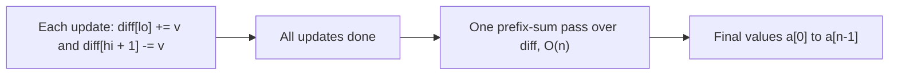

# Difference Array

> **Module 05 · Data Structures & Algorithms** · Prerequisites: [Prefix Sum](32-Prefix-Sum.md) · Next: [Greedy Algorithms](34-Greedy-Algorithms.md)

---

## ⏱ If You Only Have 2 Minutes

- A **difference array** stores how each cell differs from the cell before it: `diff[i] = a[i] - a[i-1]`, with `a[-1] = 0`.
- Adding `v` to every cell in the inclusive range `[l, r]` changes only two entries: `diff[l] += v` and `diff[r + 1] -= v`. That is **O(1)**, however long the range is.
- To read the real values, take the **prefix sum** of `diff` once. That pass costs **O(n)**. Reading is the inverse of the prefix-sum array from the previous chapter.
- Allocate `n + 1` cells so that `r + 1 = n` is a valid index. Watch the end convention: `[l, r)` half-open ranges subtract at `r` directly.
- Use it for **batches**: many updates, then reads. If updates and reads interleave, a Fenwick tree or segment tree gives O(log n) for both and is the better tool.
- Backend uses: count concurrent sessions per minute (`+1` at start, `-1` at end), track reserved seats per day, and check a car or shuttle's capacity along a route.

---

## 1. What It Is and Why It Exists

A **difference array** is a second array that records *changes* instead of values. Each cell holds "how much the value went up or down compared with the previous cell". If you know the changes, you can rebuild the values by adding them up from the left.

**Analogy:** a pay slip with step-up notes. Imagine a rent that rises by 50 on the 3rd month and falls by 20 on the 6th month. You do not write the rent for all 12 months. You write two notes, and anyone who wants the rent for month 7 adds up the notes from month 1 to month 7. A difference array works the same way: a range update becomes two notes, and the values are the running total of the notes.

**The problem it solves.** Suppose you have an array of `n` cells and must add a value to a range of cells, many times. The naive loop touches every cell in the range, so one update can cost `O(n)`. With 100,000 updates on an array of 100,000 cells, that is up to 10^10 cell writes. A difference array makes each update two writes, and it pays the `O(n)` cost only once, when you finally read the values.

The trade-off is clear. You get fast batch updates, but you cannot cheaply read one value in the middle of the update stream. That limit defines when the structure is the right choice, and section 3 explains it.

---

## 2. How It Works

### Building the difference array

Start with an array `a` of length `n`, all zeros. Define:

- `diff[0] = a[0]`
- `diff[i] = a[i] - a[i-1]` for `i ≥ 1`

Then `a[i] = diff[0] + diff[1] + … + diff[i]`. That is the prefix sum of `diff`. The two arrays are exact inverses of each other.

### Applying an update

Add `v` to `a[l..r]` (both ends included):

- `a[l]` rises by `v`, so `a[l] - a[l-1]` rises by `v`. Set `diff[l] += v`.
- `a[r+1]` is not raised, but `a[r]` is. So `a[r+1] - a[r]` falls by `v`. Set `diff[r+1] -= v`.
- Every cell between `l` and `r` has the same change from its neighbour as before, so nothing else moves.

That is why the cell at `r + 1` exists. When `r = n - 1`, the cell is `diff[n]`, which is past the end of the values, so the array needs `n + 1` cells.

### Trace on a small input

Take `n = 6` and three updates:

1. add `+2` to `[1, 3]`
2. add `+5` to `[3, 5]`
3. add `-1` to `[0, 1]`

Start with `diff = [0, 0, 0, 0, 0, 0, 0]` (seven cells, because `n + 1 = 7`).

| Step | Update | Cells changed | `diff` after the step |
|---|---|---|---|
| 0 | none | none | `[0, 0, 0, 0, 0, 0, 0]` |
| 1 | `+2` on `[1, 3]` | `diff[1] += 2`, `diff[4] -= 2` | `[0, 2, 0, 0, -2, 0, 0]` |
| 2 | `+5` on `[3, 5]` | `diff[3] += 5`, `diff[6] -= 5` | `[0, 2, 0, 5, -2, 0, -5]` |
| 3 | `-1` on `[0, 1]` | `diff[0] += -1`, `diff[2] -= -1` | `[-1, 2, 1, 5, -2, 0, -5]` |

Now read the values with one prefix-sum pass over indices `0..5`. The cell `diff[6]` is only an end marker, so it is ignored.

| `i` | 0 | 1 | 2 | 3 | 4 | 5 |
|---|---|---|---|---|---|---|
| `diff[i]` | -1 | 2 | 1 | 5 | -2 | 0 |
| running sum | -1 | 1 | 2 | 7 | 5 | 5 |
| `a[i]` | -1 | 1 | 2 | 7 | 5 | 5 |

Check by applying the updates directly: `[0,0,0,0,0,0]` becomes `[0,2,2,2,0,0]`, then `[0,2,2,7,5,5]`, then `[-1,1,2,7,5,5]`. The results match.



### Two-dimensional version

For a rectangle of rows `r1..r2` and columns `c1..c2` (inclusive), add `v` at four corners of a 2D difference grid: `D[r1][c1] += v`, `D[r1][c2+1] -= v`, `D[r2+1][c1] -= v`, `D[r2+1][c2+1] += v`. Then take a 2D prefix sum once. Each rectangle update is O(1), and the final pass is O(rows × cols). The idea is inclusion–exclusion: the four corners cancel out everywhere except inside the rectangle.

---

## 3. Key Concepts

### The difference definition

The key identity is `a[i] = sum of diff[0..i]`. Anything that changes a *range* of `a` by a constant only changes the two boundaries of `diff`. Keep this one identity in mind, and the code follows from it.

### Inclusive versus half-open ranges

Interview problems use both conventions. Mixing them up is the most common bug.

| Convention | Meaning | Updates | Array size |
|---|---|---|---|
| Inclusive `[l, r]` | Cells `l`, `l+1`, …, `r` | `diff[l] += v`, `diff[r+1] -= v` | `n + 1` |
| Half-open `[from, to)` | Cells `from`, …, `to-1` | `diff[from] += v`, `diff[to] -= v` | `n + 1` |

The half-open form has no `+1` or `-1` in the update. That is why trip-based problems such as car pooling use it naturally: a passenger who leaves at stop `to` is no longer on board at `to`.

### Batch versus online workloads

A difference array is an **offline** tool: it works best when all updates arrive first and the reads come at the end.

| Workload | Best structure | Why |
|---|---|---|
| Many updates, one final read | Difference array | O(1) per update, O(n) once |
| Updates and point or range reads interleaved | Fenwick tree (BIT) or segment tree with lazy propagation | O(log n) for both operations |
| Reads only, no updates | Prefix sum array | O(1) per range sum after O(n) build |

If you must answer a query after every update, a difference array forces an `O(n)` pass each time, which is worse than the naive loop in many cases. Switch to a logarithmic structure then.

### Complexity

| Operation | Best | Average | Worst | Extra space | Why |
|---|---|---|---|---|---|
| Apply one range update | O(1) | O(1) | O(1) | O(1) | Two array writes, whatever the range length |
| Read all values | O(n) | O(n) | O(n) | O(n) for output | One pass; every cell must be produced |
| `k` updates, then one read | O(n + k) | O(n + k) | O(n + k) | O(n) | `k` constant-time writes plus one `O(n)` pass |
| Read one value `a[i]` | O(i) | O(i) | O(i) | O(1) | Must sum `diff[0..i]` unless you already materialised the array |
| Naive loop (for comparison) | O(1) | O(length) | O(n) | O(1) | Each update writes every cell in the range |

All bounds are worst-case, not amortized. The difference array does not need dynamic resizing, so no amortized argument applies.

### Using the array for counting

Many backend questions are "how many items are active at time `t`?" Each item is an interval that turns on at its start and off at its end. Turning an interval on is `+1` at its start index, and turning it off is `-1` at its end index. The prefix sum then gives the number of active items at each index. This is the same as a sweep line over sorted events, and it is the form most interviewers expect.

---

## 4. Code Examples

Scenario: an interview setting with two classic problems. The first is **range addition**: apply many `[lo, hi, inc]` updates to an array of zeros. The second is **car pooling**: check that a car never carries more people than its capacity, given trips as `(passengers, from, to)`. Both use one shared class.

### Node.js / TypeScript

Built-ins first: JavaScript has no difference-array type. `Float64Array` and `Int32Array` are zero-filled typed arrays, and `Array` has no prefix-sum method, so the running sum is a short loop. The implementation uses `Float64Array` because it stores integers exactly up to 2^53. `Int32Array` would wrap silently on overflow.

```ts
// difference-array.ts: no npm packages. Node.js 22+, TypeScript 5, ESM.

/** Range add in O(1), read every value in O(n). Ranges are inclusive. */
export class DifferenceArray {
  readonly #size: number;
  // One spare cell, so the end marker at index hi + 1 is valid when hi = size - 1.
  readonly #diff: Float64Array;

  constructor(size: number) {
    if (!Number.isSafeInteger(size) || size < 0) {
      throw new RangeError(`size must be a non-negative integer, got ${size}`);
    }
    this.#size = size;
    this.#diff = new Float64Array(size + 1);
  }

  addRange(lo: number, hi: number, value: number): void {
    // Typed-array writes outside the bounds are silently ignored, so validate first.
    if (!Number.isSafeInteger(lo) || !Number.isSafeInteger(hi) ||
        lo < 0 || hi >= this.#size || lo > hi) {
      throw new RangeError(`invalid range [${lo}, ${hi}] for size ${this.#size}`);
    }
    this.#diff[lo] += value;
    this.#diff[hi + 1] -= value; // cancels the addition after hi
  }

  /** Prefix sum over the difference array. Call once, after all updates. */
  toArray(): number[] {
    const values = new Array<number>(this.#size);
    let running = 0;
    for (let i = 0; i < this.#size; i++) {
      running += this.#diff[i]; // the spare last cell is never read
      values[i] = running;
    }
    return values;
  }
}

/** LeetCode 370 "Range Addition": apply each [lo, hi, inc] to an array of n zeros. */
export function rangeAddition(
  n: number,
  updates: ReadonlyArray<readonly [number, number, number]>,
): number[] {
  const arr = new DifferenceArray(n);
  for (const [lo, hi, inc] of updates) {
    arr.addRange(lo, hi, inc);
  }
  return arr.toArray(); // rangeAddition(5, [[1,3,2],[2,4,3],[0,2,-2]]) → [-2,0,3,5,3]
}
```

```ts
// car-pooling.ts: imports DifferenceArray from difference-array.ts. Node.js 22+, TypeScript 5.
import { DifferenceArray } from "./difference-array.js";

/**
 * LeetCode 1094 "Car Pooling": each trip is [passengers, from, to].
 * Passengers board at `from` and leave at `to`, so they ride stops from..to-1.
 * Return true if the car never carries more than `capacity` at any stop.
 * Assumes from < to for every trip. Empty trips means nobody rides, so the answer is true.
 */
export function carPooling(
  trips: ReadonlyArray<readonly [number, number, number]>,
  capacity: number,
): boolean {
  const lastStop = trips.reduce((max, [, , to]) => Math.max(max, to), 0);
  const load = new DifferenceArray(lastStop);
  for (const [passengers, from, to] of trips) {
    // The end stop is exclusive: nobody is still on board at `to`.
    load.addRange(from, to - 1, passengers);
  }
  return load.toArray().every((seats) => seats <= capacity);
}

// carPooling([[2, 1, 5], [3, 3, 7]], 4) → false, because 2 + 3 = 5 seats at stops 3 and 4.
```

### Python

Built-ins first: Python has no difference-array type either. `itertools.accumulate` computes a running sum in one call, which is exactly the prefix-sum step. Python `int` is arbitrary precision, so the sums cannot overflow. The class relies only on the standard library.

```python
# difference_array.py: standard library only. Python 3.12+.
from collections.abc import Sequence
from itertools import accumulate


class DifferenceArray:
    """Range add in O(1), read every value in O(n). Ranges are inclusive."""

    def __init__(self, size: int) -> None:
        if size < 0:
            raise ValueError(f"size must be non-negative, got {size}")
        self._size = size
        # One spare cell: the end marker at hi + 1 is valid even when hi = size - 1.
        self._diff = [0] * (size + 1)

    def add_range(self, lo: int, hi: int, value: int) -> None:
        # A chained comparison checks 0 <= lo <= hi < size in one expression.
        if not 0 <= lo <= hi < self._size:
            raise ValueError(f"invalid range [{lo}, {hi}] for size {self._size}")
        self._diff[lo] += value
        self._diff[hi + 1] -= value  # cancels the addition after hi

    def to_list(self) -> list[int]:
        # accumulate() is the prefix sum. Slicing drops the spare end marker.
        return list(accumulate(self._diff[: self._size]))


def range_addition(n: int, updates: Sequence[tuple[int, int, int]]) -> list[int]:
    """LeetCode 370 "Range Addition": apply each (lo, hi, inc) to an array of n zeros."""
    arr = DifferenceArray(n)
    for lo, hi, inc in updates:
        arr.add_range(lo, hi, inc)
    return arr.to_list()  # range_addition(5, [(1,3,2),(2,4,3),(0,2,-2)]) → [-2, 0, 3, 5, 3]
```

```python
# car_pooling.py: imports DifferenceArray from difference_array.py. Python 3.12+.
from difference_array import DifferenceArray


def car_pooling(trips: list[tuple[int, int, int]], capacity: int) -> bool:
    """LeetCode 1094. Each trip is (passengers, start, end); end is exclusive."""
    # max(..., default=0) handles an empty trip list without a ValueError.
    last_stop = max((end for _, _, end in trips), default=0)
    load = DifferenceArray(last_stop)
    for passengers, start, end in trips:
        # Passengers ride stops start..end-1, the same rule as the TypeScript version.
        load.add_range(start, end - 1, passengers)
    return all(seats <= capacity for seats in load.to_list())


# car_pooling([(2, 1, 5), (3, 3, 7)], 4) → False, because 2 + 3 = 5 seats at stops 3 and 4.
```

**Runtime difference to notice:** the TypeScript version must check bounds itself. A write past the end of a typed array is silently dropped, not an exception, so a bad index would corrupt the answer without any error. Python raises an `IndexError` on the same mistake, but the explicit check in `add_range` gives a clearer message in both languages.

---

## 5. Production Concerns

- **Validate input from requests.** Updates often come from API payloads. Reject `lo > hi`, negative indexes, and indexes beyond the domain before writing. A silent out-of-range write is hard to spot later.
- **Size the domain carefully.** The array has one cell per possible index. Minutes in a day (1,440 cells) or in a year (525,600 cells) are cheap. Epoch milliseconds are not: use **coordinate compression** instead. Sort the distinct event times, map each to its rank, and run the same sweep over the ranks. That costs `O(k log k)` for `k` events.
- **Do not share a mutable array between requests.** A difference array is a plain array with no locking. Build one per request or per job. In Python threads, guard any shared instance with a lock. Node runs JavaScript on one thread, so a synchronous build cannot race with itself. Crossing worker threads would need `SharedArrayBuffer` and `Atomics`, which is more machinery than this structure is worth.
- **Watch numeric range.** TypeScript `number` is exact only up to 2^53. Summing large weights over many updates can pass that limit, so use `BigInt` if the values are that large. Python `int` does not have this problem.
- **Observe the cost.** Log the number of updates and the domain size for large batches. The `O(n)` read pass is the part that grows with the domain, not with the number of updates.
- **Database equivalent.** For data already in a database, the same running sum is a window function: `SUM(delta) OVER (ORDER BY ts)` over a table of `+1` and `-1` events. See [Window Functions](../Module-03-Databases/14-Window-Functions.md).

---

## 6. Common Mistakes

- **Subtracting at `r` instead of `r + 1`** — the update leaks one cell too far to the right — always write `diff[hi + 1] -= value` for inclusive ranges.
- **Forgetting the spare cell** — `r = n - 1` writes past the end of an array of size `n` — allocate `n + 1` cells.
- **Reading `diff[i]` as the value** — you get the change, not the value — run the prefix sum before using the results.
- **Mixing conventions** — an inclusive end where the problem uses an exclusive one gives off-by-one answers — write down the convention on the first line of the solution.
- **Using it for interleaved queries** — every read costs `O(n)`, which can be slower than the naive loop — switch to a Fenwick tree or segment tree.
- **Using `Int32Array` for sums** — values wrap around silently past 2^31 — use `Float64Array` or `BigInt64Array`, or `BigInt`.
- **Huge coordinate ranges** — a timestamp domain of 10^9 cells exhausts memory — compress the coordinates and sweep.

---

## 7. Comparison Table

| Approach | Update a range | Read one value | Read a range sum | Build cost | Best for |
|---|---|---|---|---|---|
| Naive loop | O(length), up to O(n) | O(1) | O(length) | O(n) | Tiny inputs, few updates |
| Difference array | O(1) | O(n) once, then O(1) per index | O(n) once | O(n) | Batch updates, one final read |
| Prefix-sum array | not supported | O(1) | O(1) | O(n) | Static data, many reads |
| Fenwick tree (BIT) | O(log n) with two trees | O(log n) | O(log n) | O(n) | Interleaved updates and reads |
| Segment tree with lazy propagation | O(log n) | O(log n) | O(log n) | O(n) | Interleaved updates and reads, plus other operations such as min or max |

The Fenwick and segment tree rows are the usual choices when the workload is online. The difference array wins only when you can batch the updates first.

---

## 8. Interview Questions

**[Junior] What does `diff[i]` store, and how do you get the values back?**
`diff[i]` stores the change from `a[i-1]` to `a[i]`, so `diff[i] = a[i] - a[i-1]`. To recover the values, take the prefix sum: each `a[i]` is the running total of `diff[0]` through `diff[i]`. Building the array costs O(n), and each range update costs O(1).

**[Junior] Why does a range update touch two cells?**
Raising a range `[l, r]` by `v` raises the change at `l`, because `a[l]` is higher than `a[l-1]`. It lowers the change at `r + 1`, because `a[r+1]` is not raised while `a[r]` is. Every cell inside the range keeps its change from the cell before it. That is why two writes are enough.

**[Mid] How would you count the maximum number of concurrent meetings in a calendar of 10,000 minutes?**
Create a difference array with one cell per minute. For each meeting from `start` to `end`, add `+1` to `[start, end - 1]`, or use the half-open form `diff[start] += 1` and `diff[end] -= 1`. Then take the prefix sum and return its maximum. The cost is O(n + k) for `k` meetings, and O(n) space for the minutes.

**[Mid] An API must answer "how many sessions are active right now?" after every session start and stop. Which structure do you use?**
A difference array does not fit, because each read would cost a full prefix-sum pass. A Fenwick tree over the time buckets gives O(log n) for each start, stop and query. If the times are arbitrary timestamps, compress them first. Alternatively, keep a plain counter that goes up on start and down on stop, which is O(1) per event and needs no array at all.

**[Senior] When is a difference array a better choice than a segment tree with lazy propagation?**
When all updates are known before any read, the difference array is simpler and faster: O(1) per update and one O(n) pass at the end, with no tree or lazy tags. A segment tree is the right answer when reads and updates alternate, or when the operation is not addition, such as range assignment or range minimum. The deciding question is whether the reads can wait until the batch ends.

**[Senior] A capacity system receives reservations as a stream and must reject any reservation that would overbook a day. Design the check.**
A difference array does not help, because the check must happen per request and the cost of each check would be O(n). Store the occupancy per day in a structure that supports a range add and a range maximum, such as a lazy segment tree, and check the maximum over the requested days before applying the range add. Keep the check and the write in one transaction or one atomic step, because two concurrent requests can both pass a stale check. In SQL, a `SELECT ... FOR UPDATE` on the day rows gives the same guarantee.

**[Senior] Why does coordinate compression matter, and what does it cost?**
A difference array needs one cell per possible index. If the indexes are epoch milliseconds, the domain is far too large to allocate. Compression sorts the distinct event times and maps each to its rank, so the array size becomes the number of distinct events. The cost is an `O(k log k)` sort for `k` events, plus the need to map times to ranks correctly at both ends of each interval.

---

## 9. Cheat Sheet

```text
Idea          a[i] = diff[0] + … + diff[i]   (diff = changes between neighbours)
Inclusive     add v to [l, r]:   diff[l] += v;  diff[r+1] -= v;   size n+1
Half-open     add v to [f, t):   diff[f] += v;  diff[t] -= v;     size n+1
Update        O(1)
Read all      one prefix-sum pass, O(n)
Batch only    updates first, read once; online mixes need Fenwick or segment tree
Count active  +1 at start, -1 at end, prefix sum, take the max
2D            four corner updates, then a 2D prefix sum
Car pooling   half-open trips, prefix sum, compare with capacity
Built-ins     Python accumulate(); TS Float64Array (not Int32Array)
Pitfalls      r+1 not r; size n+1; read the prefix sum before using values
Production    validate indexes; compress huge domains; no shared mutable array
```

---

## Related Topics

- [Prefix Sum](32-Prefix-Sum.md) — the read side of the same idea; a difference array is its inverse.
- [Greedy Algorithms](34-Greedy-Algorithms.md) — the meeting-rooms and interval problems use the same start and end events.
- [Sorting Algorithms](26-Sorting-Algorithms.md) — sorting events is the first step of coordinate compression.
- [Window Functions](../Module-03-Databases/14-Window-Functions.md) — the same running sum written as a SQL window function over events.
