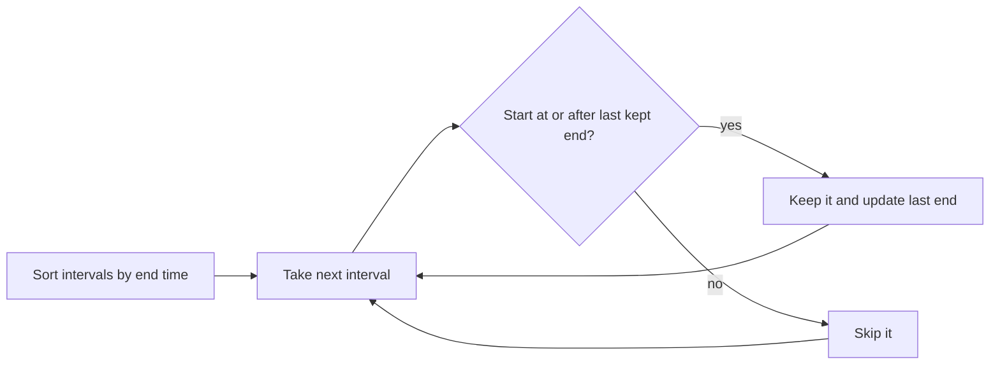

# Greedy Algorithms

> **Module 05 · Data Structures & Algorithms** · Prerequisites: [Difference Array](33-Difference-Array.md) · Next: [Backtracking](35-Backtracking.md)

---

## ⏱ If You Only Have 2 Minutes

- A **greedy algorithm** makes the locally best choice at each step and never goes back. It is fast, but it is only correct for problems where the local choice is always safe.
- Two properties make greedy correct: the **greedy-choice property** (some optimal solution starts with the greedy choice) and **optimal substructure** (what remains after that choice is a smaller copy of the same problem).
- Prove correctness with an **exchange argument**: take any optimal solution, swap in the greedy choice, and show the result is no worse.
- **Interval scheduling** is the classic win: sort by **end time**, keep an interval when it starts at or after the last kept end. Sorting by start time is wrong.
- Greedy fails for coin change with arbitrary denominations. With coins `{1, 3, 4}` and amount `6`, greedy gives `4 + 1 + 1` (3 coins) but `3 + 3` (2 coins) is better.
- Backend uses: scheduling and placing work on machines (usually as heuristics), Dijkstra's shortest path, and Huffman coding inside compressors such as DEFLATE (gzip).

---

## 1. What It Is and Why It Exists

A **greedy algorithm** solves an optimization problem in steps. At every step it picks the option that looks best *right now*, commits to it, and never reconsiders. There is no search tree and no table of past answers. The name comes from the choice: take what looks biggest, then keep going.

**Analogy:** a cashier giving change. To pay 37 cents with US coins, you hand over a 25, then a 10, then a 1, then a 1. You never think about the whole amount at once. For this coin set, the habit gives the fewest coins. For other coin sets, the same habit gives the wrong answer. Greedy works when "take the biggest coin that fits" is always safe, and fails when it is not.

**The problem it solves.** Many optimization problems have exponential search spaces. Checking every subset of 50 intervals means `2^50` possibilities. If a simple rule can produce the optimal answer, you get an `O(n log n)` algorithm instead. The challenge is not writing the greedy loop, which is short. The challenge is knowing that the loop is correct, and that is what this chapter teaches.

---

## 2. How It Works

Every greedy algorithm has the same shape:

1. Put the candidates in a useful order (often a sort).
2. Walk through them once.
3. Keep a candidate if it is feasible given what you have kept so far.
4. Return what you kept.

The hard part is step 1. The sort key *is* the greedy rule. For interval scheduling, the rule is "finish earliest".

### Trace: non-overlapping intervals

Take six intervals (the input order is `A, B, C, D, E, F`) and find the largest set that does not overlap. Intervals that merely touch, such as `[1, 2]` and `[2, 3]`, do not overlap.

| Interval | Start | End |
|---|---|---|
| A | 1 | 4 |
| B | 3 | 5 |
| C | 0 | 6 |
| D | 5 | 7 |
| E | 8 | 9 |
| F | 5 | 9 |

Sort by end time: `A(4), B(5), C(6), D(7), E(9), F(9)`. The two intervals that end at 9 keep their input order because the sort is stable. Then scan:

| Step | Interval | Start ≥ last kept end? | Last kept end | Decision |
|---|---|---|---|---|
| 1 | A `[1, 4]` | yes (no earlier interval) | none | keep A |
| 2 | B `[3, 5]` | 3 ≥ 4? no | 4 | skip |
| 3 | C `[0, 6]` | 0 ≥ 4? no | 4 | skip |
| 4 | D `[5, 7]` | 5 ≥ 4? yes | 4 | keep D |
| 5 | E `[8, 9]` | 8 ≥ 7? yes | 7 | keep E |
| 6 | F `[5, 9]` | 5 ≥ 9? no | 9 | skip |

The result is A, D, E: three intervals, so three must be removed (6 − 3 = 3). For contrast, sorting by **start** time would take C first, which spans `[0, 6]` and blocks almost everything. That plan keeps only C and E.



---

## 3. Key Concepts

### Greedy-choice property and optimal substructure

A greedy choice is **safe** when some optimal solution contains it. Then the problem left over after making that choice is a smaller instance of the same problem. If the greedy choice is safe at every step, the final answer is optimal. Both conditions must hold: a safe first choice is useless if the remaining problem is different in kind.

### Proving correctness with an exchange argument

The standard proof has three moves:

1. Let `O` be an optimal solution that does not contain the greedy choice `g`.
2. Let `o` be the first interval of `O`. Replace `o` with `g`.
3. Show the new set is still feasible and has the same size. For interval scheduling, `g` ends no later than `o`, so it cannot conflict with anything `o` did not conflict with. The new set is also optimal.

Repeat for the rest of the problem. You do not have to prove optimality by trying every input. The exchange argument gives a proof that holds for all inputs.

### When greedy fails

Greedy depends on the structure of the problem, not on the input. Take coin change with denominations `{1, 3, 4}` and amount `6`:

- Greedy takes the largest coin that fits: `4`, leaving `2`. Then `1`, then `1`. Total: 3 coins.
- The optimal answer is `3 + 3`: 2 coins.

There is no exchange argument that works here, because taking `4` is a bad first step. For US coins (1, 5, 10, 25) greedy happens to be optimal, but that is a property of the coin system, not a general rule. The fix for arbitrary coins is dynamic programming, covered in [Dynamic Programming Fundamentals](36-Dynamic-Programming-Fundamentals.md).

### Classic greedy algorithms

| Problem | Greedy rule | Why it is correct |
|---|---|---|
| Interval scheduling | Earliest end time first | Leaves the most room for later intervals |
| Jump game (can you reach the end?) | Track the farthest index reachable so far | Any reachable index can be stood on, so the farthest reach dominates |
| Dijkstra's shortest paths | Settle the closest unsettled vertex | Non-negative edge weights mean no later path can be shorter |
| Huffman coding | Repeatedly merge the two least frequent symbols | Gives an optimal prefix code (a known theorem) |

Huffman coding is the one most often mentioned in interviews. It builds a prefix code where frequent symbols get short bit strings. A min-priority queue holds the symbols and their weights; each merge removes two nodes and inserts one. DEFLATE, the format inside gzip, uses Huffman codes for its literal and length symbols.

---

## 4. Code Examples

Two classic problems, solved in both languages:

1. **Non-overlapping intervals (LeetCode 435):** return the minimum number of intervals to remove so the rest do not overlap. *Approach:* sort by end time, keep the greedy set, and subtract from the total. *Complexity:* O(n log n) time, O(n) space for the sorted copy.
2. **Meeting Rooms II (LeetCode 253):** return the minimum number of rooms so every meeting has one. *Approach:* sort the starts and the ends separately, then sweep with two pointers. A room is freed when a meeting ends at or before the next start. *Complexity:* O(n log n) time, O(n) space.

A min-heap of end times is the other common answer for problem 2. It is equally correct, but it needs a heap, and JavaScript has none built in.

**Built-ins:** JavaScript's `Array.prototype.sort` is stable (guaranteed since ES2019), but its default order compares values as strings, so `[10, 9, 1].sort()` gives `[1, 10, 9]`. Always pass a comparator for numbers. Python's `sorted()` is stable and takes a `key=`; `heapq` provides a min-heap only (negate values for a max-heap). Neither language has a built-in interval type.

### Node.js / TypeScript

```ts
// intervals.ts: no npm packages. Node.js 22+, TypeScript 5.
export type Interval = readonly [start: number, end: number];

/**
 * Greedy: sort by end time, then keep an interval if it starts at or after the last kept end.
 * Returns a maximum set of non-overlapping intervals. Empty input returns [].
 */
export function maxNonOverlapping(intervals: readonly Interval[]): Interval[] {
  // Copy before sorting: the caller's array must not change order.
  // The comparator is required; the default sort would compare numbers as strings.
  const byEnd = [...intervals].sort((a, b) => a[1] - b[1]);
  const chosen: Interval[] = [];
  let lastEnd = -Infinity;
  for (const iv of byEnd) {
    // Touching is allowed: [1, 2] and [2, 3] do not overlap, so the test is >=.
    if (iv[0] >= lastEnd) {
      chosen.push(iv);
      lastEnd = iv[1];
    }
  }
  return chosen;
}

/** LeetCode 435: the fewest intervals to remove so the rest do not overlap. */
export function minRemovals(intervals: readonly Interval[]): number {
  return intervals.length - maxNonOverlapping(intervals).length;
}

// minRemovals([[1,4],[3,5],[0,6],[5,7],[8,9],[5,9]]) → 3   (keep [1,4], [5,7], [8,9])
// minRemovals([]) → 0;  minRemovals([[1,2],[2,3]]) → 0 (touching is not overlapping)
```

```ts
// meeting-rooms.ts: no npm packages. Node.js 22+, TypeScript 5.

/**
 * LeetCode 253: the fewest rooms so that no two overlapping meetings share one.
 * Each meeting is [start, end) with start < end. Empty input needs 0 rooms.
 */
export function minMeetingRooms(meetings: ReadonlyArray<readonly [number, number]>): number {
  // Sort starts and ends separately. Pairing them is not needed, only the counts over time.
  const starts = meetings.map((m) => m[0]).sort((a, b) => a - b);
  const ends = meetings.map((m) => m[1]).sort((a, b) => a - b);

  let active = 0; // rooms in use right now
  let peak = 0;
  let j = 0;      // index of the next meeting end to check
  for (const start of starts) {
    // A meeting that ended at or before this start has freed its room.
    // Back-to-back meetings can share one room, so the test is <=.
    while (j < ends.length && ends[j] <= start) {
      active--;
      j++;
    }
    active++;
    peak = Math.max(peak, active);
  }
  return peak;
}

// minMeetingRooms([[0, 30], [5, 10], [15, 20]]) → 2
// minMeetingRooms([[7, 10], [2, 4]]) → 1
```

### Python

```python
# intervals.py: standard library only. Python 3.12+.
from collections.abc import Sequence

Interval = tuple[int, int]


def max_non_overlapping(intervals: Sequence[Interval]) -> list[Interval]:
    """Greedy: sort by end time, keep an interval if it starts at or after the last kept end."""
    # sorted() returns a new list and is stable, so the caller's list is untouched.
    by_end = sorted(intervals, key=lambda iv: iv[1])
    chosen: list[Interval] = []
    last_end: float = float("-inf")  # works with int comparisons, no sentinel needed
    for start, end in by_end:
        # Touching is allowed, so the test is >=.
        if start >= last_end:
            chosen.append((start, end))
            last_end = end
    return chosen


def min_removals(intervals: Sequence[Interval]) -> int:
    """LeetCode 435: the fewest intervals to remove so the rest do not overlap."""
    return len(intervals) - len(max_non_overlapping(intervals))


# min_removals([(1, 4), (3, 5), (0, 6), (5, 7), (8, 9), (5, 9)]) → 3
# min_removals([]) → 0;  min_removals([(1, 2), (2, 3)]) → 0
```

```python
# meeting_rooms.py: standard library only. Python 3.12+.
from collections.abc import Sequence


def min_meeting_rooms(meetings: Sequence[tuple[int, int]]) -> int:
    """LeetCode 253: the fewest rooms so no two overlapping meetings share one."""
    starts = sorted(start for start, _ in meetings)
    ends = sorted(end for _, end in meetings)

    active = 0  # rooms in use right now
    peak = 0
    j = 0       # index of the next meeting end to check
    for start in starts:
        # Free rooms whose meeting ended at or before this start. Equal times share a room.
        while j < len(ends) and ends[j] <= start:
            active -= 1
            j += 1
        active += 1
        peak = max(peak, active)
    return peak


# min_meeting_rooms([(0, 30), (5, 10), (15, 20)]) → 2
# min_meeting_rooms([(7, 10), (2, 4)]) → 1
```

**Runtime difference to notice:** a heap-based solution to Meeting Rooms II is natural in Python with `heapq`, and in TypeScript it needs a hand-written heap. The two-pointer version avoids that. It works the same in both languages and needs no extra data structure.

---

## 5. Production Concerns

- **Greedy is a heuristic until proven.** In production, a greedy rule that is "usually good" can still be far from optimal on adversarial input. Measure the result against an exact method on a sample of real data before you trust it.
- **Bin packing for containers.** Placing containers on hosts is bin packing, which is NP-hard. Systems use heuristics such as **first-fit decreasing** (sort by size, largest first, place each item in the first host with room). It is within about 11/9 of the optimal host count in the worst case, and much closer in practice. Schedulers also weigh affinity, priority and failure domains, so the greedy rule is one part of the decision, not the whole decision.
- **Deterministic tie-breaking.** Sorting by end time is not enough when two intervals end together. Add a tie-breaker such as request ID. Without one, two runs on the same input can schedule differently, which makes incidents hard to reproduce.
- **Time representation.** Store interval endpoints as UTC epoch milliseconds (numbers) or integers, not local time strings. Local times break on daylight-saving changes. Agree on half-open `[start, end)` intervals so that back-to-back bookings do not look like overlaps.
- **Observability.** Count skipped items and the final result size for each run. A sudden drop in "kept" count often means the input changed shape, such as a new long-running job arriving.
- **Cost of sorting.** Sorting dominates the run time for a few million items. Sort once and reuse the order when the data changes only slightly, or use a database index on the end time.

---

## 6. Common Mistakes

- **Sorting intervals by start time** — a long early interval blocks many short ones — sort by end time.
- **Using `>` instead of `>=` for touching intervals** — valid back-to-back bookings are rejected — use `>=` (or `<=` for meeting ends) and document the convention.
- **Using greedy for arbitrary coin sets** — `{1, 3, 4}` and amount 6 gives 3 coins instead of 2 — use dynamic programming, or check the coin system first.
- **Default sort on numbers** — `[10, 9, 1].sort()` gives `[1, 10, 9]` in JavaScript — pass `(a, b) => a - b`.
- **Sorting the caller's array in place** — the caller's order silently changes — copy first (`[...xs].sort` in TypeScript, `sorted()` in Python).
- **Assuming greedy is correct without a proof** — a plausible rule fails on a small counterexample — write the exchange argument, or test against brute force on small random inputs.

---

## 7. Comparison Table

| Approach | Optimal? | Typical time | When to use |
|---|---|---|---|
| Greedy | Only when the greedy-choice property holds | O(n log n) with a sort | Scheduling, interval problems, Huffman, Dijkstra |
| Dynamic programming | Yes, for problems with overlapping subproblems | Polynomial in the state space | Coin change, knapsack, edit distance |
| Backtracking | Yes, by trying all valid choices | Exponential in the worst case | Small inputs, constraint search, permutations |
| Heuristic (for example, first-fit decreasing) | No guarantee beyond a bound | Near O(n log n) | Large NP-hard problems such as bin packing |

Use greedy when you can state and prove the exchange argument. Use DP when greedy fails but the subproblems repeat. Use backtracking only when the input is small enough that the exponential search still finishes.

---

## 8. Interview Questions

**[Junior] What is the greedy-choice property?**
It means that a globally optimal solution exists which begins with the locally best choice. You can commit to that choice without losing the optimum. It is a property of the problem, so you must check it before writing a greedy loop. A plausible-looking rule that breaks the property gives wrong answers on some inputs.

**[Junior] Why sort intervals by end time and not by start time?**
Choosing the interval that ends first leaves the most time for the rest of the schedule. Sorting by start time can pick a long interval that blocks many short ones. The exchange argument shows that the earliest-ending interval can always replace the first interval of any optimal solution.

**[Mid] Prove that the earliest-end greedy gives the maximum number of non-overlapping intervals.**
Let `g` be the earliest-ending interval and let `O` be an optimal solution. If `g` is not in `O`, let `o` be the first interval of `O` by end time. Since `g` ends no later than `o`, replacing `o` with `g` leaves no overlap with the rest of `O`. The new set has the same size and includes `g`. Repeating the argument on the remaining intervals shows that greedy matches the optimum.

**[Mid] Why does greedy fail for coin change with coins `{1, 3, 4}` and amount `6`?**
Greedy takes `4` first, leaving `2`, which needs two `1`s, for 3 coins in total. The optimal answer is `3 + 3`, which is 2 coins. Taking the largest coin is not a safe first step for this coin system. The exchange argument breaks, so the problem needs dynamic programming over the amounts.

**[Senior] How would you decide whether a new scheduling problem can be solved greedily?**
First write down the objective and the feasibility rule. Then look for a sort key such as deadline, end time or size, and try to prove the greedy choice with an exchange argument. Test the rule against brute force on many small random inputs, because a counterexample is usually small. If no proof works, treat greedy as a heuristic, measure its gap against an exact method, and decide whether the gap matters for the product.

**[Senior] You need to place containers on a fixed set of hosts. How would you approach it, and what does first-fit decreasing guarantee?**
This is bin packing, which is NP-hard, so an exact optimum is not practical at scale. First-fit decreasing sorts containers by size, largest first, and puts each one on the first host with room. It is within about 11/9 of the optimal number of hosts in the worst case, and it runs in O(n log n) plus the placement scan. A real scheduler also needs affinity, anti-affinity, priority and failure-domain rules, so the packing heuristic is one stage in a larger decision.

**[Senior] Two requests arrive at the same instant and both want the last free slot. How does a greedy scheduler stay correct under concurrency?**
Greedy assumes that each choice is made against the current state. Two concurrent decisions can both see the same free slot, which breaks the feasibility check. Make the check and the write one atomic operation: a database transaction with a row lock, a compare-and-set on a version number, or a single writer for that resource. Retry the losing request with the new state. Without this, the algorithm is correct on paper and wrong in production.

---

## 9. Cheat Sheet

```text
Greedy        pick the locally best choice, never backtrack
Correct when  greedy-choice property + optimal substructure (prove with exchange argument)
Intervals     sort by END time; keep if start >= last kept end (touching is fine)
Min removals  n - (max non-overlapping count)
Meeting rooms sort starts and ends separately; sweep with two pointers; answer = peak
Jump game     track the farthest reachable index
Dijkstra      settle the closest vertex; needs non-negative weights
Huffman       repeatedly merge the two least frequent nodes (min-priority queue)
Coin change   greedy works for canonical systems like US coins; {1,3,4} needs DP
Bin packing   first-fit decreasing: a heuristic, about 11/9 of optimal in the worst case
Built-ins     JS sort needs a comparator for numbers; Python sorted() is stable; heapq is min-only
Pitfalls      sort by start (wrong), > vs >= (touching), mutating the input array
Proof         exchange argument, or test against brute force on small random inputs
```

---

## Related Topics

- [Dynamic Programming Fundamentals](36-Dynamic-Programming-Fundamentals.md) — the fix when greedy fails, such as arbitrary coin denominations.
- [Priority Queue](13-Priority-Queue.md) — the heap that drives Huffman coding, Dijkstra's algorithm and Meeting Rooms II.
- [Difference Array](33-Difference-Array.md) — the same start and end event sweep, used for counting overlaps.
- [Backtracking](35-Backtracking.md) — the exhaustive search to compare against when you are unsure a greedy rule is correct.
