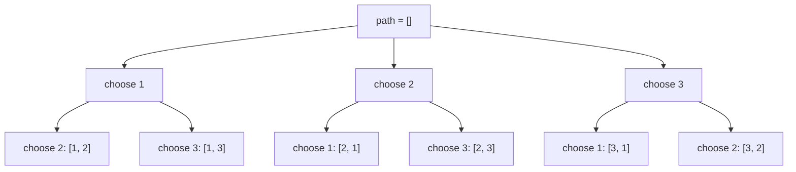

# Backtracking

> **Module 05 · Data Structures & Algorithms** · Prerequisites: [Greedy Algorithms](34-Greedy-Algorithms.md) · Next: [Dynamic Programming Fundamentals](36-Dynamic-Programming-Fundamentals.md)

---

## ⏱ If You Only Have 2 Minutes

- **Backtracking** builds a solution one choice at a time. After each choice it recurses, then **un-chooses** it, so the next branch starts from the same state.
- The template is: **choose** → **explore** (recurse) → **un-choose**. Record a result only when the partial solution is complete.
- It walks a **state-space tree**. **Pruning** cuts a branch as soon as it breaks a constraint, which is the only way the search gets faster than brute force.
- Output size sets a floor on the cost. There are `2ⁿ` subsets and `n!` permutations, so `n = 20` already gives about 2.4 × 10¹⁸ permutations.
- Avoid duplicates on inputs with repeated values by **sorting first**, then skipping an equal value at the same tree level.
- Always copy the current path before saving it. The path array is reused, so saving the reference gives you many identical, empty results.
- Backend uses: generating valid configuration combinations under dependency rules, and building test-case matrices.

---

## 1. What It Is and Why It Exists

**Backtracking** is a depth-first search over partial solutions. You try a choice, go deeper, and if the path cannot lead to a valid answer you step back and try the next choice. It is a systematic way to try every candidate without writing a separate loop for each depth.

**Analogy:** finding your way out of a maze by keeping a hand on one wall. At each junction you pick a corridor. When it dead-ends, you walk back to the last junction and try another corridor. You never walk back to the start unless every branch has failed. The "walk back" step is the **un-choose**: you undo whatever you did on the way in.

**The problem it solves.** Some problems ask for *all* valid arrangements, or for *any* arrangement that satisfies rules: all subsets of a set, all orderings, all placements of queens on a chessboard that do not attack each other, or all configurations that pass a list of dependency rules. Writing this with nested loops is impossible when the depth depends on the input. A recursive search handles any depth, and pruning keeps it from exploring pointless branches.

Backtracking does not make the problem smaller. It makes the search *organised* and lets you stop early. The cost is still exponential in the worst case, so you must know the size of the answer before you start.

---

## 2. How It Works

### The template

Every backtracking solution follows this shape:

```text
explore(state):
    if state is complete:
        record a copy of the solution
        return
    for each candidate choice at this level:
        if the choice breaks a rule:          # prune
            continue
        choose(choice)                        # change the shared state
        explore(next state)                   # go deeper
        un-choose(choice)                     # restore the state for the next sibling
```

The state is shared and mutated, so `un-choose` must reverse exactly what `choose` did. If it does not, later branches see leftover choices and return wrong answers.

### Trace: subsets of `[1, 2, 3]`

The "subsets" search picks elements in index order. At each call it records the current path, then tries each remaining element. Here is the order in which the calls run:

| Step | Action | `path` after the action | Recorded? |
|---|---|---|---|
| 1 | enter root | `[]` | yes, `[]` |
| 2 | choose 1, enter | `[1]` | yes, `[1]` |
| 3 | choose 2, enter | `[1, 2]` | yes, `[1, 2]` |
| 4 | choose 3, enter | `[1, 2, 3]` | yes, `[1, 2, 3]` |
| 5 | un-choose 3, back in `[1, 2]`, nothing left | `[1, 2]` | no |
| 6 | un-choose 2, choose 3, enter | `[1, 3]` | yes, `[1, 3]` |
| 7 | un-choose 3, back in `[1]`, nothing left | `[1]` | no |
| 8 | un-choose 1, choose 2, enter | `[2]` | yes, `[2]` |
| 9 | choose 3, enter | `[2, 3]` | yes, `[2, 3]` |
| 10 | un-choose 3, un-choose 2, choose 3, enter | `[3]` | yes, `[3]` |

Ten rows, eight recorded subsets: `[]`, `[1]`, `[1,2]`, `[1,2,3]`, `[1,3]`, `[2]`, `[2,3]`, `[3]`. Every subset appears exactly once because each call only adds elements with a *larger* index than the last one chosen.

### The state-space tree for permutations

For permutations, the tree is wider. Each level picks one unused value, so the first level has `n` branches, the next has `n − 1`, and so on. The leaves are the `n!` orderings. The first two levels of the tree for `[1, 2, 3]` look like this:



Each leaf at depth 3 is one permutation. Each level below the root has one fewer branch than the level above it.

---

## 3. Key Concepts

### Choose, explore, un-choose

The pattern works only when the shared state is restored exactly. Two common styles:

| Style | State passed as | Strength | Cost |
|---|---|---|---|
| Mutate and undo | One shared array, `push` and `pop` | Little allocation, fast | Must undo every change |
| Copy per call | A new array for each child | Simple to reason about | Extra allocation for each node |

The examples in section 4 use mutate-and-undo, because it is the style interviewers expect and it is faster.

### Pruning

Pruning means checking a constraint *before* recursing. If a partial solution already breaks a rule, no completion can fix it, so the whole subtree is skipped. In the permutation code, the `used` check prunes nothing extra, but it removes choices that would repeat a value. In N-Queens, a queen placed on a column or diagonal that is already attacked prunes that branch at once. Good pruning is the difference between a search that finishes and one that does not, but it does not change the worst-case exponent.

### Avoiding duplicates

If the input has repeated values, the same result can come from different paths. The standard fix has two steps: **sort** the input so equal values are adjacent, then **skip** an equal value at the same level of the tree. "Same level" is important. Skipping the same value on a deeper level would remove valid results, such as `[2, 2]`.

### Counting the work

The output size is a hard lower bound on the work, because each result must be produced.

| `n` | Subsets (`2ⁿ`) | Permutations (`n!`) |
|---|---|---|
| 5 | 32 | 120 |
| 10 | 1,024 | 3,628,800 |
| 20 | 1,048,576 | 2,432,902,008,176,640,000 |

### Complexity

| Problem | Time best | Time average | Time worst | Extra space | Why |
|---|---|---|---|---|---|
| Subsets | O(n · 2ⁿ) | O(n · 2ⁿ) | O(n · 2ⁿ) | O(n) | Every subset is produced; copying one costs O(n); recursion depth is n |
| Permutations | O(n · n!) | O(n · n!) | O(n · n!) | O(n) | Every ordering is produced; depth is n |
| N-Queens with pruning | depends on the board | depends on the board | O(n!) | O(n) | Pruning cuts most branches, but there is no simple closed form |

Best and worst differ only for searches that stop at the first answer. For "all solutions" problems, the output fixes the cost, so best equals worst. Extra space excludes the output. Neither bound is amortized.

---

## 4. Code Examples

Two classic problems, solved in both languages:

1. **Subsets (LeetCode 78):** return every subset of distinct integers. The same code handles duplicates with the sort-and-skip rule (LeetCode 90). *Complexity:* O(n · 2ⁿ) time, O(n) extra space.
2. **Permutations (LeetCode 46):** return every ordering of distinct integers, using a `used` flag per element. *Complexity:* O(n · n!) time, O(n) extra space.

**Built-ins:** neither language has a built-in backtracking helper. Python's `itertools.permutations(nums)` and `itertools.combinations(nums, k)` generate the same results in a fixed order, and they are the right choice when you need every ordering and no pruning. JavaScript has no equivalent, so the recursion is written by hand. In both languages, use a copy (`[...path]` or `path.copy()`) before saving a result.

### Node.js / TypeScript

```ts
// subsets.ts: no npm packages. Node.js 22+, TypeScript 5.

/** LeetCode 78: every subset of distinct integers. Empty input returns [[]]. */
export function subsets(nums: readonly number[]): number[][] {
  const out: number[][] = [];
  const path: number[] = [];

  function explore(start: number): void {
    out.push([...path]);               // copy: `path` is changed after this call returns
    for (let i = start; i < nums.length; i++) {
      path.push(nums[i]);              // choose
      explore(i + 1);                  // only later indexes, so no ordering repeats
      path.pop();                      // un-choose before the next sibling
    }
  }

  explore(0);
  return out;
}

/** LeetCode 90: the same search when the input may contain duplicates. Sort, then skip repeats per level. */
export function subsetsWithDup(nums: readonly number[]): number[][] {
  const sorted = [...nums].sort((a, b) => a - b); // equal values become neighbours
  const out: number[][] = [];
  const path: number[] = [];

  function explore(start: number): void {
    out.push([...path]);
    for (let i = start; i < sorted.length; i++) {
      // Skip an equal value at the same level: the subset it leads to was already built.
      if (i > start && sorted[i] === sorted[i - 1]) continue;
      path.push(sorted[i]);
      explore(i + 1);
      path.pop();
    }
  }

  explore(0);
  return out;
}

// subsets([1, 2, 3]).length → 8;  subsets([]) → [[]]
// subsetsWithDup([1, 2, 2]) → [[], [1], [1, 2], [1, 2, 2], [2], [2, 2]]
```

```ts
// permutations.ts: no npm packages. Node.js 22+, TypeScript 5.

/** LeetCode 46: every ordering of distinct integers. Empty input returns [[]]. */
export function permutations(nums: readonly number[]): number[][] {
  const out: number[][] = [];
  const path: number[] = [];
  // One flag per input position, so the same value is never placed twice on one path.
  const used = new Array<boolean>(nums.length).fill(false);

  function explore(): void {
    if (path.length === nums.length) {  // base case: every position is filled
      out.push([...path]);
      return;
    }
    for (let i = 0; i < nums.length; i++) {
      if (used[i]) continue;            // prune: this value is already on the path
      used[i] = true;                   // choose
      path.push(nums[i]);
      explore();
      path.pop();                       // un-choose both the value and its flag
      used[i] = false;
    }
  }

  explore();
  return out;
}

// permutations([1, 2, 3]) → [[1,2,3],[1,3,2],[2,1,3],[2,3,1],[3,1,2],[3,2,1]]
// permutations([]) → [[]]  (one empty ordering, the base case reached at once)
```

### Python

```python
# subsets.py: standard library only. Python 3.12+.
from collections.abc import Sequence


def subsets(nums: Sequence[int]) -> list[list[int]]:
    """LeetCode 78: every subset of distinct integers. Empty input returns [[]]."""
    out: list[list[int]] = []
    path: list[int] = []

    def explore(start: int) -> None:
        out.append(path.copy())          # copy: `path` keeps changing after this call returns
        for i in range(start, len(nums)):
            path.append(nums[i])         # choose
            explore(i + 1)               # only later indexes, so no ordering repeats
            path.pop()                   # un-choose before the next sibling

    explore(0)
    return out


def subsets_with_dup(nums: Sequence[int]) -> list[list[int]]:
    """LeetCode 90: sort so equal values are adjacent, then skip repeats per level."""
    ordered = sorted(nums)               # sorted() returns a new list; the input is untouched
    out: list[list[int]] = []
    path: list[int] = []

    def explore(start: int) -> None:
        out.append(path.copy())
        for i in range(start, len(ordered)):
            if i > start and ordered[i] == ordered[i - 1]:
                continue                 # same value at the same level: already built
            path.append(ordered[i])
            explore(i + 1)
            path.pop()

    explore(0)
    return out


# subsets([1, 2, 3]) has 8 entries;  subsets([]) == [[]]
# subsets_with_dup([1, 2, 2]) == [[], [1], [1, 2], [1, 2, 2], [2], [2, 2]]
```

```python
# permutations.py: standard library only. Python 3.12+.
from collections.abc import Sequence


def permutations(nums: Sequence[int]) -> list[list[int]]:
    """LeetCode 46: every ordering of distinct integers. Empty input returns [[]]."""
    out: list[list[int]] = []
    path: list[int] = []
    used = [False] * len(nums)           # one flag per input position

    def explore() -> None:
        if len(path) == len(nums):       # base case: every position is filled
            out.append(path.copy())
            return
        for i, value in enumerate(nums):
            if used[i]:                  # prune: this position is already on the path
                continue
            used[i] = True               # choose
            path.append(value)
            explore()
            path.pop()                   # un-choose both the value and its flag
            used[i] = False

    explore()
    return out


# permutations([1, 2, 3]) → [[1,2,3],[1,3,2],[2,1,3],[2,3,1],[3,1,2],[3,2,1]]
# list(itertools.permutations([1, 2, 3])) gives the same order as tuples, with no pruning.
```

**Runtime difference to notice:** Python's default recursion limit is 1,000 frames (`sys.getrecursionlimit()`), and each `explore` call is a frame. Depth equals `n`, so this is fine for small inputs but fails on very deep searches. Node's stack allows more frames, but the limit still exists. For large depths, convert to an explicit stack. In Python, the nested `def` is the closure that shares `path` and `out`.

---

## 5. Production Concerns

- **Output explosion.** A subset search over 30 items returns about 10⁹ results. Bound the output size, or return results through a generator (`yield` in Python, `function*` with `yield` in TypeScript) so the caller can stop early instead of holding everything in memory.
- **Budgets.** Put a limit on visited nodes or elapsed time, and return a partial result flagged as incomplete. An unbounded search can hold a request thread or event loop for minutes.
- **Event loop and worker pools.** A long search blocks the Node event loop, because it runs synchronously. Move it to a `worker_threads` worker, or split it into chunks with `setImmediate`. In FastAPI, a CPU-bound search inside an `async def` route blocks the loop; use a plain `def` route (run in a thread pool) or a process pool. Threads do not speed up CPU work in standard CPython builds because of the GIL.
- **Configuration generation.** A common backend use is building valid combinations of feature flags. Each flag is on or off, and dependency rules (for example, "B requires A" or "C excludes D") are the pruning checks. Prune before recursing, so invalid combinations never reach the output. See [Feature Flags](../Module-07-Advanced-Backend-and-System-Design/39-Feature-Flags.md) for how such flags are used.
- **Test-case generation.** Exhaustive generation grows fast. Teams usually choose a small subset of combinations that covers each pair of parameters (pairwise testing), instead of all `2ⁿ` or `n!` combinations.
- **Observability.** Count nodes visited, branches pruned and results produced. A jump in visited nodes with no change in results usually means the pruning rule broke.

---

## 6. Common Mistakes

- **Forgetting to un-choose** — later branches see leftover values, and the output is wrong — restore the state after every recursive call, in the same order you changed it.
- **Saving the shared array** — every saved result points to the same array, which ends up empty — copy it (`[...path]` or `path.copy()`).
- **Duplicates from unsorted input** — the same subset appears twice — sort first, then skip an equal value at the same level only.
- **Skipping at the wrong level** — the skip rule removes valid results such as `[2, 2]` — compare with `i > start`, not with the previous element at any depth.
- **Checking constraints after recursing** — the search does the work and then throws it away — check the rule before the recursive call.
- **Returning `[]` for empty input** — the empty set is a valid answer for subsets and permutations — return `[[]]` by letting the base case run.
- **Using it for counting** — listing every solution to count them wastes time — count with dynamic programming when only the number matters.

---

## 7. Comparison Table

| Approach | Enumerates every solution? | Stops early on bad branches? | Typical cost | Best for |
|---|---|---|---|---|
| Brute force (`itertools`) | Yes | No | Full output size, with no pruning | Small inputs, no constraints |
| Backtracking | Yes, or the first valid one | Yes, through pruning | Output size times pruning factor | Constraint search, listing solutions |
| Dynamic programming | No, only counts or the best value | Reuses subproblem answers | Polynomial in the state space | Counting ways, optimal value |
| Greedy | No, one answer | Not applicable | O(n log n) typically | Problems with a safe greedy choice |

Backtracking is the right tool when you must *see* the solutions. When you only need a number, DP is almost always better.

---

## 8. Interview Questions

**[Junior] What is the choose–explore–un-choose pattern?**
It is the standard shape of a backtracking search. You make one choice and change the shared state, recurse to build on that choice, and then undo the change so that the next sibling starts from the same state. The base case records a copy of a complete solution. Skipping the undo step is the most common bug.

**[Junior] How many subsets and permutations does a set of `n` distinct items have?**
A set has `2ⁿ` subsets, because each item is either in or out. It has `n!` permutations, because the first position has `n` choices, the next has `n − 1`, and so on. These numbers set the lower bound on the work for any algorithm that lists them.

**[Mid] How do you avoid duplicate results when the input contains repeated values?**
Sort the input first, so equal values sit next to each other. Then, at each level of the search, skip a value if it equals the value just before it and that earlier one was not used at this level. For subsets, the rule is `i > start` and `nums[i] === nums[i-1]`. Without the sort, equal values can be separated and the rule cannot catch them.

**[Mid] Why must the code copy the path before saving a result?**
The path is one shared array that the search keeps changing with `push` and `pop`. A saved reference would show the final state of the array, which is empty by the time the search ends. Copying takes O(n) per result, which is already part of the output cost, so it does not change the complexity.

**[Senior] Explain how pruning helps N-Queens, and why the worst case is still exponential.**
Each row takes one queen, and a placement is pruned at once if its column or either diagonal is already attacked. This removes most of the naive `n^n` choices, and for n = 8 it leaves 92 solutions to find. Pruning does not change the worst case, though: the search can still visit a large fraction of the tree on a board where many partial placements look valid for a long time. The bound is exponential, and the real speed depends on the input and the pruning rule.

**[Senior] Generate all valid feature-flag combinations given dependency rules. How would you structure it, and where is the limit?**
Treat each flag as a level in the search, choosing on or off, and check every dependency rule before recursing. An invalid partial choice is pruned, so only valid complete combinations reach the output. The number of flags makes the output grow as `2ⁿ` in the worst case, so cap the count, stream results, or generate only the combinations needed for a given test matrix. For very large sets, a pairwise covering array is usually a better output than all combinations.

**[Senior] When would you use dynamic programming instead of backtracking?**
Use DP when the question asks for a count, a minimum, or a maximum, and the same subproblem appears on many branches. Backtracking lists every solution, so its cost grows with the number of solutions. DP stores each subproblem's answer once and reuses it, which can turn an exponential count into a polynomial one. If the output must include every solution, DP cannot help, because the output itself is exponential.

---

## 9. Cheat Sheet

```text
Pattern       choose -> explore (recurse) -> un-choose (restore the shared state)
Base case     record a copy when the partial solution is complete
Pruning       check a constraint before the recursive call, not after
Subsets       2^n results; index loop from start; O(n * 2^n) time
Permutations  n! results; used[] flag per position; O(n * n!) time
Duplicates    sort first; skip equal value when i > start (subsets) or its twin is unused (permutations)
Empty input   subsets and permutations of [] give [[]]
Copy          [...path] in TypeScript, path.copy() in Python, before saving
Stack         depth = n; Python default recursion limit is 1000
Node          long searches block the event loop; use a worker thread
Built-ins     Python itertools.permutations / combinations; no JS equivalent
Use DP        when you only need a count, a min or a max
```

---

## Related Topics

- [Recursion](23-Recursion.md) — the base case and call stack that every backtracking search relies on.
- [Depth First Search](22-Depth-First-Search.md) — backtracking is a depth-first walk over the state-space tree.
- [Dynamic Programming Fundamentals](36-Dynamic-Programming-Fundamentals.md) — the choice when you need counts or optimal values rather than the full list.
- [Greedy Algorithms](34-Greedy-Algorithms.md) — when a safe greedy choice exists, the search collapses to one path.
- [Feature Flags](../Module-07-Advanced-Backend-and-System-Design/39-Feature-Flags.md) — where constraint-based combination generation shows up in backend systems.
