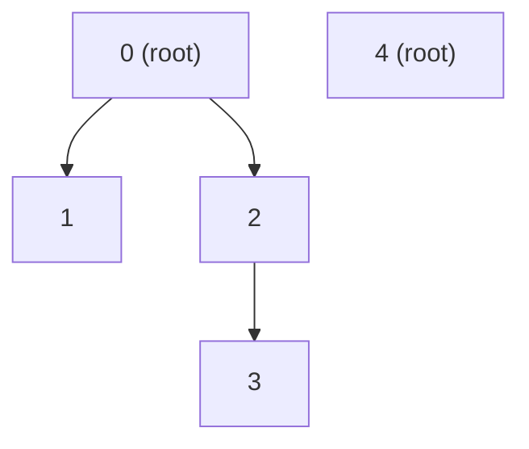

# Union Find

> **Module 05 · Data Structures & Algorithms** · Prerequisites: [Dynamic Programming Fundamentals](36-Dynamic-Programming-Fundamentals.md) · Next: [Topological Sorting](38-Topological-Sorting.md)

---

## ⏱ If You Only Have 2 Minutes

- A Union Find (also called a disjoint set union, or DSU) tracks groups of items that do not overlap. It supports two operations: `find(x)` returns the root of x's group, and `union(a, b)` merges two groups.
- With **path compression** and **union by size (or rank)**, each operation runs in O(α(n)) amortized time. α is the inverse Ackermann function. It is at most 4 for any input that fits in memory, so treat it as near-constant.
- Use it to answer "are `a` and `b` in the same group?" while groups only ever merge. It cannot split a group.
- In an undirected graph, the first edge whose two ends are already connected closes a cycle. This is the idea behind "redundant connection" problems.
- Kruskal's minimum spanning tree adds edges from cheapest to most expensive and uses Union Find to skip any edge that would form a cycle.
- In backend work it groups duplicate records (entity resolution). A merge cannot be undone, so keep the raw match edges if you may need to rebuild.

---

## 1. What It Is and Why It Exists

A **Union Find** keeps a collection of **disjoint sets**. Disjoint means no item belongs to two sets. Each set has one **representative**, also called its **root**. Two items are in the same set exactly when they have the same root.

**Analogy:** a company split into teams. Each team has one lead. To check whether two people work on the same team, you do not compare every member. You ask each person for their lead and check whether the leads match. To merge two teams, you make one lead report to the other. Both steps are short, and you never have to update every member.

**The problem it solves.** Suppose you need to answer "are these two accounts linked?" after many link events. A simple approach gives each item a label. Merging two groups then means relabeling every member of one group, which can cost O(n) per merge. Searching the graph on every question is also slow when questions come in a stream. A Union Find stores just one parent pointer per item, so a merge and a question both take near-constant time.

It is the right tool when the work is "join things together and ask if two things are joined." It is the wrong tool when you need to remove links, find the path between two nodes, or list every member of a group quickly. Those needs point to graph search or a different structure.

---

## 2. How It Works

### The parent array

Each item `0 … n-1` has an entry in a `parent` array. At the start, every item is its own parent, so every item is a root. When you merge two sets, you make one root the parent of the other root. Following parent pointers from any item eventually reaches its root.

- **find(x):** follow `parent` until you reach an item that points to itself. That item is the root.
- **union(a, b):** find both roots. If they are equal, the items are already together. If not, attach one root under the other.

### Trace on a small input

We run five operations on items `0 … 4` using union by size. The `size` value is kept only at roots.

| Step | Operation | `parent` after the step | Root sizes | Notes |
|---|---|---|---|---|
| 0 | start | `[0, 1, 2, 3, 4]` | all 1 | five separate sets |
| 1 | `union(0, 1)` | `[0, 0, 2, 3, 4]` | `size[0] = 2` | equal sizes, so 1 goes under 0 |
| 2 | `union(2, 3)` | `[0, 0, 2, 2, 4]` | `size[2] = 2` | 3 goes under 2 |
| 3 | `union(1, 3)` | `[0, 0, 0, 2, 4]` | `size[0] = 4` | roots are 0 and 2, both size 2, so 2 goes under 0 |
| 4 | `find(3)` | `[0, 0, 0, 0, 4]` | unchanged | walks 3 → 2 → 0, then re-points 3 at 0 |
| 5 | `union(4, 0)` | `[0, 0, 0, 0, 0]` | `size[0] = 5` | the single item 4 goes under the bigger root |

Step 4 is the path compression step. Before it, item 3 needed two hops to reach the root. After it, one hop is enough.



This is the tree after step 3. The chain 3 → 2 → 0 is the path that `find(3)` shortens in step 4.

### Why the rules are needed

Without union by size, the first union could make a long chain: 0 under 1, 1 under 2, and so on. Then `find` would walk the whole chain every time. Union by size keeps every tree shallow, so the height of any tree is at most log₂ n. Path compression then flattens the paths that a find has already walked, so repeated finds get faster over time.

---

## 3. Key Concepts

### Representative (root)

The root is the only item whose `parent` points to itself. Its identity is arbitrary. Two calls to `find` may return different roots over time, because a union can change which root wins. Only compare roots taken at the same moment.

### Path compression

During `find`, every item on the walk is re-pointed directly at the root. The first call pays for the walk. Later calls on those items cost one step. Implementations usually do it in two passes: one to find the root, and one to set the pointers. A recursive version also works, but it can exceed the call stack on very deep trees (see Production Concerns).

### Union by size or rank

Union by size attaches the smaller tree under the bigger one. Union by rank does the same with an estimated height instead of a count. Both keep trees shallow. Size is easier to explain and also gives `setSize(x)` for free. Use one of them, not neither.

### Near-constant time and α(n)

The combination of both rules gives O(α(n)) amortized time per operation. The inverse Ackermann function α grows so slowly that it is at most 4 for any value of n that fits in real memory. In an interview, say "effectively constant" and name α(n). Do not try to derive it in full.

### Connected components and cycles

Start with n singleton sets and call `union` for every edge. The number of sets left is the number of connected components. For cycles, note that `union` returns `false` when the two ends are already joined. In an undirected graph, that edge closes a cycle. Directed graphs need a different method. Topological Sorting covers that case.

### Kruskal's minimum spanning tree

A minimum spanning tree (MST) connects every node with the lowest total edge weight, and never creates a cycle. Kruskal's algorithm sorts edges by weight, then adds each edge whose ends are in different sets. The Union Find makes the "different sets" check fast. The total cost is O(E log E) for the sort, plus O(E α(V)) for the Union Find work. The sort usually dominates.

---

## 4. Code Examples

Both implementations use integers `0 … n-1` as elements. Real systems usually have string IDs, so map them to integers first (see Production Concerns).

**Built-ins.** Neither JavaScript nor Python has a Union Find in its standard library. You build it on an array (JavaScript `Array`, Python `list`). For a one-off component count over a large static graph, a graph library is simpler. SciPy has `scipy.sparse.csgraph.connected_components` for that. Writing your own is still the right way to show the idea in an interview.

### Node.js / TypeScript

```ts
// Node.js 22+, TypeScript 5 (strict). No packages.
// Elements are integers 0..n-1.

export class UnionFind {
  private readonly parent: number[];
  private readonly size: number[]; // size[r] is meaningful only when r is a root
  private sets: number;

  constructor(n: number) {
    if (!Number.isInteger(n) || n < 0) throw new RangeError(`n must be a non-negative integer, got ${n}`);
    this.parent = Array.from({ length: n }, (_, i) => i); // each element starts as its own root
    this.size = new Array<number>(n).fill(1);
    this.sets = n;
  }

  private assertInRange(x: number): void {
    if (!Number.isInteger(x) || x < 0 || x >= this.parent.length) {
      throw new RangeError(`element ${x} is outside 0..${this.parent.length - 1}`);
    }
  }

  /** Root of x's set. Path compression: every node on the walk is re-pointed at the root. */
  find(x: number): number {
    this.assertInRange(x);
    let root = x;
    while (this.parent[root] !== root) root = this.parent[root];
    let node = x;
    while (node !== root) {  // second walk: shorten the path for the next call
      const next = this.parent[node];
      this.parent[node] = root;
      node = next;
    }
    return root;
  }

  /** Merges the sets of a and b. Returns false if they were already together. */
  union(a: number, b: number): boolean {
    let ra = this.find(a);
    let rb = this.find(b);
    if (ra === rb) return false; // same set: an edge between a and b would close a cycle
    if (this.size[ra] < this.size[rb]) [ra, rb] = [rb, ra]; // union by size
    this.parent[rb] = ra;
    this.size[ra] += this.size[rb];
    this.sets--;
    return true;
  }

  connected(a: number, b: number): boolean {
    return this.find(a) === this.find(b);
  }

  /** Number of disjoint sets right now. Starts at n and drops by one per successful union. */
  count(): number {
    return this.sets;
  }

  setSize(x: number): number {
    return this.size[this.find(x)];
  }
}

// Problem 1: Number of Provinces. Given an n x n matrix where isConnected[i][j] = 1 links
// cities i and j, return how many groups of connected cities exist.
// Approach: union each linked pair once; the answer is the number of sets left.
// Time O(n^2 α(n)) because the matrix has n^2 cells. Space O(n).
export function countProvinces(isConnected: readonly (readonly number[])[]): number {
  const n = isConnected.length;
  const uf = new UnionFind(n);
  for (let i = 0; i < n; i++) {
    for (let j = i + 1; j < n; j++) { // the matrix is symmetric, so the upper triangle is enough
      if (isConnected[i][j] === 1) uf.union(i, j);
    }
  }
  return uf.count();
}

// Problem 2: Redundant Connection. The input is a tree with one extra edge (nodes are 1-based).
// Return the edge that closes the cycle.
// Approach: add edges in order; the first edge whose ends are already connected is the answer.
// Time O(n α(n)). Space O(n).
export function findRedundantEdge(edges: readonly (readonly [number, number])[]): [number, number] | null {
  const uf = new UnionFind(edges.length + 1); // index 0 is unused
  for (const [a, b] of edges) {
    if (!uf.union(a, b)) return [a, b];
  }
  return null;
}
```

### Python

```python
# Python 3.12+, standard library only.
from collections.abc import Sequence


class UnionFind:
    """Disjoint set union over the integers 0..n-1."""

    def __init__(self, n: int) -> None:
        if n < 0:
            raise ValueError(f"n must be non-negative, got {n}")
        self._parent: list[int] = list(range(n))  # each element starts as its own root
        self._size: list[int] = [1] * n            # meaningful only at roots
        self._sets = n

    def _check(self, x: int) -> None:
        if not 0 <= x < len(self._parent):
            raise IndexError(f"element {x} is outside 0..{len(self._parent) - 1}")

    def find(self, x: int) -> int:
        self._check(x)
        root = x
        while self._parent[root] != root:  # iterative: no recursion limit on long chains
            root = self._parent[root]
        node = x
        while node != root:                # path compression
            nxt = self._parent[node]
            self._parent[node] = root
            node = nxt
        return root

    def union(self, a: int, b: int) -> bool:
        ra, rb = self.find(a), self.find(b)
        if ra == rb:
            return False                   # already one set: this edge closes a cycle
        if self._size[ra] < self._size[rb]:
            ra, rb = rb, ra                # union by size
        self._parent[rb] = ra
        self._size[ra] += self._size[rb]
        self._sets -= 1
        return True

    def connected(self, a: int, b: int) -> bool:
        return self.find(a) == self.find(b)

    def count(self) -> int:
        return self._sets

    def set_size(self, x: int) -> int:
        return self._size[self.find(x)]


# Problem 1: Number of Provinces. Count groups in an n x n adjacency matrix.
# Approach: union each linked pair once. Time O(n^2 α(n)). Space O(n).
def count_provinces(is_connected: Sequence[Sequence[int]]) -> int:
    n = len(is_connected)
    uf = UnionFind(n)
    for i in range(n):
        for j in range(i + 1, n):
            if is_connected[i][j] == 1:
                uf.union(i, j)
    return uf.count()


# Problem 2: Redundant Connection. Return the edge that closes a cycle.
# Approach: the first edge whose ends are already connected. Time O(n α(n)). Space O(n).
def find_redundant_edge(edges: Sequence[tuple[int, int]]) -> tuple[int, int] | None:
    uf = UnionFind(len(edges) + 1)  # nodes are 1-based in this problem
    for a, b in edges:
        if not uf.union(a, b):
            return (a, b)
    return None
```

**Runtime note.** Both versions are the same algorithm. The Python `find` is written as a loop on purpose. A recursive `find` would hit Python's default recursion limit of 1,000 on a long chain, and V8 has a similar limit on deep recursion. The loop form avoids both.

---

## 5. Production Concerns

- **Map real IDs to integers.** The structure indexes arrays by integer. Build a `Map<string, number>` that assigns the next free index to each new account ID, then call `union` on the indexes. Rebuild the map from the database at startup, because it lives in memory.
- **Memory.** Two arrays of length n are the main cost. For tens of millions of elements, use typed arrays such as `Int32Array` in Node, or `array('i')` in Python, to store the parent and size values in 4 bytes each.
- **No deletion and no undo.** A union cannot be reversed. If a matching rule was wrong, the usual fix is to keep the raw match edges in a table and rebuild the structure without the bad edge. A rollback version (union by size with no path compression, plus a stack of changes) can undo the last unions, at the cost of O(log n) per find.
- **Transitive merges are aggressive.** If A matches B and B matches C, the structure puts A and C together, even if they never matched directly. For entity resolution, add a review step or a stronger rule before merging large groups.
- **Concurrency.** The structure is not safe for concurrent writers. A node process runs JavaScript on one thread, so one owner is enough. Several worker threads or processes need a single owner, or a database-backed approach. In Python, guard `union` with a lock if threads share the object, because `find` and the link are several separate steps.
- **Logging and privacy.** Log the component count and the number of merges, not raw IDs. Account IDs and emails are personal data.

---

## 6. Common Mistakes

- **Linking the items instead of the roots** — setting `parent[a] = b` without finding roots breaks other members of both sets — always call `find` on both sides and link the roots.
- **Skipping union by size or rank** — the first unions can build a long chain, and every `find` then walks it — keep the smaller tree under the larger.
- **Using a recursive `find` on large inputs** — long chains exceed the call stack (Python fails at about 1,000 frames) — write `find` as a loop.
- **Forgetting that nodes can be isolated** — a node with no edges is still its own component, so counting only the nodes that appear in edges gives the wrong answer — start with n singleton sets.
- **Counting components by re-scanning** — walking all n elements after each union is O(n) per query — keep a counter that `union` decrements.
- **Using string keys as array indexes** — `parent["acc_42"]` gives `undefined` in a typed array and a wrong result in a plain one — map IDs to integers first.
- **Expecting deletions** — a Union Find cannot remove an edge — rebuild from the remaining edges, or use a structure built for deletions.

---

## 7. Comparison Table

| Approach | Add an edge | "Same component?" | Remove an edge | Best fit |
|---|---|---|---|---|
| Union Find | O(α(n)) amortized | O(α(n)) amortized | Not supported | Growing graphs, cycle checks, Kruskal's MST |
| DFS or BFS labeling | O(1) to store the edge | O(1) after one O(V + E) labeling pass | Rebuild the labels | Static graph where you need the components themselves |
| Dynamic connectivity structures | Polylogarithmic | Polylogarithmic | Supported | Graphs with deletions; rare outside specialist systems |

Pick Union Find when the graph only grows and you ask connectivity questions often. Pick DFS or BFS when the graph is fixed and you also need the actual paths or the members of each component.

---

## 8. Interview Questions

**[Junior] What does `find` return, and why do we need it?**
`find` returns the root of the set that contains an element. Two elements are in the same set exactly when their roots are equal. We need the root because it is the single, stable name for the whole set. Comparing roots is how `union` and `connected` work without scanning the members of each set.

**[Junior] Why is `union` a no-op when both elements already share a root?**
The two elements are already in the same set, so merging them changes nothing. In a graph, that means the edge between them closes a cycle. The function returns `false` to tell the caller that the edge was redundant.

**[Mid] How would you count connected components in a graph with n nodes and m edges?**
Create a Union Find with n singleton sets. For each edge, call `union`, and let the counter drop when a merge succeeds. The final count is the number of components. The total time is O(m α(n)) and the space is O(n). A DFS also works in O(n + m), but it is a better fit when you need the members of each component.

**[Mid] Why do you need both path compression and union by size?**
Union by size keeps every tree height at most log₂ n, so a single `find` is O(log n) in the worst case. Path compression flattens the paths that finds have already walked, so later finds are shorter. Together they give O(α(n)) amortized per operation. Either rule alone is weaker, and the combination is what makes the bound near-constant.

**[Mid] How does Kruskal's algorithm use Union Find?**
Kruskal's sorts all edges by weight. It then walks the sorted list and adds an edge only when `union` succeeds, which means its ends were in different components. Each accepted edge joins two components, so no cycle can form. When n - 1 edges are accepted, the result is a minimum spanning tree. The sort costs O(E log E), which is usually the bottleneck.

**[Senior] A merge rule turned out to be wrong, and you must undo the merge. What do you do?**
A plain Union Find cannot undo a union, so you need a different approach. The simplest is to store every match edge in a table, mark the bad edge as removed, and rebuild the structure from the remaining edges. That costs O(m α(n)) per rebuild, which is fine for a nightly job. For a faster path, use a rollback Union Find: union by size with no path compression, plus a stack that records each change. Undoing the last union is then a constant-time pop, and finds cost O(log n). Path compression cannot be rolled back cheaply, which is why the rollback version gives it up.

**[Senior] You are deduplicating customer accounts across three billion events a day. What are the failure modes of a Union Find here?**
The main risk is transitive over-merging: one bad match joins two large groups of real people. Add a confidence threshold and a review queue for large merges. The structure also lives in memory, so a restart loses it unless you rebuild it from the edge table, which can take time at this scale. Concurrent writers need one owner per shard, or the merges have to go through a queue. Finally, an audit trail matters, because you must be able to explain why two accounts were joined.

**[Senior] When would you not use a Union Find?**
Do not use it when you must delete edges, enumerate members of a component quickly, or find a path between two nodes. It also does not help if the graph is directed and you ask about reachability, since a set cannot express one-way links. For a fixed graph queried many times, a labeling pass with DFS or BFS is simpler and gives you the components themselves. For a graph with deletions, use a specialist dynamic-connectivity structure.

---

## 9. Cheat Sheet

```text
Structure     parent[] + size[] over integers 0..n-1; every item starts as its own root
find(x)       walk parent pointers to the root, then point every visited node at the root
union(a, b)   find both roots; if equal, return false; else attach the smaller under the larger
Time          O(α(n)) amortized per operation; α(n) ≤ 4 for any practical n
Worst single  O(log n) per find with union by size (no compression needed for that bound)
Space         O(n)
Connected?    find(a) == find(b)
Components    start at n, subtract one per successful union
Cycle         union returns false -> the edge closes a cycle (undirected graphs)
Kruskal       sort edges by weight; keep an edge only if union succeeds
Built-ins     none in JS or Python stdlib; SciPy connected_components for batch work
Limits        no deletion, no undo, no member listing, not thread-safe
Backend       entity resolution, grouping duplicate accounts, network partitions
Never         link roots without find; recurse on long chains; use string keys as indexes
```

---

## Related Topics

- [Graphs](20-Graphs.md) — the adjacency model that Union Find works on, and when to pick a list or a matrix.
- [Depth First Search](22-Depth-First-Search.md) — the alternative for counting components when the graph is static.
- [Hash Tables](11-Hash-Tables.md) — the usual way to map string IDs to the integers a Union Find needs.
- [Topological Sorting](38-Topological-Sorting.md) — the directed-graph counterpart: ordering dependencies and detecting cycles.
- [Priority Queue](13-Priority-Queue.md) — the sorted edge order that Kruskal's algorithm depends on.
