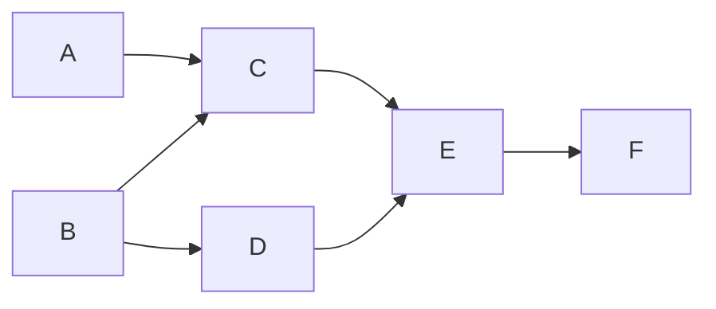

# Topological Sorting

> **Module 05 · Data Structures & Algorithms** · Prerequisites: [Union Find](37-Union-Find.md) · Next: [Monotonic Stack](39-Monotonic-Stack.md)

---

## ⏱ If You Only Have 2 Minutes

- A **topological order** lists every node of a directed graph so that each edge `u → v` puts `u` before `v`. It exists only when the graph is a **DAG** (directed acyclic graph), meaning it has no cycles.
- **Kahn's algorithm** counts each node's unfinished prerequisites (its in-degree). It starts a queue with the nodes whose count is zero, then removes them one by one. Any node left unprocessed at the end is part of, or stuck behind, a cycle.
- **DFS post-order** works too. Append a node after all of its dependencies finish, then reverse the list. Reaching a node that is still on the current path reveals a cycle.
- Both methods run in O(V + E): every vertex and every edge is handled once.
- A valid order is usually not unique. If a test compares exact output, add a tie-break rule, such as a min-heap for the smallest order by name.
- Backend uses: build steps, package installs, database migration order, job schedulers, and service start-up order. Validate new dependencies when they are added, not when the job runs.

---

## 1. What It Is and Why It Exists

A **directed graph** has arrows between nodes. An arrow `u → v` means "`u` must happen before `v`." A **topological order** is a line-up of all nodes that respects every arrow. A **DAG** is a directed graph with no cycles, and only a DAG can have a topological order.

**Analogy:** getting dressed. Socks go before shoes, and a shirt goes before a jacket. Many orders satisfy these rules. Now add a rule that says "shoes before socks." Together with "socks before shoes," you have a loop, and no order works. A cycle in dependencies is a deadlock on paper.

**The problem it solves.** A backend has many pieces that depend on each other: a database migration depends on the one before it, a container depends on its network, a report job depends on two data feeds. If you start them in the wrong order, they fail. Writing the order by hand breaks as soon as a new dependency is added. A topological sort computes a valid order automatically, and it tells you clearly when the dependencies contradict each other.

---

## 2. How It Works

### Kahn's algorithm

1. Compute the **in-degree** of every node: the number of arrows pointing into it.
2. Put every node with in-degree 0 into a queue. These have no unfinished prerequisites.
3. Pop a node `u`, append it to the output, and for each arrow `u → v`, reduce `v`'s in-degree by one. If `v` reaches zero, push it onto the queue.
4. When the queue is empty, compare the output length to the number of nodes. If they differ, there is a cycle.

### Trace on a small input

Six nodes `A … F` with edges `A→C`, `B→C`, `B→D`, `C→E`, `D→E`, `E→F`.

Starting in-degrees: `A=0, B=0, C=2, D=1, E=2, F=1`.

| Step | Queue before pop | Pop | Output so far | In-degree changes | Queue after step |
|---|---|---|---|---|---|
| 1 | `[A, B]` | A | `[A]` | C: 2 → 1 | `[B]` |
| 2 | `[B]` | B | `[A, B]` | C: 1 → 0, D: 1 → 0 | `[C, D]` |
| 3 | `[C, D]` | C | `[A, B, C]` | E: 2 → 1 | `[D]` |
| 4 | `[D]` | D | `[A, B, C, D]` | E: 1 → 0 | `[E]` |
| 5 | `[E]` | E | `[A, B, C, D, E]` | F: 1 → 0 | `[F]` |
| 6 | `[F]` | F | `[A, B, C, D, E, F]` | none | empty |

The result is `A B C D E F`. Node `E` only enters the queue after both `C` and `D` are output, which is exactly the rule.



### DFS post-order

Run a depth-first search from every unvisited node. When a node's search is complete (all its outgoing arrows are explored), append it to a list. The reverse of that list is a topological order. The reason: a node finishes only after everything it points to has finished, so in the reversed list it comes before them.

For cycle detection, mark each node as unvisited, **on the current path**, or finished. If an arrow leads to a node that is still on the current path, there is a cycle.

---

## 3. Key Concepts

### DAG and why cycles break the order

A cycle means some node must come before itself. No linear order can do that. This is why a topological sort is also a **cycle test**: if the output is short, the missing nodes sit on a cycle or depend on one. Kahn's algorithm finds this without any extra work, because nodes on a cycle never reach in-degree zero.

### Kahn's algorithm (in-degree and queue)

Kahn's algorithm is breadth-first in spirit. Each pass of the queue forms a "wave" of nodes that can run in parallel. The number of waves is the length of the longest dependency chain. This makes it a natural fit for schedulers that run independent tasks at the same time.

### DFS post-order

The DFS version needs no in-degree counts. It is shorter to write when you already have a DFS helper. Its real advantage is that, on a cycle, it can report the exact cycle, not just "something is stuck." Kahn's algorithm can only tell you which nodes are left over.

### Multiple valid orders and tie-breaking

Many orders are valid. In the trace above, `B A C D E F` is also correct. If results must be repeatable, pick a rule. Replacing the queue with a min-heap gives the **lexicographically smallest** valid order (the order you would get by always choosing the smallest available name). This costs O((V + E) log V), because each heap operation takes O(log V).

### Cycle detection and reporting

For a cycle report, DFS with three states (unvisited, on path, finished) gives you the cycle itself. When you reach a node that is on the path, the path from that node back to the current node is the cycle. Problem 2 below does exactly this.

---

## 4. Code Examples

**Built-ins.** JavaScript has no topological sort in its standard library. `Array.prototype.sort` is stable, but it sorts by a comparator and cannot respect edges. Python 3.9+ ships `graphlib.TopologicalSorter`. It implements Kahn's algorithm, supports incremental use, and raises `graphlib.CycleError` on a cycle. In production Python code, use it. The implementation below shows how it works.

Both languages use the same two problems:

- **Problem 1: Course Schedule II.** Given `numCourses` and pairs `[a, b]` (take `b` before `a`), return one valid order, or an empty list if there is a cycle.
- **Problem 2: Dependency cycle report.** Given a map from each task to the tasks it needs, return one cycle as `[a, b, c, a]`, or `null` if there is none.

### Node.js / TypeScript

```ts
// Node.js 22+, TypeScript 5 (strict). No packages.

/**
 * Kahn's algorithm. Returns the nodes so that every edge [u, v] has u before v,
 * or null if the graph has a cycle. Time O(V + E), space O(V + E).
 */
export function topoSort<T>(nodes: readonly T[], edges: readonly (readonly [T, T])[]): T[] | null {
  const next = new Map<T, T[]>();        // u -> nodes that must come after u
  const indegree = new Map<T, number>(); // number of unfinished prerequisites
  for (const n of nodes) {
    next.set(n, []);                     // include isolated nodes, or they never reach the output
    indegree.set(n, 0);
  }
  for (const [u, v] of edges) {
    if (!next.has(u) || !next.has(v)) {
      throw new Error(`edge ${String(u)} -> ${String(v)} uses an unknown node`);
    }
    next.get(u)!.push(v);
    indegree.set(v, indegree.get(v)! + 1);
  }

  // Start with every node that has no prerequisites. Map keeps insertion order, so output is repeatable.
  const queue: T[] = [];
  for (const [n, d] of indegree) if (d === 0) queue.push(n);

  const order: T[] = [];
  // An index instead of queue.shift(): shift() is O(n) in general, which would make the loop O(n^2).
  for (let head = 0; head < queue.length; head++) {
    const u = queue[head];
    order.push(u);
    for (const v of next.get(u)!) {
      const left = indegree.get(v)! - 1;
      indegree.set(v, left);
      if (left === 0) queue.push(v);
    }
  }
  // Nodes on a cycle, or behind one, never reach in-degree 0, so the output is short.
  return order.length === next.size ? order : null;
}

// Problem 1: Course Schedule II. Each pair [a, b] means b must come before a.
// Approach: turn each pair into the edge b -> a and run Kahn's algorithm.
// Time O(V + E). Space O(V + E).
export function findCourseOrder(numCourses: number, prerequisites: readonly (readonly [number, number])[]): number[] {
  const nodes = Array.from({ length: numCourses }, (_, i) => i);
  const edges = prerequisites.map(([a, b]): [number, number] => [b, a]);
  return topoSort(nodes, edges) ?? [];
}

// Problem 2: Dependency cycle report. deps maps each task to the tasks it needs.
// Approach: DFS with three states. A task on the current path that is reached again closes a cycle.
// Time O(V + E). Space O(V).
export function findDependencyCycle(deps: ReadonlyMap<string, readonly string[]>): string[] | null {
  const WHITE = 0; // not visited yet
  const GRAY = 1;  // on the current DFS path
  const BLACK = 2; // fully explored
  const color = new Map<string, number>();
  const path: string[] = [];
  let cycle: string[] | null = null;

  const visit = (task: string): boolean => {
    color.set(task, GRAY);
    path.push(task);
    for (const dep of deps.get(task) ?? []) {
      const c = color.get(dep) ?? WHITE;
      if (c === GRAY) {
        // dep is still on the path, so dep -> ... -> task -> dep is a cycle.
        cycle = [...path.slice(path.indexOf(dep)), dep];
        return true;
      }
      if (c === WHITE && visit(dep)) return true;
    }
    path.pop();
    color.set(task, BLACK);
    return false;
  };

  for (const task of deps.keys()) {
    if ((color.get(task) ?? WHITE) === WHITE && visit(task)) break;
  }
  return cycle;
}
```

### Python

```python
# Python 3.12+, standard library only.
from collections import deque
from collections.abc import Hashable, Iterable, Sequence
from typing import TypeVar

T = TypeVar("T", bound=Hashable)


def topo_sort(nodes: Iterable[T], edges: Sequence[tuple[T, T]]) -> list[T] | None:
    """Kahn's algorithm. Returns None when the graph has a cycle. Time O(V + E)."""
    next_of: dict[T, list[T]] = {}
    indegree: dict[T, int] = {}
    for n in nodes:
        next_of.setdefault(n, [])  # keep isolated nodes so they appear in the output
        indegree.setdefault(n, 0)
    for u, v in edges:
        if u not in next_of or v not in next_of:
            raise KeyError(f"edge {u!r} -> {v!r} uses an unknown node")
        next_of[u].append(v)
        indegree[v] += 1

    queue: deque[T] = deque(n for n, d in indegree.items() if d == 0)  # popleft is O(1)
    order: list[T] = []
    while queue:
        u = queue.popleft()
        order.append(u)
        for v in next_of[u]:
            indegree[v] -= 1
            if indegree[v] == 0:
                queue.append(v)
    return order if len(order) == len(next_of) else None


# Problem 1: Course Schedule II. prerequisites[i] = (a, b) means take b before a.
# Approach: edge b -> a, then Kahn's algorithm. Time O(V + E). Space O(V + E).
def find_course_order(num_courses: int, prerequisites: Sequence[tuple[int, int]]) -> list[int]:
    edges = [(b, a) for a, b in prerequisites]
    result = topo_sort(range(num_courses), edges)
    return result if result is not None else []


# Problem 2: Dependency cycle report. Iterative DFS with three states.
# Approach: a task that is still on the path when reached again closes a cycle.
# Time O(V + E). Space O(V).
def find_dependency_cycle(deps: dict[str, list[str]]) -> list[str] | None:
    # Iterative on purpose: Python's default recursion limit (1,000) fails on long chains.
    WHITE, GRAY, BLACK = 0, 1, 2
    color: dict[str, int] = {}
    for start in deps:
        if color.get(start, WHITE) != WHITE:
            continue
        path = [start]                          # tasks on the current DFS path
        iters = [iter(deps.get(start, []))]     # one iterator per entry in path
        color[start] = GRAY
        while iters:
            dep = next(iters[-1], None)
            if dep is None:                     # all dependencies of path[-1] are done
                color[path.pop()] = BLACK
                iters.pop()
                continue
            state = color.get(dep, WHITE)
            if state == GRAY:                   # dep is on the current path: a cycle
                return path[path.index(dep):] + [dep]
            if state == WHITE:
                color[dep] = GRAY
                path.append(dep)
                iters.append(iter(deps.get(dep, [])))
    return None
```

**Runtime note.** The TypeScript cycle finder is recursive. That is fine for typical dependency graphs, but a very long chain can overflow V8's call stack. The Python version uses an explicit stack of iterators for the same reason in a stricter form. Python's recursion limit is low by default, so the iterative version is the safe default there.

---

## 5. Production Concerns

- **Validate on insert, not at run time.** When someone adds a dependency `A needs B`, check whether `B` already depends on `A`, directly or through a chain. A DFS from `B` costs O(V + E) and can reject the change with the cycle path in the error. Waiting until the scheduler runs means the cycle shows up half-way through a deploy.
- **Fail loudly.** A common bug is to return the partial output when there is a cycle. Compare the output length with the node count, and throw or return an error that names the cycle.
- **Parallel waves.** Kahn's queue naturally gives "levels": every node in one wave can run at once. For a deploy with 5,000 services, the wave count equals the longest dependency chain, and that chain sets the minimum deploy time. Compute it with a DP pass over the topological order.
- **Failures and skips.** When a task fails, all its descendants must be skipped or blocked. Store the graph, and walk the descendants of the failed node. A retry should re-run only the failed node and what depends on it.
- **Stable output.** Use a sorted queue (a min-heap, or a sorted list of ready nodes) so the same input always gives the same build order. Repeatable builds are easier to debug.
- **Scale.** O(V + E) is cheap, but building the graph from a database can be the slow part. Load the edge list with one query, not one query per node. Log the graph size and the time to sort, and alert when a graph grows far beyond its normal size.
- **Names in logs.** Log task IDs and cycle paths. Avoid logging job payloads, since they may contain secrets or personal data.

---

## 6. Common Mistakes

- **Reversing the edge direction** — `A needs B` is stored as `A → B`, so `A` runs first and the output is wrong — store the arrow in the direction "must come before": `B → A`.
- **Dropping isolated nodes** — a task with no dependencies is missing from the output because only nodes in edges were added — add every node from the input list first.
- **Returning partial output silently** — the job runs on a subset of the tasks with no error — compare `order.length` to the node count and fail with the cycle.
- **Using `shift()` in a JavaScript queue** — each `shift` can cost O(n) — use an index that moves forward, or a deque.
- **Expecting one exact answer** — tests compare the whole array, but many orders are valid — check the property that every edge points forward, or set a tie-break rule.
- **Recursing deeply on long chains** — a DFS on a 50,000-task chain can overflow the stack — use Kahn's algorithm or an explicit stack.
- **Detecting cycles only at run time** — the cycle is found after earlier tasks have already run — reject the cycle when the dependency is written.

---

## 7. Comparison Table

| Approach | Time | Extra space | Cycle detection | Output | Best for |
|---|---|---|---|---|---|
| Kahn's algorithm (in-degree and queue) | O(V + E) | O(V + E) | Output is short; no path reported | Level by level, good for parallel waves | Schedulers, build graphs, migration ordering |
| DFS post-order, then reverse | O(V + E) | O(V + E) | Exact cycle found from the path stack | One valid order, depends on visit order | Reporting the cycle, reusing an existing DFS |
| Repeatedly pick any node with no unmet dependencies by scanning | O(V · (V + E)) | O(V) | Output is short | Any valid order | Tiny graphs where code clarity matters most |

Kahn's algorithm is the default choice for production schedulers because it gives parallel levels and an easy cycle check. DFS is the better choice when a user needs to see the exact cycle.

---

## 8. Interview Questions

**[Junior] What is a topological order, and when does one exist?**
It is a linear order of the nodes of a directed graph where every edge points from an earlier node to a later one. It exists only if the graph is a DAG, meaning it has no cycles. A cycle makes it impossible for some node to come before itself. Many different orders can be valid for the same DAG.

**[Junior] Describe Kahn's algorithm in three steps.**
First, compute the in-degree of every node. Second, put all nodes with in-degree zero into a queue. Third, repeatedly remove a node from the queue, add it to the output, and reduce the in-degree of each node it points to. Push any node whose in-degree reaches zero. If the output has fewer nodes than the graph, there is a cycle.

**[Mid] How does Kahn's algorithm detect a cycle?**
Nodes on a cycle depend on each other, so none of them can reach in-degree zero first. The queue therefore never includes them, and they never reach the output. The output is shorter than the node count, and the missing nodes are the cycle or the nodes stuck behind it. This costs nothing extra, but it does not tell you the exact cycle, so you need DFS for that.

**[Mid] How would you get the lexicographically smallest valid order?**
Replace the queue with a min-heap that holds the nodes whose in-degree is zero. Always pop the smallest name. The result is the smallest order in dictionary order. The cost rises to O((V + E) log V) because each heap push and pop takes O(log V). This matters when two builds must produce identical logs.

**[Mid] Solve Course Schedule II and state the complexity.**
Turn each prerequisite pair `[a, b]` into a directed edge `b → a`. Run Kahn's algorithm over all courses. If the output includes every course, return it. Otherwise a cycle exists, so return an empty list. The time is O(V + E) and the space is O(V + E), where V is the number of courses and E is the number of prerequisites.

**[Senior] A pull request adds a dependency to a graph of five thousand services. How do you stop cycles from reaching production?**
Check at review time, not at deploy time. The check is a search from the new dependency's target: if it reaches the source of the new edge, the edge would close a cycle. A DFS costs O(V + E) for each proposed edge, which is cheap compared with a failed deploy. Return the path in the CI error so the author can see which chain to break. Also run a full topological sort in CI as a second guard, because a bug in the checker should not be the only protection.

**[Senior] How do you turn a topological order into a parallel schedule, and what limits the speed?**
Use Kahn's algorithm in waves: start all nodes with in-degree zero at once, and when a node finishes, decrement its children. Each wave runs concurrently. The fastest possible finish time is the length of the longest path in the DAG, because each step on that path must wait for the previous one. You compute it with a DP pass over the topological order. Failures need care: a failed node should mark all its descendants as blocked, not just stop the run.

**[Senior] Two developers add database migrations on separate branches. The migration graph now has two heads. What should the tool do?**
The migration history is a DAG where each migration names its parent. Two heads mean the graph has forked, and any topological order is valid for the schema tools alone. The safe rule is to refuse to run until a merge migration joins the heads, because the two branches may change the same table in different ways. A tool that silently picks one order can produce a schema that neither developer tested. Failing loudly here is the correct behavior.

---

## 9. Cheat Sheet

```text
Definition    Order of nodes so that every edge u -> v puts u before v
Exists when   The graph is a DAG (no cycles)
Kahn          in-degree counts + queue of zeros; output short => cycle
DFS           post-order, then reverse; gray node on path reached => cycle
Time / space  O(V + E) time, O(V + E) space, same for every case
Ties          many valid orders; min-heap gives the smallest order
Parallel      Kahn waves; minimum finish time = longest path
Cycle report  DFS path stack gives the exact cycle
Validate      check reachability when an edge is added
Built-ins     JS: none. Python: graphlib.TopologicalSorter (raises CycleError)
Never         drop isolated nodes; return partial output; use shift() in a JS loop
Backend       build steps, package installs, migrations, schedulers, start-up order
```

---

## Related Topics

- [Graphs](20-Graphs.md) — the adjacency-list model that both algorithms use.
- [Depth First Search](22-Depth-First-Search.md) — the search behind the DFS post-order method and cycle reporting.
- [Union Find](37-Union-Find.md) — the undirected counterpart for grouping and cycle checks.
- [Dynamic Programming Fundamentals](36-Dynamic-Programming-Fundamentals.md) — the longest-path DP used to compute the minimum parallel finish time.
