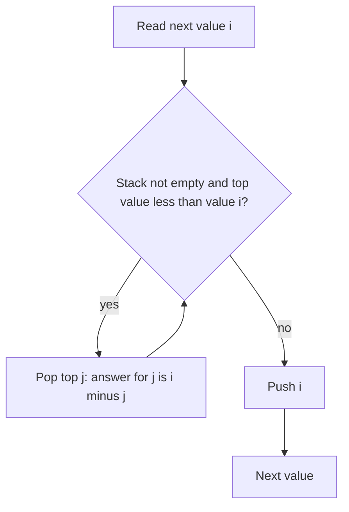

# Monotonic Stack

> **Module 05 · Data Structures & Algorithms** · Prerequisites: [Topological Sorting](38-Topological-Sorting.md) · Next: [Monotonic Queue](40-Monotonic-Queue.md)

---

## ⏱ If You Only Have 2 Minutes

- A **monotonic stack** is an ordinary stack with one rule: the values stay in sorted order from bottom to top, either always increasing or always decreasing. Before pushing a new value, pop every value that breaks the order.
- Each index is pushed once and popped at most once. So a single left-to-right pass solves "next greater element" for all n items in **O(n)**, not O(n²).
- **Next greater element** of `i` is the first index `j > i` with a larger value. **Previous smaller element** is the nearest index `j < i` with a smaller value. Both come from the same stack, read in different directions.
- Store **indexes**, not values. You need the index to compute distances and widths.
- Pick `>` or `>=` from the problem wording. Equal values change the answer for "strictly greater" questions.
- Backend use: finding the nearest earlier spike or higher reading in a metric series, such as "how many minutes since the last higher request rate." Next-greater answers need future samples, so streaming systems must delay them.

---

## 1. What It Is and Why It Exists

A **monotonic stack** keeps elements in a strict order (**monotonic** means "never changing direction"). A **decreasing** monotonic stack has values that get smaller from bottom to top. An **increasing** one gets larger. You build it the same way as a normal stack: push, pop, and read the top. The extra rule is that a push is allowed only after the pops needed to keep the order are done.

**Analogy:** a line of people waiting to be seen over a crowd. Each person in the line is still waiting for someone taller to arrive behind them. When a tall person arrives, every shorter person on the line has now found their answer, so they leave the line. Only people still waiting for a taller arrival stay.

**The problem it solves.** Many questions ask about the nearest element on one side that satisfies a condition. "For each day, how many days until a warmer day?" is one. Checking every later day for each day is O(n²). For a series of 100,000 samples, that is about 5 billion comparisons in the worst case. The monotonic stack answers all of them in one pass with about 100,000 pushes and pops.

It fits when the answer for each item depends on its nearest neighbor on one side. It does not fit when the window moves along the array and you need the best value inside it. That case belongs to the [Monotonic Queue](40-Monotonic-Queue.md).

---

## 2. How It Works

### The rule

Scan left to right. Keep a stack of indexes whose values are still waiting for a larger value (for next greater). When the current value is larger than the value at the top of the stack, the top has found its answer. Pop it, record the answer, and keep going. When the top is larger than or equal to the current value (for a strict "greater" question), stop popping and push the current index.

### Trace on a small input

Problem: for each day, how many days until a warmer day? (The answer is 0 when no warmer day exists.)

`temps = [73, 74, 75, 71, 69, 72, 76, 73]`

The stack holds indexes whose temperatures strictly decrease from bottom to top.

| Index `i` | Temp | Stack before | Pops (index: answer = `i` − index) | Stack after |
|---|---|---|---|---|
| 0 | 73 | `[]` | none | `[0]` |
| 1 | 74 | `[0]` | 0: 1 − 0 = 1 | `[1]` |
| 2 | 75 | `[1]` | 1: 2 − 1 = 1 | `[2]` |
| 3 | 71 | `[2]` | none (75 is not less than 71) | `[2, 3]` |
| 4 | 69 | `[2, 3]` | none | `[2, 3, 4]` |
| 5 | 72 | `[2, 3, 4]` | 4: 5 − 4 = 1, then 3: 5 − 3 = 2 | `[2, 5]` |
| 6 | 76 | `[2, 5]` | 5: 6 − 5 = 1, then 2: 6 − 2 = 4 | `[6]` |
| 7 | 73 | `[6]` | none | `[6, 7]` |

Indexes left on the stack at the end never found a warmer day, so they keep 0. The answer is `[1, 1, 4, 2, 1, 1, 0, 0]`.



### Why it is O(n)

Each index is pushed once, when it is read. It is popped at most once, and after that it is gone. The `while` loop may pop many items in one step, but the total number of pops across the whole run cannot exceed the number of pushes. So the total work is about 2n operations.

---

## 3. Key Concepts

### Next greater and previous smaller

These are two sides of the same idea. In a left-to-right pass, popping reveals the **next** element that beats the popped one. The element that remains on the stack under the current index is the **previous** element that is smaller (for an increasing stack). Problems often need both at once, as in the histogram problem below.

### Storing indexes, not values

The stack stores positions. From a position you can read the value and compute a distance (`i − j`) or a width (`i − left − 1`). If you stored values only, you could not tell how far away the answer is.

### Strict versus non-strict comparisons

If the question says "strictly greater," an equal value is not an answer. So you pop only when the top is strictly smaller than the current value. If the question allows equal values, pop on `<=` instead. Get this wrong and duplicates break the answer. Always decide this from the wording before writing the loop.

### Histogram area and the sentinel

For the largest rectangle in a histogram, each bar can be the shortest bar of a rectangle. Its width runs from the nearest shorter bar on the left to the nearest shorter bar on the right. A stack of increasing heights finds both boundaries at once: the right boundary is the bar that pops it, and the left boundary is the index left below it. A sentinel height of 0 at the end forces the last bars out.

### Relation to the rest of the module

A monotonic stack is a special case of the [Stacks](08-Stacks.md) chapter, with an invariant added. It often appears with a [Sliding Window](31-Sliding-Window.md) problem, where the window moves and a different structure is needed.

---

## 4. Code Examples

**Built-ins.** JavaScript has no monotonic stack type. A plain `Array` works well: `push` and `pop` at the end are O(1) amortized. Do not use `shift` or `unshift` for the stack, because they move every element. Python has no monotonic stack either. A `list` used with `append` and `pop` gives the same O(1) amortized behavior. `collections.deque` also works, but it is not needed for a stack.

Two problems are solved in both languages:

- **Problem 1: Daily Temperatures.** Given daily temperatures, return for each day how many days until a warmer day (0 if none).
- **Problem 2: Largest Rectangle in Histogram.** Given bar heights, return the area of the largest rectangle that fits under the histogram.

### Node.js / TypeScript

```ts
// Node.js 22+, TypeScript 5 (strict). No packages.

/**
 * For each i, the index of the nearest j > i with values[j] > values[i], or -1.
 * The stack holds indexes whose values strictly decrease from bottom to top.
 * Time O(n), space O(n). Empty input returns [].
 */
export function nextGreaterIndex(values: readonly number[]): number[] {
  const result = new Array<number>(values.length).fill(-1);
  const stack: number[] = [];
  for (let i = 0; i < values.length; i++) {
    // values[i] is the answer for every waiting index whose value is strictly smaller.
    while (stack.length > 0 && values[stack[stack.length - 1]] < values[i]) {
      result[stack.pop()!] = i;
    }
    stack.push(i);
  }
  return result; // indexes still on the stack never found a greater value and keep -1
}

// Problem 1: Daily Temperatures. Days until a warmer day, or 0 if none.
// Approach: next greater index, then turn each index into a distance.
// Time O(n). Space O(n).
export function dailyTemperatures(temps: readonly number[]): number[] {
  return nextGreaterIndex(temps).map((j, i) => (j === -1 ? 0 : j - i));
}

// Problem 2: Largest Rectangle in Histogram. Return the largest rectangle area.
// Approach: a stack of increasing heights. When a shorter bar arrives, each taller bar on
// the stack is finished. Its right edge is the current index, and its left edge is the
// index below it on the stack. A sentinel height 0 at the end empties the stack.
// Time O(n). Space O(n).
export function largestRectangle(heights: readonly number[]): number {
  const stack: number[] = []; // indexes with strictly increasing heights
  let best = 0;
  for (let i = 0; i <= heights.length; i++) {
    const h = i === heights.length ? 0 : heights[i]; // sentinel flushes the stack
    while (stack.length > 0 && heights[stack[stack.length - 1]] >= h) {
      const top = stack.pop()!;
      const left = stack.length > 0 ? stack[stack.length - 1] : -1;
      const width = i - left - 1; // every bar strictly between left and i is at least this tall
      best = Math.max(best, heights[top] * width);
    }
    stack.push(i);
  }
  return best;
}
```

### Python

```python
# Python 3.12+, standard library only.
from collections.abc import Sequence


def next_greater_index(values: Sequence[float]) -> list[int]:
    """For each i, the nearest j > i with values[j] > values[i], or -1. Time O(n)."""
    result = [-1] * len(values)
    stack: list[int] = []  # indexes whose values strictly decrease from bottom to top
    for i, value in enumerate(values):
        while stack and values[stack[-1]] < value:
            result[stack.pop()] = i
        stack.append(i)
    return result


# Problem 1: Daily Temperatures. Approach: next greater index, then distances.
# Time O(n). Space O(n).
def daily_temperatures(temps: Sequence[float]) -> list[int]:
    return [0 if j == -1 else j - i for i, j in enumerate(next_greater_index(temps))]


# Problem 2: Largest Rectangle in Histogram. Same stack idea as the TypeScript version.
# Time O(n). Space O(n).
def largest_rectangle(heights: Sequence[int]) -> int:
    stack: list[int] = []  # indexes with strictly increasing heights
    best = 0
    for i in range(len(heights) + 1):
        h = 0 if i == len(heights) else heights[i]  # sentinel flushes the stack
        while stack and heights[stack[-1]] >= h:
            top = stack.pop()
            left = stack[-1] if stack else -1
            best = max(best, heights[top] * (i - left - 1))
        stack.append(i)
    return best
```

**Runtime note.** The algorithm is the same in both languages, and the code is almost line for line. The difference is the error path. In JavaScript, `stack.pop()` returns `number | undefined`, so the code uses `!` after checking the length. In Python, `stack.pop()` raises `IndexError` on an empty list, so the `while stack` guard is required. Both guards are shown.

---

## 5. Production Concerns

- **Streaming needs a delay for next greater.** Previous-greater and previous-smaller answers are known as soon as the value arrives, because they only look back. Next-greater answers need a future value. A streaming pipeline must hold each unresolved index until a larger value arrives, or until a time or count limit is reached. Decide the limit up front and emit "no answer within limit" when it expires.
- **Memory grows with the input.** The stack can hold every index if the input is strictly increasing or decreasing. For an unbounded metric stream, cap the number of samples or the time window, and document what happens to older samples.
- **NaN breaks the invariant.** Any comparison with `NaN` is false, so the stack never pops it and the answers become wrong. Reject or filter `NaN` before the scan. Metric pipelines often produce `NaN` from division by zero.
- **Equal values in metrics.** Many metrics are integers with many repeats, such as response codes or request counts. Confirm whether "warmer" means strictly greater before writing the loop, because the wrong choice silently changes the counts.
- **Per-series state.** A dashboard can compute this for hundreds of series. Keep one stack per series, not one shared stack, and protect it from concurrent writers in Python with a lock.
- **Logging.** Log the input length and the run time for large batches. Do not log raw metric values if they reveal business data such as revenue.

---

## 6. Common Mistakes

- **Wrong comparison operator** — equal values are counted as "greater," so duplicate readings get a wrong answer — pick `<` or `<=` from the wording, and test with a repeated value.
- **Storing values on the stack** — you cannot compute the distance or width, so the output is the value instead of a position — store indexes and read the values from the array.
- **Forgetting the leftovers** — indexes still on the stack at the end keep their default answer without a clear rule — set the default to `-1` or `0` on purpose, and state it in the function.
- **Off-by-one widths** — the histogram width is `i - left - 1`, and writing `i - left` overstates every rectangle — check with a single bar, where the answer must equal its height.
- **Forgetting the sentinel** — bars left on the stack at the end are never measured, so the answer is too small — add a final height of 0.
- **Using it for a moving window** — a stack only sees the nearest neighbors, not the maximum inside a window that slides — use a [Monotonic Queue](40-Monotonic-Queue.md).
- **Ignoring NaN** — `NaN` is never less or greater than anything, so the stack silently keeps it — validate input before the scan.

---

## 7. Comparison Table

| Approach | Time for all n answers | Extra space | Best for |
|---|---|---|---|
| Monotonic stack | O(n), each index pushed and popped once | O(n) | Next greater, previous smaller, histogram areas |
| Nested loops | O(n²) in the worst case, such as a strictly decreasing input | O(1) | Very small inputs, or code that must be obvious |
| Sparse table or segment tree over the array | O(n log n) to build; O(log n) or O(1) per query | O(n log n) | Arbitrary range maximum queries, where ranges are not "nearest neighbor" |

Use the stack when every query asks about the nearest neighbor on one side. Use a sparse table or segment tree when the queries ask for the maximum over arbitrary ranges that you choose at query time.

---

## 8. Interview Questions

**[Junior] What is a monotonic stack?**
It is a stack that keeps its values in sorted order, either increasing or decreasing from bottom to top. Before pushing a new value, you pop every value that would break the order. It is built with the same push and pop operations as a regular stack, plus this one rule.

**[Junior] For `[2, 1, 2, 4, 3]`, what is the next greater value for each element?**
The answers are `[4, 2, 4, -1, -1]`. The first 2 is beaten by 4, the 1 is beaten by the next 2, the second 2 is beaten by 4, and nothing after the 4 or the 3 is larger. A stack that keeps decreasing values gives these answers in one pass.

**[Mid] Why is this O(n) even though the loop can pop many items at once?**
Each index is pushed exactly once and popped at most once. The total number of pops over the whole run cannot be more than the total number of pushes, which is n. A single step can be expensive, but the cost is spread across the run. This is an amortized bound.

**[Mid] Why store indexes instead of values?**
Problems usually ask for a distance or a width. The distance from day 2 to day 6 is `6 − 2`, and that needs the index. Values alone cannot tell you where the answer is. Storing indexes also means you can read the value at any time with one array lookup.

**[Mid] How do you decide between `<` and `<=` in the pop condition?**
Read the wording. "Strictly greater" means an equal value is not an answer, so you keep equal values on the stack and pop only when the top is strictly smaller. "Greater or equal" flips the condition. Write a test with a repeated value, because an error here passes most simple examples and fails only on duplicates.

**[Senior] Explain how the histogram algorithm finds the largest rectangle in one pass.**
When a bar is popped, the current index is the first bar to its right that is shorter, so that is its right boundary. The index below it on the stack is the nearest shorter bar to its left, which is its left boundary. The width is the gap between those two boundaries, and the area is that width times the popped height. Every bar is popped exactly once, so every candidate rectangle is measured with its widest valid width. The sentinel of height 0 ensures no bar is left unmeasured.

**[Senior] A monitoring stream sends one sample per second, and you must report for each sample how long ago the last higher sample occurred. What do you build, and what are the limits?**
This is previous greater, which needs only past samples, so it can be answered as each sample arrives. Keep a decreasing stack of (time, value) pairs. For each new sample, pop values that are not higher, then the top is the answer. The stack can grow to the full stream length if values keep decreasing, so bound it with a time window that expires old entries. If the question were next greater instead, each answer would wait for a future spike, and the system would need a delay or a deadline for those answers.

---

## 9. Cheat Sheet

```text
Idea            Stack of indexes kept in sorted order; pop when the order would break
Next greater    Scan left to right; pop while top value < current; popped index gets i
Previous        Same stack; the element left under the current index is the answer
Time            O(n) total, amortized: each index pushed once, popped at most once
Space           O(n) worst case (monotone input)
Store           indexes, not values; distance = i - j; width = i - left - 1
Strict          "greater" means pop only on <; "greater or equal" pops on <=
Histogram       right edge = popping index; left edge = index below; sentinel 0 at the end
Streaming       previous-greater can be answered immediately; next-greater needs a delay
NaN             never pops; reject it before the scan
Built-ins       JS: Array push/pop. Python: list append/pop. No dedicated type in either
Never           use shift() in JS; forget the sentinel; use a stack for a moving window
```

---

## Related Topics

- [Stacks](08-Stacks.md) — the plain stack this structure extends, with bracket matching as a first example.
- [Sliding Window](31-Sliding-Window.md) — the moving-window pattern that needs the next chapter's structure.
- [Monotonic Queue](40-Monotonic-Queue.md) — the same monotonic idea applied to a deque, for window maximums.
