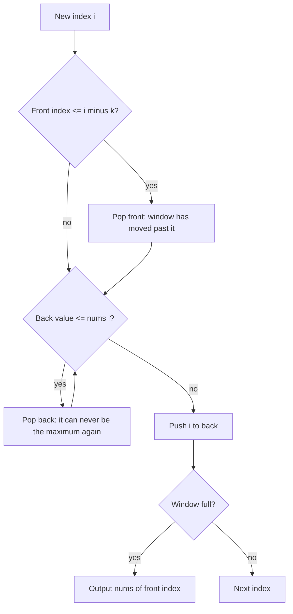

# Monotonic Queue

> **Module 05 · Data Structures & Algorithms** · Prerequisites: [Monotonic Stack](39-Monotonic-Stack.md) · Next: [Backend DSA Patterns](41-Backend-DSA-Patterns.md)

---

## ⏱ If You Only Have 2 Minutes

- A **monotonic queue** is a [deque](10-Deque.md) (double-ended queue) that keeps its candidates in sorted order. For a sliding-window **maximum**, the values run strictly decreasing from front to back, so the front is always the window's largest value.
- Two rules do all the work. **Expire from the front**: drop an index once it has slid out of the window. **Remove from the back**: before adding a new index, drop every older index whose value is not larger than the new one.
- Each index enters and leaves the deque at most once, so a whole sliding-window maximum over n items takes **O(n)**, not O(n·k) for window size k.
- Store **indexes** in the deque, not values. Indexes tell you when an entry has expired, and you read the value with one lookup.
- For a minimum, reverse the comparison. For a longest window with `max − min ≤ limit`, use two deques, one for each.
- Backend use: rolling maximum latency over the last N requests, or the highest value in the last 60 seconds of a metric. Max is easy. Percentiles such as p99 need a different structure.

---

## 1. What It Is and Why It Exists

A **monotonic queue** is a deque with a sorted rule. Each new value is added at the back, and the deque is kept in order by removing values from the back that can no longer matter. The front of the deque is always the best candidate for the current window. As the window slides, the front is removed when its index leaves the window.

**Analogy:** a shelf of high scores on a scoreboard that only shows the last N games. When a new game scores higher than an older one, the older score can never be the top score while the new game is still on the board, because the new game will stay on the board longer. So the old score is taken off. The top of the shelf is always the highest score still on the board.

**The problem it solves.** You have an array and a window of size k that slides one step at a time. You want the maximum of each window. The simple method finds the maximum of each window from scratch, which costs O(k) per window and O(n·k) in total. For a 1-million-sample series with a window of 10,000, that is 10 billion comparisons. The monotonic queue does the same job in about 2 million deque operations.

It fits when you need the extreme value of a moving range, and the range only moves forward. It does not fit when you need the maximum of arbitrary ranges chosen later. For that, use a sparse table or a segment tree.

---

## 2. How It Works

### The three steps for each new index `i`

1. **Expire.** If the front index is `i − k` or smaller, it is no longer in the window `[i − k + 1, i]`. Remove it from the front.
2. **Dominate.** While the back index has a value less than or equal to `nums[i]`, remove it from the back. It leaves the window before `i` does, and `i` is at least as large, so the back index can never be the maximum again.
3. **Add.** Push `i` to the back. Once `i ≥ k − 1`, the window is full, and the front index holds the window's maximum.

### Trace on a small input

`nums = [1, 3, −1, −3, 5, 3, 6, 7]`, window size `k = 3`.

Each deque entry is shown as `index(value)`, from front to back.

| `i` | `nums[i]` | Action | Deque after step | Window max |
|---|---|---|---|---|
| 0 | 1 | Add to empty deque | `0(1)` | not full yet |
| 1 | 3 | Remove `0(1)` because 1 ≤ 3; add 1 | `1(3)` | not full yet |
| 2 | −1 | Keep `1(3)`; add 2 | `1(3) 2(−1)` | 3 |
| 3 | −3 | Front 1 is still in `[1, 3]`; add 3 | `1(3) 2(−1) 3(−3)` | 3 |
| 4 | 5 | Expire front 1 (window is `[2, 4]`); remove 3 and 2 as ≤ 5; add 4 | `4(5)` | 5 |
| 5 | 3 | Keep `4(5)`; add 5 | `4(5) 5(3)` | 5 |
| 6 | 6 | Expire nothing; remove 5 and 4 as ≤ 6; add 6 | `6(6)` | 6 |
| 7 | 7 | Remove 6 as ≤ 7; add 7 | `7(7)` | 7 |

The output is `[3, 3, 5, 5, 6, 7]`, which matches the maximum of each window.



### Why it is O(n)

Each index is pushed once and popped at most once, either from the back (dominated) or from the front (expired). The total number of pops cannot exceed the number of pushes, so the total work is O(n). A single step can pop several entries at once, but the cost of those pops has already been "paid" by the earlier pushes.

---

## 3. Key Concepts

### The window is defined by index, not value

Expiry compares indexes: an index leaves the window when it is `k` or more positions behind the current one. This is why the deque stores indexes. Values can repeat, so a value cannot tell you which copy is old.

### The monotone invariant

The deque is strictly decreasing in value from front to back. That is the invariant. The front is the maximum because every other entry in the deque was added after it and was no larger, or was dominated by something added after it. A deque entry that breaks the invariant has already been removed.

### Why removing from the back is safe

Suppose index `j` has value `v`, and a newer index `i` (with `j < i`) has value `w ≥ v`. Index `j` expires at `j + k`, and `i` expires later, at `i + k`. So from the moment the window reaches `i`, every window that still contains `j` also contains `i`, and `i` is at least as large. Keeping `j` would never change the answer. This is called **dominance**, and it is the reason the back removal is correct.

### Minimum and two deques

For a minimum, use an increasing deque: remove from the back while the back value is greater than or equal to the new value. For a question that needs both the maximum and the minimum, such as "the longest subarray where max − min ≤ limit," keep two deques and move a left pointer until the difference is within the limit. Problem 2 below does this.

### Relation to the rest of the module

The deque itself is covered in [Deque](10-Deque.md). The moving-window pattern is covered in [Sliding Window](31-Sliding-Window.md). This chapter combines them: the window provides the movement, and the monotone deque provides the extreme value fast enough to be practical.

---

## 4. Code Examples

**Built-ins.** JavaScript has no double-ended queue type. `Array.prototype.shift` is O(n) in general, so using it as the front of a queue can make the loop quadratic. The TypeScript code below uses a small ring buffer that never shifts. Python's `collections.deque` gives O(1) `append`, `pop`, `appendleft`, and `popleft` at both ends, so the Python code is shorter. Do not use `list.pop(0)` in Python for the same reason.

Two problems are solved in both languages:

- **Problem 1: Sliding Window Maximum.** Given `nums` and a window size `k`, return the maximum of each window.
- **Problem 2: Longest Subarray with Limited Spread.** Given `nums` and `limit`, return the length of the longest contiguous subarray where `max − min ≤ limit`.

### Node.js / TypeScript

```ts
// Node.js 22+, TypeScript 5 (strict). No packages.

/** Fixed-capacity deque of indexes, stored in a ring buffer. Never shifts elements. */
class IndexDeque {
  private readonly buf: Int32Array;
  private head = 0; // position of the front element in buf
  private len = 0;

  constructor(capacity: number) {
    this.buf = new Int32Array(Math.max(1, capacity));
  }

  get size(): number { return this.len; }
  front(): number { return this.buf[this.head]; }
  back(): number { return this.buf[(this.head + this.len - 1) % this.buf.length]; }

  pushBack(x: number): void {
    this.buf[(this.head + this.len) % this.buf.length] = x;
    this.len++;
  }

  popFront(): void {
    this.head = (this.head + 1) % this.buf.length;
    this.len--;
  }

  popBack(): void {
    this.len--;
  }
}

// Problem 1: Sliding Window Maximum. Return the max of each window of size k.
// Approach: a deque of indexes with strictly decreasing values. Expire the front when it
// leaves the window; drop smaller values from the back; the front is the window max.
// Time O(n). Space O(k): the deque never holds more than k indexes.
export function slidingWindowMax(nums: readonly number[], k: number): number[] {
  if (!Number.isInteger(k) || k < 1 || k > nums.length) return [];
  const dq = new IndexDeque(k);
  const out: number[] = [];
  for (let i = 0; i < nums.length; i++) {
    // Only index i - k can expire at this step, because older indexes left earlier.
    if (dq.size > 0 && dq.front() <= i - k) dq.popFront();
    // Dominance: a smaller older value leaves the window first, so it can never be the max again.
    while (dq.size > 0 && nums[dq.back()] <= nums[i]) dq.popBack();
    dq.pushBack(i);
    if (i >= k - 1) out.push(nums[dq.front()]);
  }
  return out;
}

// Problem 2: Longest Subarray with Limited Spread. Longest run where max - min <= limit.
// Approach: two monotone deques (decreasing for max, increasing for min) with a sliding window.
// Move the left edge only while the spread is too large.
// Time O(n). Space O(n).
export function longestWithinLimit(nums: readonly number[], limit: number): number {
  if (limit < 0) throw new RangeError("limit must be non-negative");
  const maxQ = new IndexDeque(nums.length); // front = index of the window maximum
  const minQ = new IndexDeque(nums.length); // front = index of the window minimum
  let left = 0;
  let best = 0;
  for (let right = 0; right < nums.length; right++) {
    while (maxQ.size > 0 && nums[maxQ.back()] <= nums[right]) maxQ.popBack();
    maxQ.pushBack(right);
    while (minQ.size > 0 && nums[minQ.back()] >= nums[right]) minQ.popBack();
    minQ.pushBack(right);

    // A single element has spread 0, so this loop never empties the window.
    while (nums[maxQ.front()] - nums[minQ.front()] > limit) {
      if (maxQ.front() === left) maxQ.popFront();
      if (minQ.front() === left) minQ.popFront();
      left++;
    }
    best = Math.max(best, right - left + 1);
  }
  return best;
}
```

### Python

```python
# Python 3.12+, standard library only.
from collections import deque
from collections.abc import Sequence


# Problem 1: Sliding Window Maximum. Max of each window of size k.
# Approach: deque of indexes with strictly decreasing values. Time O(n). Space O(k).
def sliding_window_max(nums: Sequence[int], k: int) -> list[int]:
    if not 1 <= k <= len(nums):
        return []
    dq: deque[int] = deque()  # indexes; values strictly decrease from front to back
    out: list[int] = []
    for i, x in enumerate(nums):
        if dq and dq[0] <= i - k:       # the front has left the window [i - k + 1, i]
            dq.popleft()
        while dq and nums[dq[-1]] <= x:  # dominated: an older, smaller value can never win again
            dq.pop()
        dq.append(i)
        if i >= k - 1:
            out.append(nums[dq[0]])
    return out


# Problem 2: Longest Subarray with Limited Spread. Two monotone deques and a moving left edge.
# Time O(n). Space O(n).
def longest_within_limit(nums: Sequence[int], limit: int) -> int:
    if limit < 0:
        raise ValueError("limit must be non-negative")
    max_q: deque[int] = deque()  # front = index of the window maximum
    min_q: deque[int] = deque()  # front = index of the window minimum
    left = best = 0
    for right, x in enumerate(nums):
        while max_q and nums[max_q[-1]] <= x:
            max_q.pop()
        max_q.append(right)
        while min_q and nums[min_q[-1]] >= x:
            min_q.pop()
        min_q.append(right)

        # A single element has spread 0, so the window never becomes empty here.
        while nums[max_q[0]] - nums[min_q[0]] > limit:
            if max_q[0] == left:
                max_q.popleft()
            if min_q[0] == left:
                min_q.popleft()
            left += 1
        best = max(best, right - left + 1)
    return best
```

**Runtime note.** The TypeScript version needs its own ring buffer because JavaScript arrays are not efficient at removing from the front. The Python version uses `collections.deque`, which is designed for this. The algorithm is the same in both. One detail to notice: `dq[0]` in Python raises `IndexError` on an empty deque, so the code always checks the deque is non-empty before reading it, or relies on the window invariant. The TypeScript version reads `front()` without a check, so the invariant is what keeps it safe.

---

## 5. Production Concerns

- **Time windows versus count windows.** The code above expires by index, which means "the last k samples." For "the last 60 seconds," expire by timestamp instead. That works only if events arrive in timestamp order. Out-of-order events break dominance, because a newer event may expire before an older one it removed.
- **Out-of-order metrics.** Real collectors reorder events. Either buffer for a short lateness window and sort, or accept that late events may be counted in the wrong window. Document which choice you made.
- **Max is not percentile.** A monotonic queue gives the exact maximum of the window. It cannot give p99 or the median. Those need an order-statistic structure or a sketch such as t-digest or an HDR histogram, which trade exactness for small memory.
- **Memory per series.** Each series and each window size needs its own deque of up to k indexes. A dashboard with 10,000 series and k = 10,000 holds up to 10^8 indexes in total, so choose window sizes carefully. Store indexes in an `Int32Array` in Node, not in a regular array of objects.
- **NaN values.** Comparisons with `NaN` are always false, so a `NaN` never dominates and never expires correctly. Filter `NaN` out before the scan, and log how many were dropped.
- **Concurrency.** A deque is not safe for concurrent writers. Keep one owner per series, or add a lock in Python if several threads update the same series.
- **Logging.** Log the window size and the number of samples processed, not the raw values if they are sensitive.

---

## 6. Common Mistakes

- **Storing values in the deque** — you cannot tell when an entry expires, so old maxima stay forever — store indexes and read the values from the array.
- **Forgetting the front expiry** — the deque reports a maximum from outside the window — check `front <= i - k` on every step.
- **Keeping dominated values** — the deque grows and the front is no longer the maximum — pop from the back while the back value is less than or equal to the new value.
- **Using `shift()` in JavaScript** — each `shift` is O(n) in general, which turns the O(n) algorithm into O(n²) — use a ring buffer, or an index that moves forward with periodic compaction.
- **Using `list.pop(0)` in Python** — removing the first element of a list is O(n) — use `collections.deque.popleft()`.
- **Recomputing `max()` for each window** — `max(nums[i-k+1:i+1])` for every `i` is O(n·k) — use the deque.
- **Ignoring out-of-order timestamps** — a late event can expire the wrong entries — buffer or reorder before the window is applied.

---

## 7. Comparison Table

| Approach | Best case | Average case | Worst case | Extra space | Best for |
|---|---|---|---|---|---|
| Recompute each window with a scan | O(n·k) | O(n·k) | O(n·k) | O(1) | Tiny windows, or code that must be obvious |
| Max-heap with lazy deletion | O(n) | O(n log n) | O(n log n) | O(n) | Time-based windows where expiry is checked at pop time |
| Monotonic deque | O(n) | O(n) | O(n) total (one step may cost O(k)) | O(k) | Fixed or count-based sliding windows; time windows with ordered input |
| Sparse table or segment tree | O(n log n) build | O(log n) per query | O(log n) per query | O(n log n) | Arbitrary range maximum queries on a static array |

The monotonic deque is the best fit for the common sliding-window case. The heap is a good fallback when timestamps are out of order, because it can discard expired entries whenever they reach the top. It does more work, though, because each pop costs O(log n).

---

## 8. Interview Questions

**[Junior] Why does the deque store indexes instead of values?**
Expiry depends on position. An entry must leave the window when it is `k` positions behind the current index. Values can repeat, so a value alone cannot say which copy is old. The index also gives you the value with one array lookup.

**[Junior] What is the time complexity of the sliding-window maximum, and why is it not O(n·k)?**
It is O(n). Each index is pushed once and popped at most once, so the total work over the run is proportional to n. The naive approach rescans k items for each of the n − k + 1 windows, which is O(n·k). The deque avoids the rescan because the front already holds the answer.

**[Mid] Why is it safe to remove smaller values from the back?**
If an older value is smaller than or equal to a newer value, the newer value is in every window that the older one is in, and it is at least as large. The older value can never be the unique maximum. Removing it does not change any answer, so the back removal is correct.

**[Mid] How would you adapt the deque to find the minimum of each window?**
Reverse the comparison. Keep the deque strictly increasing from front to back, and remove from the back while the back value is greater than or equal to the new value. The front is then the window minimum. The time and space bounds stay the same.

**[Mid] Can this structure give you the p99 latency over the last 1,000 requests?**
No. The deque only tracks extreme values, because dominated values are thrown away as soon as a larger value arrives. A percentile depends on every value in the window, so the deque cannot keep the information it needs. Use an order-statistic structure for exact percentiles, or a sketch such as t-digest or an HDR histogram for an approximate answer with bounded memory.

**[Senior] Explain the two-deque solution for the longest subarray with `max − min ≤ limit`.**
The window grows on the right and shrinks on the left, and both ends only move forward. One deque keeps the maximum of the window, and the other keeps the minimum, each with the monotone rule. The window is valid while the front values differ by at most `limit`. When it is not, move the left edge, and remove the front of either deque if it is the index being dropped. Each index enters and leaves each deque once, so the whole process is O(n). Keeping the left edge monotone is what makes the two-pointer approach correct.

**[Senior] Your rolling-max service receives events out of order from several regions. What breaks, and how do you fix it?**
Dominance assumes a newer value expires no sooner than any older value it removes. Out-of-order timestamps break that, so the deque can drop a value that is still valid in some window, or keep one that has already expired. The fix is to put a watermark in front of the window: buffer events for a fixed lateness period, sort them by event time, and only then update the window. Events that arrive after the watermark are counted in a late-data metric and either corrected in a later batch or dropped with a documented policy. Without a watermark, the answers are only correct for in-order streams.

---

## 9. Cheat Sheet

```text
Structure     Deque of indexes; values monotone (decreasing for max, increasing for min)
Front         The window's extreme value; expire it when front <= i - k
Back          Pop while back value is dominated by the new value, then push i
Output        Once i >= k - 1, the front is the answer for window [i - k + 1, i]
Time / space  O(n) total; O(k) extra space for a fixed window
Two deques    Longest subarray with max - min <= limit: move left while spread is too big
Built-ins     JS: none (use a ring buffer; never shift). Python: collections.deque
Never         list.pop(0) in Python; Array.shift() in hot loops; values instead of indexes
Time windows  Expire by timestamp; needs in-order or watermarked input
Percentiles   Not possible with a max deque; use an order-statistic structure or a sketch
Backend       Rolling max latency, max in last N samples, spike detection on a metric
```

---

## Related Topics

- [Deque](10-Deque.md) — the double-ended queue this chapter is built on.
- [Sliding Window](31-Sliding-Window.md) — the moving-window pattern that these deques make fast.
- [Monotonic Stack](39-Monotonic-Stack.md) — the same monotonic idea for nearest-neighbor queries.
- [Heaps](14-Heaps.md) — the O(log n) alternative for windows with out-of-order expiry.
