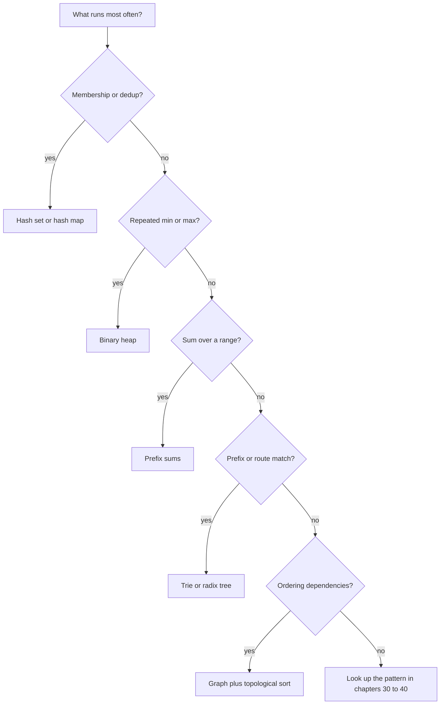

# Backend DSA Patterns

> **Module 05 · Data Structures & Algorithms** · Prerequisites: [Monotonic Queue](40-Monotonic-Queue.md) · Next: [Cache Data Structures](42-Cache-Data-Structures.md)

---

## ⏱ If You Only Have 2 Minutes

- **Dedup and idempotency** use a hash set: a membership check costs expected O(1). Across several servers the set must live in shared storage, such as Redis `SET key value NX EX <seconds>`, not in process memory.
- **Schedulers and top-K** use a binary heap. Push and pop are O(log n). A min-heap of size K finds the top K of n items in O(n log K) and keeps only K items.
- **Rate limiters** use a token bucket: O(1) per request, a burst size (capacity) and a steady rate (refill). Each client costs one small record, so memory grows with the number of active clients.
- **Usage totals over a time range** use prefix sums: O(n) to build, O(1) per range query, but only while the data is static.
- **Routing and autocomplete** use a trie or radix tree. Lookup cost depends on the key length, not on the number of routes.
- **Dependency resolution** uses a directed graph and topological sort (Kahn's algorithm, O(V + E)). If some nodes never reach in-degree zero, the dependencies contain a cycle.
- **Database indexes** are B-trees. A high fanout keeps the height small, so a lookup in a large table reads only a few pages.
- **N+1 queries** are a batching problem: collect the keys, fetch them in one query, and group the results with a hash map.

---

## 1. What It Is and Why It Exists

This chapter is a map. It connects the interview patterns from Module 05 to the places they appear in production backend code. Each pattern gets one real use, the structure that fits it, and a pointer to the chapter that teaches it in depth.

**Analogy:** a mechanic's toolbox. A socket wrench fits one kind of bolt. A hammer can move the bolt once, but it damages the thread. Data structures work the same way. A plain list is fine for ten items. The same list used for every incoming request turns into a linear scan of every stored key on every call.

**The problem it solves.** Interviewers ask "design a rate limiter" or "find the top 10 pages" and expect you to name the structure and its cost before you write code. In production the same choice decides whether a request takes a hash lookup or a scan of a million entries, and whether memory stays flat during a traffic spike. The common mistakes are rarely about the algorithm itself. They are about the container: a list where a set belongs, a full sort where a heap of size K would do, or a scan of every row where an index exists.

---

## 2. How It Works

Pattern selection starts with one question: **what is the dominant operation?** Ask what the code does most often on the hot path, then pick the structure that makes that one operation cheap. The flowchart shows the question path.



### Trace 1: idempotency keys

A client retries a payment request. The server stores each `Idempotency-Key` it has processed in a hash set. The input stream is `k1, k2, k1, k3, k2`.

| Request | Key in set? | Action | Set after |
|---|---|---|---|
| k1 | no | process, then add | {k1} |
| k2 | no | process, then add | {k1, k2} |
| k1 | yes | return the saved response | {k1, k2} |
| k3 | no | process, then add | {k1, k2, k3} |
| k2 | yes | return the saved response | {k1, k2, k3} |

Each check is one hash lookup, so the whole stream costs O(n). A list would make each check a scan, which is O(n²) for n requests.

### Trace 2: token bucket

A rate limiter allows a burst of 3 and a steady rate of 1 request per second. The bucket starts full. Each request takes one token. Tokens refill at 1 per second, up to the capacity of 3.

| Time (s) | Tokens after refill | Decision | Tokens after |
|---|---|---|---|
| 0.0 | 3.0 (starts full) | allow | 2.0 |
| 0.0 | 2.0 | allow | 1.0 |
| 0.0 | 1.0 | allow | 0.0 |
| 0.0 | 0.0 | deny | 0.0 |
| 1.5 | 1.5 | allow | 0.5 |
| 1.6 | 0.6 | deny | 0.6 |
| 2.0 | 1.0 | allow | 0.0 |

The refill is computed lazily. On each call the bucket adds `elapsed × rate` tokens, capped at the capacity. No timer thread is needed, and the work per request is constant.

### Trace 3: top-K with a min-heap

Stream: `a b a c a b d`. Ask for the top 2 items.

Step 1 counts the stream into a hash map: a = 3, b = 2, c = 1, d = 1. Step 2 scans the counts and keeps a min-heap of at most 2 entries.

| Entry | Heap after push | Size over 2? | Action | Heap kept |
|---|---|---|---|---|
| a:3 | [a:3] | no | keep | a:3 |
| b:2 | [b:2, a:3] | no | keep | b:2, a:3 |
| c:1 | [c:1, a:3, b:2] | yes | pop the minimum (c:1) | b:2, a:3 |
| d:1 | [d:1, a:3, b:2] | yes | pop the minimum (d:1) | b:2, a:3 |

The root of a min-heap is the weakest survivor, so it is the one to remove when a stronger item arrives.

---

## 3. Key Concepts

### Pattern-to-system map

| Pattern | Production use | Structure | Module 05 chapter |
|---|---|---|---|
| Hash set / map | Dedup, idempotency keys, in-memory joins, caches | Hash table | 11, 12 |
| Heap / priority queue | Job schedulers, retry timers, top-K | Binary heap | 13, 14 |
| Token bucket | Burst-tolerant rate limits | Counter plus timestamp per client | 31 |
| Sliding window | Rolling error counts, recent-request limits | Deque plus counters | 10, 31 |
| Prefix sums | Usage totals per billing period | Array of running totals | 32 |
| Trie / radix tree | HTTP routing, autocomplete, prefix search | Tree of characters or segments | 19 |
| Graph + topological sort | Build order, migrations, task dependencies | Adjacency list plus queue | 20, 38 |
| B-tree | Database indexes, file system directories | Balanced multi-way tree | 18 |
| Bloom filter | "Probably seen" check before an expensive lookup | Bit array | 42 (owns the detail) |
| Batching | Replacing an N+1 query loop | Hash map grouping | Module 03 |

### Complexity table

| Structure and operation | Best | Average | Worst | Extra space | Why |
|---|---|---|---|---|---|
| Hash set: add / contains | O(1) | O(1) amortized | O(n) | O(n) | One bucket lookup. Worst case is many keys in one bucket; resizing keeps the average constant. |
| Binary heap: push | O(1) | O(1) on random input | O(log n) | O(n) | Sift-up stops early when the new item is not smaller than its parent. |
| Binary heap: pop | O(log n) | O(log n) | O(log n) | O(n) | The last item sifts down one level per step, and the tree has log n levels. |
| Binary heap: peek | O(1) | O(1) | O(1) | O(1) | The minimum sits at the root. |
| Token bucket: try_take | O(1) | O(1) | O(1) | O(1) per client | Refill and decrement are fixed arithmetic. |
| Prefix sums: build / range sum | O(n) / O(1) | O(n) / O(1) | O(n) / O(1) | O(n) | Each prefix is one addition; a range is two subtractions. |
| Trie: lookup | O(L) | O(L) | O(L) | O(total characters) | L is the key length. Cost does not depend on how many keys are stored. |
| B-tree: search | O(log n) | O(log n) | O(log n) | O(n) | Every leaf is at the same depth, and the height is log_b n for fanout b. |
| Topological sort (Kahn) | O(V + E) | O(V + E) | O(V + E) | O(V) | Each vertex enters and leaves the queue once; each edge is read once. |

Per-request costs are O(1) worst case for a token bucket. Hash set costs are amortized, which means one resize is O(n), but the average over many inserts is constant.

### Hash sets for dedup and idempotency

An idempotency key is a client-generated ID, sent with a request, that lets the server recognise a retry. The server stores the key with the saved response. A second request with the same key returns the saved response and does not run the work again.

Two servers can both check "is this key new?" at the same time. A read followed by a write races. Redis solves this with one atomic command: `SET key value NX EX 86400` writes the key only if it does not exist, and expires it after 24 hours. The check and the write are one step.

### Heaps for schedulers and top-K

A scheduler needs the job with the earliest due time. A min-heap ordered by due time returns that job in O(1) with `peek`, and inserting a new job costs O(log n). A worker sleeps until the top job is due, then pops it.

Top-K uses a heap of size K. The heap holds the best K items seen so far. Each new item costs O(log K) at most, so the whole stream costs O(n log K). This beats sorting all n items, which costs O(n log n) and needs every item in memory first.

### Sliding windows and token buckets

A **fixed window** counter allows 100 requests per minute, reset at each minute boundary. A client can send 100 requests at 00:59 and 100 more at 01:00, which is 200 requests in two seconds. A **sliding window** smooths this out by counting requests in the last 60 seconds. A **token bucket** allows bursts up to the capacity, then holds the client to the refill rate. Module 07's [Rate Limiting](../Module-07-Advanced-Backend-and-System-Design/33-Rate-Limiting.md) chapter covers the system design choices.

### Prefix sums for usage

A prefix array stores the running total: `P[0] = 0` and `P[i + 1] = P[i] + usage[i]`. The sum over the range `[l, r)` is `P[r] - P[l]`. One pass builds the array, and each range query is O(1). The trade-off is updates: changing one value means rebuilding the prefix values after it. For data that changes often, a Fenwick tree (binary indexed tree) gives O(log n) for both updates and queries.

### Tries and B-trees for lookup

A trie stores keys one character (or one route segment) at a time, so keys with the same prefix share nodes. Autocomplete walks down the prefix, then collects the words below that node. Many HTTP routers use a radix tree, a trie that merges chains of single children, so `/users/` and `/users/profile` share one path.

A B-tree stores many keys in each node, so each level has a high fanout. A table with a billion rows may need only four or five levels. Each node is usually one disk page, so the number of page reads is the height. This is why PostgreSQL's default index type is a B-tree. See [Indexes](../Module-03-Databases/19-Indexes.md).

---

## 4. Code Examples

Two problems are solved below. The same problems and the same approaches appear in both languages.

**Problem A: rate limiter.** Allow each client about 10 requests per second on average, with bursts up to 20. *Approach:* a token bucket with capacity 20 and a refill of 10 tokens per second, one bucket per client. *Complexity:* O(1) time and O(1) space per client.

**Problem B: top K frequent items.** Given a stream of item names, return the K most frequent. *Approach:* count with a hash map in one pass, then keep a min-heap of size K while scanning the counts. *Complexity:* O(n) for counting, then O(d log K) for the heap, where d is the number of distinct items. Extra space is O(d) for the counts and O(K) for the heap.

### Node.js / TypeScript

```ts
// Standard library only (Node.js 22+, TypeScript 5). performance.now() is monotonic.
export interface TokenBucketOptions {
  capacity: number;        // maximum tokens = largest burst allowed
  refillPerSecond: number; // steady-state allowed rate
  now?: () => number;      // milliseconds; injected so tests can control time
}

export class TokenBucket {
  private tokens: number;
  private lastRefillMs: number;
  private readonly capacity: number;
  private readonly refillPerMs: number;
  private readonly now: () => number;

  constructor(options: TokenBucketOptions) {
    if (options.capacity <= 0 || options.refillPerSecond <= 0) {
      throw new RangeError("capacity and refillPerSecond must be positive");
    }
    this.capacity = options.capacity;
    this.refillPerMs = options.refillPerSecond / 1000;
    this.now = options.now ?? (() => performance.now());
    this.tokens = options.capacity;   // start full so the first burst is allowed
    this.lastRefillMs = this.now();
  }

  // Non-blocking: returns false instead of waiting. A cost above capacity can never succeed.
  tryTake(cost = 1): boolean {
    if (!Number.isFinite(cost) || cost <= 0) {
      throw new RangeError("cost must be a positive number");
    }
    const current = this.now();
    // Refill from elapsed time, so no timer is needed. Clamp at zero so a clock step
    // backwards can never remove tokens.
    const elapsed = Math.max(0, current - this.lastRefillMs);
    this.tokens = Math.min(this.capacity, this.tokens + elapsed * this.refillPerMs);
    this.lastRefillMs = current;

    if (this.tokens < cost) return false;
    this.tokens -= cost;
    return true;
  }
}
```

```ts
// Standard library only. JavaScript has no heap, so this file includes a small binary min-heap.
class MinHeap<T> {
  private readonly items: T[] = [];
  private readonly compare: (a: T, b: T) => number;

  constructor(compare: (a: T, b: T) => number) {
    this.compare = compare;
  }

  get size(): number {
    return this.items.length;
  }

  push(value: T): void {
    this.items.push(value);
    let i = this.items.length - 1;
    while (i > 0) {
      const parent = (i - 1) >> 1;
      if (this.compare(this.items[i] as T, this.items[parent] as T) >= 0) break;
      this.swap(i, parent);
      i = parent;
    }
  }

  pop(): T | undefined {
    if (this.items.length === 0) return undefined;
    const top = this.items[0];
    const last = this.items.pop() as T;
    if (this.items.length > 0) {
      this.items[0] = last;
      this.siftDown(0);
    }
    return top;
  }

  private siftDown(start: number): void {
    let i = start;
    const n = this.items.length;
    for (;;) {
      const left = 2 * i + 1;
      const right = left + 1;
      let smallest = i;
      if (left < n && this.compare(this.items[left] as T, this.items[smallest] as T) < 0) smallest = left;
      if (right < n && this.compare(this.items[right] as T, this.items[smallest] as T) < 0) smallest = right;
      if (smallest === i) return;
      this.swap(i, smallest);
      i = smallest;
    }
  }

  private swap(i: number, j: number): void {
    const tmp = this.items[i] as T;
    this.items[i] = this.items[j] as T;
    this.items[j] = tmp;
  }
}

export class HeavyHitters {
  private readonly counts = new Map<string, number>();

  add(item: string, times = 1): void {
    if (!Number.isInteger(times) || times <= 0) {
      throw new RangeError("times must be a positive integer");
    }
    this.counts.set(item, (this.counts.get(item) ?? 0) + times);
  }

  // Up to k [item, count] pairs, most frequent first.
  // Time O(d log k), heap space O(k) on top of the O(d) counts.
  topK(k: number): Array<[string, number]> {
    if (!Number.isInteger(k) || k < 0) {
      throw new RangeError("k must be a non-negative integer");
    }
    if (k === 0) return [];

    // Min-heap of the best k so far. Its root is the weakest survivor, so it is the one to evict.
    const heap = new MinHeap<[string, number]>((a, b) => a[1] - b[1]);
    for (const entry of this.counts) {
      heap.push(entry);
      if (heap.size > k) heap.pop();
    }

    // Popping a min-heap yields ascending order, so reverse for "most frequent first".
    const result: Array<[string, number]> = [];
    for (let entry = heap.pop(); entry !== undefined; entry = heap.pop()) {
      result.push(entry);
    }
    return result.reverse();
  }
}
```

**Built-ins in JavaScript.** `Map` and `Set` keep insertion order, accept any key type, and give average O(1) `get`, `set`, `has`. `Array.prototype.sort` is stable since ES2019. JavaScript has no heap, no sorted map and no LRU cache. For a small array, `sort()` is fine. Use a heap when the stream is large or K is small. Redis sorted sets fill the role of a shared, persistent priority queue.

### Python

```python
# Standard library only (Python 3.12+). time.monotonic() never goes backwards.
import time
from collections.abc import Callable


class TokenBucket:
    """Holds up to `capacity` tokens, refilled at `refill_per_second`."""

    def __init__(
        self,
        capacity: float,
        refill_per_second: float,
        now: Callable[[], float] = time.monotonic,  # seconds; injected so tests control time
    ) -> None:
        if capacity <= 0 or refill_per_second <= 0:
            raise ValueError("capacity and refill_per_second must be positive")
        self._capacity = capacity
        self._refill_per_second = refill_per_second
        self._now = now
        self._tokens = capacity          # start full so the first burst is allowed
        self._last_refill = now()

    def try_take(self, cost: float = 1.0) -> bool:
        """Non-blocking: returns False instead of waiting. A cost above capacity never succeeds."""
        if cost <= 0:
            raise ValueError("cost must be a positive number")
        current = self._now()
        # Refill from elapsed time, so no background timer is needed. max() keeps a
        # backwards clock step from removing tokens.
        elapsed = max(0.0, current - self._last_refill)
        self._tokens = min(self._capacity, self._tokens + elapsed * self._refill_per_second)
        self._last_refill = current
        if self._tokens < cost:
            return False
        self._tokens -= cost
        return True
```

```python
# Standard library only.
import heapq
from collections import Counter


class HeavyHitters:
    """Exact counts for a stream of items, with a top-K query that uses a bounded heap."""

    def __init__(self) -> None:
        self._counts: Counter[str] = Counter()

    def add(self, item: str, times: int = 1) -> None:
        if times <= 0:
            raise ValueError("times must be a positive integer")
        self._counts[item] += times

    def top_k(self, k: int) -> list[tuple[str, int]]:
        """Up to k (item, count) pairs, most frequent first.
        Time O(d log k), heap space O(k) on top of the O(d) counts."""
        if k < 0:
            raise ValueError("k must be a non-negative integer")
        if k == 0:
            return []
        # heapq is a min-heap. Its root is the weakest survivor, so it is the one to evict.
        heap: list[tuple[int, str]] = []
        for item, count in self._counts.items():
            heapq.heappush(heap, (count, item))
            if len(heap) > k:
                heapq.heappop(heap)
        heap.sort(reverse=True)
        return [(item, count) for count, item in heap]
```

**Built-ins in Python.** `dict` and `set` keep insertion order (dicts since Python 3.7) and give average O(1) lookups. `collections.Counter.most_common(k)` already solves Problem B in one line, and it uses `heapq` internally when `k` is given. `heapq` is a min-heap only. To get a max-heap, push negated values. `collections.deque` gives O(1) appends and pops at both ends, which suits sliding windows. Python has no built-in rate limiter, and a per-process bucket does not coordinate across workers. Shared limits need Redis or a gateway.

---

## 5. Production Concerns

- **Shared state across instances.** A per-process bucket lets each server spend the full rate. With 20 servers, a client can make 20 times the intended requests. Store buckets in Redis and update them in a Lua script, because Redis runs a script atomically. Two servers can then never spend the same last token.
- **Unbounded maps.** Per-client buckets and counters grow with the number of distinct keys. An attacker can send random API keys or spoofed IPs to fill memory. Give every map a TTL or a size cap. A full idle bucket can be deleted safely, because a new bucket starts full too. Chapter [LRU Cache](43-LRU-Cache.md) shows the size-capped version.
- **Clock source.** Use a monotonic clock (`performance.now()`, `time.monotonic()`) for in-process limits. Wall-clock jumps from time sync can refill buckets too early or stop them refilling.
- **Idempotency retention.** Keep each key at least as long as the client's retry window, and store the response with it. A reused key with a different request body should be rejected, not replayed. Add a unique constraint in the database as the final guard, so an expired Redis key cannot cause a double write.
- **Heavy hitters memory.** Exact counts cost O(d) memory. If the key space is unbounded, use a bounded structure (Space-Saving, or a Count-Min Sketch in [Cache Data Structures](42-Cache-Data-Structures.md)). The answer becomes approximate, so document the error.
- **Metrics.** Count rate-limit rejections per route and per client tier. A sudden spike for one tenant usually means a broken client, not an attack. Track the number of live keys in each store to size its memory.

---

## 6. Common Mistakes

- **List for membership** — every check scans all stored items, so the request path is O(n) per call — use a hash set or hash map.
- **Sorting the whole stream for top K** — O(n log n) time and all data in memory — keep a min-heap of size K.
- **Per-instance limit documented as global** — N instances allow N times the limit — store counters in Redis or a gateway, or state that the limit is per instance.
- **Read-then-write for dedup** — two servers both see "not seen" and both process the request — one atomic `SET ... NX` or a unique constraint.
- **Unbounded idempotency store** — memory grows forever — set a TTL on every key that matches the retry window.
- **Max-heap assumed in Python** — `heapq` returns the smallest item, so the top looks wrong — negate values for a max-heap, or use `Counter.most_common`.
- **N+1 query loop** — one query per parent row, so 500 parents cost 501 round trips — collect the IDs, run one `WHERE id IN (...)` query, and group with a hash map. See [Query Anti-Patterns](../Module-03-Databases/26-Query-Anti-Patterns.md).

---

## 7. Comparison Table

| Structure | Lookup by key | Min or max | Ordered or range scan | Typical backend use |
|---|---|---|---|---|
| Hash set / map | O(1) average | No | No | Dedup, idempotency keys, caches |
| Binary heap | Not supported (O(n) search) | O(1) peek, O(log n) pop | No sorted order | Schedulers, top-K, retry timers |
| Balanced tree / B-tree | O(log n) | O(log n) | Yes | Database indexes, sorted sets |
| Trie / radix tree | O(L), key length | No | Yes, by prefix | Routing, autocomplete |
| Sorted array | O(log n) binary search | O(1) first or last | Yes | Read-mostly lookup tables |

Use a hash map when you only check membership. Use a heap when you keep asking for the next best item. Use a B-tree when the data lives on disk or needs range queries.

---

## 8. Interview Questions

**[Junior] Why is a hash set better than a list for deduplicating request IDs?**
A list membership check scans every stored item, so n requests against a growing list cost O(n²) in total. A hash set checks membership in expected O(1), so the whole pass is O(n). The set uses more memory per item, so in production it needs a TTL or a size bound. Name that trade-off first in an interview.

**[Junior] When would you pick a heap instead of sorting?**
Pick a heap when you need the minimum or maximum again and again, or only the top K of a stream. Sorting costs O(n log n) and needs all the data first. A heap of size K handles a stream in O(n log K) and keeps only K items in memory. A scheduler is the classic case: `peek` gives the next due job in O(1), and each insert costs O(log n).

**[Mid] How does a fixed-window rate limiter differ from a token bucket?**
A fixed window counts requests per calendar window, such as per minute. A client can send the full limit at the end of one window and again at the start of the next, so twice the limit fits in a short time. A token bucket refills smoothly, so bursts are capped at the capacity and the long-run rate is capped at the refill rate. The token bucket also costs one small record per client, with no reset job.

**[Mid] How would you find the top 10 most-viewed pages in a stream of billions of events?**
If the page count is manageable, count in a hash map and keep a min-heap of size 10 while scanning the counts. For unbounded keys, use a bounded structure such as Space-Saving or a Count-Min Sketch, which give approximate counts in fixed memory. Shard the stream by page ID, count per shard, and merge the counts, not just the local top lists. State the error bound in the answer.

**[Senior] Your idempotency store grows without limit. How do you bound it without breaking the guarantee?**
Give each key a TTL at least as long as the longest client retry window, for example 24 hours, and store the saved response with it. After the TTL, a retry with the same key is treated as new, so the guarantee holds only inside the window. Put a unique constraint on the business table as the final guard, so a key that expired early cannot cause a double write. Track the live key count and the duplicate-hit rate to size the TTL with real data.

**[Senior] A job scheduler must run jobs at their due time across several workers. How do you design it?**
One min-heap in one process is a single point of failure, so keep the schedule in a durable store, such as a database table or a Redis sorted set scored by due time. Each worker claims due jobs atomically, for example with `SELECT ... FOR UPDATE SKIP LOCKED` in PostgreSQL, and holds a lease with an expiry. If a worker dies after doing the work but before recording it, the job runs again, so job handlers must be idempotent. The heap is then a local cache of the next few due jobs, not the source of truth.

**[Senior] You have 20 API servers and a limit of 10,000 requests per second per client. How do you enforce it?**
A per-process token bucket gives up to 20 times the limit, because each server holds its own bucket. Put the bucket in Redis and update it with a Lua script so the read, refill and decrement are atomic. This adds a network hop to every request, so decide what happens when Redis is slow or down: fail open (allow) for availability, or fail closed (deny) for protection. Many teams use a local bucket as a cheap first check and a shared bucket for the strict limit.

---

## 9. Cheat Sheet

```text
Method        Name the dominant operation first, then pick the structure
Dedup         Hash set: O(1) expected. Across servers: Redis SET key val NX EX ttl
Idempotency   Store key + response with a TTL at least as long as the retry window
Top K         Min-heap of size K: O(n log K). Python: Counter.most_common(k)
Scheduler     Min-heap on due time: peek O(1), push/pop O(log n)
Token bucket  capacity = burst, refill = steady rate, lazy refill, O(1) per request
Fixed window  Allows up to 2x the limit across a window boundary
Prefix sums   Build O(n), range query O(1), static data only (Fenwick for updates)
Trie          Lookup O(key length), independent of how many keys exist
Topo sort     Kahn: O(V + E). Leftover nodes after the queue empties = a cycle
B-tree        O(log n) search, high fanout keeps the height small
N+1           Collect IDs, one WHERE id IN query, group with a hash map
Shared limits Share state (Redis/gateway), or say the limit is per instance
Bounds        Every map gets a TTL or a size cap; attackers control the keys
Python        heapq is min-only; negate for max; deque for both-ends queues
JavaScript    Map/Set keep insertion order; no heap or sorted map built in
```

---

## Related Topics

- [Priority Queue](13-Priority-Queue.md) and [Heaps](14-Heaps.md) — the structure behind schedulers and top-K.
- [Sliding Window](31-Sliding-Window.md) — the window logic behind rate limits and rolling counts.
- [Prefix Sum](32-Prefix-Sum.md) — range totals for usage and billing periods.
- [Tries](19-Tries.md) — routing and autocomplete lookups.
- [Query Anti-Patterns](../Module-03-Databases/26-Query-Anti-Patterns.md) — N+1 queries and how batching fixes them.
- [Rate Limiting](../Module-07-Advanced-Backend-and-System-Design/33-Rate-Limiting.md) — the system-level design that uses these structures.
