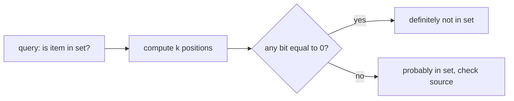

# Cache Data Structures

> **Module 05 · Data Structures & Algorithms** · Prerequisites: [Backend DSA Patterns](41-Backend-DSA-Patterns.md) · Next: [LRU Cache](43-LRU-Cache.md)

---

## ⏱ If You Only Have 2 Minutes

- A cache is a **bounded map**. Two rules decide what leaves it: the **eviction policy** (which entry goes when it is full) and the **expiry rule** (when an entry is stale).
- **LRU** evicts the least recently used key and needs a hash map plus a doubly linked list, both O(1). **LFU** evicts the least frequently used key. **FIFO** evicts the oldest insertion. **Random** picks any key.
- **TTL expiry** is lazy (checked on read, free until touched) or active (a sweep or sampling that frees memory of unread keys). Real caches use both.
- A **Bloom filter** answers "definitely not in the set" or "probably in the set". It never gives a false negative, and its false-positive rate is set by the bit count and the number of hashes.
- Sizing: for n items and false-positive rate p, a Bloom filter needs about m = -n·ln(p) / (ln 2)² bits and k = (m/n)·ln 2 hash functions. For 1 million items at 1%, that is about 9.6 million bits (1.2 MB) and 7 hashes.
- A **Count-Min Sketch** estimates counts in fixed memory. It never undercounts, but it can overcount.
- Redis `maxmemory-policy` offers `allkeys-lru`, `volatile-lru`, `allkeys-lfu`, `volatile-ttl` and others. Redis LRU and LFU are **approximated**: they sample a few keys instead of tracking exact recency.
- LRU in code is [chapter 43](43-LRU-Cache.md). Caching strategy (cache-aside, write-through, write-back) is in [Caching Fundamentals](../Module-07-Advanced-Backend-and-System-Design/14-Caching-Fundamentals.md).

---

## 1. What It Is and Why It Exists

A cache keeps a copy of data somewhere fast so the slow source is read less often. Inside the cache is a map. A map with no limits grows until the process runs out of memory, so every cache needs two decisions:

- **Eviction:** when the cache is full, which entry should leave?
- **Expiry:** when is an entry too old to serve?

This chapter covers the data structures behind those decisions, and the probabilistic structures that answer membership questions in very little memory.

**Analogy:** a kitchen fridge with limited shelves. When a new item needs space, you remove something: the item you have not touched in weeks (LRU), or the one you rarely use (LFU). Milk also leaves when its date passes (expiry), even if the shelf is not full.

**The problem it solves.** Without eviction, memory grows until the process is killed by the operating system. With the wrong policy, the hit rate drops. A FIFO cache throws out the hot key just because it was loaded first. Without expiry, stale prices or permissions stay in the cache long after they change. Without a probabilistic structure, a "have we seen this?" check across hundreds of millions of keys costs a lot of memory or a database round trip.

---

## 2. How It Works

### Eviction, traced

Capacity is 2. The request sequence is `A, B, A, C, A, B`. Here is what each policy keeps.

**LRU** (least recently used) keeps keys in order of recent use. The most recent key is listed first.

| Request | Hit or miss | Evicted | Cache after (most recent first) |
|---|---|---|---|
| A | miss | none | A |
| B | miss | none | B, A |
| A | hit | none | A, B |
| C | miss | B | C, A |
| A | hit | none | A, C |
| B | miss | C | B, A |

LRU gets 2 hits.

**FIFO** (first in, first out) ignores use. It evicts the oldest insertion, so the repeated `A` requests never refresh it. FIFO gets 1 hit: the request at step 3. The `A` at step 5 is a miss.

**LFU** (least frequently used) counts uses. At step 4, `B` has been used once and `A` twice, so `B` is evicted. LFU also gets 2 hits.

The sequences look similar, but the outcomes differ. A workload with one hot key and many one-time scans is the case that separates them, and [Production Concerns](#5-production-concerns) covers that case.

### TTL expiry

A time-to-live (TTL) stores an expiry time with each entry. Set `ttl = 10 s` at `t = 0`:

- A `get` at `t = 4` returns the value.
- A `get` at `t = 11` finds `now >= expiresAt`, so it deletes the entry and returns nothing.

That second step is **lazy expiry**. The entry stays in memory until someone reads it. **Active expiry** removes entries without a read, usually with a periodic sweep. Redis samples a few keys that have a TTL on each cycle and deletes the expired ones. Production caches combine both: lazy checks keep reads correct, and active cleanup frees memory from keys that nobody reads again.

### Bloom filter, traced

A Bloom filter is a bit array of `m` bits with `k` hash functions. To **add** an item, set the `k` bits it hashes to. To **query**, check those `k` bits. If any bit is 0, the item was never added. If all are 1, the item was probably added, because other items may have set the same bits.

Illustrative example: `m = 16`, `k = 3`. The bit positions are shown for clarity, not from a real hash function.

| Step | Positions | Result |
|---|---|---|
| add "alice" | 2, 7, 11 | bits 2, 7, 11 set |
| add "bob" | 5, 7, 14 | bits 5, 7, 14 set |
| query "carol" | 2, 9, 14 | bit 9 is 0, so **definitely not added** |
| query "dave" | 5, 11, 14 | all three are 1, so **probably added** (false positive) |

"dave" was never added. Its positions happen to be covered by other items. That is the only kind of error a Bloom filter makes.



---

## 3. Key Concepts

### Eviction policies compared

| Policy | Evicts | Needs | Strength | Weakness |
|---|---|---|---|---|
| LRU | Least recently used | Hash map + doubly linked list | Good for most workloads with temporal locality | A one-time scan of many keys pushes out the hot set |
| LFU | Least frequently used | Hash map + frequency buckets | Protects long-term hot keys from scans | Old popular keys stay forever unless counts decay |
| FIFO | Oldest insertion | Queue | Simplest; O(1) | Ignores popularity, so hot keys get evicted |
| TTL | Entries past their expiry | Map + expiry index | Keeps data fresh by time | Does not limit size by itself |
| Random | Any key | Array + index map | No bookkeeping; surprisingly good | No memory of use, so hit rate is lower |

### Complexity table

| Structure and operation | Best | Average | Worst | Extra space | Why |
|---|---|---|---|---|---|
| LRU get / put | O(1) | O(1) | O(1) | O(capacity) | Hash lookup, then O(1) list relink ([chapter 43](43-LRU-Cache.md)). |
| LFU get / put (frequency buckets) | O(1) | O(1) | O(1) | O(capacity) | Each key moves from one frequency bucket to the next. |
| FIFO get / put | O(1) | O(1) | O(1) | O(capacity) | Hash lookup plus a queue pop. |
| TTL get, lazy | O(1) | O(1) | O(1) | O(capacity) | One lookup and one time comparison. |
| TTL purge when full (full scan) | O(n) | O(n) | O(n) | O(1) | Every entry is checked. Heaps or timer wheels avoid the full scan. |
| Bloom filter add / query | O(k) | O(k) | O(k) | O(m) bits | k fixed hash positions; no per-item storage. |
| Count-Min Sketch update / estimate | O(d) | O(d) | O(d) | O(d × w) counters | One counter per row, d rows; take the minimum for the estimate. |

Read the table as: the cost of one operation, with the memory the structure keeps. The Bloom and Count-Min costs do not grow with the number of distinct keys. Their memory is fixed when you create them, and their error grows as more items are added.

### Bloom filter sizing

For `n` expected items and a target false-positive rate `p`, the usual formulas are:

- bits: `m = -n · ln(p) / (ln 2)²`
- hash functions: `k = (m / n) · ln 2`

At `p = 1%`, that is about 9.6 bits per item and 7 hashes. At `p = 0.1%`, it is about 14.4 bits per item and 10 hashes. The bit count is the budget. Fewer bits means more false positives, and more items than planned push the rate up quickly. A Bloom filter cannot delete an item. A **counting** Bloom filter stores small counters instead of bits to allow deletes, at a higher memory cost.

### Count-Min Sketch

A Count-Min Sketch has `d` rows and `w` columns of counters, each row with its own hash. An update increments one counter in every row. An estimate returns the minimum across the rows. Collisions only add to counters, so the estimate never undercounts, but it can overcount. Use it to find frequent keys in a stream when an exact hash map would be too large, as in [Backend DSA Patterns](41-Backend-DSA-Patterns.md).

### Redis eviction policies

Redis stops accepting writes, or evicts keys, when `maxmemory` is reached. The `maxmemory-policy` setting picks the rule:

| Policy | Keys considered | Victim |
|---|---|---|
| `noeviction` | none | writes fail with an error |
| `allkeys-lru` | all keys | approximated LRU |
| `volatile-lru` | keys with a TTL | approximated LRU |
| `allkeys-lfu` | all keys | approximated LFU |
| `volatile-ttl` | keys with a TTL | the keys closest to expiry |
| `allkeys-random` | all keys | random |

Redis does not keep a full recency list. It samples a small number of keys and evicts the best candidate among them. This keeps memory overhead low and avoids a global list. The result is close to LRU, not exact LRU. Check the [Redis documentation](https://redis.io/docs/latest/develop/reference/eviction/) for the exact sampling behavior of your version.

---

## 4. Code Examples

Two problems are solved below, in the same way in both languages.

**Problem A: a bounded TTL cache.** Store key-value pairs that expire after a time-to-live, with at most N entries. `get` returns nothing for a missing or expired key. *Approach:* store `expiresAt` with each value. Check it on read (lazy expiry). When the cache is full, delete expired entries first, then drop the oldest insertion. *Complexity:* get is O(1). Set is O(1) when there is room, and O(n) when the cache is full and the purge scans everything.

**Problem B: is this username probably taken?** Check membership in a set of tens of millions of names, without a database read for each check. *Approach:* a Bloom filter. "No" is certain and needs no database read. "Yes" triggers a real lookup, so a false positive only costs one extra query. *Complexity:* O(k) per add or query. Memory is fixed at m bits.

### Node.js / TypeScript

```ts
// Standard library only (Node.js 22+, TypeScript 5). Map keeps insertion order.
interface Entry<V> {
  value: V;
  expiresAt: number; // milliseconds, from a monotonic clock
}

export class TtlCache<K, V> {
  private readonly entries = new Map<K, Entry<V>>();
  private readonly maxEntries: number;
  private readonly now: () => number;

  constructor(maxEntries: number, now: () => number = () => performance.now()) {
    if (!Number.isInteger(maxEntries) || maxEntries <= 0) {
      throw new RangeError("maxEntries must be a positive integer");
    }
    this.maxEntries = maxEntries;
    this.now = now;
  }

  set(key: K, value: V, ttlMs: number): void {
    if (!(ttlMs > 0)) throw new RangeError("ttlMs must be positive");
    // Delete first: a re-set key moves to the end of the order, so it is not evicted as "oldest".
    this.entries.delete(key);
    if (this.entries.size >= this.maxEntries) this.evictOne();
    this.entries.set(key, { value, expiresAt: this.now() + ttlMs });
  }

  get(key: K): V | undefined {
    const entry = this.entries.get(key);
    if (entry === undefined) return undefined;
    // Lazy expiry: a dead entry is removed only when someone reads it.
    if (this.now() >= entry.expiresAt) {
      this.entries.delete(key);
      return undefined;
    }
    return entry.value;
  }

  // Includes expired entries that have not been read or purged yet.
  get size(): number {
    return this.entries.size;
  }

  private evictOne(): void {
    // First, purge everything already expired. Deleting while iterating a Map is safe in JavaScript.
    const now = this.now();
    for (const [key, entry] of this.entries) {
      if (now >= entry.expiresAt) this.entries.delete(key);
    }
    // Still full: drop the oldest insertion. Note this is FIFO, not LRU, because get() does not reorder.
    if (this.entries.size >= this.maxEntries) {
      const oldest = this.entries.keys().next();
      if (!oldest.done) this.entries.delete(oldest.value);
    }
  }
}
```

```ts
// Standard library only. createHash comes from node:crypto.
import { createHash } from "node:crypto";

export class BloomFilter {
  private readonly bits: Uint8Array;
  private readonly bitCount: number;
  private readonly hashCount: number;

  constructor(bitCount: number, hashCount: number) {
    if (!Number.isInteger(bitCount) || bitCount <= 0) throw new RangeError("bitCount must be positive");
    if (!Number.isInteger(hashCount) || hashCount <= 0) throw new RangeError("hashCount must be positive");
    this.bitCount = bitCount;
    this.hashCount = hashCount;
    this.bits = new Uint8Array(Math.ceil(bitCount / 8)); // one byte holds 8 bits
  }

  // Sizing from the formulas: m = -n ln p / (ln 2)^2, k = (m / n) ln 2.
  static forCapacity(expectedItems: number, falsePositiveRate: number): BloomFilter {
    if (!(expectedItems > 0) || !(falsePositiveRate > 0 && falsePositiveRate < 1)) {
      throw new RangeError("expectedItems must be > 0 and falsePositiveRate must be in (0, 1)");
    }
    const bits = Math.ceil((-expectedItems * Math.log(falsePositiveRate)) / Math.LN2 ** 2);
    const hashes = Math.max(1, Math.round((bits / expectedItems) * Math.LN2));
    return new BloomFilter(bits, hashes);
  }

  add(item: string): void {
    for (const p of this.positions(item)) {
      this.bits[p >>> 3] = (this.bits[p >>> 3] as number) | (1 << (p & 7));
    }
  }

  // false = definitely not added. true = probably added; false positives are possible.
  mightContain(item: string): boolean {
    for (const p of this.positions(item)) {
      if (((this.bits[p >>> 3] as number) & (1 << (p & 7))) === 0) return false;
    }
    return true;
  }

  // Double hashing: one SHA-256 digest gives h1 and h2; the i-th position is (h1 + i·h2) mod m.
  private positions(item: string): number[] {
    const digest = createHash("sha256").update(item, "utf8").digest();
    const h1 = digest.readUInt32BE(0);
    const h2 = digest.readUInt32BE(4);
    const out: number[] = [];
    for (let i = 0; i < this.hashCount; i++) {
      out.push((h1 + i * h2) % this.bitCount);
    }
    return out;
  }
}
```

**Built-ins in JavaScript.** `Map` keeps insertion order and gives average O(1) `get`, `set` and `delete`. Delete then set moves a key to the end, which is how the LRU shortcut in [chapter 43](43-LRU-Cache.md) works. JavaScript has no TTL map and no Bloom filter in the standard library. The npm package `lru-cache` supports both size limits and TTLs, and is the usual choice in production Node code.

### Python

```python
# Standard library only (Python 3.12+). dict keeps insertion order.
import time
from collections.abc import Callable


class TtlCache[K, V]:
    """Bounded key-value cache with per-entry TTL. Lazy expiry on read, full purge when full."""

    def __init__(self, max_entries: int, now: Callable[[], float] = time.monotonic) -> None:
        if max_entries <= 0:
            raise ValueError("max_entries must be a positive integer")
        self._max_entries = max_entries
        self._now = now
        # key -> (value, expires_at in seconds). Iteration order is insertion order.
        self._entries: dict[K, tuple[V, float]] = {}

    def set(self, key: K, value: V, ttl_seconds: float) -> None:
        if ttl_seconds <= 0:
            raise ValueError("ttl_seconds must be positive")
        # Pop first: a re-set key moves to the end, so it is not evicted as "oldest".
        self._entries.pop(key, None)
        if len(self._entries) >= self._max_entries:
            self._evict_one()
        self._entries[key] = (value, self._now() + ttl_seconds)

    def get(self, key: K) -> V | None:
        item = self._entries.get(key)
        if item is None:
            return None
        value, expires_at = item
        if self._now() >= expires_at:
            del self._entries[key]  # lazy expiry: removed only when touched
            return None
        return value

    def __len__(self) -> int:
        return len(self._entries)  # includes expired entries not yet purged

    def _evict_one(self) -> None:
        now = self._now()
        # Copy the keys first: deleting from a dict while iterating over it raises RuntimeError.
        expired = [k for k, (_, expires_at) in self._entries.items() if now >= expires_at]
        for k in expired:
            del self._entries[k]
        if len(self._entries) >= self._max_entries:
            del self._entries[next(iter(self._entries))]  # still full: drop the oldest insertion
```

```python
# Standard library only. hashlib is in the standard library.
import hashlib
import math


class BloomFilter:
    """Set membership with no false negatives and a tunable false-positive rate."""

    def __init__(self, bit_count: int, hash_count: int) -> None:
        if bit_count <= 0 or hash_count <= 0:
            raise ValueError("bit_count and hash_count must be positive")
        self._bit_count = bit_count
        self._hash_count = hash_count
        self._bits = bytearray((bit_count + 7) // 8)  # one byte holds 8 bits

    @classmethod
    def for_capacity(cls, expected_items: int, false_positive_rate: float) -> "BloomFilter":
        if expected_items <= 0 or not 0 < false_positive_rate < 1:
            raise ValueError("expected_items must be > 0 and false_positive_rate must be in (0, 1)")
        # m = -n ln p / (ln 2)^2 bits, k = (m / n) ln 2 hashes.
        bits = math.ceil(-expected_items * math.log(false_positive_rate) / math.log(2) ** 2)
        hashes = max(1, round(bits / expected_items * math.log(2)))
        return cls(bits, hashes)

    def add(self, item: str) -> None:
        for p in self._positions(item):
            self._bits[p >> 3] |= 1 << (p & 7)

    def might_contain(self, item: str) -> bool:
        # False is certain. True means "probably": other items may have set the same bits.
        return all(self._bits[p >> 3] & (1 << (p & 7)) != 0 for p in self._positions(item))

    def _positions(self, item: str) -> list[int]:
        # Double hashing: one SHA-256 digest gives h1 and h2; the i-th position is (h1 + i·h2) mod m.
        digest = hashlib.sha256(item.encode("utf-8")).digest()
        h1 = int.from_bytes(digest[0:4], "big")
        h2 = int.from_bytes(digest[4:8], "big")
        return [(h1 + i * h2) % self._bit_count for i in range(self._hash_count)]
```

**Built-ins in Python.** `dict` keeps insertion order and gives average O(1) lookups, so it works as the base of a FIFO or TTL cache. `functools.lru_cache(maxsize=N)` is a bounded LRU cache for function results, but it has no TTL. The third-party `cachetools` package provides `TTLCache` and `LRUCache`. Python has no Bloom filter in the standard library. For a shared Bloom filter across processes, keep the bit array in Redis or a similar store, because each process has its own memory.

---

## 5. Production Concerns

- **Count bytes, not entries.** A cache of 10,000 entries can hold 10 KB or 1 GB. A `maxEntries` limit alone can exceed the container memory limit. Set a byte budget and measure value size on `set`.
- **Lazy expiry leaves dead memory.** A key that is never read again stays in memory until something triggers a purge. Add an active sweep or sampling, and watch the live size against the count of expired-on-read events.
- **Hit rate is the metric that matters.** Track hits, misses, evictions and expired-on-read counts. A falling hit rate with steady traffic usually means the working set no longer fits, or the wrong policy is in use. Scan-heavy jobs are the usual cause.
- **Bloom false positives cost a lookup.** Size the filter for the false-positive rate you can afford in extra database reads. Never use a Bloom filter where a false "yes" grants access or moves money. Use it as a pre-check in front of the real check.
- **Deletes.** A standard Bloom filter cannot remove items, so a deleted username still looks "probably taken" until the filter is rebuilt. Rebuild on a schedule, or use a counting filter.
- **Process-local caches.** Each instance has its own cache, so memory is multiplied by the instance count, and the same key can have different values across instances. Put the cache's memory use inside the container memory limit.
- **Concurrency.** Node runs one thread per event loop, so the synchronous methods above are safe. Python threads can interleave between the purge and the insert in `set`. Protect the whole method with a `threading.Lock` when several threads share one cache.

---

## 6. Common Mistakes

- **Treating insertion order as recency** — `get` does not refresh the key, so a hot key is evicted as if it were old — move the key to the end on every hit, which is what chapter 43 does.
- **Counting entries instead of bytes** — a few large values exhaust memory — track the byte size of each value and evict until the budget fits.
- **Expiring only on read** — keys nobody reads again keep their memory forever — add an active sweep or sampling.
- **Deleting from a dict while iterating it in Python** — `RuntimeError: dictionary changed size during iteration` — collect the keys to delete first, then delete them.
- **Trusting a Bloom "yes"** — a false positive returns data that belongs to nobody — treat "probably" as a reason to query the source of truth.
- **Expecting deletes from a standard Bloom filter** — removed items keep answering "probably present" — use a counting filter or rebuild it.
- **Sizing a Bloom filter by guesswork** — the false-positive rate climbs past plan once more items are added — size from the formula, and rebuild when the count reaches the plan.

---

## 7. Comparison Table

| Structure | Answers | Memory | Errors | Typical backend use |
|---|---|---|---|---|
| Hash map with TTL | Exact value or "not present" | Grows with entries | None (stale only if TTL is too long) | Local cache of configuration or session data |
| Bloom filter | "Definitely not" or "probably yes" | Fixed bits, about 10 bits per item at 1% | False positives, no false negatives | Pre-check before a database or network lookup |
| Counting Bloom filter | Same, with deletes | Several times a Bloom filter | False positives | Sets that change often |
| Count-Min Sketch | Approximate count | Fixed `d × w` counters | Overcounts, never undercounts | Top-K and heavy hitters over a stream |
| Redis with `allkeys-lru` | Exact value or miss | Bounded by `maxmemory` | Approximate eviction order | Shared cache across instances |

Use an exact map when memory fits and every answer must be right. Use a Bloom filter as a cheap first check. Use a sketch when you need counts for millions of keys and can accept an approximate answer.

---

## 8. Interview Questions

**[Junior] What does an eviction policy decide, and how does it differ from expiry?**
An eviction policy decides which entry to remove when the cache is full. Expiry decides when an entry is too old to serve, even if the cache has room. The two are independent: a cache can use LRU for eviction and a 5-minute TTL for expiry. A good answer names both and gives an example of each.

**[Junior] Why can a Bloom filter never give a false negative?**
Adding an item sets all of its k bits to 1, and bits are never cleared in a standard filter. A later query for the same item checks the same k positions, which are still 1. So "definitely not in the set" is always correct when it is returned. The only error is a false positive, when other items have set the same bits.

**[Mid] Compare LRU and LFU. When does LFU lose?**
LRU keeps recently used keys, so it adapts quickly when the hot set changes. LFU keeps keys with high counts, so it resists scans of one-time keys. LFU loses when a key was popular in the past and is now cold: its high count keeps it in memory, so new popular keys are evicted first. Caches fix this by decaying counts over time. Redis LFU does this with a decay period.

**[Mid] How do lazy and active expiry differ, and why use both?**
Lazy expiry checks the time on read. It costs nothing when nobody reads the key, but dead keys keep their memory. Active expiry sweeps or samples keys in the background to free that memory, but costs CPU and can delay the cleanup. Lazy checks keep reads correct at all times, and active cleanup bounds memory, so production systems use both.

**[Senior] Redis uses approximated LRU. Why not exact LRU, and what does the approximation cost?**
Exact LRU needs a linked list that is updated on every read, which is a shared structure with a write on every access. Redis instead samples a few keys and evicts the one that was used longest ago among the samples. This keeps overhead low, because no list has to be updated on every read. The cost is that a hot key can occasionally be evicted when it is not the oldest candidate, so the hit rate is slightly lower than exact LRU. For most workloads the difference is small, and you can tune the sample size.

**[Senior] You need to check 50 million URLs against a set of blocked URLs with a 0.1% false-positive rate. How do you size the filter, and what happens when the list grows past the plan?**
The formulas give about 14.4 bits per item, so m is about 720 million bits (roughly 90 MB), with k = 10 hash functions. A false positive triggers a real check of the blocked list, so the cost is 0.1% extra lookups, not wrong answers, as long as the real check is authoritative. If the list grows to twice the planned size, the same filter reaches a false-positive rate near 6%, which is far outside plan. Size for the expected maximum with headroom, track the fill ratio, and rebuild into a larger filter before the rate drifts. Removals need a counting filter or a periodic rebuild.

---

## 9. Cheat Sheet

```text
Eviction      LRU (recency), LFU (frequency), FIFO (insertion order), random
LRU           hash map + doubly linked list: O(1) get and put (chapter 43)
LFU           frequency buckets: O(1); plain min-heap: O(log n)
Expiry        lazy on read (free until touched); active sweep or sampling frees memory
TTL purge     full scan when full is O(n); heap or timer wheel avoids it
Bloom         no false negatives, false positives possible; delete unsupported
Bloom sizing  m = -n ln p / (ln 2)^2 bits; k = (m/n) ln 2 hashes
Bloom budget  1% -> ~9.6 bits/item, 7 hashes; 0.1% -> ~14.4 bits/item, 10 hashes
Count-Min    d rows x w counters; estimate = min of rows; never undercounts
Redis        allkeys-lru, volatile-lru, allkeys-lfu, volatile-ttl; approximated
Trap         get() does not refresh insertion order; a FIFO is not an LRU
Python        dict deletes during iteration raise RuntimeError: copy keys first
Memory        bound bytes, not only entry count
Metrics       hit rate, evictions/s, expired-on-read count, live size
```

---

## Related Topics

- [LRU Cache](43-LRU-Cache.md) — the O(1) LRU implementation that this chapter's policies build on.
- [Backend DSA Patterns](41-Backend-DSA-Patterns.md) — the map from interview patterns to these production structures.
- [Hash Tables](11-Hash-Tables.md) — the hashing and resizing behind every map in this chapter.
- [Priority Queue](13-Priority-Queue.md) — a heap-based expiry index for TTL caches.
- [Caching Fundamentals](../Module-07-Advanced-Backend-and-System-Design/14-Caching-Fundamentals.md) — cache-aside, write-through and write-back, which this chapter does not cover.
