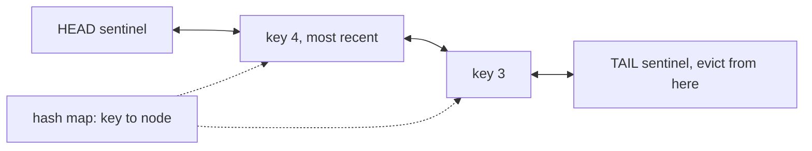

# LRU Cache

> **Module 05 · Data Structures & Algorithms** · Prerequisites: [Cache Data Structures](42-Cache-Data-Structures.md) · Next: [Consistent Hashing Basics](44-Consistent-Hashing-Basics.md)

---

## ⏱ If You Only Have 2 Minutes

- An **LRU cache** evicts the **least recently used** key when it is full. Every `get` and every `put` makes a key the most recent.
- O(1) for both `get` and `put` needs two structures: a **hash map** from key to node (lookup) and a **doubly linked list** of nodes in recency order (reorder and evict).
- `get` finds the node in the map, unlinks it, and pushes it to the front. `put` does the same, and when the size is over capacity it removes the tail node and deletes its key from the map.
- Use **sentinel** head and tail nodes. They remove every null check from the unlink and insert code.
- JavaScript shortcut: `Map` keeps insertion order, so `delete` then `set` moves a key to the end, and the first key is the least recent. Python shortcut: `collections.OrderedDict` with `move_to_end(key)` and `popitem(last=False)`.
- The hand-written version is the one to know for interviews. The shortcut is what most production code should use.
- An LRU bounds the **size**, not the **age**. Pair it with a TTL when stale data is a problem.
- The cache is not thread-safe by default, because `get` changes the list. Put a lock around both methods when threads share it.
- Redis does not implement exact LRU. It approximates it by sampling keys, to avoid a full list per key.

---

## 1. What It Is and Why It Exists

An LRU (least recently used) cache is a fixed-size key-value store. When it is full and a new key arrives, it drops the entry that has gone unused for the longest time. The idea is that recent data is more likely to be needed soon, which is called temporal locality.

**Analogy:** a bookshelf with room for 10 books. When you take a book out and put it back, it goes to the front of the shelf. When a new book arrives and the shelf is full, you remove the one at the back, the one you have not touched for the longest time.

**The problem it solves.** Without a size limit, a cache grows until the process runs out of memory. A naive limit that removes a random or the oldest-inserted key throws away hot data. An LRU keeps the working set close to the front, so a fixed budget of memory serves the most requests possible. It is also the most common interview design question about data structures, because the answer forces you to combine two structures and reason about O(1) cost.

---

## 2. How It Works

The cache needs three operations to be O(1):

1. **Find** a key's entry. A hash map does this in average O(1).
2. **Move** an entry to the front of the recency order. A doubly linked list does this in O(1) if you have the node: you connect its neighbours to each other and link the node in at the head.
3. **Evict** the least recent entry. It is the node just before the tail sentinel, so removing it is O(1).

A single list alone would need O(n) to find a key. A single map alone cannot tell you which key is oldest. Together they cover both needs.



### Trace: the classic sequence

Capacity is 2. The operations are the standard interview example.

| Operation | Returns | Evicted | Map keys | List (most recent first) |
|---|---|---|---|---|
| put(1, 1) | | | 1 | 1 |
| put(2, 2) | | | 1, 2 | 2, 1 |
| get(1) | 1 | | 1, 2 | 1, 2 |
| put(3, 3) | | key 2 | 1, 3 | 3, 1 |
| get(2) | -1 (miss) | | 1, 3 | 3, 1 |
| put(4, 4) | | key 1 | 3, 4 | 4, 3 |
| get(1) | -1 (miss) | | 3, 4 | 4, 3 |
| get(3) | 3 | | 3, 4 | 3, 4 |
| get(4) | 4 | | 3, 4 | 4, 3 |

Look at `get(1)` on the third row. Key 1 was the oldest, so it moves to the front, and key 2 is now the least recent. That is why `put(3, 3)` evicts key 2, not key 1. The last two rows show that `get` also refreshes recency.

### Step by step: `get`

1. Look up the key in the map. A miss returns "not found" in O(1).
2. On a hit, the map gives the node directly. Unlink it: its previous node's `next` points to its next node, and the reverse.
3. Link the node between the head sentinel and the first real node.
4. Return its value.

### Step by step: `put`

1. If the key exists, update its value, and move its node to the front. No eviction is needed.
2. If the key is new and the map is full, take the node before the tail sentinel. Unlink it and delete its key from the map. Dropping the key from the map matters: skipping it leaks memory.
3. Create a node, add it to the map, and link it at the front.

---

## 3. Key Concepts

### Sentinel nodes

Two dummy nodes sit at the ends of the list. The head's `next` is always the most recent real node, and the tail's `prev` is always the least recent one. Without them, every insert and remove needs a check for an empty list or an edge node. With them, every real node always has a neighbour on both sides, so the code is the same for every position.

### The JavaScript `Map` shortcut

`Map` iterates in insertion order. To refresh a key, delete it and set it again: it moves to the end. The first key in iteration order is therefore the least recent. Eviction is `keys().next()` followed by `delete`. Both operations are O(1) average. This replaces the whole linked list, and for most services it is the right choice.

### The Python `OrderedDict` shortcut

`collections.OrderedDict` keeps a linked list internally. `move_to_end(key)` moves a key to the end in O(1), and `popitem(last=False)` removes the first item, which is the least recent. A plain `dict` also keeps insertion order, but it has no `move_to_end`, so you would have to pop and reinsert the key instead.

### Why Redis approximates LRU

A full list would need two pointers per key (16 bytes on a 64-bit system) and a write to the list on every read. Redis has millions of keys, so it stores only a small timestamp per key and samples a few candidates when it must evict. The result is close to LRU at much lower cost. See [Cache Data Structures](42-Cache-Data-Structures.md).

### Complexity table

| Operation | Best | Average | Worst | Extra space | Why |
|---|---|---|---|---|---|
| `get` (hit) | O(1) | O(1) | O(1) | O(1) | One map lookup, then four pointer updates to move the node. |
| `get` (miss) | O(1) | O(1) average | O(n) | O(1) | A hash lookup. The worst case needs every key to collide in one bucket. |
| `put` (new key, not full) | O(1) | O(1) | O(1) amortized | O(1) | Map insert plus a list insert. Map resizing is amortized. |
| `put` (new key, full) | O(1) | O(1) | O(1) amortized | O(1) | Also one tail unlink and one map delete. |
| `put` (existing key) | O(1) | O(1) | O(1) amortized | O(1) | Update the value and move the node. No eviction. |
| Whole cache | | | | O(capacity) | One map entry and one node per key. |

The bounds are amortized because the map's hash table occasionally resizes. The worst case for a single operation can be O(n) during a resize, but the average over a long sequence stays O(1).

---

## 4. Code Examples

**Problem: LRU Cache.** Implement `get(key)` and `put(key, value)` for a cache with fixed capacity. `get` returns the value or a miss. `put` evicts the least recently used key when the capacity is reached. (This is the LeetCode 146 problem.) *Approach:* a hash map from key to node, plus a doubly linked list with sentinels. *Complexity:* `get` and `put` are O(1) average, and the space is O(capacity).

The first block in each language is the hand-written version. The second block is the built-in shortcut, which solves the same problem in fewer lines.

### Node.js / TypeScript

```ts
// Standard library only (Node.js 22+, TypeScript 5). Map finds nodes; we link them ourselves.
class Node<K, V> {
  key: K;
  value: V;
  prev: Node<K, V> | null = null;
  next: Node<K, V> | null = null;

  constructor(key: K, value: V) {
    this.key = key;
    this.value = value;
  }
}

export class LRUCache<K, V> {
  private readonly capacity: number;
  private readonly map = new Map<K, Node<K, V>>();
  // Sentinels: head.next is the most recent node, tail.prev the least recent.
  // They mean every real node always has two neighbours, so no null checks are needed.
  private readonly head = new Node<K, V>(undefined as K, undefined as V);
  private readonly tail = new Node<K, V>(undefined as K, undefined as V);

  constructor(capacity: number) {
    if (!Number.isInteger(capacity) || capacity <= 0) {
      throw new RangeError("capacity must be a positive integer");
    }
    this.capacity = capacity;
    this.head.next = this.tail;
    this.tail.prev = this.head;
  }

  // Returns undefined on a miss. If undefined is a legal value for V, return a wrapper instead.
  get(key: K): V | undefined {
    const node = this.map.get(key);
    if (node === undefined) return undefined;
    this.unlink(node);
    this.pushFront(node);            // a read makes the key the most recent
    return node.value;
  }

  put(key: K, value: V): void {
    const existing = this.map.get(key);
    if (existing !== undefined) {
      existing.value = value;        // update in place: no eviction is needed
      this.unlink(existing);
      this.pushFront(existing);
      return;
    }
    if (this.map.size === this.capacity) {
      // Full: evict the least recent node. Remove its key from the map too, or the map leaks.
      const lru = this.tail.prev as Node<K, V>;
      this.unlink(lru);
      this.map.delete(lru.key);
    }
    const node = new Node(key, value);
    this.map.set(key, node);
    this.pushFront(node);
  }

  get size(): number {
    return this.map.size;
  }

  private unlink(node: Node<K, V>): void {
    const prev = node.prev as Node<K, V>;
    const next = node.next as Node<K, V>;
    prev.next = next;
    next.prev = prev;
    node.prev = null;
    node.next = null;
  }

  private pushFront(node: Node<K, V>): void {
    const first = this.head.next as Node<K, V>;
    node.prev = this.head;
    node.next = first;
    first.prev = node;
    this.head.next = node;
  }
}
```

```ts
// Standard library only. The shortcut: Map keeps insertion order, and re-inserting moves a key to the end.
export class LRUCacheMap<K, V> {
  private readonly map = new Map<K, V>();
  private readonly capacity: number;

  constructor(capacity: number) {
    if (!Number.isInteger(capacity) || capacity <= 0) {
      throw new RangeError("capacity must be a positive integer");
    }
    this.capacity = capacity;
  }

  get(key: K): V | undefined {
    if (!this.map.has(key)) return undefined;
    const value = this.map.get(key) as V;
    this.map.delete(key);            // delete + set moves the key to the end: most recent
    this.map.set(key, value);
    return value;
  }

  put(key: K, value: V): void {
    this.map.delete(key);            // delete first, so an update also becomes the most recent
    this.map.set(key, value);
    if (this.map.size > this.capacity) {
      // The first key in iteration order is the least recent one.
      const lru = this.map.keys().next().value as K;
      this.map.delete(lru);
    }
  }
}
```

**Built-ins in JavaScript.** `Map` is the only ordered-by-insertion structure in the standard library, and it gives average O(1) `get`, `set` and `delete`. The shortcut above works because of that order. JavaScript has no LRU class in the standard library. The npm package `lru-cache` provides a production-ready version with size and TTL limits. It is a better choice than hand-rolling one for a real service.

### Python

```python
# Standard library only (Python 3.12+). Sentinels keep the splice code free of None checks.
from typing import cast


class _Node[K, V]:
    __slots__ = ("key", "value", "prev", "next")  # no per-node __dict__: less memory per entry

    def __init__(self, key: K, value: V) -> None:
        self.key = key
        self.value = value
        self.prev: "_Node[K, V] | None" = None
        self.next: "_Node[K, V] | None" = None


class LRUCache[K, V]:
    """O(1) get and put: a dict finds nodes, a doubly linked list keeps recency order."""

    def __init__(self, capacity: int) -> None:
        if capacity <= 0:
            raise ValueError("capacity must be a positive integer")
        self._capacity = capacity
        self._map: dict[K, _Node[K, V]] = {}
        self._head: _Node[K, V] = _Node(cast(K, None), cast(V, None))
        self._tail: _Node[K, V] = _Node(cast(K, None), cast(V, None))
        self._head.next = self._tail
        self._tail.prev = self._head

    def get(self, key: K) -> V | None:
        node = self._map.get(key)
        if node is None:
            return None
        self._unlink(node)
        self._push_front(node)  # a read makes the key the most recent
        return node.value

    def put(self, key: K, value: V) -> None:
        existing = self._map.get(key)
        if existing is not None:
            existing.value = value  # update in place: no eviction is needed
            self._unlink(existing)
            self._push_front(existing)
            return
        if len(self._map) == self._capacity:
            # Full: evict the least recent node, and remove its key from the dict too.
            lru = self._tail.prev
            assert lru is not None  # a full cache always has a real node before the tail
            self._unlink(lru)
            del self._map[lru.key]
        node = _Node(key, value)
        self._map[key] = node
        self._push_front(node)

    def _unlink(self, node: _Node[K, V]) -> None:
        prev, nxt = node.prev, node.next
        assert prev is not None and nxt is not None  # real nodes always have neighbours
        prev.next = nxt
        nxt.prev = prev
        node.prev = node.next = None

    def _push_front(self, node: _Node[K, V]) -> None:
        first = self._head.next
        assert first is not None
        node.prev = self._head
        node.next = first
        first.prev = node
        self._head.next = node
```

```python
# Standard library only. The shortcut: OrderedDict keeps a recency-ordered list internally.
from collections import OrderedDict


class LRUCacheOrdered[K, V]:
    def __init__(self, capacity: int) -> None:
        if capacity <= 0:
            raise ValueError("capacity must be a positive integer")
        self._capacity = capacity
        self._data: OrderedDict[K, V] = OrderedDict()

    def get(self, key: K) -> V | None:
        if key not in self._data:
            return None
        self._data.move_to_end(key)  # the last item is the most recent
        return self._data[key]

    def put(self, key: K, value: V) -> None:
        self._data[key] = value
        self._data.move_to_end(key)  # an update also becomes the most recent
        if len(self._data) > self._capacity:
            self._data.popitem(last=False)  # the first item is the least recent
```

**Built-ins in Python.** `collections.OrderedDict` is the shortcut above. `move_to_end` and `popitem(last=False)` are both O(1). A plain `dict` keeps insertion order too, but it has no O(1) move, so use `OrderedDict` for recency. `functools.lru_cache(maxsize=N)` is an LRU cache for function results. It needs no code, but it has no TTL, and its key is the function arguments, not an arbitrary key you choose. Its size limit is a count of entries, not bytes, so large results can still use a lot of memory.

---

## 5. Production Concerns

- **Thread safety.** `get` modifies the list, so a read is also a write. Two threads calling `get` at once can corrupt the links. Wrap both methods in one lock. In Python, use `threading.Lock`. Node runs JavaScript on one thread, so synchronous methods are safe, but an `await` between a lookup and an update is not. Keep the methods synchronous.
- **Lock contention.** One lock on a busy cache becomes the bottleneck. To scale across many threads, shard the keys into N independent LRUs, each with its own lock and capacity/N. Eviction order is then per shard, not global. This is the usual trade-off.
- **Memory per entry.** Each entry costs the value, the key, a node object, and a map slot. A node with two pointers and a key adds real overhead, so a cache of 10 million small entries can use much more memory than the values alone. Measure with real data. In Python, `__slots__` reduces the per-node cost.
- **Values are shared, not copied.** A cache returns the same object every time. If a caller mutates it, every other caller sees the change. Return copies, or freeze the value, when callers can mutate it.
- **Size is not age.** An LRU keeps the most used entries, however old. A price or permission can stay cached for days. Combine the LRU with a TTL, as in [Cache Data Structures](42-Cache-Data-Structures.md).
- **Scans wipe out the hot set.** A single batch job that reads a million keys once evicts everything useful. Keep batch reads away from the user-facing cache, or use a scan-resistant policy such as segmented LRU or 2Q.
- **Metrics.** Track hits, misses, evictions, and the size against capacity. A hit rate that falls with traffic means the capacity is too small or the access pattern has changed.

---

## 6. Common Mistakes

- **Forgetting to update recency on `put` for an existing key** — the key stays in an old position and is evicted too early — move the node to the front on every update.
- **Not deleting the evicted key from the map** — the map grows past capacity and memory leaks — delete the tail's key from the map in the same step.
- **Evicting before checking for an existing key** — updating a key evicts a different one for no reason — check for an existing key first, and evict only for a new key.
- **Null checks scattered through the splice code** — edge cases in the first and last position cause crashes — use sentinel head and tail nodes.
- **Treating `undefined` or `None` as a miss when it is a valid value** — a stored null looks like a missing key — return a wrapper or use a separate `has` check.
- **Sharing the cache between threads without a lock** — links break and the list loses nodes — lock both `get` and `put`, or shard the cache.
- **Using `OrderedDict` or `Map` without `move_to_end` or delete-then-set** — a read does not refresh the key, so the cache behaves like a FIFO — refresh on every hit.

---

## 7. Comparison Table

| Implementation | `get` | `put` | Lines of code | Use it when |
|---|---|---|---|---|
| Hand-written map + doubly linked list | O(1) | O(1) | 60–80 | Interviews, or when you need a custom callback on eviction |
| JS `Map` delete + set | O(1) average | O(1) average | about 20 | Most Node.js services with a small or medium cache |
| Python `OrderedDict` | O(1) | O(1) | about 20 | Most Python services that need a bounded cache |
| `functools.lru_cache` | O(1) | Not public | 1 decorator | Memoising pure function results |
| Redis `allkeys-lru` | Network call | Network call | Config only | A cache shared across instances |
| Array scan for the oldest entry | O(n) | O(n) | 10 | Never, except as a baseline for a test |

The hand-written version is the same complexity as the shortcut. Choose the shortcut unless you need behavior the built-in does not give you.

---

## 8. Interview Questions

**[Junior] What is an LRU cache, and which entry does it evict?**
An LRU cache is a fixed-size key-value store. When it is full and a new key arrives, it evicts the key that was used least recently. Both reads and writes count as use. The point is that recently used data is more likely to be needed again, so a fixed amount of memory serves the most requests.

**[Junior] Why does an LRU need both a hash map and a linked list?**
The hash map finds a key's entry in average O(1). The linked list keeps the entries in recency order, so moving one to the front and removing the least recent one are O(1). A list alone would need O(n) to find a key. A map alone cannot tell you which key is oldest. Each structure covers the other's weakness.

**[Mid] Why must the list be doubly linked?**
To remove a node in O(1), you must update its previous node's `next` pointer, and you need the previous node to do that. A doubly linked list stores `prev` in each node, so it has the previous node without a search. A singly linked list would need an O(n) scan from the head to find it. The cost of the extra pointer is one more reference per node, which is small compared with the O(n) scan.

**[Mid] How do you make an LRU cache safe for concurrent use?**
`get` writes to the list, so reads and writes must both be serialised. A single lock around both methods is correct but can become a bottleneck under load. Shard the keys across several independent caches, each with its own lock, to reduce contention. The cost is that eviction becomes per shard, so the order is no longer global. In Node, a synchronous implementation needs no lock, but an `await` inside the critical section does.

**[Senior] Your LRU hit rate fell sharply after a nightly batch job ran. What happened, and what do you change?**
The batch job read a large number of keys once each. Each read made the key most recent and pushed the hot working set toward the tail, so the hot keys were evicted. LRU has no memory of frequency, so it cannot tell a scan from real demand. The fixes are to keep the batch reads out of the user-facing cache, to use a scan-resistant policy such as segmented LRU or 2Q, or to admit a key only after it has been seen more than once. Measure the hit rate with and without the batch job to confirm the cause.

**[Senior] Design an LRU cache that 16 threads use at once, with a hit rate close to a single global LRU.**
A single lock serialises all 16 threads, so the cache becomes the bottleneck. Shard the keys by hash into 16 independent LRUs, each with its own lock and a quarter of the total capacity. A thread only locks one shard, so contention falls sharply. A key's eviction depends on its shard's traffic, so with an even hash distribution the hit rate stays close to a global LRU, but not identical. Watch the per-shard hit rate and size: a skewed key distribution puts most hot keys on one shard and needs a different sizing.

---

## 9. Cheat Sheet

```text
Goal          Evict the least recently used key; get and put are both O(1)
Structures    hash map key -> node  +  doubly linked list in recency order
get           lookup, unlink node, push to front; miss returns nothing
put (exists)  update value, move to front; no eviction
put (new)     if full: unlink tail.prev AND delete its key from the map; then push front
Sentinels     head and tail dummy nodes: no null checks in splice code
JS shortcut   Map: delete + set = most recent; keys().next().value = least recent
Py shortcut   OrderedDict: move_to_end(key); popitem(last=False) evicts oldest
Space         O(capacity): one map entry and one node per key
Thread safety get writes the list: lock both methods, or shard
Scans         one-time scans evict the hot set; use segmented LRU or 2Q
Size vs age   LRU bounds size only: add a TTL for freshness
Redis         approximates LRU by sampling keys; no full list per key
Trap          Forgetting to delete the evicted key from the map leaks memory
```

---

## Related Topics

- [Cache Data Structures](42-Cache-Data-Structures.md) — eviction policies, TTL and Bloom filters, the wider context for this chapter.
- [Linked Lists](07-Linked-Lists.md) — the pointer manipulation behind the unlink and push-front steps.
- [Hash Tables](11-Hash-Tables.md) — why the map lookup is average O(1) and how resizing affects it.
- [Caching Fundamentals](../Module-07-Advanced-Backend-and-System-Design/14-Caching-Fundamentals.md) — where an in-process LRU fits in a system-wide cache design.
