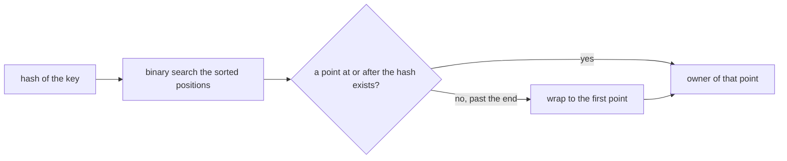

# Consistent Hashing Basics

> **Module 05 · Data Structures & Algorithms** · Prerequisites: [LRU Cache](43-LRU-Cache.md) · Next: [Module 06: Networking and Distributed Basics](../Module-06-Networking-and-Distributed-Basics/README.md)

---

## ⏱ If You Only Have 2 Minutes

- `hash(key) % N` remaps almost every key when N changes. Going from 4 to 5 servers moves about 80% of keys, because a key's server depends on N.
- A **hash ring** puts both servers and keys on a circle of hash values. A key belongs to the first server clockwise from its position. Adding or removing a server moves only the keys in one arc.
- Adding the (N+1)-th node moves about **1/(N+1)** of the keys, and every moved key goes to the new node.
- Lookup is a binary search over the sorted ring positions: O(log P) for P points, with P = N × V.
- **Virtual nodes** (V points per physical server, commonly 100 to 200) spread each server's load evenly. One point per server gives uneven arcs and uneven load.
- **Replication** walks clockwise and takes the next R distinct physical servers, skipping extra virtual points of a server already chosen.
- Real uses: Dynamo-style key-value stores, the Cassandra token ring, and memcached client libraries. Rendezvous hashing is a simpler alternative for small node counts.
- Balanced keys do not mean balanced load. A single hot key still lands on one server.

---

## 1. What It Is and Why It Exists

Consistent hashing is a way to assign keys to servers so that adding or removing a server moves only a small share of the keys. It is the standard placement scheme for distributed caches, key-value stores and sharded databases.

**Analogy:** a clock face with servers marked at some hours and keys at others. Each key belongs to the first server you reach when you walk clockwise from it. If a new server is placed at 3 o'clock, only the keys between 2 o'clock and 3 o'clock change owner. The rest of the clock is untouched.

**The problem it solves.** The obvious approach is `server = hash(key) % N`. It is simple and balanced, but it breaks when N changes. The table shows how many keys move if you change the server count and use modulo placement, compared with a ring.

| Servers before → after | Keys moved, `hash % N` | Keys moved, ring (expected) |
|---|---|---|
| 4 → 5 | about 80% | about 20% (1/5) |
| 10 → 11 | about 91% | about 9% (1/11) |
| 99 → 100 | about 99% | about 1% (1/100) |

For a cache, each moved key is a miss, and the database behind it takes the extra load. For a store, each moved key must be copied across the network. A placement scheme that moves nearly everything on every scale-up or failure makes the whole cluster fragile.

---

## 2. How It Works

Hash both nodes and keys into the same range, for example 0 to 2³² − 1. Place each node at `hash(node)` on the ring. A key goes to the first node at or after `hash(key)`, and if there is none, it wraps to the first node on the ring.

### Trace: a small ring

For readability, this ring uses positions 0 to 99. Three servers sit at positions 15 (A), 45 (B) and 80 (C). Then server D joins at 60.

| Key | Position | Owner before D | Owner after D | Moved? |
|---|---|---|---|---|
| k1 | 10 | A (first point at or after 10 is 15) | A | no |
| k2 | 50 | C (first point at or after 50 is 80) | D (first point at or after 50 is 60) | yes |
| k3 | 85 | A (no point at or after 85, so wrap to 15) | A | no |
| k4 | 20 | B (first point at or after 20 is 45) | B | no |

Only k2 moved, and it moved to D, the new server. Keys between 45 and 60 switched from C to D. Every other arc kept its owner. This is the whole idea: a change touches one arc.



### Lookup and update

- **Lookup:** keep the ring as a sorted array of `(position, node)` pairs. Binary search finds the first position at or after the key's hash. If the search runs past the end, use index 0.
- **Add a node:** insert its points into the sorted array. Only keys in the arcs that the new points split change owner.
- **Remove a node:** delete its points. Its keys fall through to the next point clockwise, which is the next server.

---

## 3. Key Concepts

### Virtual nodes

With one point per server, the arcs between points are uneven. Some servers get a large arc and most of the keys. Virtual nodes fix this. Each physical server gets V points, such as `hash("server-a#0")` to `hash("server-a#149")`. Each arc is now a sum of many small pieces, so the load evens out. The load spread shrinks as V grows. A larger server can take more points, which gives it a proportionally bigger share.

The cost is memory and lookup size: the ring holds N × V points. With 100 servers and 150 points each, that is 15,000 entries, which is small.

### Replication on the ring

Dynamo-style stores replicate each key to several servers. The usual rule is to walk clockwise from the key and take the next R distinct physical servers. The walk must skip points that belong to a server already chosen. Otherwise, two replicas land on the same machine, and one failure loses both copies.

### Rendezvous hashing

Rendezvous hashing (highest random weight) has no ring. For each key, compute a score for every server, `hash(server + key)`, and pick the server with the highest score. Lookup costs O(N), with one hash per server. Membership is a plain list, so there is no ring state to keep in sync. It moves about 1/(N+1) of the keys when a server is added, the same as a ring. It is simpler, and it is a good choice when N is small. The ring wins when N is large and lookups are very frequent.

### Real uses

- **Dynamo-style key-value stores.** The Amazon Dynamo paper (2007) describes consistent hashing with virtual nodes and a preference list for replication.
- **Cassandra.** Each node owns token ranges on a ring. Virtual nodes are set with the `num_tokens` option.
- **Memcached client libraries.** Clients use a ring to choose the server for each key, so the cache hit rate survives a server being added or removed.

### Complexity table

| Operation | Best | Average | Worst | Extra space | Why |
|---|---|---|---|---|---|
| Owner lookup (P = N × V points) | O(log P) | O(log P) | O(log P) | O(P) | A lower-bound binary search always takes about log₂ P probes. |
| Replica lookup (R nodes) | O(log P + R) | O(log P + R) | O(P) | O(R) | Walk clockwise past duplicate points. The worst case is many points of the same node in a row. |
| Add a node (V points) | O(V log P) | O(V · P) | O(V · P) | O(V) | Each point needs a binary search and an array insert that shifts up to P entries. |
| Remove a node | O(P) | O(P) | O(P) | O(P) | Filter every point. A balanced tree would make this O(V log P). |
| Modulo placement (baseline) | O(1) | O(1) | O(1) | O(1) | One division, but changing N moves about N/(N+1) of the keys. |

The lookup bound is what matters in production. A ring lookup costs a few dozen comparisons even with thousands of points.

---

## 4. Code Examples

Two problems are solved below, in the same way in both languages.

**Problem A: distribute keys across servers so that a change moves few keys.** *Approach:* a hash ring with virtual nodes, and binary search for the owner. A test adds one node to a 5-node ring and measures the moved keys. *Complexity:* lookup O(log P), with P = N × V.

**Problem B: store each key on R distinct servers.** *Approach:* walk clockwise from the key and collect the first R distinct owners. *Complexity:* O(log P + R) typical.

The two blocks in each language are the ring and the test.

### Node.js / TypeScript

```ts
// Standard library only (Node.js 22+, TypeScript 5). node:crypto gives a hash that is
// the same on every machine and every run.
import { createHash } from "node:crypto";

// SHA-256, first 4 bytes, as an unsigned 32-bit number. Used for spread, not for security.
export function hash32(input: string): number {
  return createHash("sha256").update(input, "utf8").digest().readUInt32BE(0);
}

interface Point {
  position: number; // 0 .. 2^32 - 1
  node: string;     // the physical server that owns this point
}

export class HashRing {
  private points: Point[] = [];          // kept sorted by position
  private readonly nodes = new Set<string>();
  private readonly vnodes: number;

  constructor(vnodes = 150) {
    if (!Number.isInteger(vnodes) || vnodes <= 0) {
      throw new RangeError("vnodes must be a positive integer");
    }
    this.vnodes = vnodes;
  }

  addNode(node: string): void {
    if (this.nodes.has(node)) return;
    this.nodes.add(node);
    for (let i = 0; i < this.vnodes; i++) {
      this.points.push({ position: hash32(`${node}#${i}`), node });
    }
    // Re-sorting is simple and fine for a demo. A production ring inserts in place.
    this.points.sort((a, b) => a.position - b.position);
  }

  removeNode(node: string): void {
    if (!this.nodes.delete(node)) return;
    this.points = this.points.filter((p) => p.node !== node);
  }

  // Owner of a key: the first point clockwise from the key's position.
  getNode(key: string): string | undefined {
    return this.getNodes(key, 1)[0];
  }

  // Up to `count` distinct physical servers, clockwise from the key. Used for replication.
  getNodes(key: string, count: number): string[] {
    if (this.points.length === 0 || count <= 0) return [];
    const start = this.lowerBound(hash32(key));
    const found: string[] = [];
    for (let step = 0; step < this.points.length && found.length < count; step++) {
      const point = this.points[(start + step) % this.points.length] as Point;
      // Skip extra virtual points of a server we already chose: replicas must be distinct servers.
      if (!found.includes(point.node)) found.push(point.node);
    }
    return found;
  }

  // First index whose position is >= target. Past the end, wrap to index 0.
  private lowerBound(target: number): number {
    let lo = 0;
    let hi = this.points.length;
    while (lo < hi) {
      const mid = (lo + hi) >>> 1;
      if ((this.points[mid] as Point).position < target) lo = mid + 1;
      else hi = mid;
    }
    return lo % this.points.length;
  }
}
```

```ts
// Save the first block as hash-ring.ts in the same folder, then run this test with your TypeScript runner (for example tsx).
// Standard library only: node:test and node:assert are built in.
import { test } from "node:test";
import assert from "node:assert/strict";
import { HashRing, hash32 } from "./hash-ring.ts";

const keys = Array.from({ length: 10_000 }, (_, i) => `user:${i}`);

test("adding one node moves about 1/(N+1) of keys, and only to the new node", () => {
  const ring = new HashRing(150);
  for (const n of ["node-a", "node-b", "node-c", "node-d", "node-e"]) ring.addNode(n);
  const before = new Map(keys.map((k) => [k, ring.getNode(k)] as const));

  ring.addNode("node-f");
  const moved = keys.filter((k) => ring.getNode(k) !== before.get(k));
  const ratio = moved.length / keys.length;
  console.log(`ring: moved ${moved.length} of ${keys.length} keys (${(ratio * 100).toFixed(1)}%)`);

  assert.ok(moved.every((k) => ring.getNode(k) === "node-f")); // keys only flow to the new node
  assert.ok(ratio > 0.1 && ratio < 0.25, `expected about 16.7% (1/6), got ${ratio}`);
});

test("modulo placement moves most keys when the node count changes", () => {
  const moved = keys.filter((k) => hash32(k) % 5 !== hash32(k) % 6);
  console.log(`modulo: moved ${moved.length} of ${keys.length} keys`);
  assert.ok(moved.length / keys.length > 0.7); // about 5/6 = 83%
});

test("replicas are distinct physical servers", () => {
  const ring = new HashRing(150);
  for (const n of ["node-a", "node-b", "node-c", "node-d", "node-e"]) ring.addNode(n);
  for (const k of keys.slice(0, 1_000)) {
    const replicas = ring.getNodes(k, 3);
    assert.equal(new Set(replicas).size, 3);
  }
});
```

**Built-ins in JavaScript.** JavaScript has no consistent hashing in the standard library, and `Array.prototype.sort` is stable, so equal positions keep their order. For a stable hash, use `node:crypto` (as above) rather than `Math.random` or any value that changes between runs. Real deployments use a ring in a client library, such as an npm package for memcached or a Redis cluster client, and do not write their own in production.

### Python

```python
# Standard library only (Python 3.12+). hashlib gives a stable hash; bisect does the binary search.
import bisect
import hashlib


def hash32(text: str) -> int:
    # Do NOT use the built-in hash(): Python randomises str hashes per process (PYTHONHASHSEED),
    # so two workers would disagree about the owner of the same key.
    return int.from_bytes(hashlib.sha256(text.encode("utf-8")).digest()[:4], "big")


class HashRing:
    def __init__(self, vnodes: int = 150) -> None:
        if vnodes <= 0:
            raise ValueError("vnodes must be a positive integer")
        self._vnodes = vnodes
        self._positions: list[int] = []  # sorted ring positions
        self._owners: list[str] = []     # _owners[i] owns _positions[i]
        self._nodes: set[str] = set()

    def add_node(self, node: str) -> None:
        if node in self._nodes:
            return
        self._nodes.add(node)
        for i in range(self._vnodes):
            pos = hash32(f"{node}#{i}")
            idx = bisect.bisect_left(self._positions, pos)  # keeps both lists sorted
            self._positions.insert(idx, pos)
            self._owners.insert(idx, node)

    def remove_node(self, node: str) -> None:
        if node not in self._nodes:
            return
        self._nodes.remove(node)
        keep = [(p, o) for p, o in zip(self._positions, self._owners, strict=True) if o != node]
        self._positions = [p for p, _ in keep]
        self._owners = [o for _, o in keep]

    def get_node(self, key: str) -> str | None:
        nodes = self.get_nodes(key, 1)
        return nodes[0] if nodes else None

    def get_nodes(self, key: str, count: int) -> list[str]:
        if not self._positions or count <= 0:
            return []
        # bisect_left returns the first index with position >= hash; past the end it returns len,
        # and the modulo wraps that back to index 0.
        start = bisect.bisect_left(self._positions, hash32(key))
        found: list[str] = []
        for step in range(len(self._positions)):
            owner = self._owners[(start + step) % len(self._positions)]
            if owner not in found:  # distinct physical servers only
                found.append(owner)
                if len(found) == count:
                    break
        return found
```

```python
# Save the first block as hash_ring.py in the same folder, then run `python -m unittest`.
# Standard library only: unittest is built in.
import unittest

from hash_ring import HashRing, hash32

KEYS = [f"user:{i}" for i in range(10_000)]


class HashRingTests(unittest.TestCase):
    def test_adding_a_node_moves_only_keys_to_that_node(self) -> None:
        ring = HashRing(vnodes=150)
        for n in ["node-a", "node-b", "node-c", "node-d", "node-e"]:
            ring.add_node(n)
        before = {k: ring.get_node(k) for k in KEYS}

        ring.add_node("node-f")
        moved = [k for k in KEYS if ring.get_node(k) != before[k]]
        ratio = len(moved) / len(KEYS)
        print(f"ring: moved {len(moved)} of {len(KEYS)} keys ({ratio:.1%})")

        self.assertTrue(all(ring.get_node(k) == "node-f" for k in moved))  # only the new node gains keys
        self.assertTrue(0.10 < ratio < 0.25, f"expected about 16.7% (1/6), got {ratio:.3f}")

    def test_modulo_placement_moves_most_keys(self) -> None:
        moved = [k for k in KEYS if hash32(k) % 5 != hash32(k) % 6]
        print(f"modulo: moved {len(moved)} of {len(KEYS)} keys")
        self.assertGreater(len(moved) / len(KEYS), 0.7)  # about 5/6 = 83%

    def test_replicas_are_distinct_physical_servers(self) -> None:
        ring = HashRing(vnodes=150)
        for n in ["node-a", "node-b", "node-c", "node-d", "node-e"]:
            ring.add_node(n)
        for k in KEYS[:1_000]:
            self.assertEqual(len(set(ring.get_nodes(k, 3))), 3)


if __name__ == "__main__":
    unittest.main()
```

**Built-ins in Python.** The standard library has no consistent hash ring. `bisect` gives the binary search for the owner, and `bisect.insort`-style insertion keeps the arrays sorted. `hashlib` gives a stable hash. The built-in `hash()` is randomised per process, which makes it unusable for placement across workers. Production Python services usually use a ring from a client library, not hand-written code.

---

## 5. Production Concerns

- **Stable hash across processes.** Every client must compute the same position for the same key. Python's `hash()` breaks this, as does any hash seeded at startup. Use a fixed algorithm, and test that two processes agree.
- **Agreed membership.** If two clients hold different server lists, the same key goes to different servers, and reads miss. Publish the server list from one source of truth, such as [service discovery](../Module-06-Networking-and-Distributed-Basics/26-Service-Discovery.md), and version it so clients can tell which view is current.
- **Hot keys.** Consistent hashing balances keys, not traffic. One viral key lands on one server no matter how many servers exist. Fix this with a local cache in front of the hot key, or by splitting it into several keys such as `key#0` to `key#9` and reading one at random.
- **Capacity weights.** Give a larger server more virtual points, in proportion to its capacity. Measure the keys per server, and adjust when the ratio drifts.
- **Cost of a change.** Adding a node moves about 1/(N+1) of the keys. In a store, those keys must be copied, so throttle the copy and watch disk and network. In a cache, the moved keys become misses.
- **Failures.** When a cache server dies, its keys move to the next server and miss once. A synchronized burst of misses can overload the database behind the cache. Stagger the restarts, and protect the database with limits.
- **Metrics.** Track keys per server, the ratio of the busiest server to the average, the number of keys moved per membership change, and the miss rate in the minutes after a change.

---

## 6. Common Mistakes

- **Using `hash(key) % N` for a changing cluster** — going from 10 to 11 servers moves about 91% of keys — use a ring or rendezvous hashing.
- **One point per server** — arcs are uneven, so one server gets several times the load of another — use 100 to 200 virtual points per server.
- **Using a non-stable hash** — Python's `hash()` differs between processes, so clients disagree on owners — use a fixed algorithm such as SHA-256.
- **Clients with different server lists** — the same key is read from one server and written to another — publish one versioned membership list.
- **Assuming balanced keys means balanced load** — a viral key overloads one server — replicate or split hot keys.
- **Replicas on the same physical server** — a single failure removes every copy — skip virtual points of servers already chosen.
- **Removing a server without moving its data** — a store loses the keys it held — drain or copy the data first, then remove the server.

---

## 7. Comparison Table

| Method | Owner lookup | Keys moved when N changes | Load balance | State to share | Best for |
|---|---|---|---|---|---|
| `hash(key) % N` | O(1) | About N/(N+1) | Excellent while N is fixed | The number N | Fixed-size pools that never change |
| Hash ring with virtual nodes | O(log P) | About 1/(N+1) | Good with 100+ points per node | Ring positions for every node | Large clusters with many lookups |
| Rendezvous hashing | O(N) | About 1/(N+1) | Good with equal weights | The list of nodes | Small or medium node counts, simple state |
| Range partitioning | O(log R) for R ranges | Only the split or merged ranges | Depends on key distribution | Range boundaries | Ordered scans, such as time-series data |

Use modulo only when N will never change. For a cache or store that grows and shrinks, use a ring. For a small pool with simple state, rendezvous hashing is often enough.

---

## 8. Interview Questions

**[Junior] Why does `hash(key) % N` cause a problem when servers change?**
The owner of a key depends on N, so changing N changes the answer for almost every key. Going from 10 to 11 servers moves about 91% of keys. For a cache, that is a wave of misses. For a store, it is a large copy. A ring fixes this, because a key's owner depends only on the nearest server clockwise, and a change moves only one arc.

**[Junior] What is a virtual node, and why do we use them?**
A virtual node is one of several points on the ring that belong to one physical server. With one point per server, the arcs are uneven, and some servers get far more keys than others. Giving each server 100 to 200 points splits its share into many small arcs, which makes the load even. A larger server gets more points.

**[Mid] How many keys move when you add an 11th node to a 10-node ring, and why?**
About 1/11, or roughly 9%. The new node's points split existing arcs, and only the keys in those split arcs change owner. Each moved key goes to the new node, and no other server gains or loses keys except through those arcs. The exact number depends on the hash, but the expected value is 1/(N+1).

**[Mid] How would you place three replicas of each key on a ring?**
Find the first point clockwise from the key's hash. Keep walking clockwise and collect owners, skipping any owner already collected. Stop at three distinct physical servers. This is the preference-list approach used in Dynamo-style stores. Skipping duplicates matters, because a server with 150 points would otherwise fill all three replica slots by itself.

**[Senior] A 5-node cache cluster lost one node, and the hit rate fell by about 20%. Explain this and what you would do.**
About 1/5 of the keys belonged to the lost node, and their owner has moved to the next node on the ring. Those keys are cold on the new owner, so they miss once. The drop is expected, not a bug. To reduce it, warm the new owner from the old node's data if it is still reachable, or use dual reads during a short transition. Also check that the misses do not all hit the database at the same time, because that can overload it. Rate-limit the database fallback or add a short lock per key.

**[Senior] For a service with 50 nodes and mixed hardware, would you use a ring or rendezvous hashing?**
Rendezvous hashing costs 50 hash computations per lookup, which is cheap, and it needs only a list of nodes, so there is no ring state to keep in sync. Weights are possible with a weighted score. A ring needs O(log P) with P = 50 × V points, and it needs every client to hold the same ring. The ring wins when lookups are very frequent or when the node count is in the thousands. At 50 nodes, I would choose rendezvous hashing for simplicity, unless the lookup rate makes the 50 hashes a measurable cost.

**[Senior] Why is consistent hashing not enough to balance load in a cache?**
Consistent hashing balances the number of keys across servers, not the requests for each key. One key that is requested thousands of times per second is served by one server, however many servers exist. The fix is at a different layer: a small local cache in front of the hot key, replicating hot keys to several servers, or splitting the key into sub-keys and reading one at random. Measure requests per key, not only keys per server.

---

## 9. Cheat Sheet

```text
Modulo        server = hash(key) % N: changing N moves about N/(N+1) of keys
Ring          hash servers and keys onto one circle; owner = first server clockwise
Add a node    moves about 1/(N+1) of keys, and only to the new node
Remove        its keys move to the next server clockwise
Lookup        binary search on sorted positions: O(log P), P = N × V
Virtual nodes 100-200 points per server; more points = better balance, more memory
Replication   walk clockwise, collect R distinct physical servers
Hash          stable across processes: SHA-256, not Python's randomised hash()
Rendezvous    score every node with hash(node + key); pick the highest; O(N) lookup
Real uses     Dynamo-style stores, Cassandra token ring, memcached client rings
Hot keys      consistent hashing balances keys, not requests
Membership    one versioned source of truth for the server list
Metrics       keys per server, max/avg load ratio, keys moved per change, miss rate
```

---

## Related Topics

- [Hash Tables](11-Hash-Tables.md) — the hash functions and collision handling that the ring builds on.
- [Binary Search](25-Binary-Search.md) — the lower-bound search that finds a key's owner.
- [LRU Cache](43-LRU-Cache.md) — the per-node cache that a ring usually sits in front of.
- [Load Balancers](../Module-06-Networking-and-Distributed-Basics/24-Load-Balancers.md) — how traffic is spread across servers, including hash-based balancing.
- [Service Discovery](../Module-06-Networking-and-Distributed-Basics/26-Service-Discovery.md) — how clients learn the current server list.
