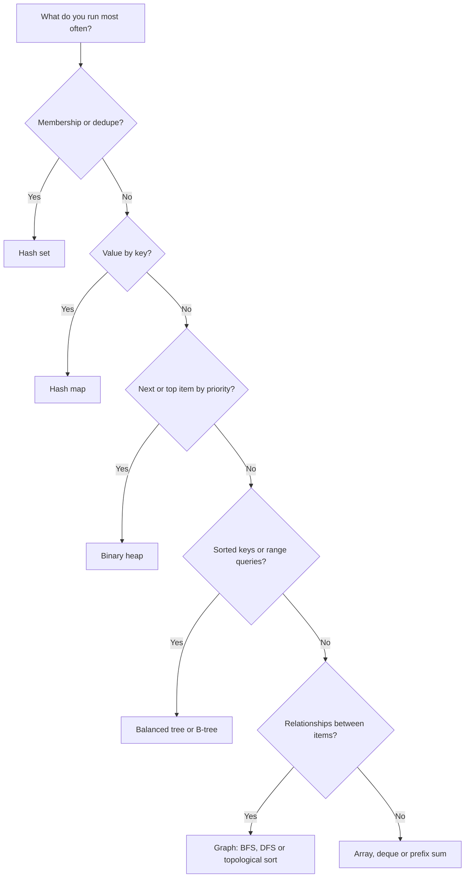

# Module 5: Data Structures & Algorithms — Full Revision Guide

This guide tells Module 5 as one story. Every backend problem starts as a question about a collection: is this key present, what comes next, which item is largest, what is reachable from here. The right answer depends on the operations you run most often and on how the data grows. So the method is always the same: name the operations, pick the smallest structure that makes them cheap, state the cost in terms of `n`, and check that the loop cannot do more work than that. The module moves from measuring cost (Part 1), to choosing a structure (Part 2), to trees and graphs (Part 3), to sorting and searching (Part 4), to the patterns behind interview problems (Part 5), and finally to the same ideas inside real backend systems (Part 6).

## Essential Definitions

| Term | Meaning | Why it matters |
|---|---|---|
| Invariant | A condition that stays true after every step. | It proves a loop correct and says what a pointer may ignore. |
| Big O / Θ / Ω | Upper bound / tight bound / lower bound on growth. | Say which one you mean; bare "O(n log n)" hides exactness. |
| Amortized cost | Total cost of `n` operations divided by `n`. | Explains why a dynamic array `push` is O(1) despite occasional copies. |
| Auxiliary space | Extra memory allocated, not counting the input. | Include the recursion stack. |
| Hash table / set | Expected O(1) lookup by key / membership. | The default tool for dedupe, counting and "seen before". |
| Binary heap | Complete tree in an array keeping the min or max at the root. | Next or top-K item in O(log n) without a full sort. |
| Balanced tree | Search tree whose height stays O(log n) for any input order. | Ordered lookup and range scans; basis of database indexes. |
| Trie | Tree of characters where each path spells a prefix. | Prefix cost depends on key length, not on key count. |
| DAG | Directed graph with no cycles. | Only DAGs have a topological order. |
| Stable sort | Equal keys keep their original relative order. | Needed for multi-key sorts done in passes. |
| Monotonic stack / deque | Stack or deque whose values stay ordered; each index enters and leaves once. | Next-greater, window maximum and histograms in O(n). |
| Dynamic programming | Solving overlapping subproblems once each and reusing answers. | Turns exponential recursion into a table. |
| Greedy | Make the locally best choice and never backtrack. | Correct only when an exchange argument proves it. |

---

## Part 1: Complexity — How to Analyse and Talk About Cost

Big-O measures how operations grow with the input size `n`. It is not seconds. Count the work that depends on `n`, drop constants and lower terms (`3n + 5` is O(n); `n² + 100n` is O(n²)), and always name the variable.

- **O(g)** is an upper bound, **Ω(g)** a lower bound (comparison sorting needs Ω(n log n) comparisons), **Θ(g)** both at once.
- Sequential steps add; nested loops multiply; a loop that halves the range is O(log n), about 20 steps for a million items.
- Two inputs keep two variables: scanning lists of size `n` and `m` is O(n + m).
- **Hidden calls count.** `x in list` or `list.includes(x)` inside a loop over another list is O(n²).
- **Recurrences** describe recursion: `T(n) = 2T(n/2) + O(n)` is merge sort, O(n log n). The master theorem compares the combine work with `n^(log_b a)`.
- **Amortized** cost averages a sequence. Doubling copies fewer than `2n` items over `n` pushes, so each push is O(1) amortized. The same holds for hash-table resizes.
- **Average vs worst:** a hash lookup is O(1) on average and O(n) when every key collides. If an attacker picks the keys, quote the worst case.
- **Space** includes the call stack: recursion `n` deep is O(n) even if it allocates nothing.

**Feasibility.** A rough budget is about 10⁸ simple operations per second on one core; constants vary by language.

| Input size `n` | Acceptable complexity | Typical example |
|---|---|---|
| up to about 10 | O(n!) | all permutations |
| up to about 20 | O(2ⁿ) | all subsets |
| up to about 500 | O(n³) only with a small constant | triple loops over a small matrix |
| up to about 5,000 | O(n²) | all pairs (about 2.5 × 10⁷ checks) |
| up to about 10⁶ | O(n log n) | sorting, heap-based top-K |
| up to about 10⁸ | O(n) with small constants | one pass, hash lookups |
| 10⁹ and above | O(log n), O(1) per query, or precomputed | indexes, prefix sums, binary search |

**Talking template:** "O(n log n) time and O(n) extra space, expected because the hash map is average case, with O(log n) recursion depth." State the complexity before you write the code.

---

## Part 2: Choosing a Data Structure

Choose from the operations you run most often. "None" means you write it or use a package.

| Operations you need | Structure | Cost | JavaScript / TypeScript | Python |
|---|---|---|---|---|
| Membership, deduplication | Hash set | O(1) expected | `Set` | `set` |
| Value by key, counting | Hash table | O(1) expected | `Map`; `Map` plus helper for counts | `dict`; `collections.Counter` |
| Last in, first out | Stack | O(1) push, pop, peek | `Array` push and pop | `list` append and pop |
| First in, first out | Queue or ring buffer | O(1) enqueue and dequeue | none (`shift()` is O(n)) | `collections.deque` |
| Both ends, last N items | Deque or bounded deque | O(1) at both ends | none (ring buffer) | `deque(maxlen=N)` |
| Next or top item by priority | Binary heap | O(log n) push and pop, O(1) peek | none (write one) | `heapq` (min-heap only) |
| Sorted keys, range queries | Balanced tree or B-tree | O(log n) search and insert | none | `bisect` on a list (insert O(n)); `sortedcontainers` |
| Prefix search, autocomplete | Trie or radix tree | O(L) for key length L | none | none (dict-based trie) |
| Dependencies, reachability | Adjacency list plus BFS, DFS, topological sort | O(V + E) | none | `graphlib.TopologicalSorter` |
| Same group? Merge groups? | Union-find | O(α(n)) amortized | none | none |
| Range sums, static data | Prefix sum | O(n) build, O(1) query | none | `itertools.accumulate` |
| Sorted output | Comparison sort | O(n log n) | `Array.prototype.sort` (stable) | `sorted()` (stable) |
| Index by position | Array | O(1) read | `Array`, typed arrays | `list`, `array.array` |

**Decision rule:** hash set for membership, queue for FIFO work, heap for priority and top-K, ordered tree or index for range questions, graph traversal for dependency and reachability, prefix sums or difference arrays for many reads or updates over a range.

**Heap example: top K.** A min-heap of size K keeps the K largest values seen. It costs O(n log K) time and O(K) space.

```ts
class MinHeap {
  private a: number[] = [];

  get size(): number {
    return this.a.length;
  }

  push(x: number): void {
    const a = this.a;
    a.push(x);
    let i = a.length - 1;
    while (i > 0) {
      const p = (i - 1) >> 1;
      if (a[p] <= a[i]) break;
      [a[p], a[i]] = [a[i], a[p]];
      i = p;
    }
  }

  pop(): number | undefined {
    const a = this.a;
    if (a.length === 0) return undefined;
    const top = a[0];
    const last = a.pop()!;
    if (a.length > 0) {
      a[0] = last;
      let i = 0;
      for (;;) {
        const l = 2 * i + 1;
        const r = l + 1;
        let m = i;
        if (l < a.length && a[l] < a[m]) m = l;
        if (r < a.length && a[r] < a[m]) m = r;
        if (m === i) break;
        [a[m], a[i]] = [a[i], a[m]];
        i = m;
      }
    }
    return top;
  }
}

function topK(nums: number[], k: number): number[] {
  const heap = new MinHeap();
  for (const x of nums) {
    heap.push(x);
    if (heap.size > k) heap.pop(); // evict the smallest, keep the K largest
  }
  const out: number[] = [];
  while (heap.size > 0) out.push(heap.pop()!); // ascending
  return out.reverse(); // largest first
}
```

```python
import heapq


def top_k(nums: list[int], k: int) -> list[int]:
    heap: list[int] = []  # min-heap holding the K largest values seen so far
    for x in nums:
        heapq.heappush(heap, x)
        if len(heap) > k:
            heapq.heappop(heap)  # drop the smallest
    return sorted(heap, reverse=True)
```

For ties, push `(priority, counter, item)` so equal priorities come out in insertion order and items are never compared. For a max-heap in Python, push negated values.

---

## Part 3: Trees and Graphs

### Choosing BFS or DFS

| Question | Traversal | Why | Cost |
|---|---|---|---|
| Fewest edges, grid distance | BFS | First arrival is the shortest hop count. | O(V + E); memory = widest layer |
| Components, cycles | DFS | Natural exploration; visited marks stop loops. | O(V + E); memory = depth |
| Build or dependency order | DFS post-order or Kahn | Each node is emitted after its prerequisites. | O(V + E) |
| Weighted shortest path | Dijkstra with a heap | BFS counts hops, not costs. | O((V + E) log V), non-negative weights |

**BFS skeleton.** Mark nodes on enqueue, keep a distance map, and use an index pointer or `deque`, never `shift()` in a loop.

```ts
function shortestHops(graph: Map<string, string[]>, start: string, goal: string): number {
  const dist = new Map<string, number>([[start, 0]]); // visited on enqueue
  const queue: string[] = [start];
  let head = 0; // index pointer: no O(n) shift()
  while (head < queue.length) {
    const node = queue[head++];
    const d = dist.get(node)!;
    if (node === goal) return d;
    for (const next of graph.get(node) ?? []) {
      if (!dist.has(next)) {
        dist.set(next, d + 1);
        queue.push(next);
      }
    }
  }
  return -1; // unreachable
}
```

```python
from collections import deque


def shortest_hops(graph: dict[str, list[str]], start: str, goal: str) -> int:
    dist = {start: 0}  # visited on enqueue
    queue = deque([start])
    while queue:
        node = queue.popleft()
        if node == goal:
            return dist[node]
        for nxt in graph.get(node, []):
            if nxt not in dist:
                dist[nxt] = dist[node] + 1
                queue.append(nxt)
    return -1  # unreachable
```

### Tree traversals and search trees

- **Pre-order** copies or serializes; **post-order** computes bottom-up answers (height, diameter); **in-order** on a BST yields sorted keys; **level-order** uses a queue. Each is O(n); recursion uses O(h) stack, so use an explicit stack for deep input.

| Structure | Height and search | Typical home | Watch for |
|---|---|---|---|
| Plain BST | O(h); h = n on sorted input | Teaching, in-order output | Unbalanced on sorted input |
| AVL tree | About 1.44 log₂ n; balance factor in {−1, 0, 1} | In-memory lookup-heavy maps | Rotations on insert and delete |
| Red–black tree | At most 2 log₂(n + 1) | In-memory ordered maps in many standard libraries | Fewer rotations than AVL |
| B / B+ tree | Few levels; many keys per node sized to a disk page | Database indexes, file systems | B+ keeps values in linked leaves for range scans |
| Skip list | Expected O(log n) | Redis sorted sets | Randomized levels |

A rotation changes a subtree's root but keeps the in-order key sequence.

### Tries, union-find and topological sort

- **Trie:** insert, lookup and prefix check cost O(L), regardless of how many keys exist. Memory per prefix is the cost; radix trees compress single-child chains, and many HTTP routers use them. Remember the end flag: `contains("app")` is false when only "apple" is stored.
- **Union-find:** groups that only merge. With path compression and union by size, each operation is O(α(n)) amortized. It detects the edge that closes a cycle and powers Kruskal's spanning tree. It cannot split groups.
- **Topological sort:** exists only for a DAG. Kahn's algorithm removes zero in-degree nodes; leftovers mean a cycle. DFS post-order, reversed, also works; a node still on the current path reveals the cycle. Both cost O(V + E).

---

## Part 4: Sorting and Searching

| Algorithm | Best | Average | Worst | Extra space | Stable | In place | Use it when |
|---|---|---|---|---|---|---|---|
| Insertion | n | n² | n² | O(1) | Yes | Yes | Small or nearly sorted input |
| Merge | n log n | n log n | n log n | O(n) | Yes | No | Stability; linked lists; external sort |
| Quick | n log n | n log n | n² | O(log n) stack | No | Yes | Fast average with random pivots |
| Heap | n log n | n log n | n log n | O(1) | No | Yes | Guaranteed bound, O(1) memory |
| Timsort | n | n log n | n log n | O(n) | Yes | No | General purpose: Python `sorted()`, V8 sort |
| Counting / radix | n + k | n + k | n + k | O(n + k) | Yes (standard form) | No | Integers in a small range |

No comparison sort beats Ω(n log n) comparisons in the worst case. Stability matters when a user sorts by one column after another. In JavaScript, `Array.prototype.sort` with no comparator compares **strings**: `[10, 9, 1].sort()` gives `[1, 10, 9]`. Pass a numeric comparator, or use `toSorted()` to keep the input unchanged.

**Binary search.** Needs sorted input or a monotonic test that goes `false, …, false, true, …, true`. Use one template: half-open `[lo, hi)`, loop while `lo < hi`, and set `lo = mid + 1` or `hi = mid`. Compute `mid` as `lo + (hi - lo) // 2`.

| Question | Returns | Python |
|---|---|---|
| Lower bound: first `a[i] >= x` | index in `0..n` | `bisect_left` |
| Upper bound: first `a[i] > x` | index in `0..n` | `bisect_right` |
| Count of `x` | `upper - lower` | difference of the two |
| First value where a predicate turns true | smallest candidate answer | search over candidate values |

```ts
// First index i with a[i] >= x, or a.length if none. Half-open range [lo, hi).
function lowerBound(a: readonly number[], x: number): number {
  let lo = 0;
  let hi = a.length;
  while (lo < hi) {
    const mid = lo + Math.floor((hi - lo) / 2);
    if (a[mid] < x) lo = mid + 1;
    else hi = mid;
  }
  return lo;
}
```

```python
def lower_bound(a: list[int], x: int) -> int:
    """First index i with a[i] >= x, or len(a) if none."""
    lo, hi = 0, len(a)
    while lo < hi:
        mid = lo + (hi - lo) // 2
        if a[mid] < x:
            lo = mid + 1
        else:
            hi = mid
    return lo
```

---

## Part 5: The Pattern-Recognition Guide

Read the problem for its nouns and constraints, then match the phrase.

| If the problem says… | Try… | Typical complexity |
|---|---|---|
| Pair with a given sum, sorted array | Two pointers (opposite ends) | O(n) after sorting |
| Pair with a given sum, unsorted | Hash set of seen values | O(n) time, O(n) space |
| Remove or dedupe in place, keep order | Two pointers (read and write) | O(n), O(1) space |
| Longest or shortest substring or subarray with a property | Variable sliding window | O(n) |
| Max, min or sum over every window of length k | Fixed sliding window | O(n) |
| Many range-sum queries on static data | Prefix sum | O(n) build, O(1) query |
| Subarray sum equals k, negatives allowed | Prefix sums plus a count map | O(n) |
| Add to a range many times, read once | Difference array | O(1) per update, O(n) read |
| Next greater or previous smaller; histogram area | Monotonic stack | O(n) total |
| Sliding-window maximum or minimum | Monotonic deque | O(n) total |
| Top K, kth largest, k smallest | Heap of size K, or quickselect | O(n log K), or O(n) average |
| Merge K sorted lists or streams | Min-heap of list heads | O(N log K) |
| All subsets, permutations, placements under constraints | Backtracking with pruning | O(n · 2ⁿ) or O(n · n!) before pruning |
| Count ways, minimum cost, maximum value, repeated subproblems | Dynamic programming | Number of states × work per state |
| Local choice, intervals, provable | Greedy with exchange argument | O(n log n) for the sort |
| Connected? Merge groups? Redundant edge? | Union-find | O(α(n)) per operation |
| Build order, dependency cycle | Topological sort | O(V + E) |
| Fewest moves in an unweighted graph or grid | BFS | O(V + E) |
| Shortest path, non-negative weights | Dijkstra with a heap | O((V + E) log V) |
| Components, all paths, cycle detection | DFS | O(V + E) |
| Smallest value where a yes/no check flips | Binary search on the answer | O(log range) × check cost |
| Autocomplete, prefix matching | Trie | O(L) per key |

**Invariants.** State the invariant before coding. For Two Sum on a sorted array, "no valid pair lies outside `[lo, hi]`" makes moving the pointer that the sum points toward safe. For a window, "the window contains no violation" does the same job.

**Sliding window template (variable width).** Expand on the right; while the rule breaks, shrink from the left. Each index enters and leaves once, so the loop is O(n).

```ts
// Length of the longest substring with no repeated character.
// Works on UTF-16 code units; use code points for emoji-heavy text.
function longestUniqueSubstring(s: string): number {
  const inWindow = new Set<string>();
  let left = 0;
  let best = 0;
  for (let right = 0; right < s.length; right++) {
    while (inWindow.has(s[right])) {
      inWindow.delete(s[left]);
      left++;
    }
    inWindow.add(s[right]);
    best = Math.max(best, right - left + 1);
  }
  return best;
}
```

```python
def longest_unique_substring(s: str) -> int:
    in_window: set[str] = set()
    left = 0
    best = 0
    for right, ch in enumerate(s):
        while ch in in_window:
            in_window.remove(s[left])
            left += 1
        in_window.add(ch)
        best = max(best, right - left + 1)
    return best
```

**Greedy or DP?** Use greedy only when you can state why the local choice is safe. Coin change with `{1, 3, 4}` and amount 6 breaks it: greedy gives `4 + 1 + 1`, but `3 + 3` is better, so use DP. **Backtracking** is choose, explore, un-choose; copy the path before saving it, because the path array is reused.

---

## Part 6: Data Structures Inside Backend Systems

| Backend problem | Structure or algorithm | Why it fits | Read more |
|---|---|---|---|
| Find rows by key or range in a large table | B-tree / B+ tree index | High fan-out keeps the height to a few levels | [Indexes](../Module-03-Databases/19-Indexes.md) |
| Hot data with a size limit | LRU: hash map plus doubly linked list | O(1) get and put; evicts least recent | [LRU Cache](43-LRU-Cache.md) |
| Data that must expire | TTL per entry, plus purge | Bounds age; a size bound alone does not | [Cache Data Structures](42-Cache-Data-Structures.md) |
| Skip an expensive lookup when the answer is "no" | Bloom filter | No false negatives; false positives cost one extra check | [Cache Data Structures](42-Cache-Data-Structures.md) |
| Spread keys over servers | Consistent hashing with virtual nodes | Adding the (N+1)-th node moves about 1/(N+1) of keys | [Consistent Hashing](44-Consistent-Hashing-Basics.md) |
| Limit requests per client | Token bucket or sliding window | O(1) per request; fixed windows allow boundary bursts | [Rate Limiting](../Module-07-Advanced-Backend-and-System-Design/33-Rate-Limiting.md) |
| Run jobs by due time or priority | Min-heap keyed on due time | Peek O(1); push and pop O(log n); needs aging | [Priority Queue](13-Priority-Queue.md) |
| Ensure a retry runs once | Set with TTL, or Redis `SET key v NX EX ttl` | "First caller wins" only with shared storage | [Hash Sets](12-Hash-Sets.md) |
| Build order and cycle checks | Directed graph plus topological sort | Finds cycles before a job runs | [Topological Sorting](38-Topological-Sorting.md) |
| Related records without N+1 queries | Collect IDs, one `IN` query, group with a map | One round trip instead of N | [Backend DSA Patterns](41-Backend-DSA-Patterns.md) |

**Token bucket.** Hold up to `capacity` tokens and refill at `rate` per second. On each request add `elapsed × rate` tokens up to the capacity, then spend one or reject. Across servers, the check and update must be atomic (for example a Redis script), or two replicas can spend the same last token.

**Bloom filter sizing.** For `n` items and false-positive rate `p`, use `m = -n·ln(p) / (ln 2)²` bits and `k = (m/n)·ln 2` hashes. At 1%, that is about 9.6 bits and 7 hashes per item. The basic form cannot delete.

**Hashing for shards.** Python's built-in `hash()` for strings is randomized per process, so use a stable hash such as SHA-256 across servers. Balanced keys still do not balance load: one hot key lands on one server.

---

## Two-Minute Recap

- Name the operations first; pick the structure that makes the dominant one cheap.
- Big-O is growth in a named variable. Say worst, average or amortized.
- An `includes` call inside a loop turns O(n) into O(n²); build a set or map once.
- Hash sets give expected O(1) membership; a heap gives top-K in O(n log K).
- BFS finds fewest hops; DFS finds components, cycles and post-order; Dijkstra handles weights.
- Balanced trees and B-trees keep ordered lookup at O(log n); tries cost O(key length).
- Binary search: one half-open template; a lower bound is the first index where `a[i] >= x`.
- Two pointers and windows state an invariant and never move a pointer backward.
- Monotonic stacks and deques give next-greater and window maximum in O(n).
- Use DP when subproblems overlap; use greedy only with an exchange argument.

## Decision Tree



## Interview Answer Templates

**30-second answer:**

> "The operations are `<list>`, so I would use `<structure>`. Its `<operation>` costs `<complexity>`, and the trade-off is `<memory or worst case>`. I would check it with `<brute-force comparison on a small input>`."

**Two-minute answer:** restate the operations and input size → give the brute force and its cost → name the repeated work → pick the structure or pattern and state its invariant → give time and space, marking worst or average → name the edge cases (empty, one item, duplicates, sorted, maximum size) → say how you would test it and what changes at production scale.

## Failure Scenarios: Symptom → Investigation → Fix

| Symptom | Likely cause | Investigate | Safe fix |
|---|---|---|---|
| Latency grows with data, code looks simple | Hidden linear call inside a loop | Time at two sizes: 4× input → 4× time is linear, 16× is quadratic | Build a `Set` or `Map` once; add an index |
| Memory climbs with a cache | No bound on entries or bytes, or no TTL | Live entry count, evictions per second | Cap size, add TTL, measure bytes |
| Hit rate drops after adding a server | Modulo hashing remaps keys | Keys moved per membership change | Consistent hashing with virtual nodes |
| Burst passes a limit at window edges | Fixed-window counter | Requests either side of the boundary | Sliding window or token bucket, atomic update |
| Bloom filter false positives too high | Filter undersized for item count | Inserted items vs designed capacity | Rebuild with correct `m` and `k` |
| Jobs stuck, deploy order never completes | Dependency cycle | Nodes left after Kahn's queue empties | Break the edge; validate on insert |
| `RangeError` or `RecursionError` on big input | Recursion depth set by input | Stack trace; nesting depth | Explicit stack; cap depth at the edge |
| Top-K endpoint slow at peak | Full sort of millions per request | Items sorted per request | Heap of size K; precompute per interval |
| Duplicate side effects across replicas | Dedupe set in one process | Which instance handled each retry | Shared store with `NX` and TTL |

## Flashcards

| Question | Answer |
|---|---|
| Why is a dynamic array push O(1) amortized? | Doubling copies fewer than `2n` items over `n` pushes. |
| Why can't a comparison sort beat n log n? | n! possible orders, and each comparison gives one bit. |
| Which common sorts are stable? | Merge, insertion, Timsort; quick and heap are not. |
| Why does default JavaScript `sort` surprise with numbers? | It compares values as strings. |
| What is a lower bound? | The first index with `a[i] >= x` (Python `bisect_left`). |
| When does a graph have a topological order? | Only when it is a DAG. |
| Why is a monotonic stack O(n)? | Each index is pushed and popped at most once. |
| Why does a Bloom filter never miss an inserted item? | Lookups say "no" only when a required bit is zero. |
| What does Redis `SET ... NX EX` give you? | Set only if absent, with an expiry: first caller wins. |
| What moves when a node joins a consistent-hash ring? | About 1/(N+1) of keys, and only to the new node. |

## End-to-End Case Study: Search Suggestions

A search box sends a prefix on every keystroke, so answers must be fast and memory must be bounded.

1. Words live in a **trie** with a weight per word; the lookup walks `L` characters.
2. The words below the prefix node feed a **min-heap of size K**, giving the top K by weight in O(S log K).
3. Hot prefixes are cached in an **LRU with a TTL**, bounded by entries and age.
4. A **Bloom filter** of prefixes with at least one result answers "definitely no" first, so impossible prefixes skip the trie.
5. The API caps prefix length, so time and stack depth stay bounded.

**Key lesson:** each structure has one job: the trie answers prefixes, the heap bounds output, the cache bounds memory and age, and the length cap bounds time.

## Debugging Commands and Evidence

```bash
python -m timeit -s "from mod import f; data = list(range(10_000))" "f(data)"  # time one call
python -m cProfile -s cumtime script.py                                         # where the time goes
node --cpu-prof script.js                                                       # writes a .cpuprofile
```

Measure at two sizes and compare growth, not one number. Keep a brute-force version as an oracle and compare on small random inputs, including empty, duplicate, sorted and maximum-size cases.

## Self-Test Checklist

You are ready to move on when you can:

- [ ] Derive the running time of nested loops, halving loops and recursion, with space including the call stack.
- [ ] Explain amortized cost with a dynamic array, and when it does not hold.
- [ ] Choose a structure from its operations and justify it with the Part 2 table.
- [ ] Write BFS and a lower-bound binary search in TypeScript and Python without notes.
- [ ] Explain why BFS gives shortest hops, why Dijkstra needs non-negative weights, and when topological order exists.
- [ ] Name a pattern for ten phrases in the Part 5 table, and state the invariant for two.
- [ ] Size a Bloom filter, and explain why modulo sharding remaps keys.
- [ ] Find a hidden O(n²) in a loop and fix it with a set or map.

## Cross-Module Study Links

- Module 2: [Core Backend](../Module-02-Core-Backend/module-summary.md), including background workers that run queued jobs.
- Module 3: [Databases](../Module-03-Databases/module-summary.md), [Indexes](../Module-03-Databases/19-Indexes.md), [Query Execution Plans](../Module-03-Databases/22-Query-Execution-Plans.md): B-tree indexes and hash joins.
- Module 4: [Operating Systems](../Module-04-Operating-Systems/module-summary.md): memory layout, cache locality and the cost of recursion.
- Module 7: [Advanced Backend and System Design](../Module-07-Advanced-Backend-and-System-Design/module-summary.md), including [Rate Limiting](../Module-07-Advanced-Backend-and-System-Design/33-Rate-Limiting.md) and [Caching Fundamentals](../Module-07-Advanced-Backend-and-System-Design/14-Caching-Fundamentals.md).
- Module 11: [Interview Preparation](../Module-11-Interview-Preparation/module-summary.md) for timed live-coding practice.

## Interview Drills

1. **Design an O(1) LRU cache.** Explain the hash map, the doubly linked list, sentinel nodes and the eviction step; then say why it is not thread-safe by default.
2. **Top 100 products by sales from a stream of 10⁹ events.** Explain the size-K min-heap, O(n log K) time, memory bounded by K, and what changes for an endless stream.
3. **Order tasks with dependencies, or report the cycle.** Explain Kahn's algorithm, the leftover-node check, and how to return the cycle path.
4. **A rate limiter lets 2× the limit through at a window boundary.** Explain the fixed-window flaw, then compare sliding-window log, sliding-window counter and token bucket on memory and accuracy.
