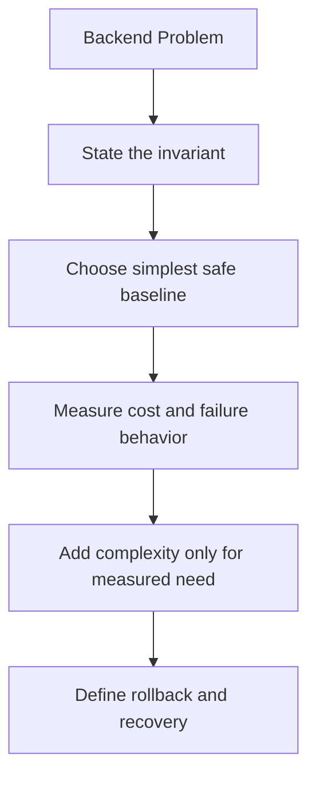

# Module 5: Data Structures & Algorithms — Full Revision Guide

This guide connects the module into one study story: choosing the smallest data structure and algorithm that preserves correctness within a CPU and memory budget.

## Essential Definitions

| Term | Meaning |
|---|---|
| Invariant | Condition that remains true through every algorithm step. |
| Time complexity | How running work grows with input size. |
| Space complexity | Extra memory required as input grows. |
| Hash table | Expected O(1) key lookup structure. |
| Heap | Priority structure with efficient min/max extraction. |

## Module Map

- [Introduction to DSA](01-Introduction-to-DSA.md)
- [Time Complexity](02-Time-Complexity.md)
- [Space Complexity](03-Space-Complexity.md)
- [Big O Analysis](04-Big-O-Analysis.md)
- [Arrays](05-Arrays.md)
- [Strings](06-Strings.md)
- [Linked Lists](07-Linked-Lists.md)
- [Stacks](08-Stacks.md)
- [Queues](09-Queues.md)
- [Deque](10-Deque.md)
- [Hash Tables](11-Hash-Tables.md)
- [Hash Sets](12-Hash-Sets.md)
- [Priority Queue](13-Priority-Queue.md)
- [Heaps](14-Heaps.md)
- [Trees](15-Trees.md)
- [Binary Trees](16-Binary-Trees.md)
- [Binary Search Trees](17-Binary-Search-Trees.md)
- [Balanced Trees](18-Balanced-Trees.md)
- [Tries](19-Tries.md)
- [Graphs](20-Graphs.md)
- [Breadth First Search](21-Breadth-First-Search.md)
- [Depth First Search](22-Depth-First-Search.md)
- [Recursion](23-Recursion.md)
- [Divide and Conquer](24-Divide-and-Conquer.md)
- [Binary Search](25-Binary-Search.md)
- [Sorting Algorithms](26-Sorting-Algorithms.md)
- [Merge Sort](27-Merge-Sort.md)
- [Quick Sort](28-Quick-Sort.md)
- [Heap Sort](29-Heap-Sort.md)
- [Two Pointers](30-Two-Pointers.md)
- [Sliding Window](31-Sliding-Window.md)
- [Prefix Sum](32-Prefix-Sum.md)
- [Difference Array](33-Difference-Array.md)
- [Greedy Algorithms](34-Greedy-Algorithms.md)
- [Backtracking](35-Backtracking.md)
- [Dynamic Programming Fundamentals](36-Dynamic-Programming-Fundamentals.md)
- [Union Find](37-Union-Find.md)
- [Topological Sorting](38-Topological-Sorting.md)
- [Monotonic Stack](39-Monotonic-Stack.md)
- [Monotonic Queue](40-Monotonic-Queue.md)
- [Backend DSA Patterns](41-Backend-DSA-Patterns.md)
- [Cache Data Structures](42-Cache-Data-Structures.md)
- [LRU Cache](43-LRU-Cache.md)
- [Consistent Hashing Basics](44-Consistent-Hashing-Basics.md)

## Two-Minute Recap

- Start with a brute-force baseline.
- State time and space cost plus assumptions.
- Boundary cases cause most interview bugs.
- Hashing trades memory for fast membership.
- Production algorithms need input and memory limits.

## Decision Tree



**Decision rule:** Use a hash map for membership/deduplication, a queue for FIFO work, a heap for priority/top-k, a tree/index for ordered lookup, and a graph traversal for dependency/reachability questions.

## Interview Answer Templates

### 30-second answer

> “`<concept>` solves `<problem>` with `<mechanism>`. The important trade-off is `<cost/risk>`. I would validate it using `<test/metric/trace>`.”

### Two-minute answer

1. State the user/business invariant.
2. Describe normal request or execution flow.
3. Name the likely failure or edge case.
4. Explain the protection, limit, or recovery path.
5. Finish with metrics, rollout, and trade-off.

## Failure Scenarios

| Symptom | Investigation | Safe response |
|---|---|---|
| Latency increases | Trace slow path; inspect saturation/queueing | Add deadline/bounds; remove bottleneck after evidence |
| Duplicate/inconsistent effect | Check retry, concurrency, and durable state | Add idempotency/constraint/ownership rule |
| Release regression | Compare deployment/config/version and SLOs | Roll back or disable safely; preserve evidence |
| Capacity exhaustion | Inspect resource, cardinality, and growth | Backpressure, scale, partition, or reduce work |

## Common Anti-patterns

| Anti-pattern | Why it fails | Better approach |
|---|---|---|
| Tool-first design | Hides requirement and invariant | State problem, baseline, and measured trigger first |
| Unbounded resource | Turns overload into outage | Bound time, memory, pools, queues, and retries |
| Local-only correctness | Breaks under replicas/restart | Use durable ownership/constraints/idempotency |
| Green happy path | Misses production failures | Test timeout, retry, restart, concurrency, and recovery |

## Flashcards

| Question | Answer |
|---|---|
| What comes before selecting a tool? | The invariant, requirements, and constraints. |
| What makes a retry safe? | Idempotency plus a bounded policy and durable outcome. |
| What should every production design include? | Limits, observability, deployment/rollback, and recovery. |
| What makes an interview answer senior-level? | Explicit trade-offs, failure modes, evidence, and ownership. |

## When to Use / When Not to Use

| Use | When | Avoid when |
|---|---|---|
| Simpler baseline | It meets stated requirements | A measured invariant/SLO requires more |
| Async workflow | Work is slow, retryable, or fan-out | Caller needs final invariant immediately |
| Cache/optimization | Evidence shows a bottleneck | Source-of-truth rules are unclear |
| Abstraction | It protects a real boundary | It only adds indirection |

## End-to-End Case Study

A rate limiter uses a bounded sliding window per tenant; Redis provides atomic distributed counters, while the API validates tenant identity and emits only bounded-cardinality metrics.

## Debugging Commands and Evidence

Focus on: Compare optimized output with a brute-force oracle on small random inputs; profile runtime and allocations; test empty, duplicate, sorted, skewed, and maximum-size inputs.

```bash
# Capture deployment/runtime evidence first
docker compose logs -f
docker stats
curl -i http://localhost:8000/healthz
```

## Self-Test Checklist

- [ ] I can explain the module’s core terms in plain English.
- [ ] I can choose an approach from an invariant and stated constraints.
- [ ] I can name a likely failure, how to investigate it, and safe recovery.
- [ ] I can give a 30-second and two-minute interview answer.
- [ ] I can connect this module to APIs, data, operations, and testing.

## Cross-Module Study Links

- [Core Backend](../Module-02-Core-Backend/module-summary.md)
- [Databases](../Module-03-Databases/module-summary.md)
- [Operating Systems](../Module-04-Operating-Systems/module-summary.md)
- [Networking](../Module-06-Networking-and-Distributed-Basics/module-summary.md)
- [System Design](../Module-07-Advanced-Backend-and-System-Design/module-summary.md)
- [Testing](../Module-09-Testing-and-Code-Quality/module-summary.md)
- [DevOps](../Module-10-DevOps-and-Cloud/module-summary.md)
- [Interview Preparation](../Module-11-Interview-Preparation/module-summary.md)

## Interview Drills

1. Design an O(1) LRU cache and explain map plus doubly linked list.
2. Choose data structures for top-priority jobs without starving old work.
3. Explain cursor pagination as a binary-search/index problem.

## Shortcuts

- Start with a brute-force baseline.
- State time and space cost plus assumptions.
- Boundary cases cause most interview bugs.
- Hashing trades memory for fast membership.
- Production algorithms need input and memory limits.
