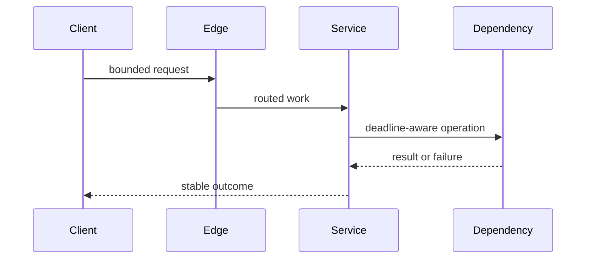
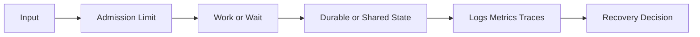

# TLS SSL

---
# ⏱ If You Only Have 2 Minutes
- Networks fail partially: a timeout does not prove the server did not act.
- TCP is reliable byte-stream transport, not message framing.
- TLS authenticates and encrypts a connection; certificate/hostname validation is mandatory.
- Latency budget, connection reuse, payload size, and retries determine user-visible p99.

---
# Simple Explanation
TLS SSL matters because a backend is not just application code. It runs on finite operating-system resources or communicates across unreliable networks. The practical job is to preserve the user-facing invariant while the normal path becomes slow, concurrent, or partially unavailable.

# 1. What is it?
TLS SSL is the set of concepts behind **tls ssl**. It describes how work, state, or messages move through a real backend system and where the implementation must set a boundary.

# 2. Why do we need it?
Without a design, overload becomes a cascade: workers wait forever, queues grow, connections leak, retries amplify traffic, and support cannot explain what happened. Production behavior must be bounded, observable, and recoverable.

# 3. How does it work?
1. Accept work at a bounded boundary.
2. Validate the request/message and establish its deadline.
3. Acquire only the resources required for the invariant.
4. Execute or wait without blocking unrelated work.
5. Release resources, classify the outcome, and emit evidence.



# 4. Internal Workflow
The important internal question is ownership. A local variable is owned by one request; a shared queue, lock, socket, database row, or network connection is not. Give shared resources a capacity, lifecycle, timeout, and owner.



# 5. Important Concepts
## Invariant
The fact that must remain true: no duplicate payment, no negative inventory, no unauthorized data, or no silent message loss.

## Backpressure
Slow consumers must make producers slow down, reject work, or queue within a known limit. Unlimited buffering is delayed failure.

## Timeout and cancellation
A timeout protects capacity. Propagate a deadline so a downstream operation does not outlive the caller.

## Observability
Use metrics for trends, logs for events, and traces for one path. Include safe identifiers, version, outcome, and duration.

# 6. Real Backend Examples
```python
import asyncio

limit = asyncio.Semaphore(32)  # Cap concurrent dependency calls.

async def call_dependency(client, request):
    async with limit:
        return await asyncio.wait_for(client.send(request), timeout=0.8)
```
The semaphore protects one process only. For durable cross-replica correctness, use PostgreSQL constraints/transactions or an idempotent queue consumer. Avoid holding locks or database transactions while waiting on the network.

# 7. Common Mistakes
- Treating a timeout as proof the remote action failed.
- Creating unbounded tasks, threads, sockets, or queues.
- Retrying non-idempotent work without a key or durable result.
- Using a local lock as a distributed coordination mechanism.
- Monitoring averages while p99, queue age, or memory grows.

# 8. Comparison Table
| Choice | Strength | Risk |
|---|---|---|
| Synchronous call | Immediate answer | Cascading latency |
| Queue/worker | Absorbs slow work | Duplicate/delayed work |
| Local lock | Low latency | Invalid across replicas |
| Database constraint | Durable correctness | Contention/latency |
| Retry | Recovers transient faults | Amplifies overload |

# 9. Things I Must Remember
- Networks fail partially: a timeout does not prove the server did not act.
- TCP is reliable byte-stream transport, not message framing.
- TLS authenticates and encrypts a connection; certificate/hostname validation is mandatory.
- Latency budget, connection reuse, payload size, and retries determine user-visible p99.
- Bound time, memory, connections, concurrency, and queue depth.
- Make shared ownership explicit.
- Test restart, timeout, duplicate, overload, and cancellation paths.
- Separate liveness from readiness.
- Design graceful draining and recovery before deploying replicas.

# 10. Interview Questions
**Q: What fails first under load?**  
Usually a bounded resource: connection pool, worker, lock, queue, CPU, memory, or downstream dependency. Find it with saturation and latency evidence.

**Q: How do you make this safe across replicas?**  
Do not rely on process-local state. Use durable constraints, idempotency, partition ownership, or a carefully designed lease with recovery.

# 11. Cheat Sheet
- Define invariant.
- Bound admission.
- Propagate deadlines.
- Avoid blocking unrelated work.
- Release resources deterministically.
- Retry only safe transient failures.
- Observe p95/p99 and saturation.
- Test restart and partial failure.

## Related Topics
- [Backend Concurrency Patterns](32-Backend-Concurrency-Patterns.md)
- [Failure Handling](34-Failure-Handling.md)
