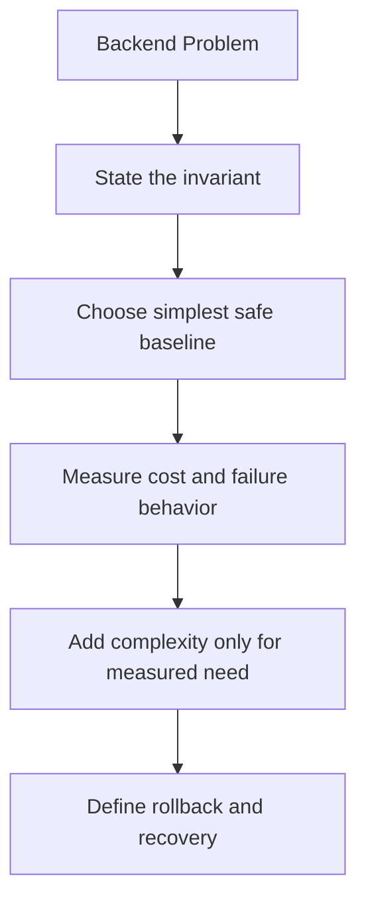

# Module 6: Networking & Distributed Basics — Full Revision Guide

This guide connects the module into one study story: how requests travel through DNS, TLS, TCP, proxies, services, and dependencies while networks fail partially.

## Essential Definitions

| Term | Meaning |
|---|---|
| DNS | Name-to-address/service resolution system. |
| TCP | Reliable ordered byte-stream transport. |
| TLS | Authenticated encrypted transport layer. |
| Timeout | Deadline that bounds waiting and capacity use. |
| Partial failure | One dependency/path fails while others still work. |

## Module Map

- [Networking Fundamentals](01-Networking-Fundamentals.md)
- [OSI Model](02-OSI-Model.md)
- [TCP IP Model](03-TCP-IP-Model.md)
- [IP Addressing](04-IP-Addressing.md)
- [IPv4 vs IPv6](05-IPv4-vs-IPv6.md)
- [MAC Addresses](06-MAC-Addresses.md)
- [Ports and Sockets](07-Ports-and-Sockets.md)
- [TCP](08-TCP.md)
- [UDP](09-UDP.md)
- [TLS SSL](10-TLS-SSL.md)
- [HTTP over TCP](11-HTTP-over-TCP.md)
- [HTTPS](12-HTTPS.md)
- [DNS](13-DNS.md)
- [DHCP](14-DHCP.md)
- [NAT](15-NAT.md)
- [Latency](16-Latency.md)
- [Bandwidth](17-Bandwidth.md)
- [Throughput](18-Throughput.md)
- [Jitter](19-Jitter.md)
- [Packet Loss](20-Packet-Loss.md)
- [Network Failures](21-Network-Failures.md)
- [Reverse Proxy](22-Reverse-Proxy.md)
- [Forward Proxy](23-Forward-Proxy.md)
- [Load Balancers](24-Load-Balancers.md)
- [API Gateway](25-API-Gateway.md)
- [Service Discovery](26-Service-Discovery.md)
- [Synchronous Communication](27-Synchronous-Communication.md)
- [Asynchronous Communication](28-Asynchronous-Communication.md)
- [RPC and gRPC](29-RPC-and-gRPC.md)
- [WebSockets](30-WebSockets.md)
- [Server Sent Events](31-Server-Sent-Events.md)
- [Long Polling](32-Long-Polling.md)
- [Distributed Systems Fundamentals](33-Distributed-Systems-Fundamentals.md)
- [Failure Handling](34-Failure-Handling.md)
- [Reliability Basics](35-Reliability-Basics.md)

## Two-Minute Recap

- A timeout does not prove the server did not perform the action.
- TCP is a byte stream; applications define message framing.
- TLS needs certificate and hostname validation.
- Retries need deadlines, jitter, and idempotency.
- Load balancer health checks must distinguish ready from live.

## Decision Tree



**Decision rule:** Use HTTP/gRPC request-response for immediate bounded answers; use queues/events for slow/retryable work; use WebSockets/SSE only when clients need live updates and connection lifecycle is managed.

## Interview Answer Templates

### 30-second answer

> “`<concept>` solves `<problem>` with `<mechanism>`. The important trade-off is `<cost/risk>`. I would validate it using `<test/metric/trace>`.”

### Two-minute answer

1. State the user/business invariant.
2. Describe normal request or execution flow.
3. Name the likely failure or edge case.
4. Explain the protection, limit, or recovery path.
5. Finish with metrics, rollout, and trade-off.

## Failure Scenarios

| Symptom | Investigation | Safe response |
|---|---|---|
| Latency increases | Trace slow path; inspect saturation/queueing | Add deadline/bounds; remove bottleneck after evidence |
| Duplicate/inconsistent effect | Check retry, concurrency, and durable state | Add idempotency/constraint/ownership rule |
| Release regression | Compare deployment/config/version and SLOs | Roll back or disable safely; preserve evidence |
| Capacity exhaustion | Inspect resource, cardinality, and growth | Backpressure, scale, partition, or reduce work |

## Common Anti-patterns

| Anti-pattern | Why it fails | Better approach |
|---|---|---|
| Tool-first design | Hides requirement and invariant | State problem, baseline, and measured trigger first |
| Unbounded resource | Turns overload into outage | Bound time, memory, pools, queues, and retries |
| Local-only correctness | Breaks under replicas/restart | Use durable ownership/constraints/idempotency |
| Green happy path | Misses production failures | Test timeout, retry, restart, concurrency, and recovery |

## Flashcards

| Question | Answer |
|---|---|
| What comes before selecting a tool? | The invariant, requirements, and constraints. |
| What makes a retry safe? | Idempotency plus a bounded policy and durable outcome. |
| What should every production design include? | Limits, observability, deployment/rollback, and recovery. |
| What makes an interview answer senior-level? | Explicit trade-offs, failure modes, evidence, and ownership. |

## When to Use / When Not to Use

| Use | When | Avoid when |
|---|---|---|
| Simpler baseline | It meets stated requirements | A measured invariant/SLO requires more |
| Async workflow | Work is slow, retryable, or fan-out | Caller needs final invariant immediately |
| Cache/optimization | Evidence shows a bottleneck | Source-of-truth rules are unclear |
| Abstraction | It protects a real boundary | It only adds indirection |

## End-to-End Case Study

A public API passes through DNS, CDN/WAF, ALB, FastAPI, Redis, PostgreSQL, and an outbox worker. Every hop has a deadline, trace context, health rule, and capacity limit.

## Debugging Commands and Evidence

Focus on: Check DNS resolution/TTL, TLS handshake/certificate, connection resets, proxy logs, p95/p99 hop timing, retransmissions, pool saturation, queue age, and one trace from client to dependency.

```bash
# Capture deployment/runtime evidence first
docker compose logs -f
docker stats
curl -i http://localhost:8000/healthz
```

## Self-Test Checklist

- [ ] I can explain the module’s core terms in plain English.
- [ ] I can choose an approach from an invariant and stated constraints.
- [ ] I can name a likely failure, how to investigate it, and safe recovery.
- [ ] I can give a 30-second and two-minute interview answer.
- [ ] I can connect this module to APIs, data, operations, and testing.

## Cross-Module Study Links

- [Core Backend](../Module-02-Core-Backend/module-summary.md)
- [Databases](../Module-03-Databases/module-summary.md)
- [Operating Systems](../Module-04-Operating-Systems/module-summary.md)
- [Networking](../Module-06-Networking-and-Distributed-Basics/module-summary.md)
- [System Design](../Module-07-Advanced-Backend-and-System-Design/module-summary.md)
- [Testing](../Module-09-Testing-and-Code-Quality/module-summary.md)
- [DevOps](../Module-10-DevOps-and-Cloud/module-summary.md)
- [Interview Preparation](../Module-11-Interview-Preparation/module-summary.md)

## Interview Drills

1. Why is retrying POST dangerous without idempotency?
2. Compare WebSocket, SSE, and long polling for order-status updates.
3. Design a reverse-proxy/load-balancer timeout and draining policy.

## Shortcuts

- A timeout does not prove the server did not perform the action.
- TCP is a byte stream; applications define message framing.
- TLS needs certificate and hostname validation.
- Retries need deadlines, jitter, and idempotency.
- Load balancer health checks must distinguish ready from live.
