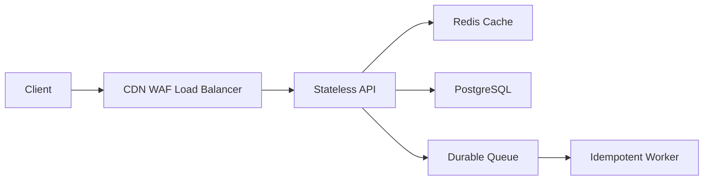

# Kafka Fundamentals

---
# ⏱ If You Only Have 2 Minutes
- At-least-once delivery means every consumer must be idempotent.
- An outbox connects a database commit to event publication.
- Queues trade immediate consistency for throughput, resilience, and operational work.
- Sagas compensate business effects; they do not provide magical global rollback.

---
# Simple Explanation
Kafka Fundamentals is a way to make a backend system survive growth and failure without losing the product behavior users care about. In an interview, first make the requirement concrete, then select only the components needed to protect it.

# 1. What is it?
Kafka Fundamentals is a system-design concern around **kafka fundamentals**. It turns a broad requirement into explicit request flow, state ownership, capacity, failure handling, and operational evidence.

# 2. Why do we need it?
Systems fail when assumptions stay implicit: traffic grows, dependencies slow down, an AZ disappears, a client retries, or a deployment overlaps older code. A design needs an answer for each failure before the incident.

# 3. How does it work?
1. Clarify functional and non-functional requirements.
2. Estimate traffic, storage, bandwidth, concurrency, and growth.
3. Define data ownership and the durable invariant.
4. Separate synchronous user work from asynchronous effects.
5. Add caching, replication, partitioning, or isolation only for a measured need.
6. Define SLOs, alerts, rollout, rollback, backup, and recovery.



# 4. Internal Workflow
The request path should be short and bounded. The API validates/authenticates, performs only the durable synchronous invariant, and returns. Slow or retryable effects enter a queue through an outbox. Workers consume idempotently, record outcomes, and expose queue age/retry/DLQ metrics.

# 5. Important Concepts
## Requirement
Turn “fast” into p95/p99 targets, “available” into a failure domain/SLO, and “large” into estimated QPS, bytes, and concurrency.

## Durable boundary
Use database constraints/transactions for the core business fact. A cache or message is not a substitute for the source of truth.

## Backpressure
Bound clients, pools, queues, and retries. Reject/degrade deliberately before overload becomes a cascade.

## Observability
Connect request, deployment, dependency, queue, and business outcome through metrics, logs, traces, and runbooks.

# 6. Real Backend Examples
```python
async def create_payment(command, db, outbox):
    async with db.transaction():
        payment = await db.insert_payment_if_new(command.idempotency_key, command)
        await outbox.add("payment.created", payment.id)
    return payment
```
The transaction protects the ledger/idempotency invariant. An outbox relay publishes later; the consumer must still tolerate duplicate delivery. Keep provider calls outside the transaction and reconcile uncertain external outcomes.

# 7. Common Mistakes
- Starting with Kafka, Redis, or microservices before stating requirements.
- Treating a timeout as proof an external effect did not happen.
- Adding a cache without invalidation and stampede policy.
- Calling multi-region active-active “high availability” without conflict/recovery design.
- Ignoring egress, idle capacity, observability, and operational labor cost.

# 8. Comparison Table
| Choice | Benefit | Cost |
|---|---|---|
| Monolith | Simple deploy/transaction | Boundary discipline required |
| Microservices | Independent scaling/ownership | Distributed failure and operations |
| Sync call | Immediate result | Coupling and cascades |
| Queue | Absorb/retry work | Eventual consistency |
| Replica | Read scale/HA | Lag and failover complexity |
| Shard | Write/data scale | Routing and rebalancing |

# 9. Things I Must Remember
- At-least-once delivery means every consumer must be idempotent.
- An outbox connects a database commit to event publication.
- Queues trade immediate consistency for throughput, resilience, and operational work.
- Sagas compensate business effects; they do not provide magical global rollback.
- Estimate before selecting capacity.
- Preserve core invariants durably.
- Use idempotency for retried effects.
- Propagate deadlines and bound retries.
- Design for AZ/region/provider failure explicitly.
- Measure SLO burn, saturation, queue age, lag, hit rate, and cost.
- Deploy progressively; keep rollback compatible.

# 10. Interview Questions
**Q: How do you begin a system-design answer?**  
Clarify users/actions, scale, latency, availability, consistency, security, retention, and non-goals; then state a simple baseline.

**Q: When do you shard?**  
After a measured single-database limit and a defined partition key, with a plan for skew, cross-shard queries, migration, and operations.

**Q: How do you make payments safe?**  
Use idempotency keys, ledger/database constraints, provider reconciliation, outbox events, bounded retries, auditability, and explicit uncertain-state handling.

# 11. Cheat Sheet
- Clarify requirements.
- Estimate load/storage.
- State invariant and owner.
- Keep user path bounded.
- Queue slow/retryable effects.
- Make consumers idempotent.
- Cache with invalidation.
- Scale stateless compute first.
- Design for failure domains.
- Measure and roll out safely.

## Related Topics
- [System Design Fundamentals](01-System-Design-Fundamentals.md)
- [Idempotency](32-Idempotency.md)
- [Timeout Pattern](37-Timeout-Pattern.md)
- [System Design Case Studies](56-System-Design-Case-Studies.md)
