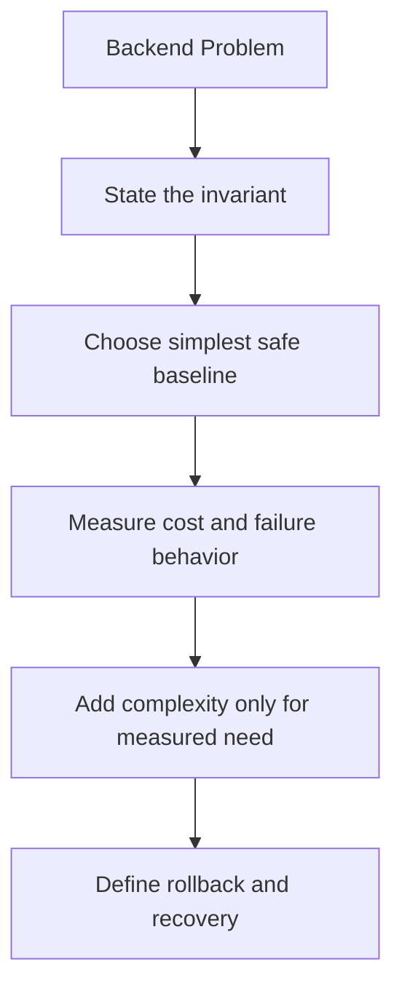

# Module 7: Advanced Backend & System Design — Full Revision Guide

This guide connects the module into one study story: turning product requirements into scalable, reliable, secure, observable, and cost-aware production systems.

## Essential Definitions

| Term | Meaning |
|---|---|
| SLO | Measured reliability target for a user-facing operation. |
| Replication | Copies of data for availability/read scale. |
| Partitioning | Splitting data/work by a routing key. |
| Outbox | Durable event record committed with business state. |
| Saga | Distributed workflow with compensating actions. |

## Module Map

- [System Design Fundamentals](01-System-Design-Fundamentals.md)
- [Functional Requirements](02-Functional-Requirements.md)
- [Non Functional Requirements](03-Non-Functional-Requirements.md)
- [Back Of The Envelope Calculations](04-Back-Of-The-Envelope-Calculations.md)
- [System Capacity Planning](05-System-Capacity-Planning.md)
- [Scalability](06-Scalability.md)
- [Vertical Scaling](07-Vertical-Scaling.md)
- [Horizontal Scaling](08-Horizontal-Scaling.md)
- [High Availability](09-High-Availability.md)
- [Single AZ vs Multi AZ](10-Single-AZ-vs-Multi-AZ.md)
- [Multi Region Deployments](11-Multi-Region-Deployments.md)
- [Storage Systems](12-Storage-Systems.md)
- [Data Modeling](13-Data-Modeling.md)
- [Caching Fundamentals](14-Caching-Fundamentals.md)
- [Redis Deep Dive](15-Redis-Deep-Dive.md)
- [Cache Invalidation](16-Cache-Invalidation.md)
- [CDN](17-CDN.md)
- [Replication](18-Replication.md)
- [Partitioning](19-Partitioning.md)
- [Sharding](20-Sharding.md)
- [Message Queues](21-Message-Queues.md)
- [Kafka Fundamentals](22-Kafka-Fundamentals.md)
- [RabbitMQ Fundamentals](23-RabbitMQ-Fundamentals.md)
- [Pub Sub Pattern](24-Pub-Sub-Pattern.md)
- [Event Driven Architecture](25-Event-Driven-Architecture.md)
- [Event Sourcing](26-Event-Sourcing.md)
- [CQRS](27-CQRS.md)
- [Consistency in Distributed Systems](28-Consistency-in-Distributed-Systems.md)
- [Distributed Transactions](29-Distributed-Transactions.md)
- [Two Phase Commit](30-Two-Phase-Commit.md)
- [SAGA Pattern](31-SAGA-Pattern.md)
- [Idempotency](32-Idempotency.md)
- [Rate Limiting](33-Rate-Limiting.md)
- [Circuit Breaker](34-Circuit-Breaker.md)
- [Retry Pattern](35-Retry-Pattern.md)
- [Exponential Backoff](36-Exponential-Backoff.md)
- [Timeout Pattern](37-Timeout-Pattern.md)
- [Bulkhead Pattern](38-Bulkhead-Pattern.md)
- [Feature Flags](39-Feature-Flags.md)
- [Safe Deployments](40-Safe-Deployments.md)
- [Blue Green Deployment](41-Blue-Green-Deployment.md)
- [Canary Deployment](42-Canary-Deployment.md)
- [Rolling Deployment](43-Rolling-Deployment.md)
- [Cloud Fundamentals](44-Cloud-Fundamentals.md)
- [Object Storage](45-Object-Storage.md)
- [Blob Storage](46-Blob-Storage.md)
- [System Architecture Patterns](47-System-Architecture-Patterns.md)
- [Layered Architecture](48-Layered-Architecture.md)
- [Hexagonal Architecture](49-Hexagonal-Architecture.md)
- [Monolith](50-Monolith.md)
- [Modular Monolith](51-Modular-Monolith.md)
- [Microservices](52-Microservices.md)
- [Service Mesh](53-Service-Mesh.md)
- [API Versioning](54-API-Versioning.md)
- [System Design Interview Strategy](55-System-Design-Interview-Strategy.md)
- [System Design Case Studies](56-System-Design-Case-Studies.md)

## Two-Minute Recap

- Clarify requirements and estimates before naming products.
- Keep the immediate invariant in a short durable transaction.
- Consumers must be idempotent under at-least-once delivery.
- Caches need invalidation/staleness rules.
- Multi-region adds consistency, routing, and recovery cost.

## Decision Tree



**Decision rule:** Start with a modular monolith and one primary database unless independence or scale proves otherwise; add cache, queue, replica, shard, or region for a measured bottleneck and an explicit failure-domain goal.

## Interview Answer Templates

### 30-second answer

> “`<concept>` solves `<problem>` with `<mechanism>`. The important trade-off is `<cost/risk>`. I would validate it using `<test/metric/trace>`.”

### Two-minute answer

1. State the user/business invariant.
2. Describe normal request or execution flow.
3. Name the likely failure or edge case.
4. Explain the protection, limit, or recovery path.
5. Finish with metrics, rollout, and trade-off.

## Failure Scenarios

| Symptom | Investigation | Safe response |
|---|---|---|
| Latency increases | Trace slow path; inspect saturation/queueing | Add deadline/bounds; remove bottleneck after evidence |
| Duplicate/inconsistent effect | Check retry, concurrency, and durable state | Add idempotency/constraint/ownership rule |
| Release regression | Compare deployment/config/version and SLOs | Roll back or disable safely; preserve evidence |
| Capacity exhaustion | Inspect resource, cardinality, and growth | Backpressure, scale, partition, or reduce work |

## Common Anti-patterns

| Anti-pattern | Why it fails | Better approach |
|---|---|---|
| Tool-first design | Hides requirement and invariant | State problem, baseline, and measured trigger first |
| Unbounded resource | Turns overload into outage | Bound time, memory, pools, queues, and retries |
| Local-only correctness | Breaks under replicas/restart | Use durable ownership/constraints/idempotency |
| Green happy path | Misses production failures | Test timeout, retry, restart, concurrency, and recovery |

## Flashcards

| Question | Answer |
|---|---|
| What comes before selecting a tool? | The invariant, requirements, and constraints. |
| What makes a retry safe? | Idempotency plus a bounded policy and durable outcome. |
| What should every production design include? | Limits, observability, deployment/rollback, and recovery. |
| What makes an interview answer senior-level? | Explicit trade-offs, failure modes, evidence, and ownership. |

## When to Use / When Not to Use

| Use | When | Avoid when |
|---|---|---|
| Simpler baseline | It meets stated requirements | A measured invariant/SLO requires more |
| Async workflow | Work is slow, retryable, or fan-out | Caller needs final invariant immediately |
| Cache/optimization | Evidence shows a bottleneck | Source-of-truth rules are unclear |
| Abstraction | It protects a real boundary | It only adds indirection |

## End-to-End Case Study

A payment service writes a ledger plus idempotency result and outbox in PostgreSQL, publishes events asynchronously, reconciles uncertain provider outcomes, exposes SLOs, and uses progressive deployment.

## Debugging Commands and Evidence

Focus on: Use requirement-to-SLO mapping, capacity estimates, traces, saturation metrics, cache hit/eviction, replication lag, queue age, deployment markers, and cost/egress dashboards.

```bash
# Capture deployment/runtime evidence first
docker compose logs -f
docker stats
curl -i http://localhost:8000/healthz
```

## Self-Test Checklist

- [ ] I can explain the module’s core terms in plain English.
- [ ] I can choose an approach from an invariant and stated constraints.
- [ ] I can name a likely failure, how to investigate it, and safe recovery.
- [ ] I can give a 30-second and two-minute interview answer.
- [ ] I can connect this module to APIs, data, operations, and testing.

## Cross-Module Study Links

- [Core Backend](../Module-02-Core-Backend/module-summary.md)
- [Databases](../Module-03-Databases/module-summary.md)
- [Operating Systems](../Module-04-Operating-Systems/module-summary.md)
- [Networking](../Module-06-Networking-and-Distributed-Basics/module-summary.md)
- [System Design](../Module-07-Advanced-Backend-and-System-Design/module-summary.md)
- [Testing](../Module-09-Testing-and-Code-Quality/module-summary.md)
- [DevOps](../Module-10-DevOps-and-Cloud/module-summary.md)
- [Interview Preparation](../Module-11-Interview-Preparation/module-summary.md)

## Interview Drills

1. Design a URL shortener from requirements through cache, database, rate limit, and failure recovery.
2. Explain SAGA versus two-phase commit for order/payment/inventory.
3. Defend a Multi-AZ versus multi-region design with cost and RPO/RTO.

## Shortcuts

- Clarify requirements and estimates before naming products.
- Keep the immediate invariant in a short durable transaction.
- Consumers must be idempotent under at-least-once delivery.
- Caches need invalidation/staleness rules.
- Multi-region adds consistency, routing, and recovery cost.
