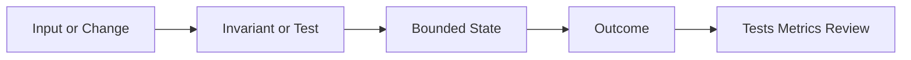

# Stress Testing

---
# ⏱ If You Only Have 2 Minutes
- Tests provide confidence, not proof of absence of defects.
- Use the test pyramid: many fast unit tests, fewer integration tests, minimal end-to-end tests.
- Mock boundaries you own; prefer real PostgreSQL/Redis behavior when semantics matter.
- A flaky test is a production-quality problem because it destroys CI trust.

---
# Simple Explanation
Stress Testing is a repeatable way to make backend work safer or faster. For interview revision, remember the problem it solves first, then the invariant or feedback loop that makes the approach correct.

# 1. What is it?
Stress Testing covers the practical rules behind **stress testing**. It gives an engineer a way to control work, state, correctness, and future change instead of relying on intuition.

# 2. Why do we need it?
Without it, systems often become slow, incorrect, difficult to test, or costly to change. The failure usually hides until input size, concurrency, team size, or deployment frequency increases.

# 3. How does it work?
1. State the input, desired outcome, and constraints.
2. Choose the smallest structure or feedback mechanism that protects the invariant.
3. Implement a clear baseline.
4. Measure correctness, time, space, and failure behavior.
5. Improve only the demonstrated bottleneck.



# 4. Internal Workflow
The key internal idea is explicit state. An algorithm keeps only the state needed to avoid repeated work; a quality practice keeps only the evidence needed to prevent a regression. In both cases, unbounded state or invisible assumptions become production risk.

# 5. Important Concepts
## Invariant
The condition that stays true before and after an iteration, recursive call, test, or refactor.

## Complexity and cost
Count CPU, memory, allocations, network calls, CI time, and human review cost. Big O is useful, but constants and data skew matter in services.

## Boundary
Validate input size and ownership before expensive computation or external effects.

# 6. Real Backend Examples
```python
def unique_ids(ids: list[str]) -> list[str]:
    # A set turns repeated membership scans into expected O(1) lookups.
    seen: set[str] = set()
    return [item for item in ids if not (item in seen or seen.add(item))]
```
For production, cap user-controlled input, benchmark realistic cardinality, and test the implementation against a simple oracle. For quality work, run the same checks in CI and keep outputs/artifacts actionable.

# 7. Common Mistakes
- Quoting complexity without stating average/worst-case assumptions.
- Optimizing before writing a correct baseline.
- Testing an implementation detail instead of a stable outcome.
- Using unbounded cache/maps/fixtures with user-controlled keys.
- Treating green CI or coverage percentage as proof of quality.

# 8. Comparison Table
| Choice | Best use | Main risk |
|---|---|---|
| Simple scan | Small bounded input | Becomes O(n²) when nested |
| Hash-based lookup | Membership/deduplication | Memory and collision assumptions |
| Integration test | Real adapter semantics | Slower setup/feedback |
| Mock | Isolate a controlled boundary | False confidence from wrong behavior |
| Refactor | Improve design safely | Behavior change without tests |

# 9. Things I Must Remember
- Tests provide confidence, not proof of absence of defects.
- Use the test pyramid: many fast unit tests, fewer integration tests, minimal end-to-end tests.
- Mock boundaries you own; prefer real PostgreSQL/Redis behavior when semantics matter.
- A flaky test is a production-quality problem because it destroys CI trust.
- Make input and resource bounds explicit.
- Explain the invariant before code.
- Test empty, duplicate, boundary, and adversarial cases.
- Measure before optimizing.
- Keep correctness and operational evidence close to the change.

# 10. Interview Questions
**Q: What is the baseline and its bottleneck?**  
Explain the direct solution first, then identify the repeated operation or feedback gap.

**Q: How do you prove the optimized version is correct?**  
State the invariant, test it against a baseline on small/random inputs, and cover boundary cases.

**Q: What changes in production?**  
Add input limits, cancellation/time budgets, concurrency ownership, metrics, and durable boundaries where business state is involved.

# 11. Cheat Sheet
- Clarify constraints.
- Write a baseline.
- Name the invariant.
- State time and space cost.
- Test boundaries.
- Bound input and memory.
- Profile real data.
- Keep changes reviewable.
- Automate regression checks.

## Related Topics
- [Unit Testing](04-Unit-Testing.md)
- [Integration Testing](05-Integration-Testing.md)
- [CI Testing](21-CI-Testing.md)
