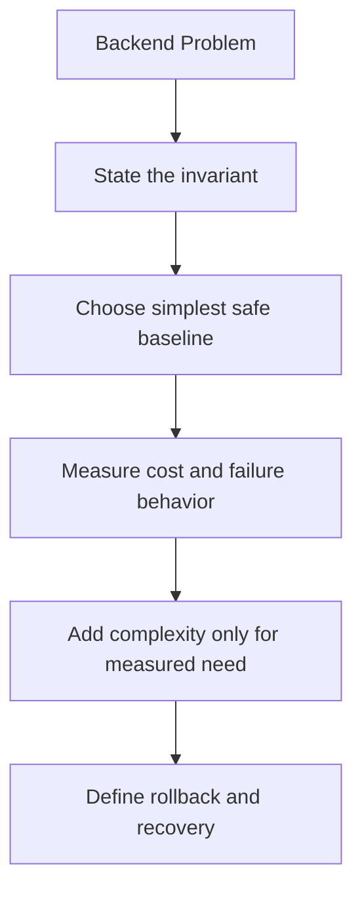

# Module 9: Testing & Code Quality — Full Revision Guide

This guide connects the module into one study story: using fast feedback, realistic integration evidence, review, and refactoring to change backend services safely.

## Essential Definitions

| Term | Meaning |
|---|---|
| Unit test | Fast isolated test of one behavior. |
| Integration test | Test using real adapter behavior such as PostgreSQL. |
| Contract test | Compatibility test between consumer/provider expectations. |
| Test double | Stub, fake, mock, or spy replacing a collaborator. |
| Regression | Previously fixed behavior that breaks again. |

## Module Map

- [Introduction to Testing](01-Introduction-to-Testing.md)
- [Manual Testing](02-Manual-Testing.md)
- [Testing Pyramid](03-Testing-Pyramid.md)
- [Unit Testing](04-Unit-Testing.md)
- [Integration Testing](05-Integration-Testing.md)
- [End to End Testing](06-End-to-End-Testing.md)
- [Contract Testing](07-Contract-Testing.md)
- [Smoke Testing](08-Smoke-Testing.md)
- [Regression Testing](09-Regression-Testing.md)
- [Performance Testing](10-Performance-Testing.md)
- [Load Testing](11-Load-Testing.md)
- [Stress Testing](12-Stress-Testing.md)
- [Test Doubles](13-Test-Doubles.md)
- [Mocking](14-Mocking.md)
- [Stubs](15-Stubs.md)
- [Fakes](16-Fakes.md)
- [Spies](17-Spies.md)
- [Test Coverage](18-Test-Coverage.md)
- [Test Driven Development](19-Test-Driven-Development.md)
- [Behavior Driven Development](20-Behavior-Driven-Development.md)
- [CI Testing](21-CI-Testing.md)
- [Code Quality](22-Code-Quality.md)
- [Code Smells](23-Code-Smells.md)
- [Clean Code](24-Clean-Code.md)
- [Refactoring](25-Refactoring.md)
- [Code Reviews](26-Code-Reviews.md)
- [Git Workflow](27-Git-Workflow.md)
- [Git Branching Strategies](28-Git-Branching-Strategies.md)
- [Pull Requests](29-Pull-Requests.md)
- [Domain Driven Design](30-Domain-Driven-Design.md)
- [Clean Architecture Review](31-Clean-Architecture-Review.md)

## Two-Minute Recap

- The test pyramid favors many unit tests and fewer integration/E2E tests.
- Use real database behavior when constraints, SQL, or transactions matter.
- Coverage is a signal, not proof.
- Flaky tests destroy CI trust.
- Refactoring preserves behavior; characterization tests protect legacy code.

## Decision Tree



**Decision rule:** Use a unit test for local business rule, integration test for adapter semantics, contract test for service boundary, E2E/smoke test for critical deployed path, and load test for capacity/SLO risk.

## Interview Answer Templates

### 30-second answer

> “`<concept>` solves `<problem>` with `<mechanism>`. The important trade-off is `<cost/risk>`. I would validate it using `<test/metric/trace>`.”

### Two-minute answer

1. State the user/business invariant.
2. Describe normal request or execution flow.
3. Name the likely failure or edge case.
4. Explain the protection, limit, or recovery path.
5. Finish with metrics, rollout, and trade-off.

## Failure Scenarios

| Symptom | Investigation | Safe response |
|---|---|---|
| Latency increases | Trace slow path; inspect saturation/queueing | Add deadline/bounds; remove bottleneck after evidence |
| Duplicate/inconsistent effect | Check retry, concurrency, and durable state | Add idempotency/constraint/ownership rule |
| Release regression | Compare deployment/config/version and SLOs | Roll back or disable safely; preserve evidence |
| Capacity exhaustion | Inspect resource, cardinality, and growth | Backpressure, scale, partition, or reduce work |

## Common Anti-patterns

| Anti-pattern | Why it fails | Better approach |
|---|---|---|
| Tool-first design | Hides requirement and invariant | State problem, baseline, and measured trigger first |
| Unbounded resource | Turns overload into outage | Bound time, memory, pools, queues, and retries |
| Local-only correctness | Breaks under replicas/restart | Use durable ownership/constraints/idempotency |
| Green happy path | Misses production failures | Test timeout, retry, restart, concurrency, and recovery |

## Flashcards

| Question | Answer |
|---|---|
| What comes before selecting a tool? | The invariant, requirements, and constraints. |
| What makes a retry safe? | Idempotency plus a bounded policy and durable outcome. |
| What should every production design include? | Limits, observability, deployment/rollback, and recovery. |
| What makes an interview answer senior-level? | Explicit trade-offs, failure modes, evidence, and ownership. |

## When to Use / When Not to Use

| Use | When | Avoid when |
|---|---|---|
| Simpler baseline | It meets stated requirements | A measured invariant/SLO requires more |
| Async workflow | Work is slow, retryable, or fan-out | Caller needs final invariant immediately |
| Cache/optimization | Evidence shows a bottleneck | Source-of-truth rules are unclear |
| Abstraction | It protects a real boundary | It only adds indirection |

## End-to-End Case Study

An order API has unit tests for validation, disposable PostgreSQL tests for unique/idempotency constraints, contract tests for payment provider mapping, and CI gates that publish failure artifacts.

## Debugging Commands and Evidence

Focus on: Capture failing seed, test order, fixture state, container logs, SQL, timing, dependency version, and whether failure is deterministic; fix the root cause instead of increasing retries.

```bash
# Capture deployment/runtime evidence first
docker compose logs -f
docker stats
curl -i http://localhost:8000/healthz
```

## Self-Test Checklist

- [ ] I can explain the module’s core terms in plain English.
- [ ] I can choose an approach from an invariant and stated constraints.
- [ ] I can name a likely failure, how to investigate it, and safe recovery.
- [ ] I can give a 30-second and two-minute interview answer.
- [ ] I can connect this module to APIs, data, operations, and testing.

## Cross-Module Study Links

- [Core Backend](../Module-02-Core-Backend/module-summary.md)
- [Databases](../Module-03-Databases/module-summary.md)
- [Operating Systems](../Module-04-Operating-Systems/module-summary.md)
- [Networking](../Module-06-Networking-and-Distributed-Basics/module-summary.md)
- [System Design](../Module-07-Advanced-Backend-and-System-Design/module-summary.md)
- [Testing](../Module-09-Testing-and-Code-Quality/module-summary.md)
- [DevOps](../Module-10-DevOps-and-Cloud/module-summary.md)
- [Interview Preparation](../Module-11-Interview-Preparation/module-summary.md)

## Interview Drills

1. Choose tests for an idempotent checkout endpoint.
2. Explain mock versus fake versus stub with one example.
3. Review a PR that adds a feature but no failure-path test.

## Shortcuts

- The test pyramid favors many unit tests and fewer integration/E2E tests.
- Use real database behavior when constraints, SQL, or transactions matter.
- Coverage is a signal, not proof.
- Flaky tests destroy CI trust.
- Refactoring preserves behavior; characterization tests protect legacy code.
