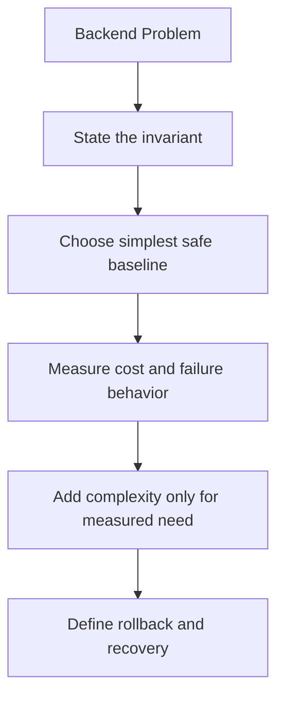

# Module 10: DevOps & Cloud Basics — Full Revision Guide

This guide connects the module into one study story: building, deploying, observing, securing, and recovering cloud-hosted backend services safely.

## Essential Definitions

| Term | Meaning |
|---|---|
| Image | Immutable container filesystem/build artifact. |
| Container | Running isolated process from an image. |
| IAM role | Short-lived workload identity and permissions. |
| VPC | Private cloud network boundary. |
| CI/CD | Automated build, validation, artifact promotion, and delivery. |

## Module Map

- [Introduction to DevOps](01-Introduction-to-DevOps.md)
- [DevOps Culture](02-DevOps-Culture.md)
- [Linux for Backend Engineers](03-Linux-for-Backend-Engineers.md)
- [Docker Fundamentals](04-Docker-Fundamentals.md)
- [Docker Images](05-Docker-Images.md)
- [Docker Containers](06-Docker-Containers.md)
- [Docker Volumes](07-Docker-Volumes.md)
- [Docker Networks](08-Docker-Networks.md)
- [Docker Compose](09-Docker-Compose.md)
- [Multi Stage Builds](10-Multi-Stage-Builds.md)
- [Container Best Practices](11-Container-Best-Practices.md)
- [CI CD Fundamentals](12-CI-CD-Fundamentals.md)
- [GitHub Actions](13-GitHub-Actions.md)
- [Environments](14-Environments.md)
- [Configuration Management](15-Configuration-Management.md)
- [Secrets Management](16-Secrets-Management.md)
- [AWS Overview](17-AWS-Overview.md)
- [Amazon EC2](18-Amazon-EC2.md)
- [Amazon S3](19-Amazon-S3.md)
- [CDN](20-CDN.md)
- [Amazon RDS](21-Amazon-RDS.md)
- [Amazon ElastiCache](22-Amazon-ElastiCache.md)
- [Amazon MQ](23-Amazon-MQ.md)
- [Amazon ECR](24-Amazon-ECR.md)
- [Amazon ECS](25-Amazon-ECS.md)
- [Load Balancing](26-Load-Balancing.md)
- [Auto Scaling](27-Auto-Scaling.md)
- [VPC Fundamentals](28-VPC-Fundamentals.md)
- [Subnets](29-Subnets.md)
- [Security Groups](30-Security-Groups.md)
- [IAM Fundamentals](31-IAM-Fundamentals.md)
- [NAT Gateway](32-NAT-Gateway.md)
- [CloudWatch](33-CloudWatch.md)
- [Logging in AWS](34-Logging-in-AWS.md)
- [Monitoring](35-Monitoring.md)
- [Observability](36-Observability.md)
- [Benchmarking](37-Benchmarking.md)
- [Performance Testing](38-Performance-Testing.md)
- [Cost Optimization](39-Cost-Optimization.md)
- [Production Deployment](40-Production-Deployment.md)

## Two-Minute Recap

- Images are immutable; configuration and secrets arrive at runtime.
- Run containers as non-root with explicit resource/health settings.
- Use IAM roles, not long-lived keys.
- RDS/ElastiCache still need capacity, backup, failover, and cost design.
- Deploy progressively with readiness, telemetry, and rollback.

## Decision Tree



**Decision rule:** Use managed RDS/ElastiCache/ECS when the team needs operational leverage; use EC2 only when control/legacy requirements justify patching and capacity ownership.

## Interview Answer Templates

### 30-second answer

> “`<concept>` solves `<problem>` with `<mechanism>`. The important trade-off is `<cost/risk>`. I would validate it using `<test/metric/trace>`.”

### Two-minute answer

1. State the user/business invariant.
2. Describe normal request or execution flow.
3. Name the likely failure or edge case.
4. Explain the protection, limit, or recovery path.
5. Finish with metrics, rollout, and trade-off.

## Failure Scenarios

| Symptom | Investigation | Safe response |
|---|---|---|
| Latency increases | Trace slow path; inspect saturation/queueing | Add deadline/bounds; remove bottleneck after evidence |
| Duplicate/inconsistent effect | Check retry, concurrency, and durable state | Add idempotency/constraint/ownership rule |
| Release regression | Compare deployment/config/version and SLOs | Roll back or disable safely; preserve evidence |
| Capacity exhaustion | Inspect resource, cardinality, and growth | Backpressure, scale, partition, or reduce work |

## Common Anti-patterns

| Anti-pattern | Why it fails | Better approach |
|---|---|---|
| Tool-first design | Hides requirement and invariant | State problem, baseline, and measured trigger first |
| Unbounded resource | Turns overload into outage | Bound time, memory, pools, queues, and retries |
| Local-only correctness | Breaks under replicas/restart | Use durable ownership/constraints/idempotency |
| Green happy path | Misses production failures | Test timeout, retry, restart, concurrency, and recovery |

## Flashcards

| Question | Answer |
|---|---|
| What comes before selecting a tool? | The invariant, requirements, and constraints. |
| What makes a retry safe? | Idempotency plus a bounded policy and durable outcome. |
| What should every production design include? | Limits, observability, deployment/rollback, and recovery. |
| What makes an interview answer senior-level? | Explicit trade-offs, failure modes, evidence, and ownership. |

## When to Use / When Not to Use

| Use | When | Avoid when |
|---|---|---|
| Simpler baseline | It meets stated requirements | A measured invariant/SLO requires more |
| Async workflow | Work is slow, retryable, or fan-out | Caller needs final invariant immediately |
| Cache/optimization | Evidence shows a bottleneck | Source-of-truth rules are unclear |
| Abstraction | It protects a real boundary | It only adds indirection |

## End-to-End Case Study

GitHub Actions tests and scans a FastAPI image, pushes immutable SHA tag to ECR, ECS deploys behind ALB, task role accesses RDS/S3, and CloudWatch records logs/SLO signals.

## Debugging Commands and Evidence

Focus on: Check deployment revision, task health/readiness, ALB target status, IAM denial, security-group path, CloudWatch logs/metrics, RDS connections, Redis memory, and cost/egress anomalies.

```bash
# Capture deployment/runtime evidence first
docker compose logs -f
docker stats
curl -i http://localhost:8000/healthz
```

## Self-Test Checklist

- [ ] I can explain the module’s core terms in plain English.
- [ ] I can choose an approach from an invariant and stated constraints.
- [ ] I can name a likely failure, how to investigate it, and safe recovery.
- [ ] I can give a 30-second and two-minute interview answer.
- [ ] I can connect this module to APIs, data, operations, and testing.

## Cross-Module Study Links

- [Core Backend](../Module-02-Core-Backend/module-summary.md)
- [Databases](../Module-03-Databases/module-summary.md)
- [Operating Systems](../Module-04-Operating-Systems/module-summary.md)
- [Networking](../Module-06-Networking-and-Distributed-Basics/module-summary.md)
- [System Design](../Module-07-Advanced-Backend-and-System-Design/module-summary.md)
- [Testing](../Module-09-Testing-and-Code-Quality/module-summary.md)
- [DevOps](../Module-10-DevOps-and-Cloud/module-summary.md)
- [Interview Preparation](../Module-11-Interview-Preparation/module-summary.md)

## Interview Drills

1. Dockerize FastAPI securely and explain each image/runtime decision.
2. Design CI/CD for backward-compatible migration and rollback.
3. Diagnose an ECS service that is healthy locally but failing ALB checks.

## Shortcuts

- Images are immutable; configuration and secrets arrive at runtime.
- Run containers as non-root with explicit resource/health settings.
- Use IAM roles, not long-lived keys.
- RDS/ElastiCache still need capacity, backup, failover, and cost design.
- Deploy progressively with readiness, telemetry, and rollback.
