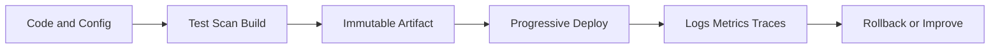

# DevOps Review

---
# ⏱ If You Only Have 2 Minutes
- Interview performance improves through structured practice, not memorized speeches.
- Start answers with assumptions and the main invariant, then explain trade-offs.
- Use STAR for behavioral stories: situation, task, action, result, reflection.
- A good offer decision weighs role, growth, compensation, manager, team, risk, and values.

---
# Simple Explanation
DevOps Review is practical backend work: either making software safe to build and run, or explaining that work clearly in an interview. The value comes from reducing uncertainty before it reaches users, teammates, or a hiring panel.

# 1. What is it?
DevOps Review is the discipline around **devops review**. It connects code to its operating environment, evidence, recovery plan, and communication.

# 2. Why do we need it?
Without this discipline, a correct local change can fail in CI, leak a secret, overload production, become impossible to roll back, or be explained poorly in an interview. Production engineering is the ability to anticipate those paths.

# 3. How does it work?
1. State the desired outcome and constraints.
2. Build a small reproducible baseline.
3. Validate it automatically and review the failure paths.
4. Promote a traceable artifact/configuration through environments.
5. Observe behavior and reverse/recover safely when signals regress.



# 4. Internal Workflow
Use a single source of truth for code and reviewed configuration. CI creates an immutable artifact tied to a commit. Deployment injects short-lived identity and runtime configuration. Readiness controls admission, telemetry controls rollout, and a compatible rollback protects users.

# 5. Important Concepts
## Reproducibility
The same source, dependencies, configuration contract, and artifact should explain what runs in every environment.

## Least privilege
Workloads and CI receive only the permissions needed for one action, preferably through expiring roles rather than copied secrets.

## Feedback loop
Tests prevent known regressions; dashboards/alerts reveal production behavior; post-incident learning improves both.

# 6. Real Backend Examples
```yaml
services:
  api:
    image: registry.example/api:${IMAGE_SHA}
    read_only: true
    environment:
      DATABASE_URL: ${DATABASE_URL}
    healthcheck:
      test: ["CMD", "python", "-c", "import urllib.request; urllib.request.urlopen('http://localhost:8000/healthz')"]
```
Use an immutable image reference, inject secrets at runtime, run as non-root, set resource limits, and distinguish readiness from liveness. A deployment must also have database compatibility and rollback rules.

# 7. Common Mistakes
- Using long-lived cloud keys in CI or local files.
- Tagging production artifacts as `latest`.
- Treating a container as a virtual machine and storing durable state inside it.
- Rolling out code before a backward-compatible schema/config change exists.
- Giving an interview answer without clarifying requirements or explaining a trade-off.

# 8. Comparison Table
| Choice | Benefit | Risk |
|---|---|---|
| Immutable artifact | Reproducible release | Requires promotion discipline |
| Manual deploy | Fast once | Not auditable/repeatable |
| Canary | Limits blast radius | Needs metrics and capacity |
| Blue/green | Fast traffic switch | Duplicate environment cost |
| STAR answer | Clear behavioral evidence | Sounds scripted if not genuine |

# 9. Things I Must Remember
- Interview performance improves through structured practice, not memorized speeches.
- Start answers with assumptions and the main invariant, then explain trade-offs.
- Use STAR for behavioral stories: situation, task, action, result, reflection.
- A good offer decision weighs role, growth, compensation, manager, team, risk, and values.
- Validate configuration at startup.
- Keep secrets out of code, images, logs, and metrics.
- Use readiness, draining, and rollback.
- Monitor user impact, saturation, and deployment versions.
- In interviews, state assumptions, reasoning, and residual risk.

# 10. Interview Questions
**Q: How would you deploy a FastAPI service safely?**  
Build/test/scan an immutable image, inject runtime config with role identity, deploy compatible schema/code progressively, gate on readiness/SLOs, then retain a tested rollback and runbook.

**Q: How do you answer a question you do not know?**  
State what you know, clarify assumptions, reason from first principles, propose how to validate, and avoid inventing product behavior.

**Q: What makes a behavioral story strong?**  
Specific context, personal action, measurable result, collaboration, failure/learning, and an honest reflection.

# 11. Cheat Sheet
- Immutable artifact.
- Runtime configuration.
- Least privilege.
- Test before deploy.
- Readiness before traffic.
- Observe rollout.
- Roll back compatibly.
- Protect secrets.
- Measure cost.
- Explain assumptions.

## Related Topics
- [Backend Fundamentals Review](05-Backend-Fundamentals-Review.md)
- [System Design Review](09-System-Design-Review.md)
- [30 Day Interview Study Plan](20-30-Day-Interview-Study-Plan.md)
