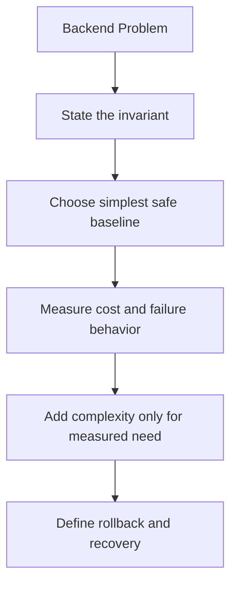

# Module 11: Interview Preparation — Full Revision Guide

This guide connects the module into one study story: turning backend knowledge into clear, structured, evidence-based technical and behavioral interview answers.

## Essential Definitions

| Term | Meaning |
|---|---|
| STAR | Situation, task, action, result story format. |
| Invariant | Fact the design/code must preserve. |
| Trade-off | Benefit gained at a cost/risk. |
| Capacity estimate | Approximate traffic/storage/concurrency calculation. |
| Mock interview | Timed practice with feedback and reflection. |

## Module Map

- [Backend Interview Process](01-Backend-Interview-Process.md)
- [Technical Screening](02-Technical-Screening.md)
- [HR Screening](03-HR-Screening.md)
- [Behavioral Interviews](04-Behavioral-Interviews.md)
- [Backend Fundamentals Review](05-Backend-Fundamentals-Review.md)
- [Databases Review](06-Databases-Review.md)
- [Networking Review](07-Networking-Review.md)
- [Operating Systems Review](08-Operating-Systems-Review.md)
- [System Design Review](09-System-Design-Review.md)
- [Testing Review](10-Testing-Review.md)
- [DevOps Review](11-DevOps-Review.md)
- [Coding Interview Strategies](12-Coding-Interview-Strategies.md)
- [Live Coding Best Practices](13-Live-Coding-Best-Practices.md)
- [Debugging Interviews](14-Debugging-Interviews.md)
- [Code Review Interviews](15-Code-Review-Interviews.md)
- [Take Home Assignments](16-Take-Home-Assignments.md)
- [Communication During Interviews](17-Communication-During-Interviews.md)
- [Salary Negotiation](18-Salary-Negotiation.md)
- [Offer Evaluation](19-Offer-Evaluation.md)
- [30 Day Interview Study Plan](20-30-Day-Interview-Study-Plan.md)

## Two-Minute Recap

- Clarify assumptions before solving.
- Explain the simple baseline before complex architecture.
- State time/space cost in coding answers.
- Use STAR with personal action and measurable result.
- Evaluate offers beyond base salary.

## Decision Tree



**Decision rule:** For coding: clarify → baseline → invariant → optimize → test. For system design: requirements → estimates → data/API → scale/failures → trade-offs. For behavioral: STAR → reflection → learning.

## Interview Answer Templates

### 30-second answer

> “`<concept>` solves `<problem>` with `<mechanism>`. The important trade-off is `<cost/risk>`. I would validate it using `<test/metric/trace>`.”

### Two-minute answer

1. State the user/business invariant.
2. Describe normal request or execution flow.
3. Name the likely failure or edge case.
4. Explain the protection, limit, or recovery path.
5. Finish with metrics, rollout, and trade-off.

## Failure Scenarios

| Symptom | Investigation | Safe response |
|---|---|---|
| Latency increases | Trace slow path; inspect saturation/queueing | Add deadline/bounds; remove bottleneck after evidence |
| Duplicate/inconsistent effect | Check retry, concurrency, and durable state | Add idempotency/constraint/ownership rule |
| Release regression | Compare deployment/config/version and SLOs | Roll back or disable safely; preserve evidence |
| Capacity exhaustion | Inspect resource, cardinality, and growth | Backpressure, scale, partition, or reduce work |

## Common Anti-patterns

| Anti-pattern | Why it fails | Better approach |
|---|---|---|
| Tool-first design | Hides requirement and invariant | State problem, baseline, and measured trigger first |
| Unbounded resource | Turns overload into outage | Bound time, memory, pools, queues, and retries |
| Local-only correctness | Breaks under replicas/restart | Use durable ownership/constraints/idempotency |
| Green happy path | Misses production failures | Test timeout, retry, restart, concurrency, and recovery |

## Flashcards

| Question | Answer |
|---|---|
| What comes before selecting a tool? | The invariant, requirements, and constraints. |
| What makes a retry safe? | Idempotency plus a bounded policy and durable outcome. |
| What should every production design include? | Limits, observability, deployment/rollback, and recovery. |
| What makes an interview answer senior-level? | Explicit trade-offs, failure modes, evidence, and ownership. |

## When to Use / When Not to Use

| Use | When | Avoid when |
|---|---|---|
| Simpler baseline | It meets stated requirements | A measured invariant/SLO requires more |
| Async workflow | Work is slow, retryable, or fan-out | Caller needs final invariant immediately |
| Cache/optimization | Evidence shows a bottleneck | Source-of-truth rules are unclear |
| Abstraction | It protects a real boundary | It only adds indirection |

## End-to-End Case Study

For a payment-service interview, clarify idempotency/ledger/latency needs, draw request/outbox flow, discuss provider uncertainty, state SLOs, and close with rollout/observability trade-offs.

## Debugging Commands and Evidence

Focus on: When stuck, narrate hypothesis, inspect evidence, reduce to a minimal case, choose one change, validate it, and state what you would monitor after release.

```bash
# Capture deployment/runtime evidence first
docker compose logs -f
docker stats
curl -i http://localhost:8000/healthz
```

## Self-Test Checklist

- [ ] I can explain the module’s core terms in plain English.
- [ ] I can choose an approach from an invariant and stated constraints.
- [ ] I can name a likely failure, how to investigate it, and safe recovery.
- [ ] I can give a 30-second and two-minute interview answer.
- [ ] I can connect this module to APIs, data, operations, and testing.

## Cross-Module Study Links

- [Core Backend](../Module-02-Core-Backend/module-summary.md)
- [Databases](../Module-03-Databases/module-summary.md)
- [Operating Systems](../Module-04-Operating-Systems/module-summary.md)
- [Networking](../Module-06-Networking-and-Distributed-Basics/module-summary.md)
- [System Design](../Module-07-Advanced-Backend-and-System-Design/module-summary.md)
- [Testing](../Module-09-Testing-and-Code-Quality/module-summary.md)
- [DevOps](../Module-10-DevOps-and-Cloud/module-summary.md)
- [Interview Preparation](../Module-11-Interview-Preparation/module-summary.md)

## Interview Drills

1. Give a two-minute answer to 'What is idempotency?'.
2. Solve a coding problem aloud using brute force then optimization.
3. Compare two offers using role, manager, growth, equity risk, benefits, and values.

## Shortcuts

- Clarify assumptions before solving.
- Explain the simple baseline before complex architecture.
- State time/space cost in coding answers.
- Use STAR with personal action and measurable result.
- Evaluate offers beyond base salary.
